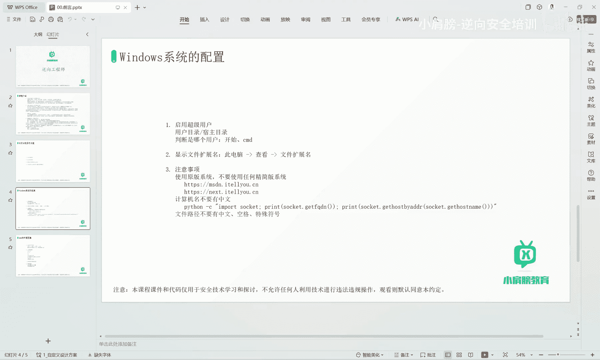

# 🖥️ Windows系统配置：01：Windows系统的配置

在本节课中我们将要学习Windows系统配置中几个常见注意事项，目的是避免安装软件和运行程序时出现稀奇古怪的问题。内容覆盖启用超级用户、显示文件扩展名、使用原版系统、计算机名与文件路径规范，并通过演示说明中文计算机名可能带来的编码错误。下面按步骤说明这些配置要点。


## 👤 Windows系统配置：01.1：查看当前登录用户与用户目录


在正式配置前，先确认当前登录的是哪个用户以及用户目录在哪里，因为后面启用超级用户和排查权限问题都要用到这些信息。以下是查看当前登录用户的两种方式。

- 第一种方式：点击“开始”，开始菜单中会显示当前登录账户的名字，当前可以看到是Administrator，原文显示为administr。
- 第二种方式：点击“开始”，输入`CMD`，打开“命令提示符”；打开后看到的这个名字就是当前登录的用户名，当前也是Administrator。

确认用户名后，还需要找到用户目录，也叫宿主目录，原文口播为“搜组目录”。用户目录位于系统盘的“用户”文件夹下，这里显示的就是当前用户目录。如果当前登录的不是超级用户，就需要启用超级用户，下一节来看具体操作。

## 🔑 Windows系统配置：01.2：启用超级用户

上一节我们介绍了如何确认当前用户和用户目录，本节来看看如何启用超级用户。启用超级用户可以提高权限，减少执行文件时权限不够的问题。以下是专业版启用超级用户的步骤。

- 在“开始”处右键，选择“计算机管理”。
- 在“计算机管理”中找到“本地用户和组”，双击“用户”。
- 在用户列表中找到`Administrator`。默认情况下它是禁用的。
- 右键点击`Administrator`，选择“属性”。
- 在属性中取消勾选“账户已禁用”，然后点击“应用”。
- 注销原先登录的用户，再用`Administrator`登录。


完成上述操作后，超级用户就可以使用了。需要注意，以上是专业版的启用方法；家庭版的启用方式不一样，可以自行百度如何启用超级用户。之所以要启用超级用户，是因为它的权限大。有时执行某些文件会遇到权限不够的问题，系统会要求右键“以管理员身份运行”；启用超级用户后，你本身就是管理员，就不再需要这个额外操作。下一节我们来看文件扩展名的显示设置。

## 📄 Windows系统配置：01.3：显示文件扩展名

上一节我们介绍了启用超级用户，本节来看看如何显示文件扩展名。显示扩展名可以更清楚地知道文件类型，也方便在需要时修改后缀。以下是Windows 11和Windows 10中的设置方式。

- Windows 11：打开“此电脑”，点击“查看”，找到“显示”，勾选“文件扩展名”。默认情况下没有勾选。
- Windows 10：打开“此电脑”，点击“查看”，勾选“文件扩展名”。


设置完成后，就能看到文件后面的后缀。所谓扩展名，就是文件名后面的后缀，用来表示当前文件是什么类型。可以用下面的公式理解：

```text
文件名 = 主文件名 + "." + 扩展名
```

以下是常见扩展名含义。

- 后缀是`.exe`，代表可执行文件，双击可以运行。
- 后缀是`.pptx`，代表PPT文件。
- 后缀是`.html`，代表网页文件。

有时我们需要修改文件后缀，例如原文举例将`.apk`文件改成`.cip`文件，或将`.eit`文件改成`.tit`文件。修改后可以看到图标已经变化，按`Ctrl+Z`可以撤销。如果未开启文件扩展名显示，就看不到`.exe`这样的字眼；此时在文件名后加`.tatt`并没有用，因为文件实际还是`.exe`后缀，只是文件名后面多了一个点`.tatt`，并不是改扩展名。勾选文件扩展名的好处有两个：一是可以清楚知道文件是什么类型，二是修改后缀比较方便。一般情况下不需要改后缀。下一节我们来看系统版本选择。


## 💿 Windows系统配置：01.4：使用原版系统


上一节我们介绍了文件扩展名，本节来看看系统版本的选择。推荐使用原版系统，不要使用任何精简版系统，因为精简版是最容易出问题的地方。Windows系统有很多被别人修改过的版本，可能删掉了某些东西，也可能新加了某些东西，跟原版系统不一样；安装某些软件时可能出问题，说白了就是默认情况下系统里有的组件，在精简版里被删掉了，软件运行就会报错，并且你还不知道少了什么东西。因此推荐使用原版系统。以下是原版系统下载来源说明。

- 原文给出两个网站，它们实际上是同一个网站。MSDN可用于下载Windows 10或Windows 10以前的一些系统。
- 下载后保存，文件是`.iso`镜像。用U盘制作启动盘的工具做一个U盘启动盘，然后安装新系统。
- 如果要安装更新版本的系统，需要到另一个网站，也就是原文写出的那个网址。该网站需要登录，可以在那里安装Windows 11或更新版本的Windows 10系统。下载方法可以自行研究。


系统来源确认后，还要注意计算机名和路径规范。下一节我们来看计算机名和文件路径为什么不要带中文、空格和特殊符号。


## 🧩 Windows系统配置：01.5：计算机名与文件路径规范

上一节我们介绍了使用原版系统，本节来看看计算机名和文件路径的注意事项。计算机名就是电脑的名字，不要有中文。原因是某些库在操作时可能要获取计算机名，如果计算机名有中文，可能会报错。例如下面这段Python代码可以用来获取计算机名：


```python
import socket

computer_name = socket.gethostname()
print(computer_name)
```

在Python 3.8中，如果计算机名是中文，运行这段代码会报错；更新版本的Python可能没问题，但仍然推荐不要带中文。原文还计划演示计算机名中文的情况。既然计算机名都不推荐有中文，那么文件路径更加不要有中文、不要有空格、不要有特殊符号。Windows系统里很多文件和名字可以带中文，文件夹命名限制也比较宽松，可以有特殊符号和空格；但是很多国外开发的软件，如果路径里带中文，可能会出现稀奇古怪的错误，导致读取不到某些文件。因此安装软件时，如果操作和别人一样，但别人没出错你出错了，就要考虑安装路径里是否带了中文、空格或特殊符号。下一节通过演示确认中文计算机名的影响。

## 🧪 Windows系统配置：01.6：中文计算机名演示

上一节我们介绍了计算机名和路径规范，本节通过演示看看中文计算机名的实际影响。演示时先重命名计算机，将计算机名改成中文；重命名后需要重启才能生效。重启回来后再次运行前面获取计算机名的代码，可以看到已经报错。报错原因实际上是编码问题：Python大概需要UTF-8编码，但是从计算机中获取到的计算机名字默认是GBK编码。可以用下面的关系概括：


```text
计算机名含中文 ⇒ 获取到的名称编码不匹配 ⇒ Python 3.8 可能报错
```

最简单的解决方式就是计算机名和文件路径不要带中文。一般情况下，文件名没关系，但是文件名里也不要带空格和特殊符号。到这里，本课的主要注意事项已经介绍完毕，下一节做总结。


## ✅ Windows系统配置：01.7：课程总结



本节课中我们一起学习了Windows系统配置中的几个关键注意事项。为了减少稀奇古怪的问题，需要启用超级用户，以便获得更大权限；需要显示文件扩展名，以便识别文件类型和修改后缀；需要使用原版系统，避免精简版缺失组件导致软件报错；需要让计算机名和文件路径不含中文、空格和特殊符号，避免编码和读取错误。原文最后也通过演示说明，中文计算机名在Python 3.8中可能导致编码报错。掌握这些配置后，再安装软件和运行程序时就能少走很多弯路。
