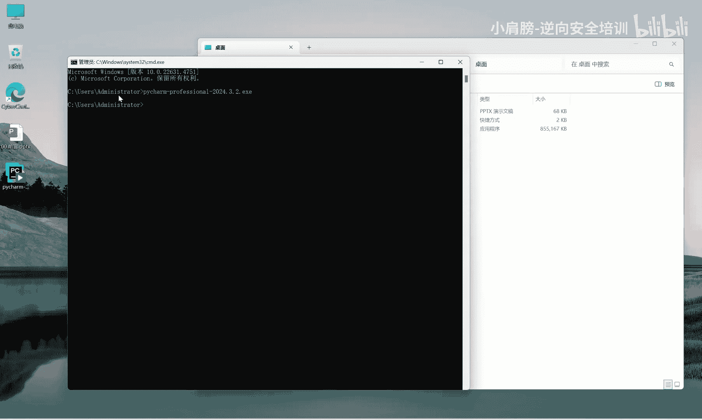
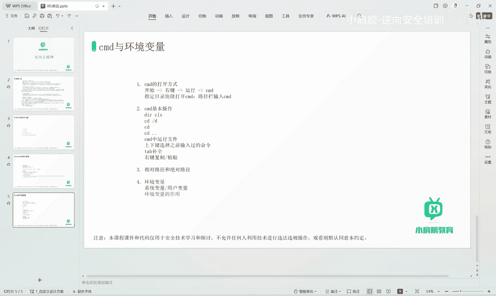

# 🖥️ CMD与环境变量：02：cmd与环境变量

在本节课中我们将要学习CMD环境变量的基础用法。CMD就是命令提示符，是Windows系统提供的命令行交互界面。掌握CMD的基本操作、路径切换方式以及环境变量的作用，对后续编写爬虫代码和进行逆向操作时的文件定位和程序调用非常有帮助。

## CMD基本概念与常用命令

上一节我们介绍了命令行的基本思想，本节中我们来看看CMD中光标代表的含义以及最常用的几个指令。

打开CMD之后界面会出现一个光标，光标前面的路径表示当前CMD所处的位置。这个概念和打开此电脑后看到的文件夹层级是类似的。当打开某个文件夹时，当前路径就是该文件夹，继续进入子文件夹时，当前路径也会随之变化。在CMD中无法直观看到文件夹树，只能通过光标前面的路径来判断当前位置。

以下是CMD中最基础的几个命令：

* `DIR`：列举当前目录下的所有目录以及文件
* `CLS`：清屏
* `CD`：切换目录

可以通过`DIR`快速查看当前路径下的内容，通过`CD`进入目标目录。

## 目录切换与历史操作

了解基本命令后，我们来看看如何实际切换目录并运行文件。

假设当前在某个目录下，想要进入桌面。桌面的英文名是`desktop`，可以使用命令 `CD desktop` 进行切换。切换成功后再次使用`DIR`就可以看到桌面下的文件和文件夹。

如果需要返回上一级目录，可以使用 `CD ..`。`..`代表上级目录，连续使用可以不断向上回退。

在输入长文件名时可以使用 `Tab` 键补全。输入部分名字后按 `Tab` 键可以自动补全剩余部分，然后按回车即可切换或运行。

运行程序的方式和双击文件类似。首先切换到目标文件所在的目录，然后直接输入文件名即可运行。文件名过长时同样可以使用 `Tab` 键补全。

在CMD界面不关闭的情况下，可以使用键盘上下键切换之前输入过的命令，选择后回车即可再次运行。需要注意的是，如果关闭了CMD窗口重新打开，历史记录会丢失。

CMD还支持右键复制和粘贴。选中文字后右键即可复制，在需要粘贴的位置右键即可完成粘贴。

跨盘符切换目录时需要使用 `CD /D`。例如从 `C` 盘切换到 `D` 盘的某个目录时，必须加上 `/D` 参数，否则目录不会改变。当前只有一个 `C` 盘时该区别不明显，但在多盘符环境下非常重要。

## 打开CMD的几种方式

掌握基本操作后，了解如何快速打开CMD也是必要的。

以下是常用的打开方式：

* 在资源管理器的地址栏中直接输入 `CMD` 回车，可以在指定目录下直接打开CMD，路径自动定位到当前文件夹
* 开始菜单右键运行，输入 `CMD` 回车打开命令提示符

推荐掌握在路径栏输入 `CMD` 的方式，使用起来最方便快捷。

## 相对路径与绝对路径

打开方式熟悉后，本节中我们来看看相对路径和绝对路径的概念。

绝对路径是以盘符开始的完整路径，例如 `C:\Users\Administrator\Desktop`。只拿到这条路径就能在任意电脑上准确定位到文件。

相对路径是不以盘符开始的路径，例如 `desktop` 或 `..\desktop`。这类路径必须结合CMD当前的路径才能确定实际位置。

举例说明，当前在 `C:\Users\Administrator` 下，使用 `CD desktop` 切换到桌面，这是相对路径。如果使用绝对路径 `CD C:\Users\Administrator\Desktop` 也可以达到同样效果。

从 `C:\Users\Administrator\Desktop` 切换到 `C:\Users`，可以用绝对路径 `CD C:\Users`，也可以用相对路径连续执行 `CD ..` 两次。盘符开始的路径是绝对路径，不以盘符开始的路径是相对路径，后者需要结合CMD当前目录才能定位。

## 环境变量与PATH

路径概念清晰后，最后我们来学习环境变量的作用。

环境变量可以在系统属性 -> 高级系统设置 -> 环境变量 中查看。分为用户环境变量和系统环境变量。用户环境变量作用于当前用户，系统环境变量作用于整个系统，日常使用中可以视为同一类东西。

环境变量的作用是让程序可以在任意目录下被调用。以运行桌面上的安装包为例，如果不修改环境变量，必须先 `CD` 到桌面目录再运行文件。在其他目录下直接运行文件名会找不到文件。

CMD查找可执行文件的顺序是：首先在当前目录查找，其次在 `PATH` 环境变量列出的多个目录中依次查找。如果在这些路径中找到文件就运行，否则报错。

因此可以将桌面路径添加到 `PATH` 环境变量中，添加完成后需要重启CMD窗口使配置生效。生效后就可以在任意目录下直接运行桌面上的程序了。修改环境变量后一定要点击确定保存，并重启CMD，否则不会加载新的配置。

本节课中我们一起学习了CMD的基本操作、目录切换、Tab补全和历史命令、多种打开CMD的方式、相对路径与绝对路径的区别，以及环境变量特别是PATH的作用和修改方法。这些基础内容虽然与爬虫和逆向没有直接关系，但在实际开发中会经常使用，需要熟练掌握。
