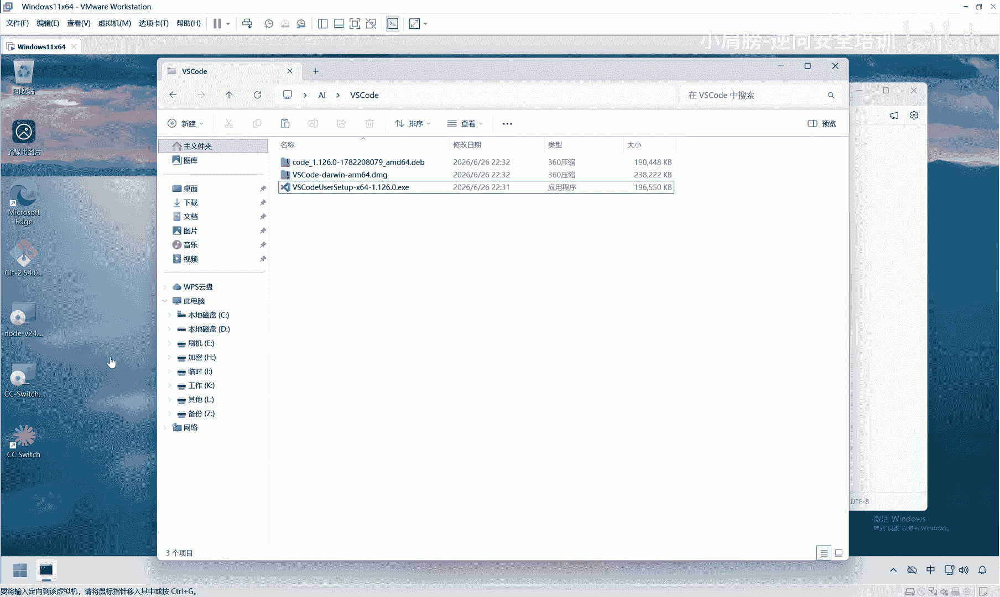
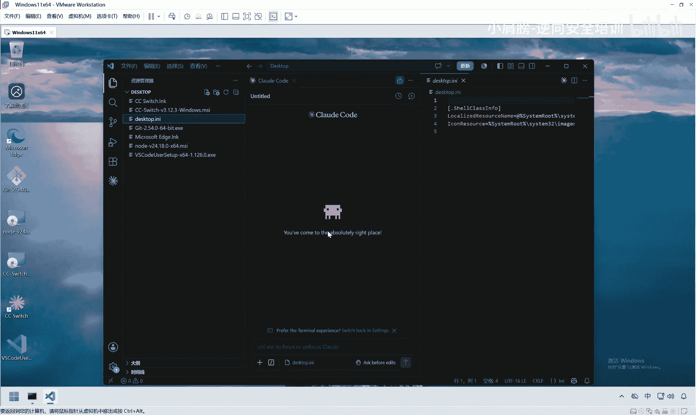

# Windows中AI客户端配置：03：Claude Code配置 🚀

在本节课中我们将要学习Windows系统中Claude Code的配置方法，本质上就是给AI客户端配置可用模型。本教程对应原文视频标识 `BV1vi3d6LE5S`。Claude Code是一个客户端，可以在其中配置Claude模型，也可以配置国产模型，例如智谱模型和DeepSeek模型。GPT也可以配置，但不推荐在Claude Code中使用GPT，GPT更推荐在Codex中使用，在Codex中使用比较省token。换句话说，模型选择和客户端选择要匹配，选对工具能减少不必要的消耗。

下面从整体选择开始，再逐步进入安装和配置。上一段已经说明了本课程的定位，本节先看看Claude Code适合配置哪些模型，以及为什么要在Windows中准备一个全新环境。原文使用了一个Win11虚拟机进行配置，目的是保证环境是全新的，减少旧软件和旧配置带来的干扰。以下是模型选择与环境准备中需要明确的几个点。

- Claude Code可以配置Claude模型。

- Claude Code也可以配置国产模型，例如智谱模型和DeepSeek模型。

- Claude Code可以配置GPT，但GPT不推荐放在Claude Code中使用。

- GPT推荐放在Codex中使用，原因是在Codex中使用比较省token。

- 如果使用Claude、智谱或DeepSeek，可以按本课程配置Claude Code。

- 原文在Win11虚拟机中进行配置，保证是全新环境。

可以用一个简单关系来描述客户端与模型的关系，核心概念如下。

```text
Claude Code = AI客户端外壳 + 可配置的AI模型
模型选择建议：Claude / 智谱 / DeepSeek -> Claude Code；GPT -> Codex
```

完成模型选择的认识后，下一步就是准备基础工具。上一节我们介绍了Claude Code适合配置哪些模型，本节中我们来看看Windows中为什么需要先安装Git，以及如何让Claude Code调用Git Bash。AI在进行操作时会使用很多命令行，但Windows自带的CMD和PowerShell与Linux或macOS的命令行并不通用。配置Git后可以使用Git Bash，如果AI需要执行一些Linux中的命令，就可以通过Git Bash运行。

以下是安装Git时需要关注的几个操作点。

- 需要安装Git，因为AI操作会使用大量命令行。

- Windows的CMD和PowerShell与Linux或macOS的命令行不通用。

- 可以在Git中使用Git Bash。

- 如果AI需要用到Linux中的命令，就可以在Git Bash中执行。

- Git下载地址使用原文给出的链接。

- 打开下载地址后，页面会显示对应下载选项。

- Windows在该页面下载，并根据CPU指令集选择安装包。

- 如果CPU是x64指令集，就选择x64对应版本。

- 如果CPU是ARM64指令集，就选择ARM64对应版本。

- 页面上还有macOS和Linux的安装方式，它们通过命令行安装。

- 原文中安装包已经下载，放入系统后一路下一步即可。

- 安装完成后运行Git，能够打开就说明没有问题。

Git安装完成后，还需要配置环境变量，让Claude Code知道Git Bash在哪里。核心概念可以用下面的环境变量表示。

```text
CLAUDE_CODE_GIT_BASH_PATH = <Git Bash 中 bash.exe 的实际路径>
```

具体操作是打开“高级系统设置”，进入“环境变量”，新建变量名并填入路径。路径不是固定的，取决于Git Bash安装位置；如果使用默认安装，就使用默认安装对应的路径。原文提醒要在环境变量中配置 `CLAUDE_CODE_GIT_BASH_PATH`，告诉Claude Code Git Bash在哪个路径下面。完成这一步后，Claude Code才更容易调用Git Bash中的命令。

Git准备完成后，还需要安装Node.js。上一节我们完成了Git与Git Bash路径配置，本节中我们来看看Node.js的安装和npm验证。Claude Code可以通过Node.js的npm管理器安装，因此Node.js是后续安装Claude Code的基础。原文给出的Node.js下载地址打开后，可以选择需要的平台，Windows、macOS、Linux都可以。当前需要Windows平台，并且是x64 CPU，因此下载Windows x64安装程序。

以下是Node.js安装与验证的操作点。

- 打开Node.js下载地址后，页面会显示平台选择。

- 可以选择Windows、macOS或Linux。

- 当前选择Windows平台。


- CPU为x64，因此下载x64安装程序。

- 原文中安装程序已经下载。

- 双击安装程序进行安装。

- 安装路径原文保持默认，读者可以自行修改。

- 如果修改安装路径，一定要记住安装位置。

- 安装完成后按 `Win + R` 打开运行窗口。


- 输入 `CMD` 并回车，打开CMD命令行。

- 在CMD中输入 `npm`。

- 如果能够显示npm相关信息，就代表Node.js安装没有问题。

可以用下面的命令验证npm是否可用。

```bat
npm
```

Node.js和npm验证完成后，就可以安装Claude Code。上一节我们确认了npm可用，本节中我们来看看如何使用npm全局安装Claude Code，并查看版本和升级。原文说明 `npm install` 代表安装，`-g` 代表全局安装，要安装的是Anthropic Claude Code，后面的部分代表指定版本 `2.1.176`。安装完成后可以通过 `claude --version` 查看当前版本。

以下是安装与版本管理时需要执行的命令。

- 使用npm命令安装Claude Code。

- `-g` 表示全局安装。

- 安装包为Anthropic Claude Code。

- 指定版本为 `2.1.176`。

- 安装完成后查看Claude Code当前版本。

- 可以看到版本为 `2.1.176`。

- 如果要使用新版本，可以通过 `claude update` 升级。

- 如果一开始就想安装新版本，可以只运行升级或安装新版本对应的命令。

核心命令如下。

```bat
npm install -g @anthropic-ai/claude-code@2.1.176
claude --version
claude update
```

Claude Code安装完成后不能直接使用，还需要做配置。上一节我们完成了Claude Code安装，本节中我们来看看如何使用CC Switch配置供应商、请求地址、API Key和模型。原文使用CC Switch进行配置，可以通过百度下载，也可以直接使用原文提供的安装包。双击安装后，安装路径可以自行修改，原文保持默认，然后运行CC Switch。

以下是使用CC Switch添加供应商时的操作点。

- 运行CC Switch。

- 如果使用Claude模型，就在界面中选择对应选项。

- 添加供应商时选择自定义配置。

- 供应商名称可以随便输入，主要用于自己区分。

- 官网链接可以不填。

- 需要填写请求地址和API Key。

- 请求地址和API Key不要照抄原文，需要自己花钱购买。

- 如果使用DeepSeek，先购买DeepSeek，然后在后台生成API Key。

- 拿到DeepSeek对应的请求地址后填入。

- 如果使用智谱AI，购买后在后台生成API Key。

- 将智谱对应的请求地址写入配置。

- 如果使用中转站，购买后在中转站后台生成API Key。

- 将中转站的请求地址填入配置。

- 原文在该处填写了一个地址，其他项不需要额外配置。

- 可以点击测速。

- 如果能够连通，就代表配置没有问题。

- 然后保存并添加。

可以用下面的配置字段关系来理解这一过程。

```text
供应商配置 = {
  供应商名称: 自定义，用于区分,
  请求地址: 所购买服务对应的接口地址,
  API Key: 在对应后台生成的密钥
}
```

保存供应商后，可以在命令行输入 `claude` 启动Claude Code。上一节我们完成了供应商配置，本节中我们来看看启动后的配色、目录信任和模型高级选项。启动后可以选择一个自己喜欢的配色，这就是代码高亮；原文保持默认，然后按回车继续。界面会显示当前工作目录，并询问是否信任这个目录，这里肯定要信任。随后就可以和AI进行沟通，例如输入“你是谁”，可以看到它会给出相应回答。

以下是启动Claude Code后需要了解的操作点。

- 输入 `claude` 启动Claude Code。

- 选择一个自己喜欢的配色，用于代码高亮。

- 原文保持默认配色。

- 按回车继续。

- 界面显示当前工作目录。

- 界面询问是否信任该目录。

- 需要选择信任该目录。

- 然后可以与AI沟通。

- 例如输入“你是谁”，AI会给出相应回答。

原文还补充了一个高级选项。高级选项中可以配置模型。中转站默认模型原文显示为 `off4.8`，具体模型名称在中转站上会有说明，需要根据实际情况填写。例如要使用Claude 4.6，就给对应的模型ID，把几项都填好。这里之所以要填多项，是因为Claude Code自身有一个设计：它会根据任务复杂度自动切换模型。复杂任务会调用Opus模型，中等任务会调用Sonnet模型，简单任务会调用Haiku模型，原文将简单任务模型写作“开口模型”。一般将各项配置成一样即可，不需要考虑这么多。高强度思考选项也要注意：不勾选时少一个字段，勾选时多一个 `effort level`，代表思考深度。一般勾选所谓思考，就是模型在回答之前先考虑再回答，这样回答质量会比较高。保存后，界面中的模型会变成4.6。

模型自动切换的核心概念可以用下面的公式描述。

```text
任务复杂度 -> 模型选择
复杂任务 -> Opus
中等任务 -> Sonnet
简单任务 -> Haiku（原文写作“开口模型”）
高强度思考 -> effort level 增加，回答前先思考
```

配置完成后，可以看看CC Switch到底做了什么事情。上一节我们配置了模型和思考深度，本节中我们来看看CC Switch修改的配置文件以及全局提示词。打开用户目录，不同系统的用户目录路径不一样，总之先找到用户目录；用户目录下面有一个 `.claude` 文件夹，在这个文件夹中会有 `settings.json` 文件，原文将该文件写作“ss点jason”。CC Switch实际上就是帮助配置这个文件，其中包含刚才设置的请求地址、API Key、思考深度以及配置的模型。

以下是CC Switch涉及配置文件和全局提示词时需要理解的点。

- 先找到当前系统的用户目录。

- 用户目录下存在 `.claude` 文件夹。

- `.claude` 文件夹中有 `settings.json` 文件。

- CC Switch会帮助配置这个文件。

- 文件中包含请求地址。

- 文件中包含API Key。

- 文件中包含思考深度。

- 文件中包含配置的模型。

- CC Switch不只做这些事情，还会做其他配置。

- 默认情况下在CMD中直接运行Claude Code，大概率会报错提示当前国家不支持。

- 配置对应字段后可以跳过这个错误。

- CC Switch还做了很多其他事情，但最关心的是这个配置文件。

可以用下面的路径表示核心配置文件。

```text
用户目录/.claude/settings.json
```

接着是全局提示词配置。原文提到一个文件 `CLAUDE.md`，原文写作“框在点MD”，将这个文件放到对应目录下面即可。这个文件中写了一些提示词，这些提示词就是全局提示词。每次请求时都会带上这个提示词，因此可以把每次请求都需要携带的提示词写到其中，这样不容易遗漏，而且比较方便。完成全局提示词配置后，Claude Code的使用会更顺手。

全局提示词的核心概念如下。

```text
全局提示词文件 = CLAUDE.md
每次请求 -> 自动携带 CLAUDE.md 中的提示词
```

通过命令行工具使用Claude Code比较麻烦，通常还会再配一个IDE。上一节我们了解了配置文件和全局提示词，本节中我们来看看如何在VS Code中安装插件并使用Claude Code。可以选择VS Code，然后在VS Code中安装Claude Code for VS Code插件，这样就可以在VS Code中使用Claude。VS Code下载地址在原文中给出，搜索即可找到。打开下载页面后，点击Download for Windows即可，原文将该按钮写作“登录的 forwind”。原文中VS Code安装包也已经下载。

以下是VS Code安装、中文界面和插件安装的操作点。

- 双击VS Code安装包进行安装。



- 同意协议后点击下一步。

- 安装路径可以自行修改，原文保持默认。

- 点击完成。

- 安装窗口可以关闭。

- 默认情况下VS Code是英文界面。

- 点击扩展，也就是插件市场。

- 在插件市场中搜索 `Chinese`。

- 安装中文简体插件。

- 安装完成后会提示更改语言并重启。


- 重启后界面会变成中文。

- 再次打开扩展，在插件市场中搜索 `Claude`。

- 找到Claude Code for VS Code插件。

- 安装该插件。


- 信任发布者。

- 界面中有一个聊天窗口，这是微软内置的AI，不需要使用，可以关掉。

- 防火墙提示需要允许。

- 界面中有一个图标，点击该图标即可使用。

有时可能看不到图标，例如界面处于某种状态。此时最好先打开一个文件夹，也就是先指定一个工作目录，然后切换到扩展，再选择Claude Code。如果没有启用，就启用一下，然后就可以打开。打开后可以看到正常可用的状态。给它发送一条消息，如果能够成功返回信息，就代表配置没有问题。原文测试时可以正常使用，当前显示为4.6模型，因为配置的是4.6；原文提示实际上应该配置4.8。如果要修改配置，就在CC Switch中修改，修改完成后最好将相关窗口重开，再使用模型。

在VS Code中还可以通过斜杠命令查看和切换模型。上一段说明了插件安装和配置验证，本段补充VS Code中的模型查看方式。输入斜杠后可以看到 `switch model`，界面会显示当前模型，然后可以选择模型。并不一定要问AI才知道当前是什么模型，使用IDE查看会比较方便。左边可以打开代码，右边可以和AI沟通，让AI生成代码或修改代码。

以下是VS Code中模型查看与使用方式的要点。

- 在VS Code输入斜杠。

- 可以看到 `switch model` 选项。

- 界面会显示当前模型。

- 可以选择需要的模型。

- 不一定问AI才知道当前模型，使用IDE更方便。

- 左侧可以打开代码。

- 右侧可以和AI沟通。

- 可以让AI生成代码或修改代码。

可以用下面的关系概括IDE中的使用方式。



```text
VS Code = 代码编辑区 + Claude Code聊天区
斜杠命令 -> switch model -> 查看/切换当前模型
```

# Windows中AI客户端配置：03.8：总结 ✅

本节课中我们一起学习了Windows中Claude Code的完整配置流程。我们首先明确了Claude Code是AI客户端，可以配置Claude、智谱、DeepSeek等模型，GPT更推荐在Codex中使用。然后安装了Git并配置 `CLAUDE_CODE_GIT_BASH_PATH`，让Claude Code可以调用Git Bash。接着安装了Node.js，验证npm可用，并通过npm全局安装Claude Code 2.1.176，还学习了查看版本和升级命令。随后使用CC Switch配置供应商、请求地址、API Key、模型和思考深度，并了解了 `settings.json` 与全局提示词 `CLAUDE.md` 的作用。最后在VS Code中安装Claude Code for VS Code插件，完成中文界面设置、插件启用、消息测试、模型查看与切换，以及代码与AI对话协同使用。整套流程的核心就是先把基础环境准备好，再把模型和客户端配置正确，最后在IDE中验证能否正常返回信息。
