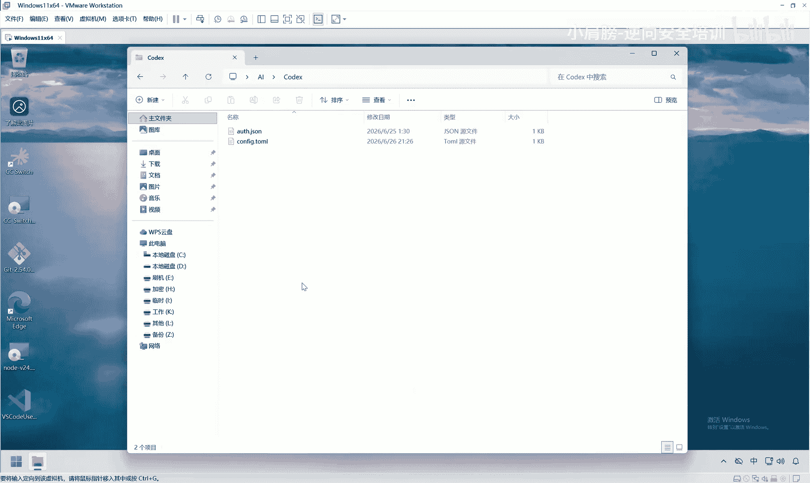
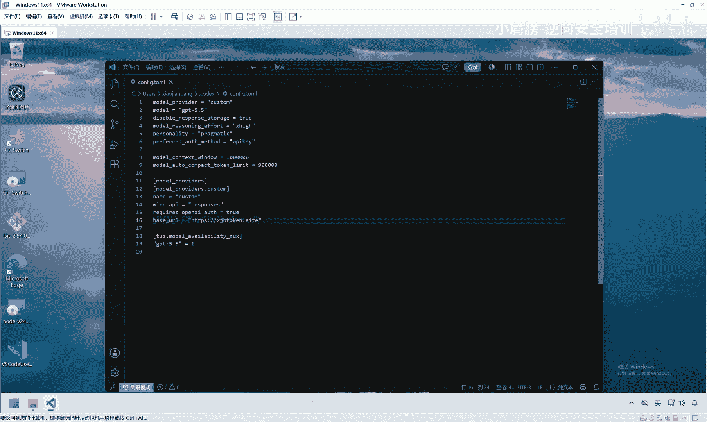
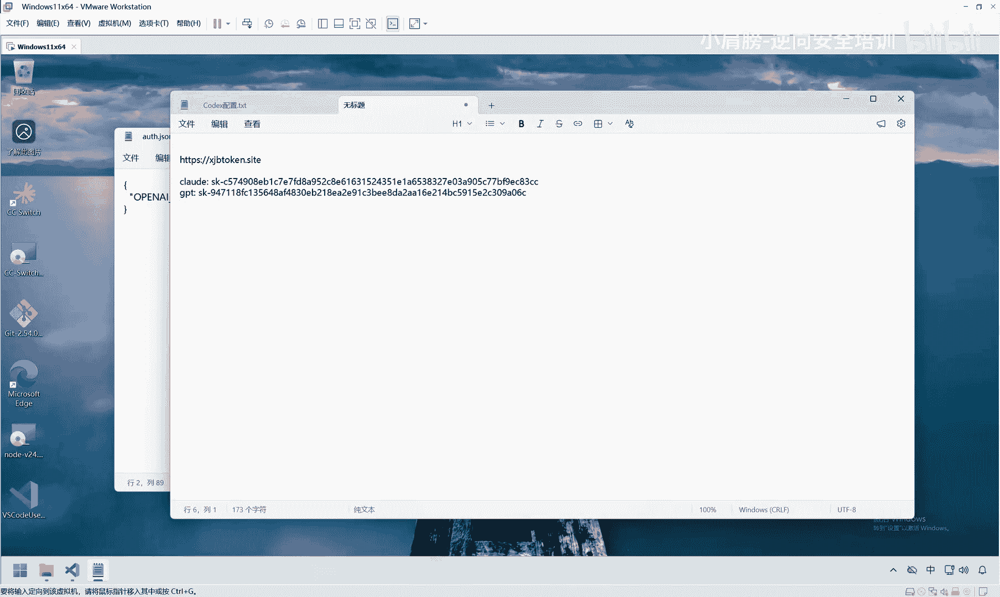
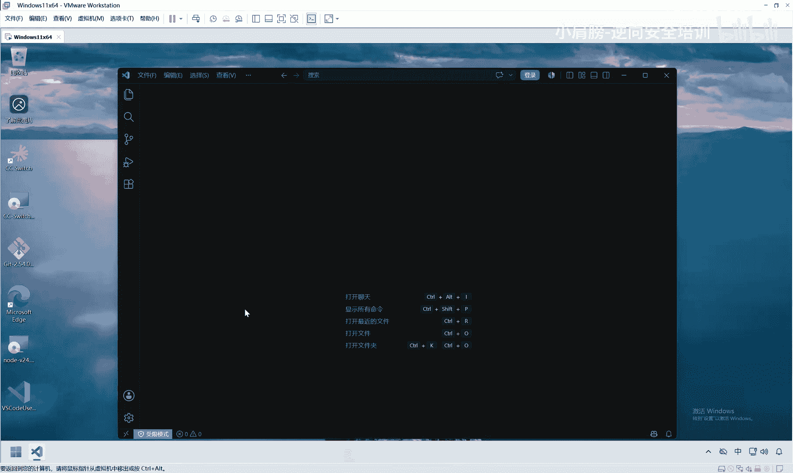
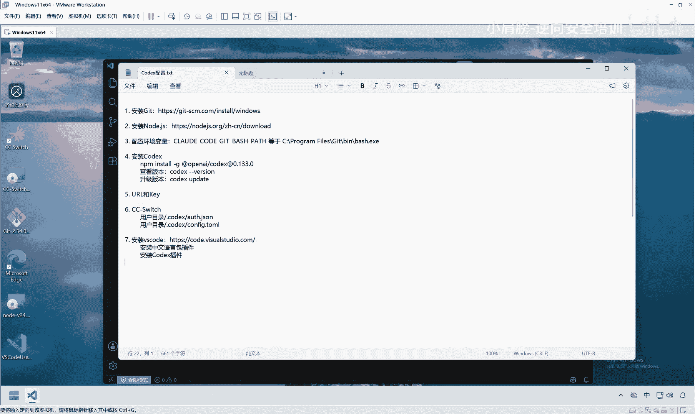
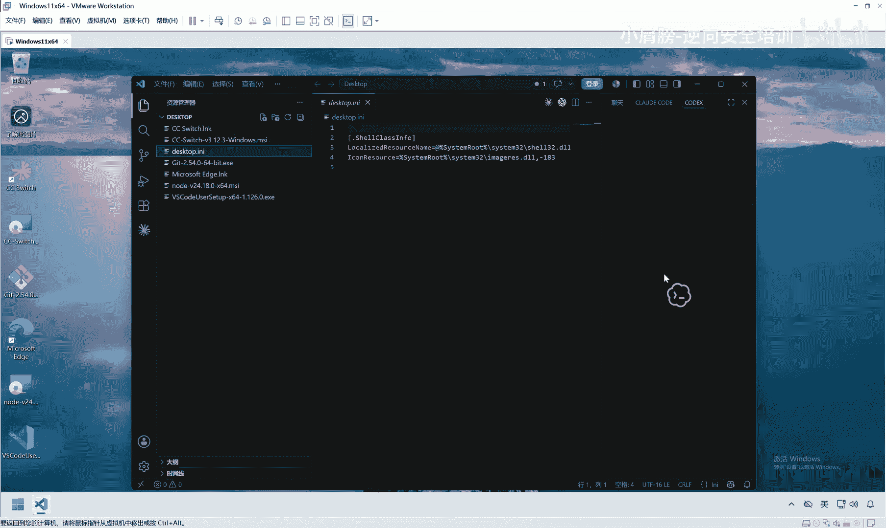
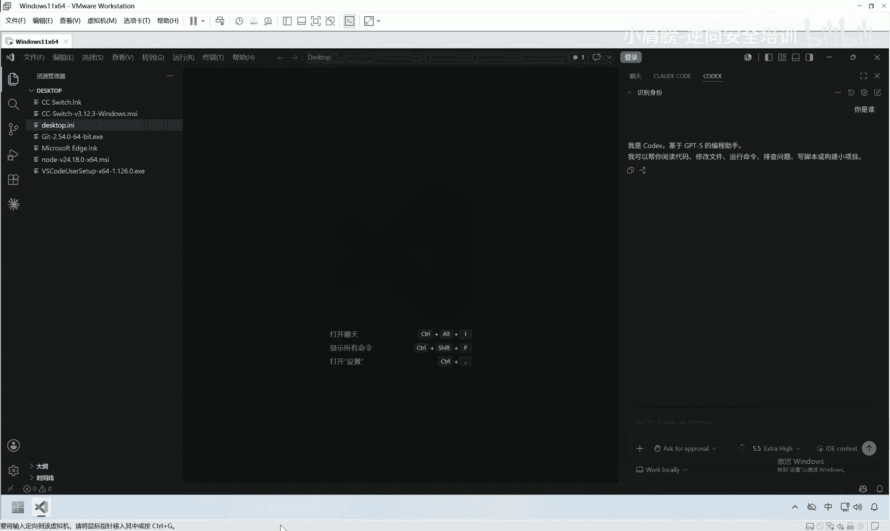

# 🚀 AI客户端配置教程：04：Windows中Codex配置

在本节课中，我们将学习如何在Windows系统中配置Codex这款AI客户端。Codex和Claude Code一样，也是一个客户端，只不过是由不同的公司开发的。通常我们会使用GPT模型来驱动它。配置方法跟Claude Code差别不大，所以如果已经安装过一些依赖项，就不需要重复安装了。整个流程不复杂，只要按步骤操作，你就能顺利跑起来。

## 1. 🛠️ 准备工作：安装Git和Node.js

首先，我们来简单过一下准备工作。第一个需要准备的工具是Git。如果你希望在Windows中使用Linux命令行，就需要安装Git。环境变量可以不用配置，作者表示没有在纯净系统上测试过，因为都是装完Claude Code之后直接装Codex，环境变量本身已经有了。至于是否需要配置，你可以自己测试一下。第二个需要准备的是Node.js，因为Codex可以通过NPM进行安装，安装命令和Claude Code也差不多。

以下是安装过程中需要执行的主要步骤：

- 安装Git，用于在Windows上提供Linux命令行环境。
- 安装Node.js，因为Codex需要通过NPM来安装。

## 2. 📦 通过NPM安装Codex

接下来，我们来看看如何安装Codex。在CMD中进入指定目录，然后运行下面的命令即可。这里的`npm install`代表安装，`-g`代表全局安装，后面跟的是要安装的包名`codex`，以及版本号`0.133`。



```bash
npm install -g codex@0.133
```

安装完成后，下面有两个常用命令，第一个是查看版本，第二个是升级：

```bash
codex --version
codex update
```

如果你已经按照上面的命令安装好了，输入`codex --version`，可以看到它确实是指定的版本。

## 3. 🔑 首次运行与API密钥配置



安装好之后，我们输入`codex`，它会让你选择三种情况。这时候我们要选择第三种“使用API Key”。接着，它会让你输入你的API Key是什么。

如果你使用的是中转站，那么这个地方不用输入API Key，因为它默认的链接是OpenAI的。输入完或者直接关闭窗口后，就完成了初步的初始化。



然后，在`.codex`目录下，你需要把两个文件丢过去。基本上字段都可以照抄，但有几个地方需要修改。以下是需要修改的核心字段：

- **模型名称或模型ID**：目前GPT最新的版本是5.6。
- **思考深度**：一般GPT使用`high`就可以了。
- **链接地址**：需要改成你自己的中转站地址。

这里要注意，有些中转站可能这个地址就可以用，有些中转站可能要在地址后面再加上`/v1`。这个需要自己去测试一下，看看中转站有没有做兼容。

另外一个文件是`auth.json`，这个文件里面输入的实际上是API Key。这个Key不要抄别人的，你需要自己去购买以后，在后台生成一个能用的Key，而且这个Key是需要选择对应的模型的。在模型选择上，推荐你使用GPT。这样就配好了。

## 4. 🖥️ 在命令行中验证配置

配置完成之后，我们再打开CMD，输入`codex`。这个地方是让你去更新，我们就跳过，继续。接着，它会让你选择沙盒的形式，我们就默认的第一个吧。当它把沙盒配置好以后，我们就可以去跟AI聊天了。这样，命令行中的配置就完成了。

## 5. 🔄 在C1sw中配置Codex

当然，Codex的配置在C1sw里面也可以配置。打开C1sw以后，选择这个图标，可以直接添加供应商，也可以导入当前的配置。这个就是我们刚才手动配的。现在在这个地方，请求地址、模型等都可以设置。你填写的API Key会生成一个`auth.json`，你填写的URL会生成相应的配置。

如果你使用多个中转站的话，你也可以在这里添加一个新的供应商。这个地方的供应商名称可以随便写，官网链接可以留空。以下是添加新供应商时需要填写的几项内容：



- **供应商名称**：随便写一个即可。
- **官网链接**：可以留空。
- **API Key**：填入新中转站生成的Key。
- **地址**：填入新中转站的地址。
- **模型**：填入要使用的模型名称。

填写完成后，点击添加就可以了。另外，这里似乎没有思考深度的配置。如果要配置思考深度，直接改这个字段，手动改。然后这个地方也可以进行管理和测速。保存以后，在这里也可以去测试模型。

但是，你可能看到这个地方的提示是“404 GPT-5.1 codex”，这实际上是模型没有找到，因为这个模型太老了，已经下架了。所以我们需要在模型测试配置里面去配置测试模型，比如说使用`gpt-5.5`，保存。这个时候你再去测试，就成功了。



## 6. 💻 在VS Code中使用Codex

同样的，在CMD命令行里面去使用Codex太麻烦了，我们更喜欢在IDE里面去使用。这个时候，你要去安装一个VS Code。装完之后，安装中文语言包插件。这个在Claude Code课程里面讲过，如果不会的话，你可以回到Claude Code课程里面去看一下。

那么，如果你要使用Codex，你需要在扩展里面去装一个Codex插件。直接在扩展搜索栏中输入`codex`，找到这个插件，点击安装，然后信任。现在它已经装好了，装好之后，在侧边栏会出现一个图标，点击打开。Codex是显示在侧边栏上面的。当然，最好在这里打开一下文件夹，相当于指定一下工程目录。然后，再去打开Codex侧边栏。



此时，左边可以查看代码，右边可以跟AI进行沟通，让AI去生成代码或者是修改代码。这个面板是可以拖动的。Codex插件打开会比较慢，不用着急，这里点击“继续”就可以了。这样子就可以正常使用了。

## 总结



本节课中，我们一起学习了如何在Windows中配置Codex客户端。我们从安装Git和Node.js开始，通过NPM安装了Codex，配置了API Key和模型参数，还在C1sw中完成了供应商设置，最后在VS Code中安装了插件并成功使用。希望你能按照这个流程，顺利配置好属于自己的Codex环境。

