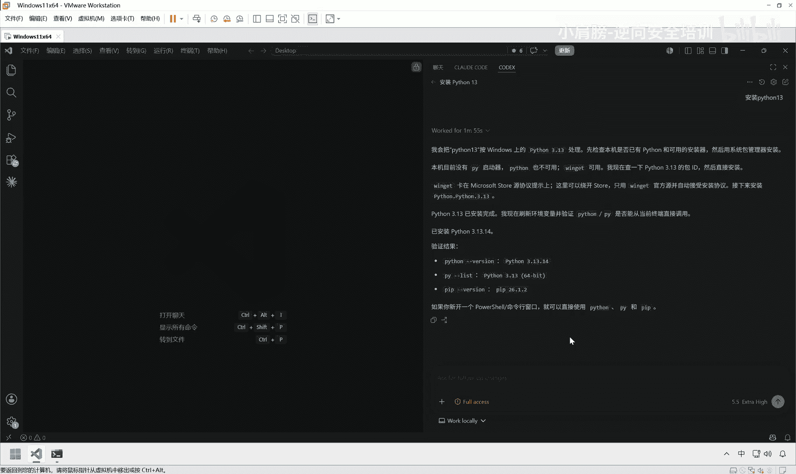
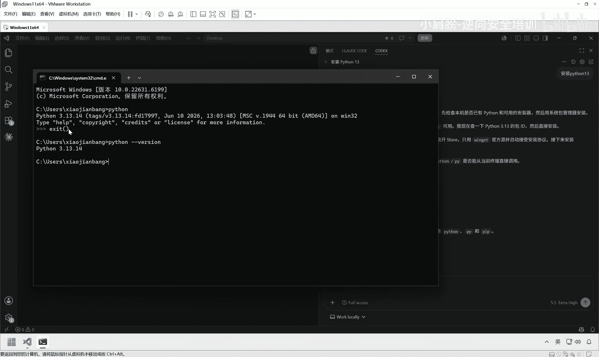
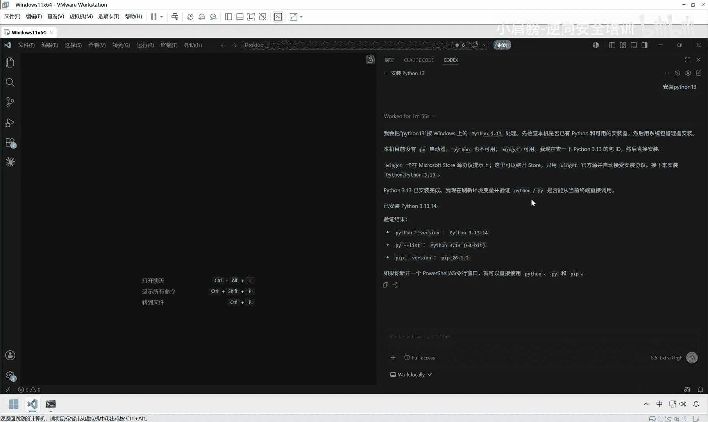

# 🤖 AI自动配置环境：05：AI自动配置环境

> 课程编号：BV1qh3d6UEyW

在本节课中我们将要学习如何让 AI 自动配置开发环境。整体方法并不复杂，核心思路是把安装需求写成清楚的提示词，然后交给 AI 完成下载、安装和验证。学会这个流程后，后续课程中遇到常见工具安装任务时，就可以先让 AI 尝试处理，再根据结果做检查。核心流程可以概括为下面的公式。

```text
自动配置环境流程 = 明确软件与版本 → AI 下载安装 → 命令行验证
```

上一段说明了本节的核心目标，下面先看一个最直接的例子：让 AI 安装 Python 3.13。提示词可以写得非常简单，直接表达安装需求即可。

## 🐍 用一句话让 AI 安装 Python 3.13



本节中我们来看看最简单的自动安装示例。假设需要让 AI 安装 Python 3.13，提示词可以直接写成下面这样。

```text
安装 Python 3.13
```

这条提示词本身已经包含目标软件和版本号，因此 AI 可以据此理解任务。原文示例中，AI 在没有收到安装包的情况下，会自行寻找并下载安装包，并在两分钟左右完成安装。这里的关键点是：提示词要明确写出软件名称和版本，AI 才能知道要安装什么。

完成安装后，还需要确认是否真的成功。验证方式如下：打开命令行，输入 `python` 命令，观察是否进入 Python 3.13 的命令行环境。也可以按照课程中提到的验证方法，在命令行中使用 `python` 命令进行确认。



```bash
python
```

如果命令行能够正常进入 Python 3.13 环境，就说明安装结果基本符合预期。通过这个例子可以看到，AI 自动配置环境的第一步是给出明确需求，第二步是执行安装，第三步是验证结果。

上一节通过 Python 3.13 演示了自动安装和验证流程。本节中我们来看看后续课程中的工具安装场景。后续课程会用到很多工具，这些工具并不要求全部手动安装；如果遇到不会安装的工具，可以从课程网盘下载工具安装包，再让 AI 执行安装。后面课程仍然会讲解这些工具的具体安装方法。

以下是后续工具安装时需要关注的几个要点。

- 可以先从网盘获取工具安装包，再把安装包交给 AI 进行安装。

- 后续课程会继续讲解工具的具体安装方式，因此当前阶段重点是理解流程。

- 看课程时要重点关注流程，而不是只记住某一个命令。

上一段列出了工具安装的基本要点，下面进一步说明为什么流程比单个命令更重要。学习课程时，重点应放在流程上，例如完成一个逆向任务需要用到哪些工具，每个工具具体起什么作用，安装流程大概是什么样子。只要掌握这些内容，就可以把任务拆解成可执行的步骤。

以下是流程学习中需要弄清楚的几个问题。

- 当前任务需要哪些工具。

- 每个工具在任务中承担什么作用。

- 这些工具的安装流程大概是什么样。



如果这些内容都不清楚，提示词就很难写清楚，AI 也无法准确理解任务。因此，在让 AI 自动配置环境之前，需要先知道任务目标和工具范围。

上一段强调了流程理解的重要性。本节中我们来看看 AI 找不到下载地址时应该如何处理。如果 AI 找不到某个工具的下载位置，就需要把下载地址或安装包提供给 AI，让它能够继续完成安装。这个步骤说明，AI 自动配置环境并不等于完全不需要人工判断；必要的信息仍然需要由使用者补充。

最后做一个总结。本节课中我们一起学习了 AI 自动配置环境的基本方法：用明确提示词让 AI 安装指定版本软件，例如安装 Python 3.13；安装后通过命令行验证结果；后续课程中的工具可以从网盘获取安装包并交给 AI 安装；学习时要重点理解工具作用和安装流程；当 AI 找不到下载位置时，需要主动提供下载地址或安装包。掌握这些内容后，就可以把 AI 自动配置环境作为后续课程中的辅助手段。

