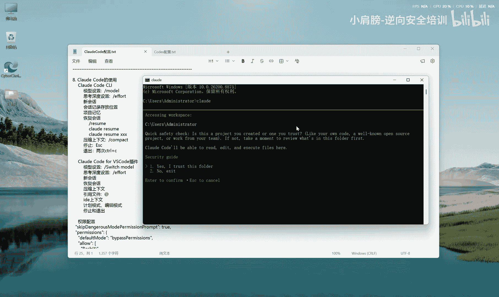

# 🚀 Claude Code 使用教程：06：Claude Code 的使用

在本节课中我们将要学习 Claude Code 的命令行版本，也就是 Claude Code CLI，以及 Claude Code for VS Code 插件的基本使用。内容会覆盖启动与信任目录、模型与思考深度设置、新建和恢复会话、会话记录存放位置、项目记忆、停止与退出、插件里的模型与思考深度、上下文压缩、文件引用、IDE 上下文、计划模式与编辑模式、权限配置以及会话合并这些常见操作。下面我们按照实际使用顺序，一步一步把这些内容串起来，尽量用大白话讲清楚，让初学者也能看懂。


## 🧭 Claude Code 使用教程：06.1：启动 Claude Code 与信任目录

首先来看命令行版本。打开 CMD 或终端，在里面输入 `claude`，就可以启动 Claude Code CLI。启动时它会让你选择是否信任当前目录。这个目录肯定要信任，因为不信任的话，后续很多操作就没法正常进行。启动命令如下：

```bash
claude
```

输入命令后，按照提示选择信任当前目录即可。完成启动和信任目录之后，我们就进入配置环节。上一节我们完成了启动，本节中我们来看看模型和思考深度怎么设置。


## ⚙️ Claude Code 使用教程：06.2：模型设置与思考深度

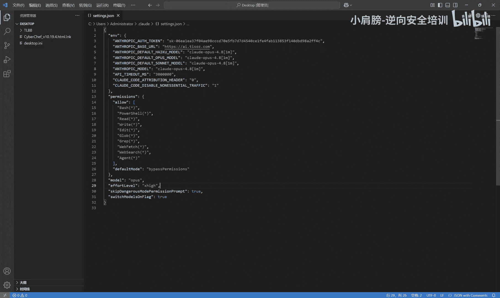

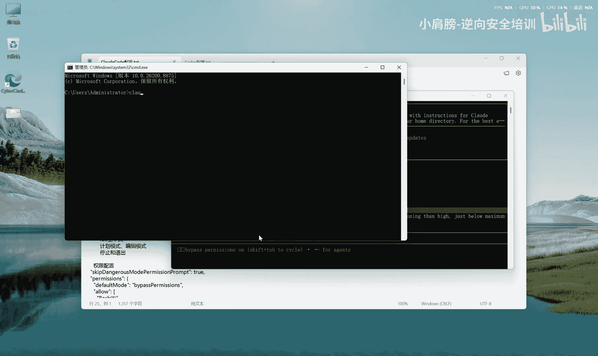

模型设置可以在这个地方输入斜杠命令 `/model`，然后回车去选择模型。一般很少这样用，因为这里出现的模型实际上已经在你的配置文件里面了。配置文件里面填了哪些模型，这里就会出现哪些模型。按 `Esc` 可以退出来。命令示意如下：

```text
/model
```

一般也很少去修改模型，除非厂家出了新模型，才会把模型换成新的。这个时候一般也是去修改配置文件，或者使用 `ccswitch` 去进行修改。所以 `/model` 实际上很少用。模型配置的核心关系可以简单理解为：

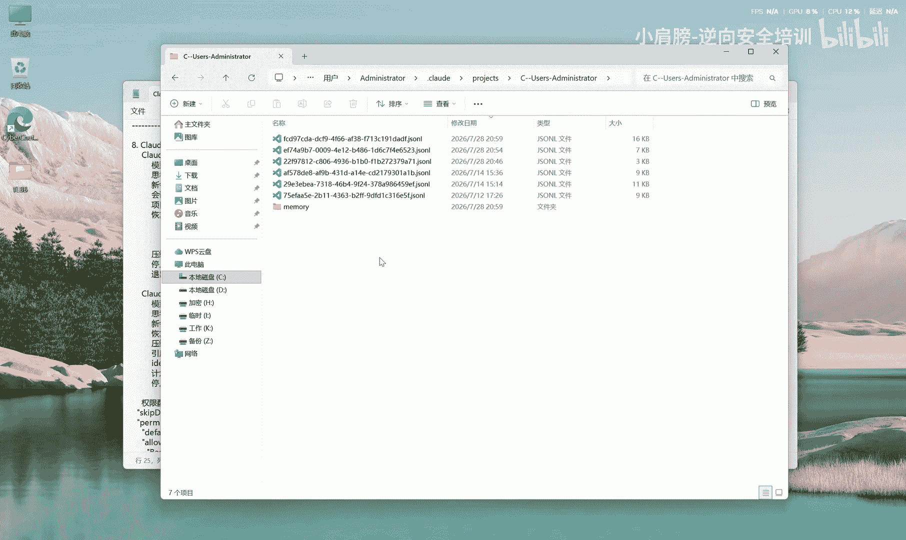

```text
可选模型列表 = 配置文件里已经写入的模型
```

还有一个是思考深度设置，原文提到的是斜杠命令 `/e`，在这个地方可以设置思考深度。一般设置成 `high`、`xhigh` 或者 `max`，一般 `xhigh` 就够了。因为思考深度设置得越深，它思考的时间越久，也就是回答得越慢，而且越消耗 token。思考的过程也是消耗 token 的。回车之后，在这个地方可以看到配置文件里面也跟着变了。所以我们要修改思考深度的话，在配置文件里面也可以改，或者就在 `ccswitch` 里面改。设置示意如下：

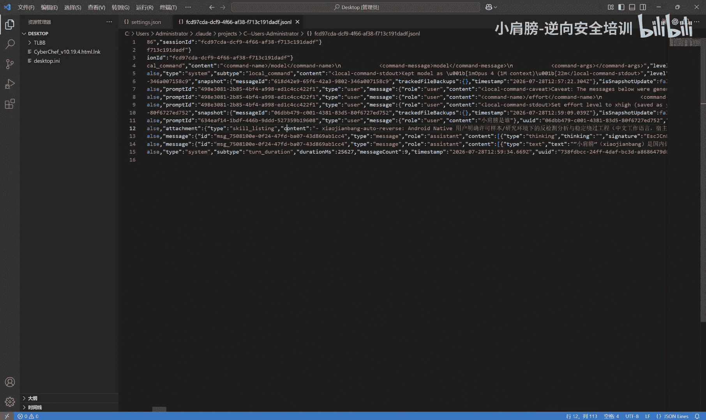

```text
/e
# 选择 high / xhigh / max
```

配置好模型和思考深度后，我们自然会想开一个新会话。下面看看新建会话、恢复会话以及停止退出怎么操作。


## 🆕 Claude Code 使用教程：06.3：新建会话、恢复会话、停止与退出

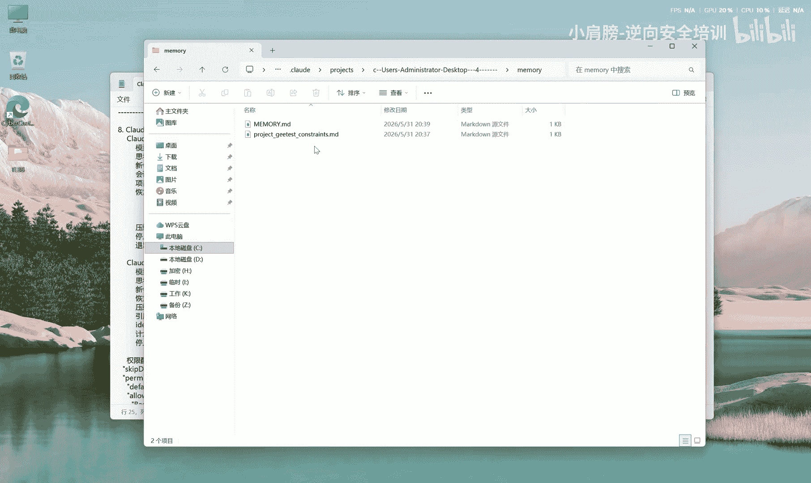

新建会话这个就更简单了。你再开一个 CMD 窗口，输入 `claude` 就可以了。这就是一个新会话。然后可以先跟 AI 对话一下。命令如下：

```bash
claude
```

恢复历史会话可以在 Claude Code 里使用斜杠命令 `/resume`，也就是原文说的恢复会话命令。选择一个历史记录进去，就是之前的会话记录了，然后你可以接着去聊天。除了进入 Claude 后使用 `/resume`，还可以使用 `claude resume 会话ID` 这种方式去恢复。比如这个地方它的提示，它会给出一个会话 ID，这个会话 ID 实际上就是对应 `.jsonl` 文件的文件名。命令示意如下：

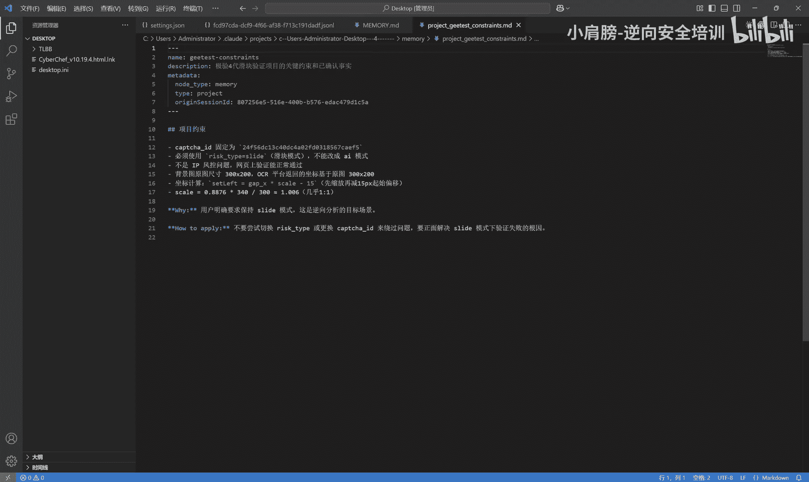

```bash
claude resume <会话ID>
claude --resume
```

当然也可以让它切换到别的会话上面去，在里面应该也是可以切换的，这样就可以切换过来了。也可以直接执行 `claude --resume`，再去进行选择。

停止和退出也要说明一下。停止就是说 AI 在回答的过程中，可能你对它的回答不太满意，然后你就不想接着听它说了，那么你可以按 `Esc` 键停掉。当前这个会话如果你不想用了，你要退出，这个时候你可以按两次 `Ctrl+C` 就可以退出来，或者直接关掉窗口。操作示意如下：

```text
Esc           # 停止当前回答
Ctrl+C 两次   # 退出当前会话
```

上面我们说了怎么开新会话和恢复会话，接下来看看这些会话记录到底存在哪里，这样心里更有数。


## 📁 Claude Code 使用教程：06.4：会话记录的存放位置

会话记录存放位置可以这样找：首先找到当前的用户目录，再找到 `.claude` 目录。在这个下面有一个 `projects` 文件夹，在这个里面存放的就是会话记录，也就是你和 AI 的聊天记录。Claude Code 是根据路径来存放的，就是你当时进入的时候的项目路径。比如说我们这个会话当时是在某个地方进去的，所以我们要到这个里面去看。路径关系可以写成：

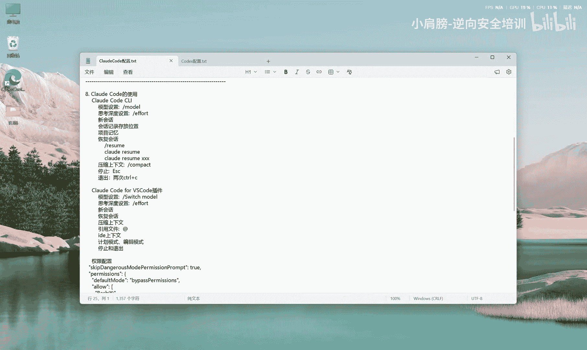

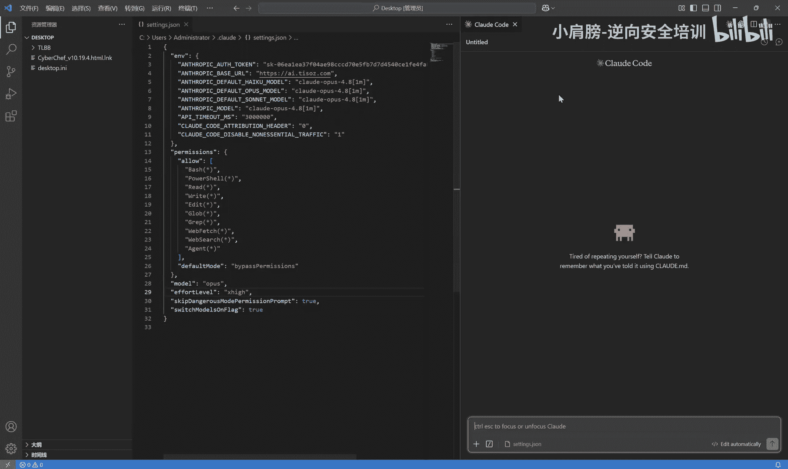

```text
会话记录路径 = 用户目录/.claude/projects/<项目路径对应的目录>
```

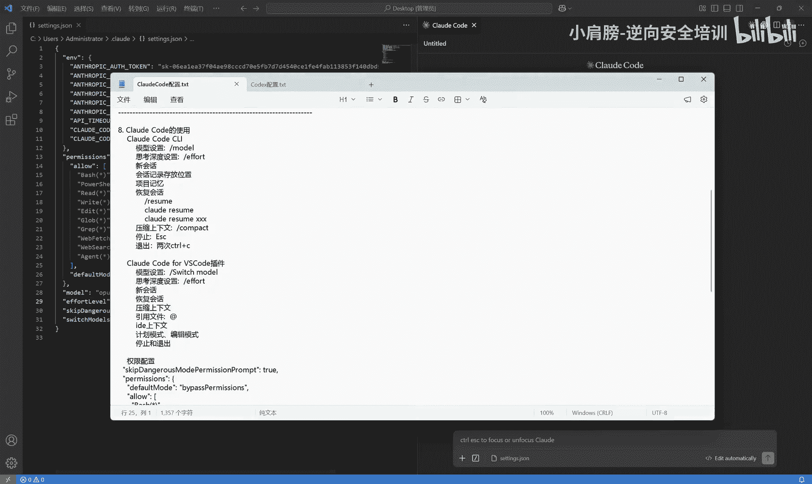

可以看到这里有一行新的会话，打开来看一下它里面有没有什么样的记录。可以看到这个地方有一个提问“小监网是谁”，然后这个地方是 AI 的回答。当然，AI 在回答之前还做了一些其他的操作，这个操作是去访问了 skill。skill 我们以后再说。这个会话记录跟我们当前看到的是匹配的。

知道了记录位置，我们再来看项目记忆。项目记忆会影响 AI 在当前项目里的行为，所以需要单独说明。


## 🧠 Claude Code 使用教程：06.5：项目记忆

项目记忆实际上就是在当前的项目目录下面有一个 `mem` 文件夹或相关记忆文件。这个地方可以看到是没有东西的，说明在这个项目目录下面是没有项目记忆的。那么看一下别的项目，比如说这个项目，可以看到有一个 `memory.md`。项目记忆是由你去设置的，你可以直接在提示词里面告诉 AI，要把哪些东西设置成项目记忆。路径示意如下：

```text
项目记忆文件 ≈ 当前项目目录/memory.md
```

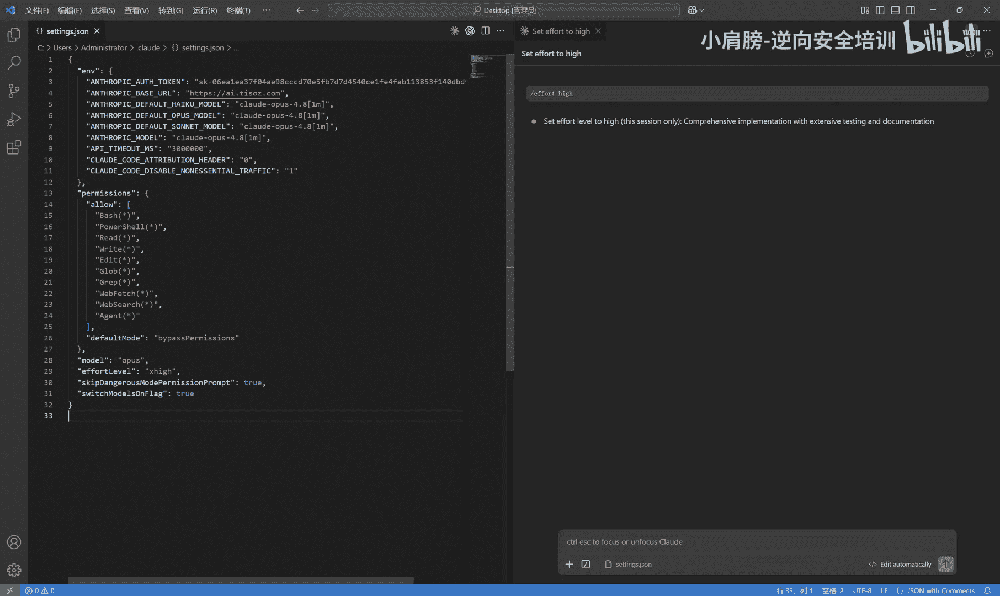

项目记忆有强约束的效果。就是有的时候 AI 它很不听话，不按照你的操作来，或者刚开始按照你的操作来，但是过一会它自己就换了个思路跑飞了。那么可以在项目记忆里面给 AI 加上强约束，在这个里面一般来讲它是会去参照的。这个也是项目记忆，这里面是简短的，这里面是详细的。当你不需要这个项目记忆的时候，你可以删掉，或者你让 AI 清理也可以。

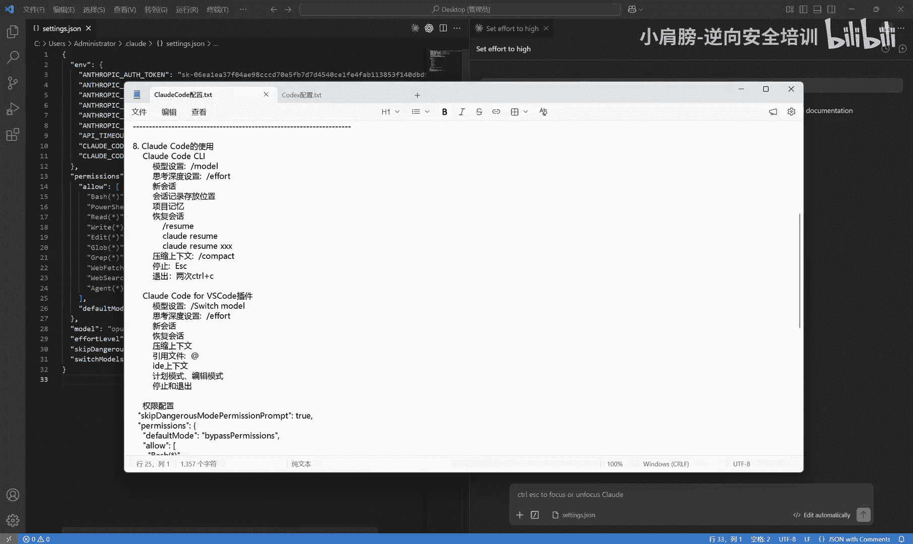

项目记忆讲完后，我们回到 VS Code 插件。前面是命令行版本，本节中我们来看看 Claude Code for VS Code 插件怎么操作。


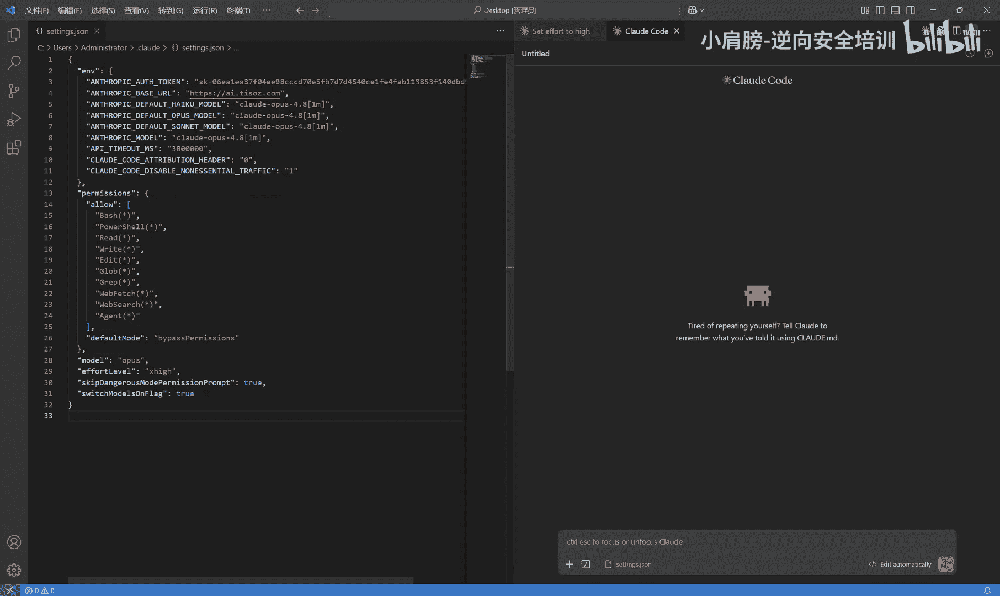

## 🧩 Claude Code 使用教程：06.6：VS Code 插件中的模型、思考深度与新会话

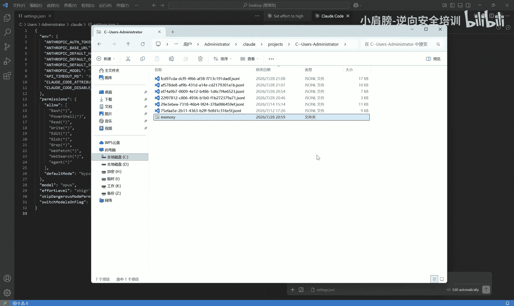

VS Code 插件就是这个东西。在这个里面怎么去操作呢？首先是模型设置。在这个地方输入斜杠，可以看到有一个选项叫 `Search model`，在这个地方点击进去也可以进行选择，同样的很少使用。因为这边的选择是有限的，通常是你在配置文件里面已经设置好了。所以我们更多的是去修改配置文件，或者使用 `ccswitch`。命令示意如下：

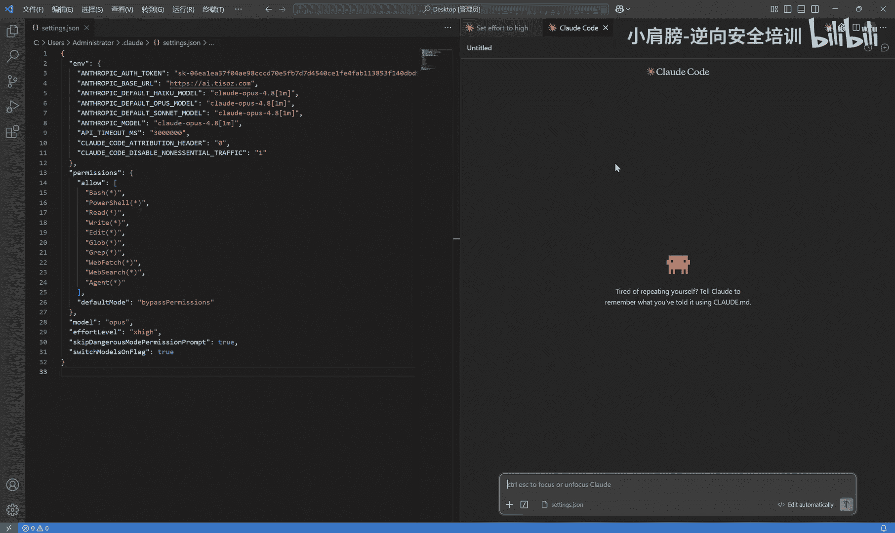

```text
/搜索模型
# 或修改配置文件 / 使用 ccswitch
```

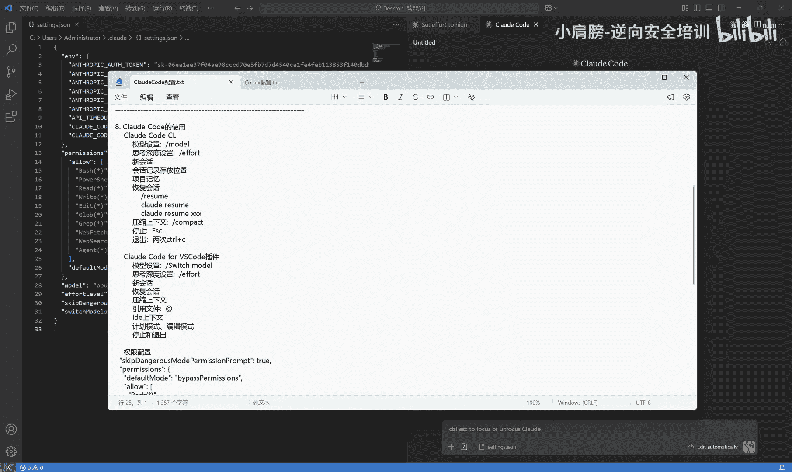

还有就是思考深度的设置。这个插件有很多个版本，有几个版本在这个地方是可以直接去设置思考深度的。但是这个版本好像没有设置思考深度的地方，只能在这个地方开启或者关闭思考。当然你也可以输入跟 CMD 里面相同的命令，比如 `/think` 空格，然后后面跟上你要修改的思考深度的值，原文这里提到的是 `F方tain` 这一类命令，具体以实际版本为准。这个就改过去了。但是这个地方没有变，说明这个思考深度修改是对当前这个会话有效。命令示意如下：

```text
/think xhigh
```

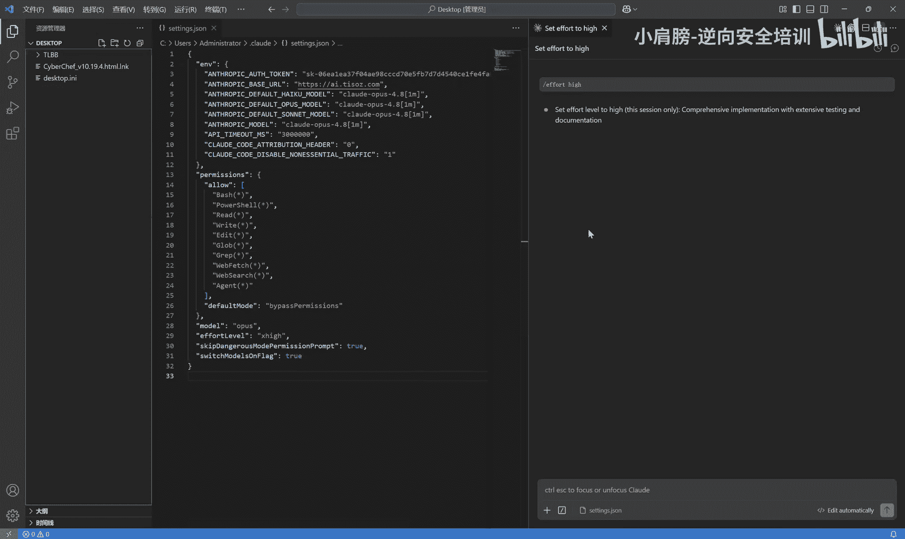

然后来说一下新会话，这个就更简单了。你直接在这里再开一个，那这个就是新会话了。当然这里要注意的是，如果你当前目录下面设置了项目记忆，那么这个项目记忆在你新开的窗口里面也是生效的。所以如果你要在新开的窗口里面让项目记忆不生效，你要么就换一个项目路径，要么就是把之前的项目记忆给删了。

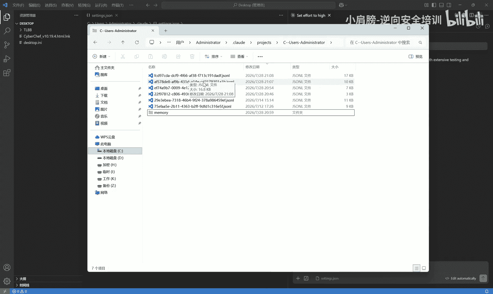

插件里的新会话和项目记忆说完了，接下来看看插件里恢复会话、压缩上下文、引用文件和 IDE 上下文这些常用操作。


## 🔄 Claude Code 使用教程：06.7：插件恢复会话与上下文压缩


在插件里点击相应地方可以恢复之前的会话。但是这里恢复的会话有限，而且它是根据项目的路径来的。当前如果是在桌面，所以刚才某个目录下面的会话记录是不会被筛选到的。比如说我们切换到用户目录下面去，打开一下，看一下这个地方有没有，可以看到确实是有的。它会筛选到我们刚才在命令行里面聊的一些东西。这样子你就可以不用通过命令行去进行操作了，也不需要去记会话 ID。

当你的会话久了之后，在这个地方会出现一个图标，一个圆圈的图标会显示你当前使用了多少上下文，按百分比来显示。然后你点一下它会立马压缩。当然也可以通过命令去操作，比如说在这个地方输入 `/compact`，那么它就会去压缩上下文。但是当前提示没有足够的消息去进行压缩，也就是说不需要压缩上下文。在命令行里面要压缩上下文的话也是一样的，输入 `/compact` 就可以了。命令如下：

```text
/compact
```


上下文压缩之后，我们再来看看怎么让 AI 读取文件，以及 IDE 上下文是怎么带进去的。


## 📎 Claude Code 使用教程：06.8：引用文件与 IDE 上下文

在 VS Code 里，我们想让 AI 去读取某个文件，可以在这里输入 `@`，然后选择对应的文件，让 AI 去进行读取。当然这种方式也很少用。一般更喜欢直接把文件的路径给它，或者把目录的路径给它，然后让它去读取。命令示意如下：

```text
@文件名
# 或直接发送文件路径 / 目录路径
```

然后是 IDE 的上下文。在这个地方打开一个文件，可以看到在这个地方显示了这个文件的文件名。那么当我们下次发送消息的时候，它实际上是会带上这个文件的内容的，或者说带上它的路径，然后 AI 会去读取。如果你不想让 AI 去读取这个文件，你可以在这个地方再点一下，当它是灰色的时候，AI 就不会去读取了。这个实际上就是当前 IDE 的上下文。


文件引用和 IDE 上下文清楚了，接下来看两个很常用的工作模式：计划模式和编辑模式。


## 🗺️ Claude Code 使用教程：06.9：计划模式与编辑模式

在这个地方点一下，可以看到会出来这么几种模式。通常比较常用的是一个编辑模式，一个是计划模式。这两个有什么区别呢？编辑模式就是你发送提示词之后，AI 会直接去修改文件。但是这样子可能会产生一个问题：当你的项目比较复杂的时候，AI 前面直接修改了文件，然后经过后续的分析，它突然发现前面的修改有问题，它就需要再回过头去把前面文件再给它修改过来。计划模式则是只读取当前项目下面的相关文件，AI 综合分析以后给出一个方案，然后问你接不接受，然后你接受以后，它会自动切换到编辑模式去进行修改。根据自己的需求来，这两个模式都要用。可以用伪代码表示：

```text
编辑模式：提示词 -> 直接修改文件
计划模式：提示词 -> 读取相关文件 -> 给出方案 -> 你接受 -> 自动切到编辑模式修改
```

模式选择讲完了，我们再说停止和退出在插件里的表现，然后就进入权限配置。


## ⏹️ Claude Code 使用教程：06.10：插件中的停止与退出

这个没什么好说的。在 AI 正在回答的时候，这个地方会是一个方框，点击一下它就会自动停止，也就是取消了。退出的话，你就直接关掉窗口就可以了。


插件的基本操作已经覆盖得差不多了，下面看一个实际使用中经常碰到的问题，也就是权限配置。上一节我们说了停止和退出，本节中我们来看看怎么减少频繁弹窗。


## 🔐 Claude Code 使用教程：06.11：权限配置与跳过确认


在使用 AI 的过程中，你可能会经常碰到一个问题：AI 回答了没几句，当它去执行一个命令的时候，突然弹出一个对话框，让你选择是否同意。等你同意之后，它过了一会儿又要去执行另外一个命令，然后又弹出来一个对话框，让你确认是否同意，这样子就很麻烦。那么有没有默认同意的方式呢？就是需要进行全局配置，把下面的这些添加到 `.claude` 目录下面的 `settings.json` 里面，加到这里。当然还有一个是这个。加上去以后，只要是执行这些命令，它就不会再弹窗提示了。因为这边是星号代表匹配所有，而且这个地方设置了 bypass。配置思路可以用代码表示：

```text
~/.claude/settings.json
# 加入允许执行命令的规则
# 使用 * 匹配所有命令
# 将权限模式设置为 bypass
```


具体键名和写法以你当前 Claude Code 版本的配置格式为准。有没有设置成功呢？你可以在这个地方去测试一下，或者你就直接进到 CMD 的 Claude 里面。在这个地方如果显示了 `bypass`，那么就代表设置是成功的。它不会再让你确认的，它会自己去干活。需要提醒的是，放开权限会提高便利性，也要注意命令安全。

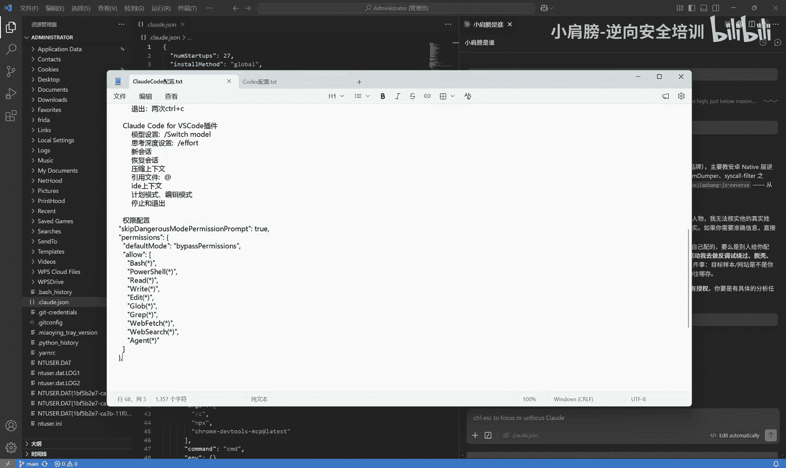

权限配置完成后，最后我们来看会话合并。Claude Code 的会话合并非常简单。


## 🧷 Claude Code 使用教程：06.12：会话合并

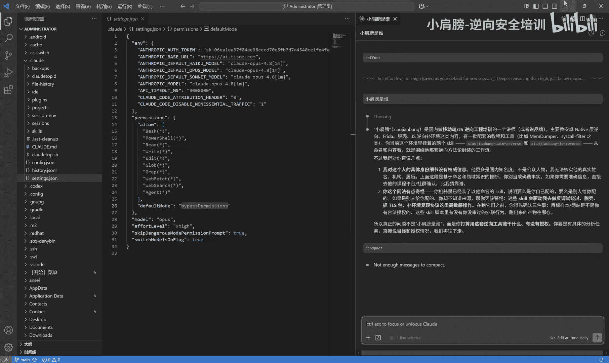

这里不是有两个工作目录吗？如果你想要整合到一起，你就直接把它复制过来就可以了。那这个就不需要了。当然在这个地方，你再去打开桌面的话，可能有一些会话依旧是没有的，有一些会话会出来。可以用文字理解：

```text
会话合并 ≈ 把对应工作目录下的会话记录复制到目标目录
```

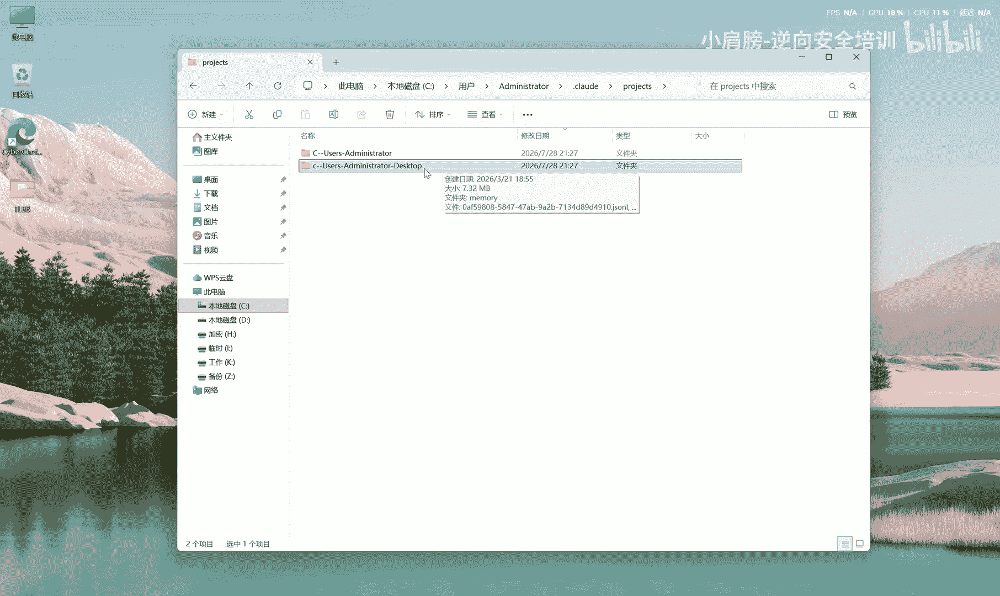

到这里，命令行版本和 VS Code 插件的主要操作都过了一遍。我们最后做一个小结。


## ✅ Claude Code 使用教程：06.13：总结

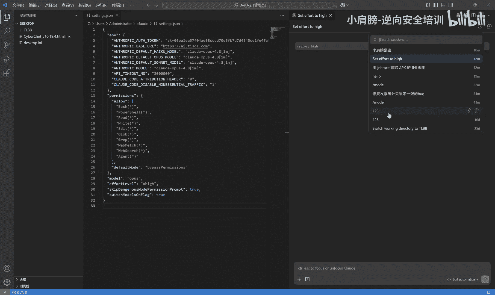

本节课中我们一起学习了 Claude Code 命令行版本和 VS Code 插件的基本使用，包括启动与信任目录、模型与思考深度设置、新建和恢复会话、会话记录存放位置、项目记忆、停止与退出、插件里的模型与思考深度、上下文压缩、文件引用、IDE 上下文、计划模式与编辑模式、权限配置以及会话合并。简单回顾一下，命令行里常用的是 `claude`、`/model`、`/think`、`/resume`、`/compact` 这些命令；插件里则重点掌握模型配置、恢复会话、压缩上下文、引用文件、IDE 上下文和两种工作模式。项目记忆和权限配置需要按项目实际需求谨慎设置，既要让 AI 听话，也要注意命令安全。把这些内容串起来，就可以比较顺畅地开始使用 Claude Code 了。

