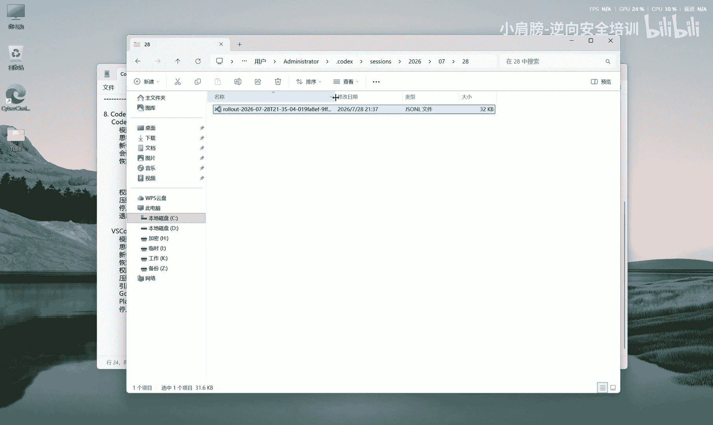
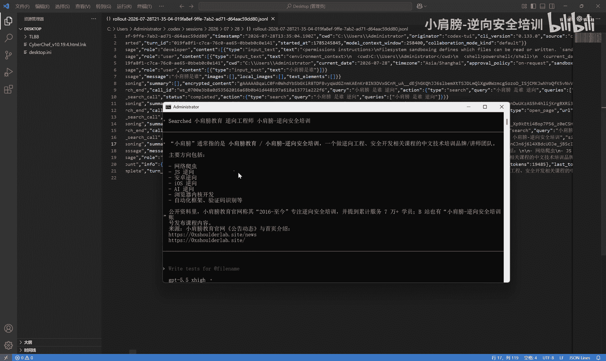
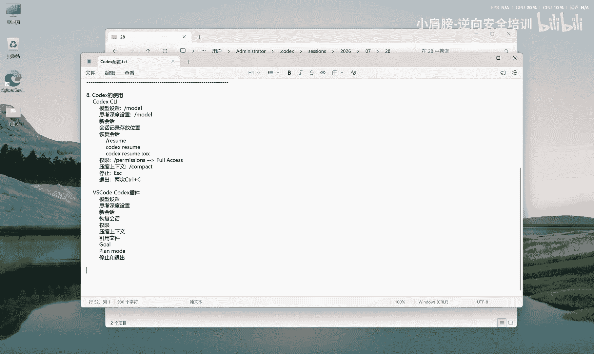
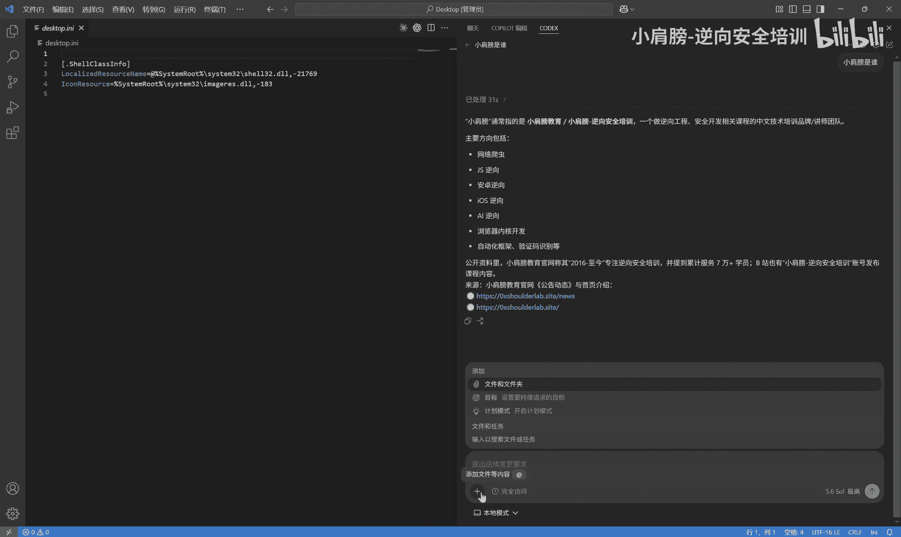
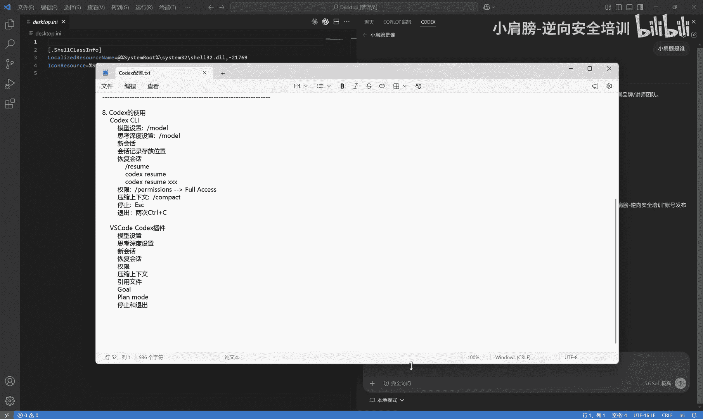
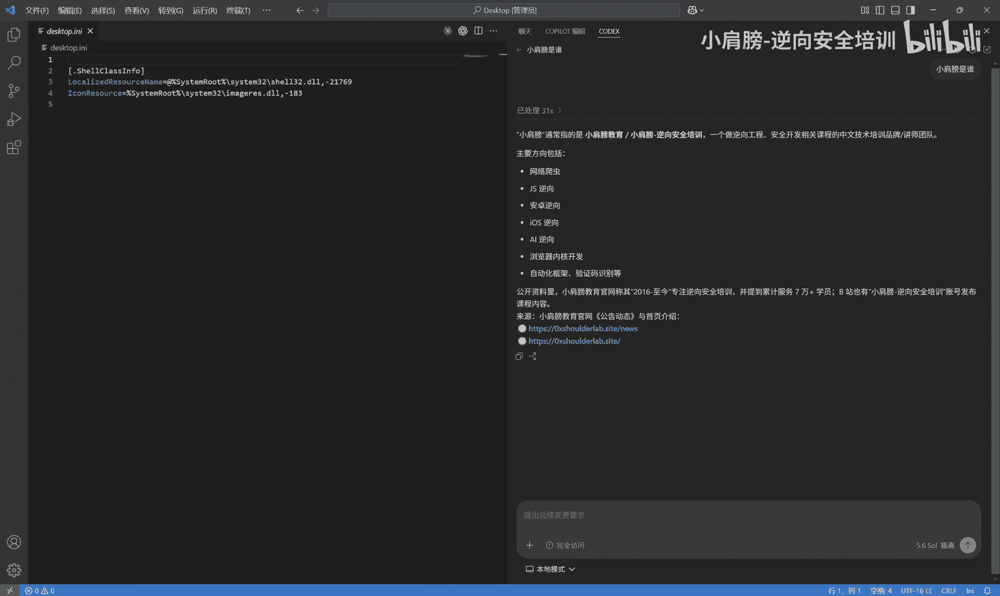
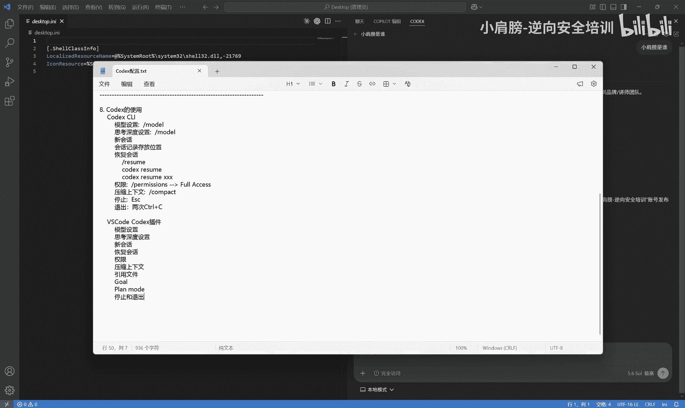
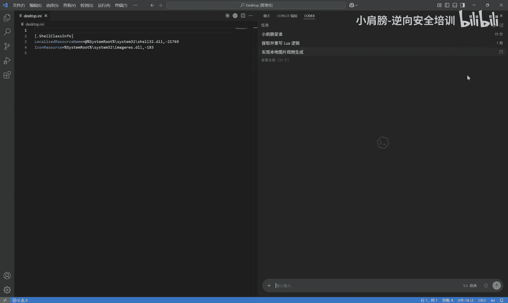

# Codex使用教程：07：Codex的使用 🛠️

在本节课中我们将要学习 Codex 的完整使用方法。内容会分成命令行工具 Codex CLI 和 VS Code 插件两部分进行介绍。整体思路是先认识基本操作，再了解会话管理、模型选择、权限控制等核心功能，最后掌握插件的日常用法。讲解会尽量用大白话，保证初学者也能直接上手。

## 1. 命令行工具 Codex CLI 🖥️

这一节课先介绍 Codex 的使用。首先来说一下 Codex CLI，也就是 Codex 的命令行工具。打开 CMD 输入 `codex` 就可以进入。然后在这个地方输入 `/model` 可以去设置模型。

一般情况下很少通过交互界面去修改模型。虽然在这个地方可选模型看起来很多，但实际上下面这些模型现在基本上都用不了了。能用的也就 5.4、5.5 和 5.6，而且 5.4 应该马上就要停掉了。

所以一般就用最新的模型就可以了，直接在配置文件里面改，或者在 `CDswitch` 里面改。选择一个模型之后进入，就可以设置思考深度，一般设置成 `X high` 就可以了。

当前模型已经切换到了 `GPT5.5X time`。这个地方没法选 5.6 的原因是我配置文件里面没有配置 5.6，改一下配置文件就可以了。配置文件怎么改之前说过。然后是新会话，这个很简单。

再开 1 个 CMD，那就是一个新会话。然后我们给 AI 发送一个消息。接下来来说一下会话记录的存放位置。首先打开用户目录，找到 `.codex` 目录。进去以后，在这个地方有一个 `sessions` 目录。

在这个里面它是根据时间来存放的。比如说今天的。同样的也是 `.son` 文件。可以看到这个是我们发送过去的消息。AI 去进行了搜索，然后给出了相应的回答。他的回答是这一段。前面都是在搜索。

## 2. 恢复会话与会话 ID 🔄

上一节我们介绍了会话创建，本节中我们来看看如何恢复会话。在这个地方输入 `/resume` 可以选择一个会话来进行恢复。他执行的命令实际上就是 `codex resume`。会换 ID。

所以你在外面运行这个命令进来。退出的话按两次 `Ctrl + C`。会话 ID 在哪个地方看，实际上就是后面这一段，就是这个。

## 3. 权限设置 🔐

接下来介绍权限。在 Codex 里面给 AI 完整的权限非常容易。直接输入 `/approvals`。

然后选择 `for access` 就是完全接受，然后选择 `yes anyway`，任何情况下都完全接受，这个就是给 AI 最大的权限，然后就让他自己去干活，这样就不会弹出让你确认的提示了。

以下是权限相关的常用操作：
- 输入 `/approvals`
- 选择 `for access`
- 选择 `yes anyway`

## 4. 压缩上下文 📦

接着来说一下压缩上下文。使用 `/compact`。一般你不用管上下文满了，它会自动压缩。这个地方代表上下文已经压缩的。

AI 在回答的时候，如果你对它的回答不满意，想要停掉，你就直接按 `ESC` 退出键就可以了。

那么 CLI 就说到这里，下面来说一下 Codex 插件。

## 5. VS Code 插件基础 🧩

在这个地方打开侧边栏。在这个地方可以点开一个已有的任务，这个实际上就是恢复会话。也可以在这个地方点击，然后切换到任何一个你想要跳转到的会话上面去。

如果要新开一个会话，可以点击这个，然后去输入新的内容。以下是插件中常用的设置入口：
- 设置模型
- 设置思考深度
- 设置访问权限

在这个地方可以设置模型，点击后可以选择一个需要设置的模型。在这个地方也可以设置思考的深度，极高其实就是 `X high`。在这个地方可以设置访问的权限，完全访问权限就是刚才在命令行看到的 `for access`。这样 AI 就不会弹出确认提示。

在这个地方还有一个 Codex 设置。默认情况下 Codex 插件它显示的是英文，可以在 Codex 设置里面去设置成中文。在这个地方可以设置成中文。当然在这个地方没有什么特别的设置，所以一般可以不用管。

然后是压缩上下文。可以在这个地方输入 `/` 选择压缩，也就是 `compact`。当然，当上下文用满之后，它也会自动压缩。

## 6. 引用文件与目标设置 📎

接着来说一下引用文件。可以在这个地方输入 `@` 然后选择添加文件或文件夹，去选择一个文件。也可以在这个地方点击加号去选择一个文件。

接下来来说一下目标设置。你可以在这个地方输入 `/` 然后选择目标。这个有什么用呢。

在使用 AI 的时候可能会碰到这样的情况，就是你给了一堆提示词。AI 老是干到一半就停下来。但是它会给出下一步如何去做。然后你只要输入继续，它又会继续干活，直到整个任务完成。说白了就是 AI 明明能够根据最初的提示词直接完成整个任务，但它偏偏要在中途停下来。你需要明确告诉他继续，它才给你继续干活。

设置目标就是说你的这个提示词作为最终的目标，直到完成以后它才会停下来。这个地方还有一个是计划模式。计划模式我没用过，应该是跟 Cursor 差不多。

就是说在普通模式下 AI 会直接修改文件。在计划模式下 AI 只会去读取文件，读取足够多的信息综合起来，然后给出一个方案。你接收以后它再切换到普通模式去进行修改。

## 7. 停止与退出 ⏹️

然后是停止和退出，这个没有什么好说的。AI 在回答的时候，这个地方会变成一个方框，点击一下它就停掉了。退出嘛，你就整个关掉就可以了。

当然在 Codex 插件里面使用要注意。点击新会话并不代表原先的会话已经停止了。比方说这个地方 AI 正在干活，然后你点击了个新会话。那么实际上这个会话在这个地方会有个图标，一个圆圈在转圈的图标，代表它正在工作，并没有停止。

你要进到里面，给它停掉之后，再切换到新会话。

本节课中我们一起学习了 Codex CLI 的基本进入方式、模型选择与思考深度设置、新会话创建与会话记录存放位置、会话恢复、权限完全授权、上下文压缩，以及 VS Code 插件的任务管理、模型与权限设置、语言设置、文件引用、目标设置、计划模式和停止退出等完整操作流程。
