# 🐍 Python入门教程：08：Python的安装（BV1zYoqByEEd）


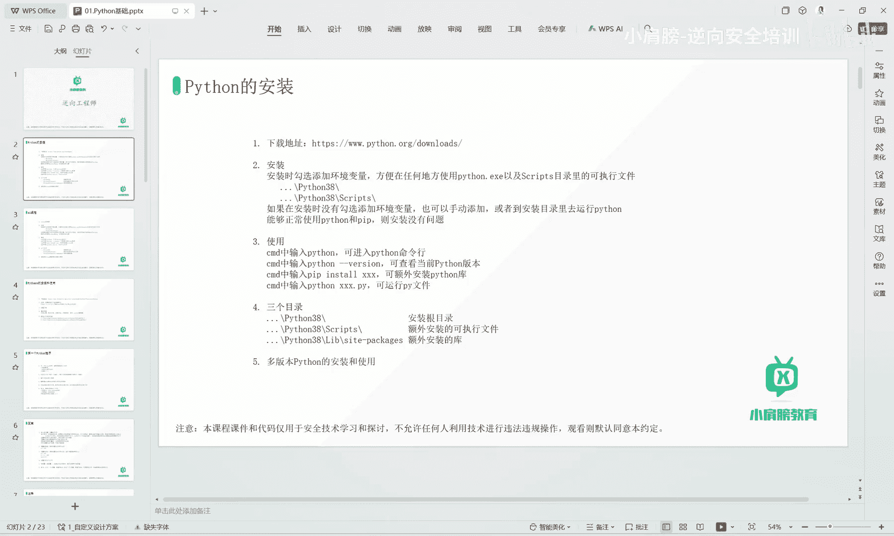

在本节课中我们将要学习Python的安装流程，包括下载入口、版本说明、安装包选择、环境变量验证、pip使用以及如何运行一个`.py`文件。安装Python看起来只是双击下一步，但版本选择、安装路径和环境变量都会影响后面写代码是否顺利，所以本节会把完整流程讲清楚。先说明下载和版本，再说明安装，最后验证命令行、pip和运行Python文件。


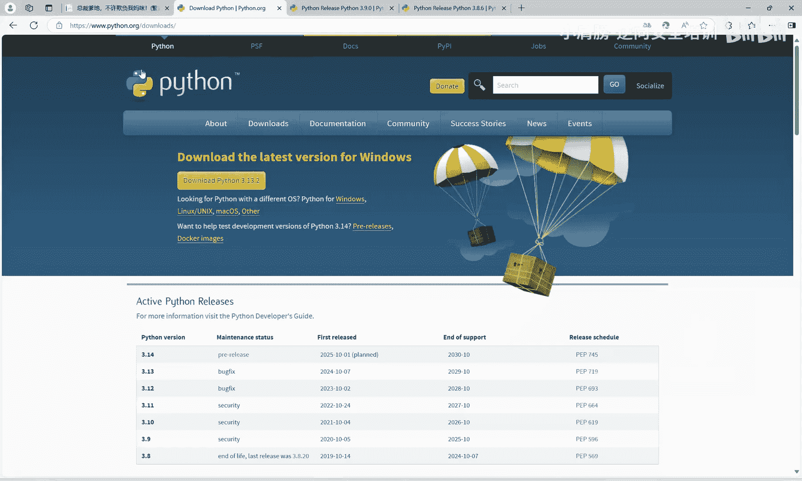

## 📥 Python入门教程：08.1：下载入口与版本说明


在正式安装之前，先找到Python的下载入口。下载地址就在原文给出的位置，也可以直接百度搜索“Python”。打开下载页面后，页面会显示版本列表、发布时间和终止时间等信息，整体就是这样的版本信息页面。下面先把页面上容易混淆的版本信息说明白。


以下是下载页面中需要关注的版本信息：


- 页面当前最新版本是3.13。
- 页面已经出现3.14，但3.14并不是正式版。
- 如果页面英文看不懂，可以使用Edge浏览器的翻译功能。
- 页面显示当前活跃的Python版本为3.8到3.14。
- 页面会列出每个版本的发布时间。
- 页面会列出每个版本的终止时间。


上面列表里的“终止时间”需要特别说明。这里的终止并不是指过了这个时间之后Python版本就不能用了，而是说过这个时间后，该Python版本不再维护小版本，不再增加新东西，也不再修复问题。像3.8的最终版本是3.8.20，目前已经过了最终支持时间，但现在依然可以使用3.8。如果要下载特定版本，可以在页面相应位置下载。页面上的版本看起来比较乱，一会儿3.13，一会儿3.12，一会儿又3.13，它实际上是按发布日期排序的；并不是出了3.13之后，3.12和3.9就不再维护了，不是这个意思。


> 注意：终止支持不等于不能使用。终止支持表示该版本不再维护小版本、不再增加新功能，也不再修复问题。


本套课程暂时使用两个版本：3.9.0和3.8.6。本节课先安装3.9.0；在对应位置点击后会跳转到下载页面，往下拉就能看到下载文件区域。版本信息理解清楚后，下一节我们来看看安装包如何选择和安装。


## 🛠️ Python入门教程：08.2：选择安装包与安装方式


上一节我们说明了下载入口和版本信息，本节中我们来看看Windows下应该下载哪个安装包，以及安装界面里的两个安装方式。下载页面会列出可以下载的文件；如果你使用Windows，就下载这一区域的文件，一般选择x64 executable installer，也就是64位可执行安装包。该安装包已经提前下载好，放在对应位置；安装很简单，双击安装包即可。安装路径尽量简单，放到自己知道的位置，避免以后找不到。


以下是安装界面提供的两种安装方式：


- 立即安装：安装路径就是界面写明的默认路径。
- 自定义安装：可以自己设置安装路径。


安装界面里有一个选项需要勾选：Add Python 3.9 to PATH。这个选项表示将Python 3.9加入环境变量；之后在命令行里就可以在任意路径下使用Python相关命令。环境变量可以理解为系统查找命令的目录列表，加入后系统就知道去哪里找`python`和`pip`。


```text
Path = Python 3.9 安装根目录 + Scripts 目录
```


勾选这个选项后，点击自定义安装；第一页全部默认，点击Next；第二页也全部默认；在这里改一个安装路径，放到自己知道的地方，例如`Python390`；然后点击安装。使用默认安装也可以。这样Python 3.9就安装完成。安装完成后，还需要确认环境变量和命令行是否正常，下一节就来看这些内容。


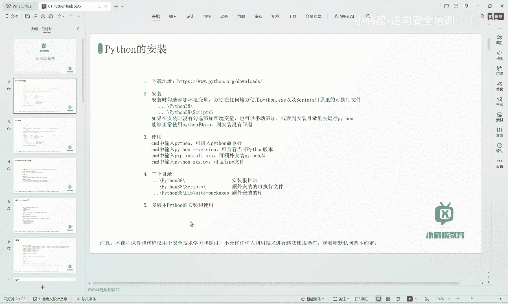

## 🧭 Python入门教程：08.3：环境变量与命令行验证


前面我们完成了Python 3.9的安装，本节中我们来看看环境变量到底加了什么，以及如何在命令行里验证安装。安装时勾选添加环境变量，实际上是将两个路径加入环境变量。我们去找一下：在Path这个地方可以看到，它把`Python390`的安装根目录以及下属的`Scripts`目录放到了环境变量里。如果安装时没有勾选添加环境变量，也可以手动将这两个目录添加到环境变量里。


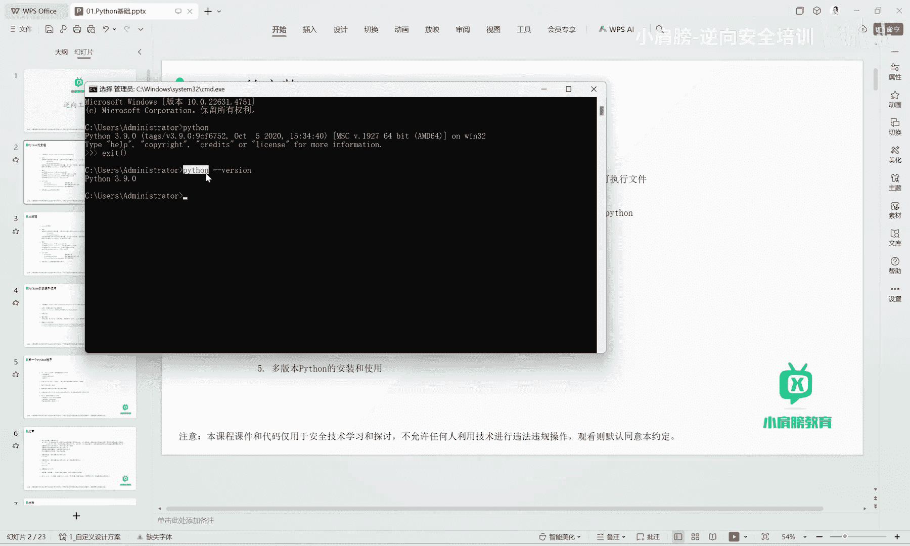

然后可以在命令行输入`python`，进入Python 3.9.0控制台；在控制台里可以运行一些命令。也可以输入下面的命令查看Python版本。


```bash
python --version
```


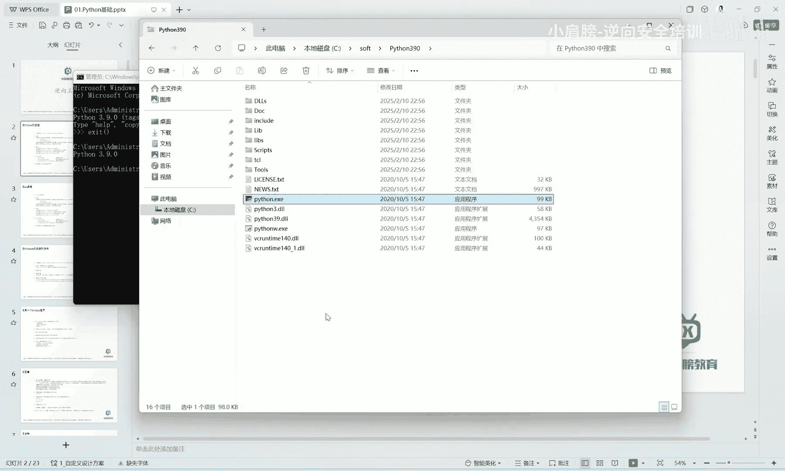

这里执行的`python`实际上调用的是该目录下的`python.exe`，也就是Python解释器。之所以在任意目录下也能访问`python.exe`，原因就是这个目录已经添加到环境变量。只要能够正常使用`python`和`pip`，就代表安装没有问题。pip位于安装根目录下的`Scripts`目录，里面有`pip`和`pip3`。安装验证通过后，下一节我们简单说说pip和第三方库怎么用。


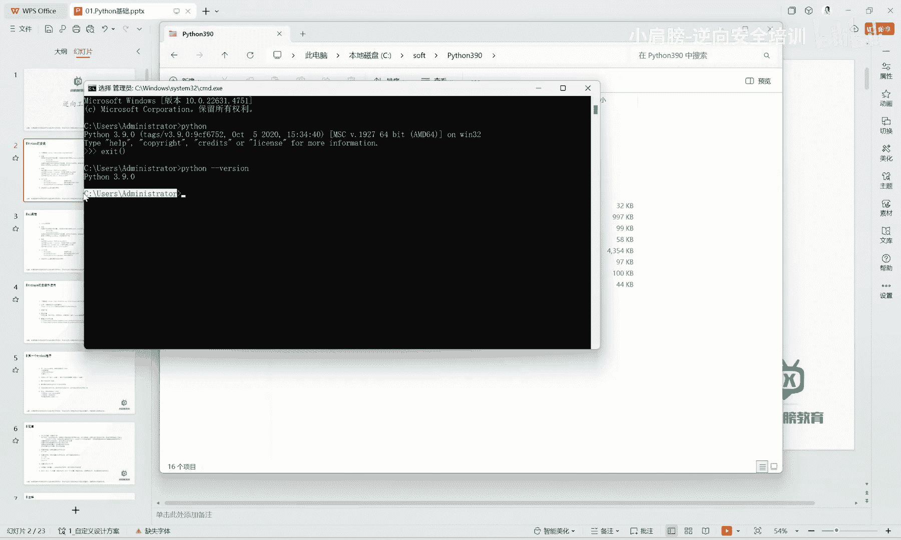

## 📦 Python入门教程：08.4：pip与第三方库


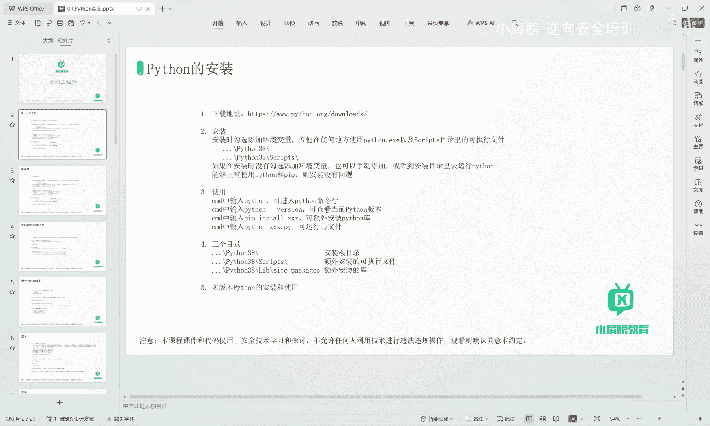

上一节我们验证了`python`和`pip`是否可用，本节中我们来看看pip的用途以及第三方库安装后放在哪里。pip可以额外安装Python库。Python安装包大约26 MB，里面实际上只有一些基本库，容纳不了多少东西；所以要用额外库，需要通过pip安装。第三方库可以理解为别人写好的工具，安装后可以直接拿来用，不用自己从头写。


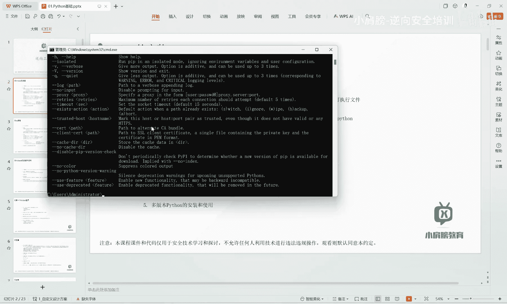

例如输入下面的命令安装`requests`。


```bash
pip install requests
```


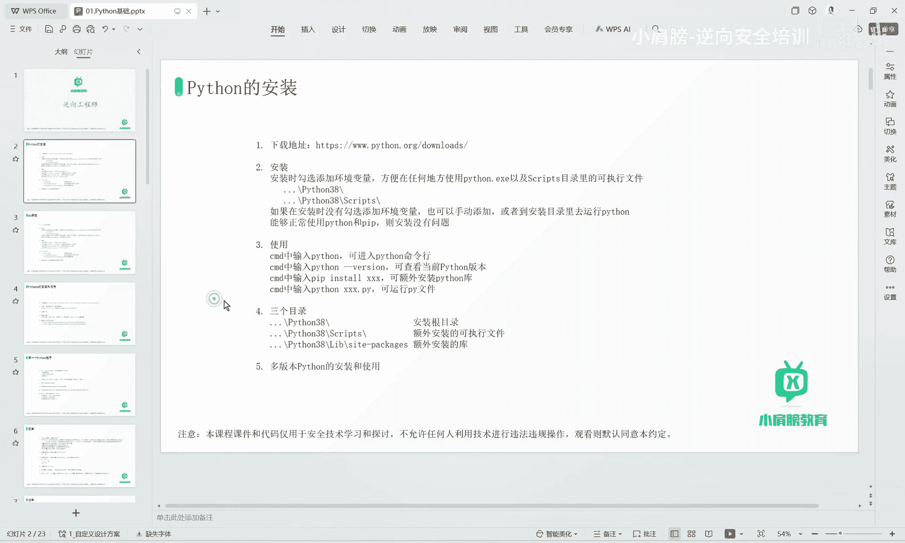

`requests`是用来做HTTP请求的Python库。它会安装这个库并且安装相关依赖。出现成功提示就是安装成功。安装完成后，在安装根目录下的`Lib`目录下的`site-packages`目录中，可以看到安装的`requests`相关库，它们实际上就放在这个地方。因此在Python里要额外注意三个目录，其中两个目录需要加入环境变量。


以下是需要额外注意的三个目录：


- 安装根目录：例如`Python390`，里面包含`python.exe`。
- `Scripts`目录：位于安装根目录下，里面包含`pip`和`pip3`。
- `Lib`目录下的`site-packages`目录：第三方库安装后放在这里。


其中安装根目录和`Scripts`目录需要加入环境变量。知道了pip和库目录后，下一节我们来看看如何用Python解释器运行一个`.py`文件。


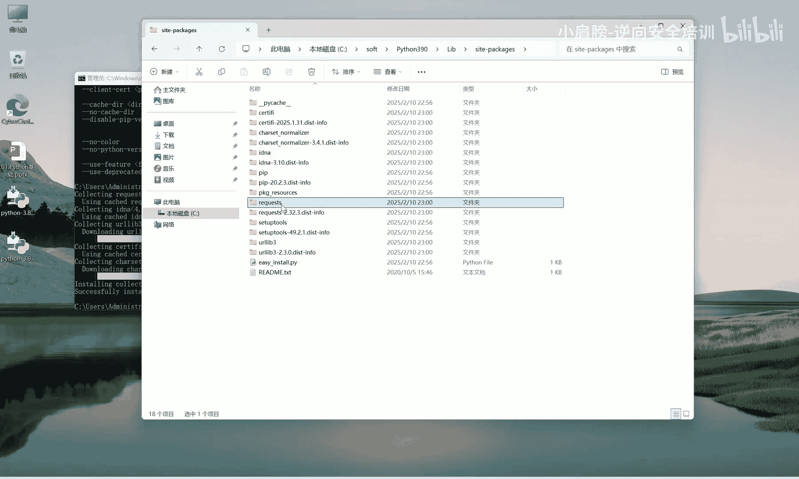

## ▶️ Python入门教程：08.5：运行一个Python文件


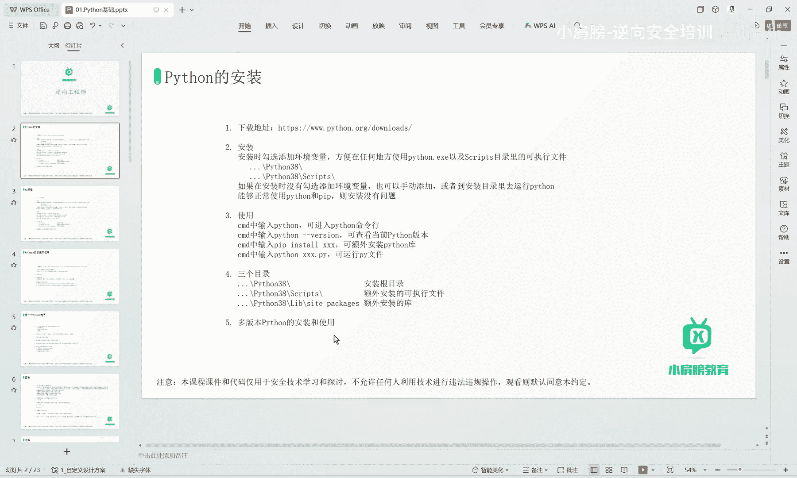

前面我们介绍了pip和第三方库，本节中我们来看看如何运行一个Python文件。如何用Python解释器运行一个`.py`文件？例如在这里创建一个文本文档，在里面写入一些代码，然后改名为`demo.py`。`.py`文件就是保存Python代码的文本文件。运行的时候需要切换到桌面，然后输入下面的命令。


```bash
python demo.py
```


这里的`python`就是Python解释器，空格后面的内容就是传给它的参数。代码里没有`printf`这种写法；`printf`是C语言里的。这时可以看到控制台输出了对应结果，代表代码正常运行。到这里，安装、验证和运行文件的流程已经走完，最后我们做一个简单总结。


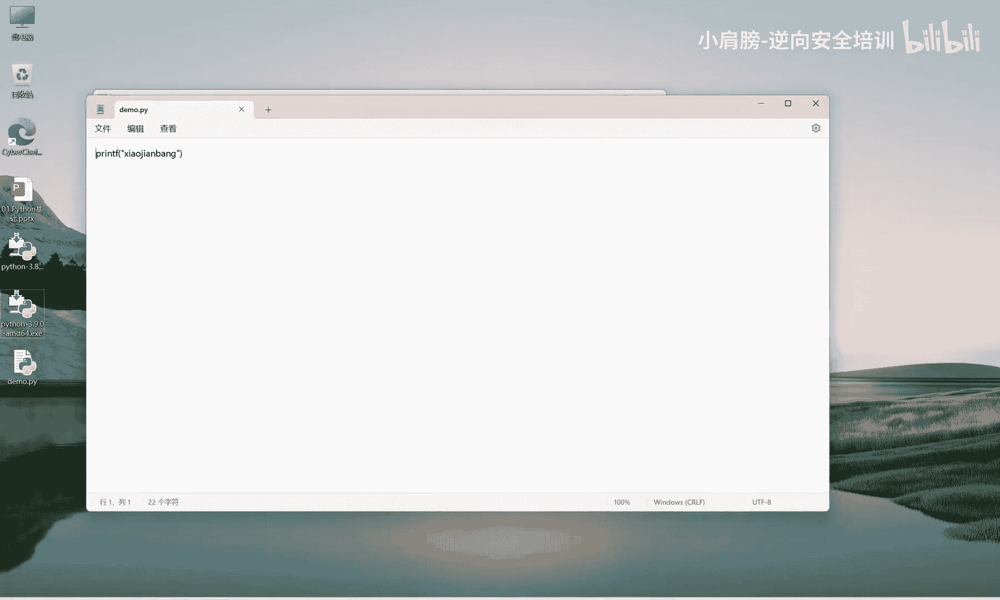

## 📌 Python入门教程：08.6：本节课总结


本节对整节课的内容做一个收束。本节课中我们一起学习了Python的安装流程：从下载页面和版本说明开始，理解了活跃版本、发布时间和终止时间的含义；然后选择Windows下的x64可执行安装包，安装时勾选Add Python 3.9 to PATH，将安装根目录和`Scripts`目录加入环境变量；接着在命令行用`python`和`python --version`验证安装；再通过`pip install requests`了解第三方库的安装和`site-packages`目录；最后用`python demo.py`运行了一个Python文件。这节课就说到这里。


