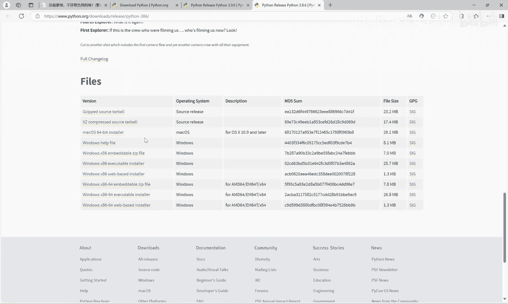
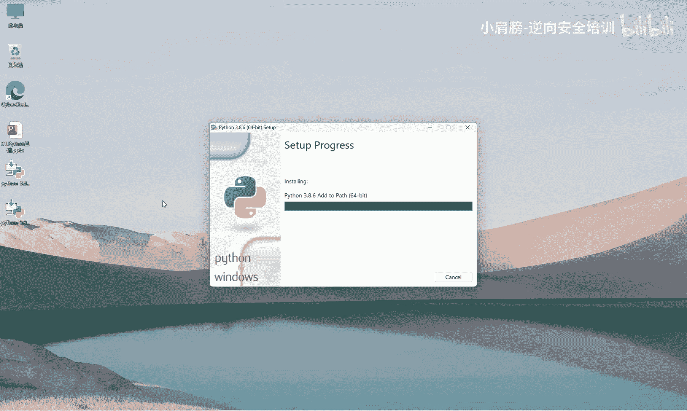
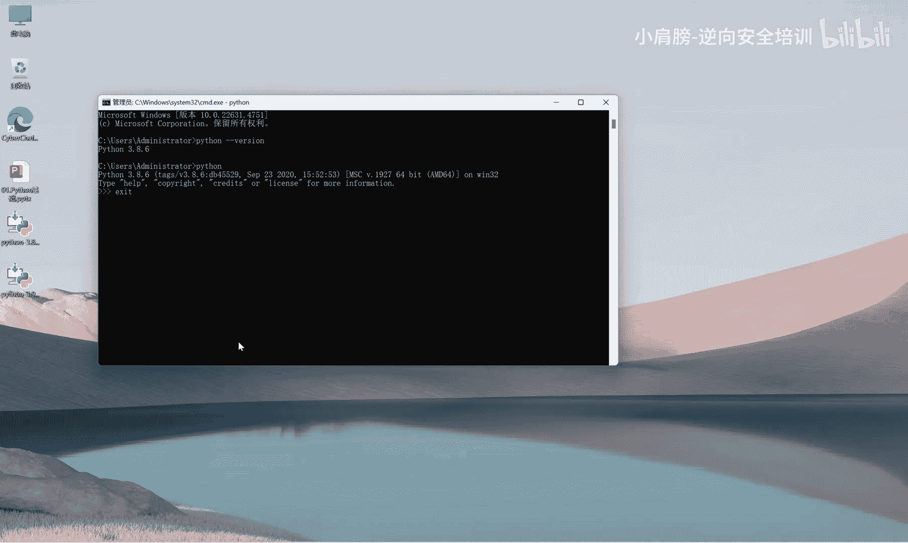
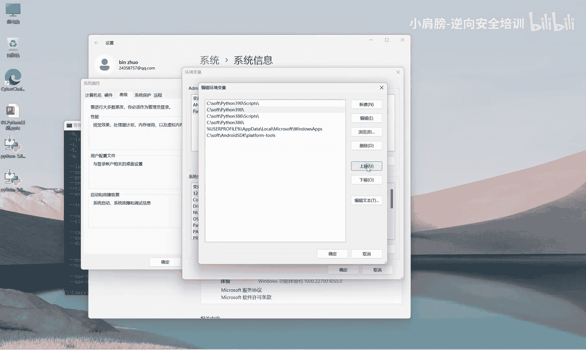
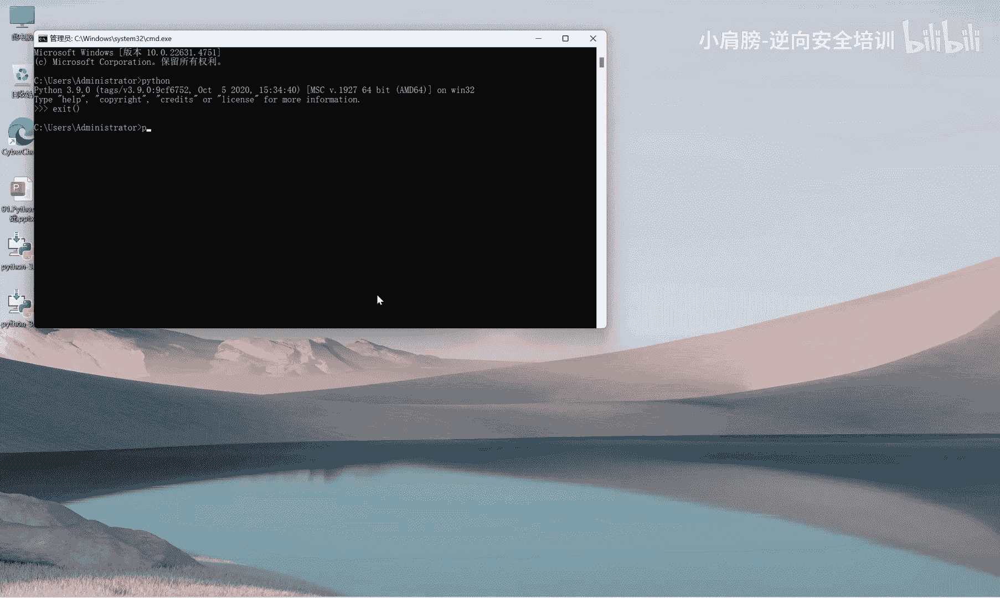
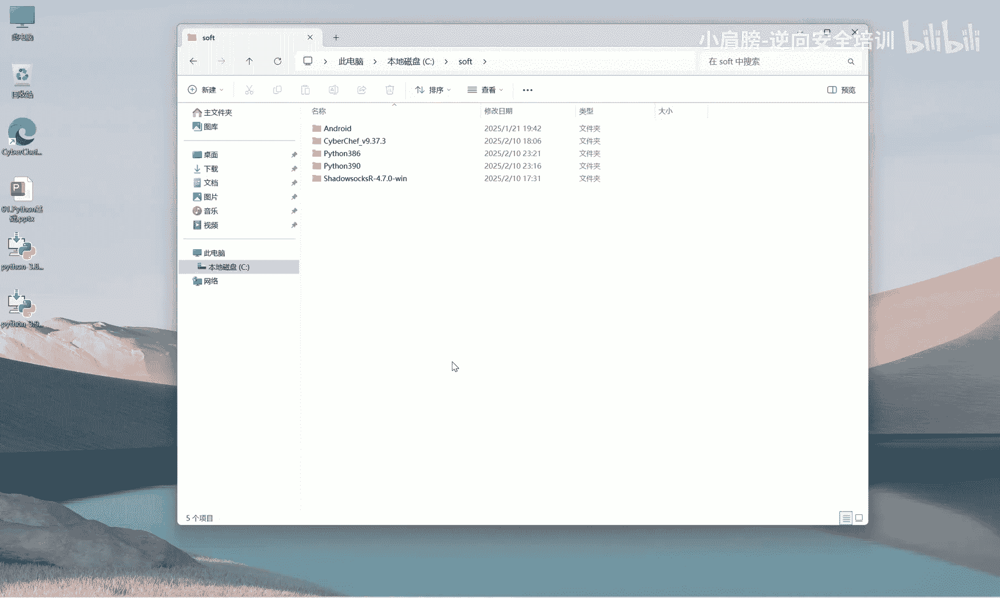
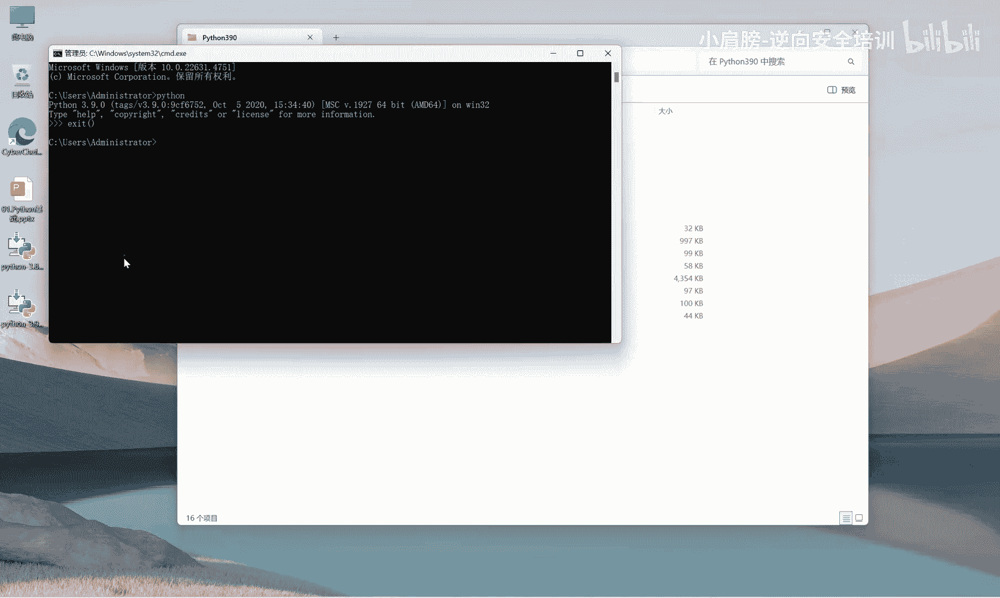
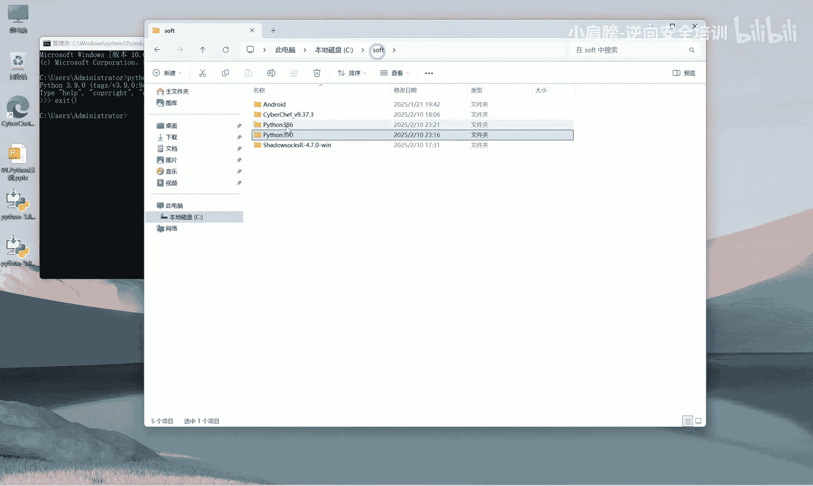

# Python基础教程：09：多版本Python的安装和使用 🐍

在本节课中我们将要学习多版本 Python 的安装和使用。上一节课我们已经安装了 Python 3.9.0，并且已经可以正常使用。本节课我们来安装 Python 3.8.6。学会在同一台电脑上保留多个 Python 版本，并知道命令行默认使用哪一个版本、PIP 把包装到哪一个版本里，是这一节的重点。

## Python基础教程：09.1：下载并安装Python 3.8.6 📥

上一节我们确认了 Python 3.9.0 可以正常使用，本节我们来看看怎样再安装一个 Python 3.8.6。安装多版本并不神秘，本质上就是把另一个版本的安装包下载下来，再按正常流程安装一遍。这样多版本共存的基本思路就清楚了，接下来我们看看安装完成后怎么验证。

同样是在下载页面里寻找特定版本。打开对应页面后拉到最下面，根据你的操作系统选择对应的安装包。macOS 选择 macOS 对应的安装包；Windows 选择 Windows 对应的安装包。Windows 这里要选的是 x64 的可执行安装包。

以下是选择安装包时可以参考的要点：

- macOS 选择 macOS 对应的安装包。
- Windows 选择 Windows 对应的安装包，也就是 x64 可执行安装包。
- macOS 上这个包可能因面向 10.9 而装不了，需要安装更新版本 Python。
- 没有 Mac 的学员可先跳过，Mac 学员需自行研究。

需要特别说明的是，macOS 可能安装不了这个包，因为页面上的这个包好像是面向 10.9 的，而现在的 Mac 系统已经不是这个版本了。所以 macOS 用户可能要安装更新版本的 Python。目前我没有 Mac，因此 macOS 学员可能需要自己研究一下这部分。Python 3.8.6 我已经下载好了，双击打开，然后按照之前安装 Python 3.9.0 的方式一步步往下操作即可。

这里可以把“多版本共存”先理解成下面这个简单关系：



```text
电脑上可以有多个 Python 安装目录
每个安装目录都可以有自己的 python 和 pip
```

## Python基础教程：09.2：验证Python 3.8.6和PIP是否可用 ✅



上一节我们完成了 Python 3.8.6 的安装，本节我们来看看安装完成后能不能正常使用。安装完成后，同样可以查看 Python 的版本，确认输出是 3.8.6，并且同样可以使用 python 命令。接下来同样可以使用 PIP，这一点和之前使用 Python 3.9.0 时是一样的。确认可用之后，一个自然的问题就出现了：原来的 Python 3.9.0 去哪了？下一节我们通过环境变量来找答案。

以下是验证 Python 3.8.6 和 PIP 是否可用的步骤：



- 执行 `python --version`，查看版本是否为 3.8.6。
- 确认 python 命令可以正常使用。
- 执行 `pip --version`，确认 PIP 可以正常使用。

验证时可以用下面的命令：

```bash
python --version
pip --version
```

如果 `python --version` 显示 3.8.6，就说明当前命令行里优先找到的是 Python 3.8.6。PIP 可用，说明这个版本对应的包管理工具也能正常工作。

## Python基础教程：09.3：环境变量与Python版本切换 🔀



在确认 Python 3.8.6 可用之后，一个自然的问题就出现了：原来的 Python 3.9.0 去哪了？本节我们来看看环境变量。打开环境变量就能看到，Python 3.8.6 的路径排在前面，而 Python 3.9.0 的路径排在后面。通过环境变量切换版本虽然可行，但手动操作会比较麻烦，下一节我们看看开发环境和 PIP 安装位置。

这时候如果要使用 Python 3.9.0，就把 Python 3.9.0 对应的路径移到上面。移动完成后，把 CMD 重新打开一下。重新打开后，你在命令行里使用的就是 Python 3.9.0。这个时候执行 PIP，同样也是安装在 Python 3.9.0 里面，也就是装在 Python 3.9.0 对应的目录里。

以下是切换默认 Python 版本时需要注意的操作顺序：



- 打开环境变量，找到不同 Python 版本对应的路径。
- 把想默认使用的 Python 版本路径移到前面。
- 重新打开 CMD，让新的环境变量生效。
- 再次查看版本，确认当前命令行使用的是目标版本。

可以用下面这个关系来理解：

```text
PATH 中越靠前的 Python 路径 = 命令行默认优先使用的 Python 版本
```

## Python基础教程：09.4：PIP安装位置与项目解释器 📦

上一节我们通过调整环境变量来切换默认 Python 版本，本节我们来看看 PIP 安装位置和项目解释器。这样切换版本可能你会觉得比较麻烦。后面使用 Python 的开发环境（比如 PyCharm 这类 IDE）就会比较方便，因为在开发环境里可以为每一个项目指定对应的 Python 解释器，也可以把不同的项目指定到不同的解释器上面去。这些注意点清楚后，我们最后做一个小结。

项目与解释器的关系可以简单写成：



```text
项目 A -> Python 3.8.6
项目 B -> Python 3.9.0
```

这个 Python 实际上可以是绿色版的，不同版本之间互不影响。使用 PIP 时一定要注意：如果当前命令行使用的是 Python 3.9.0，那么 PIP 安装的包就安装在这个 Python 3.9.0 里面；如果当前使用的是 Python 3.8.6，那么 PIP 安装的包就安装在 Python 3.8.6 里面。这个区别需要特别注意。

以下是 PIP 安装位置的检查清单：



- 当前默认 Python 是 3.9.0 时，PIP 安装的包进入 Python 3.9.0 的环境。
- 当前默认 Python 是 3.8.6 时，PIP 安装的包进入 Python 3.8.6 的环境。
- 切换版本后重新打开 CMD，再执行 PIP。
- 开发环境中为不同项目指定不同 Python 解释器。



可以用下面的命令提醒自己：

```bash
python -m pip install 包名
# 会安装到当前命令行正在使用的那个 Python 环境中
```


## Python基础教程：09.5：本节总结 🧭

本节课中我们一起学习了多版本 Python 的安装和使用。我们安装了 Python 3.8.6，验证了 python 和 PIP 可以正常使用，查看了环境变量中不同 Python 路径的先后顺序，也知道了调整路径并重新打开 CMD 后可以切换默认 Python 版本。最后我们还说明了 PIP 会把包装到当前命令行对应的 Python 环境中，以及开发环境里可以为不同项目指定不同解释器。掌握这些内容后，在同一台电脑上使用多个 Python 版本就不会混乱了。

