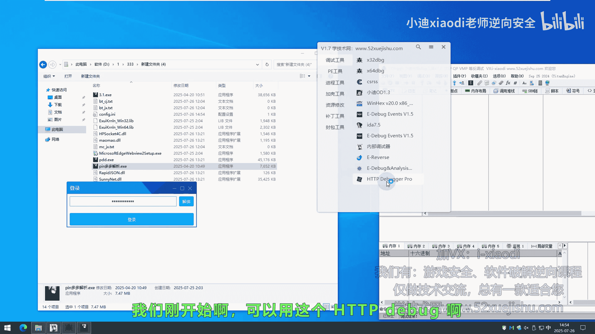
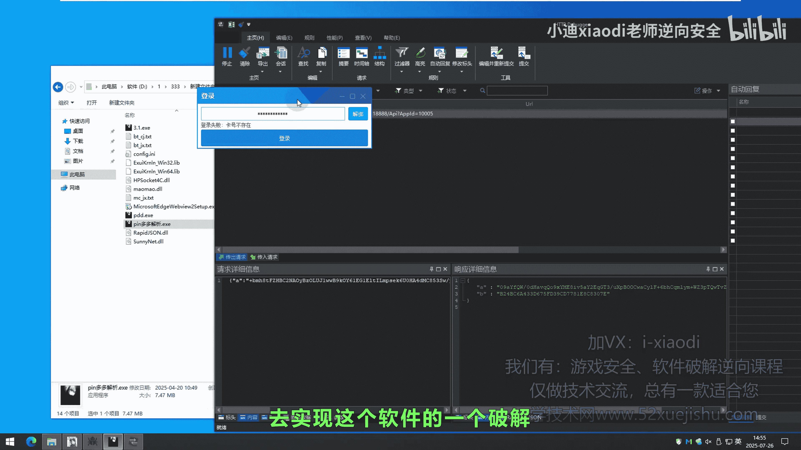
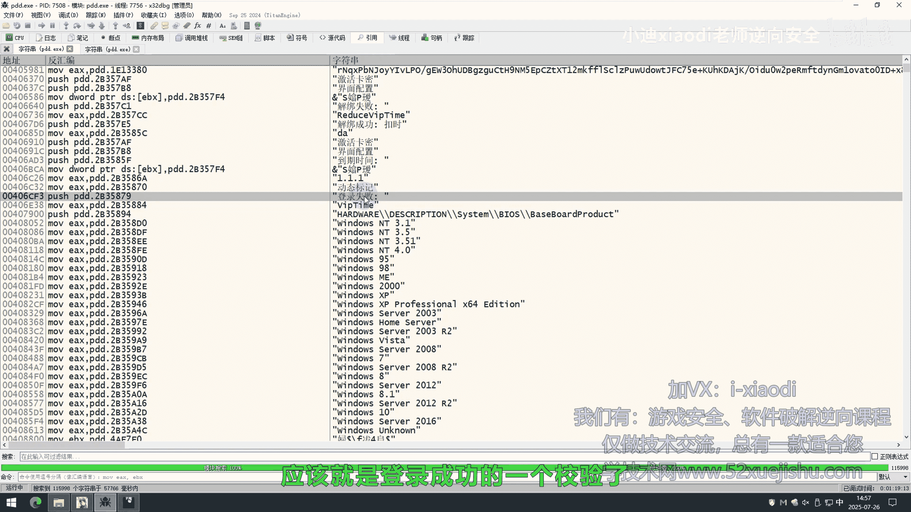

# 🛠️ 0基础学会破解软件卡密，网络验证卡密软件逆向破解技术：01：网络验证卡密软件逆向入门实战

概述

在本节课中我们将要学习软件逆向破解的基础思路，以网络验证卡密软件为例，演示从运行观察到封包分析，再到调试器定位关键字符串的完整流程。课程仅做技术交流，旨在提升对软件安全防护性的理解。

课程介绍

大家好，我是小李老师。今天我们继续讲软件逆向破解。这边让不少同学都纳闷了。所以讲软件逆向为什么那么多人听，这个软件逆向到底能干什么。实际上就是能分析一些小软件。

比如一些卡密软件，咱们分析一下，了解它的安全防护性，然后实现一个突破的测试，仅做技术交流，大家要记住，仅做技术交流。那现在大家看到的这个软件就是已经被我们突破完毕的。

原版软件运行演示

那么它原版是怎么样的。我们去看一下这个原版的程序长什么样。我们一起来看一下，我们双击运行一下。好，运行起来之后，大家会发现它需要我们去输入卡密，然后点击登录。

这个卡密现在我们都是随意输入的，随意输入的。随后界面会提示登录失败，卡号不存在。可以看出程序存在本地校验与服务器验证的逻辑。

封包抓取分析

我们刚开始可以用 HTTP Debugger，然后去抓一下这个封包，看一下是不是明文的数据包。点击登录之后，它会提示登录失败，卡号不存在。

同时这个工具里边会出现一条封包的访问，这是它的请求信息，这是它从服务器响应的一个信息。我们会发现它的封包数据都是加密的。所以你直接从封包上去入手的话，不是很好去入手。

以下是封包分析的要点：

网络请求被加密处理，无法直接阅读
响应信息同样经过编码
单纯抓包难以实现破解

调试器定位关键字符串

所以今天我们就给大家讲一下，如何用代码暴力破解法去实现这个软件的破解。那么这个时候我们要打开这个调试器，调试工具，然后点击文件点击附加，然后双击这个程序。

然后点击符号切换到程序的主模块。这个时候我们可以去搜索一下当前程序的一个字符串。通过搜索，我们可以看到一些关键的字符串。比如这里有登录失败，还有一个 VIP。



time 这个 VIP time 应该就是一个到期时间。那这个登录失败，应该就是登录成功的一个校验了。那么我们只需要对这边的代码做一些简单的处理就可以了。具体如何处理。



以下是调试器常用操作步骤：

文件 -> 附加，选中目标进程
切换至主模块
字符串搜索定位提示信息

核心概念可以用代码表示：

```text
校验逻辑 ≈ 包含 "登录失败" 字符串的分支
有效状态 ≈ VIP time 未过期 且 校验通过
```

代码层面破解思路

咱们社区中都有非常详细的教学。如果想要学习相关内容，可以抓紧联系咱们。那么处理完成之后，这个程序的界面，就是这样一个登录状态了。那这个就是我们今天要分享的一个内容。

就是给大家提供一种思路，当我们去分析一款网络验证卡密软件的时候，如果它的封包是加密的，那么我们可以从代码的方向去切入，进行一个暴力的破解。如果大家想要学习相关内容，可以抓紧联系咱们，我们下期再见。

拜拜。



总结

本节课中我们一起学习了软件逆向破解的基本思路，演示了原版卡密软件的运行现象，尝试了封包抓取并确认数据被加密，最后通过调试器搜索关键字符串定位校验逻辑，实现从代码层面切入的破解思路。仅做技术交流，安全合规使用。
