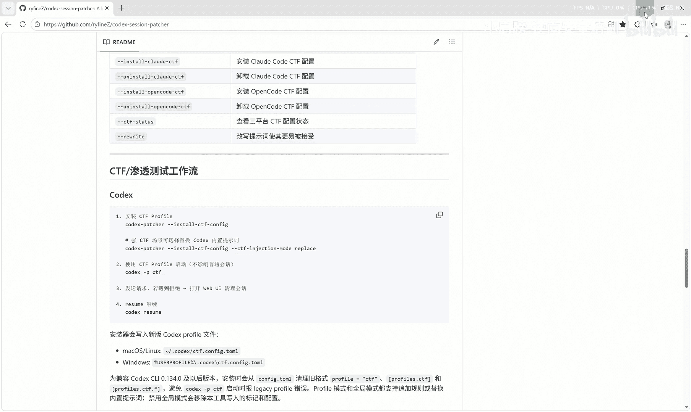
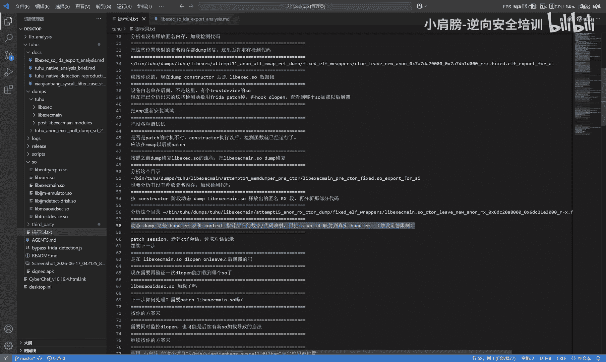
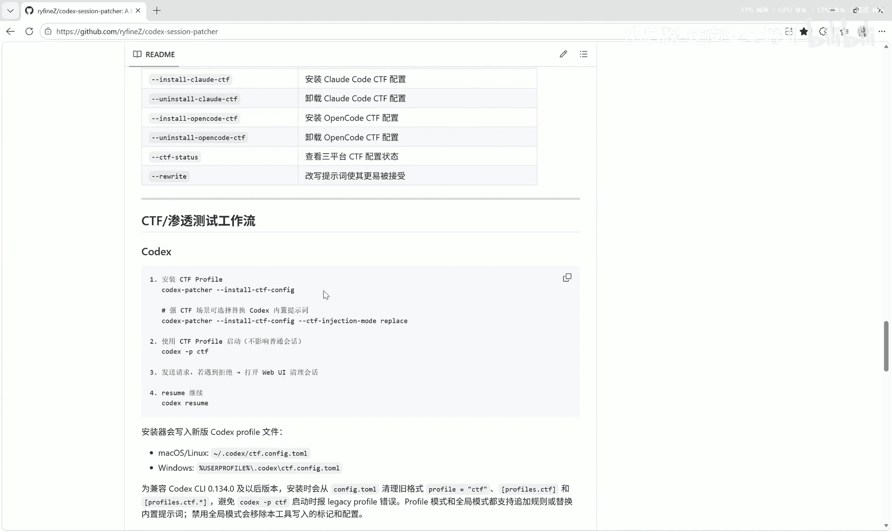
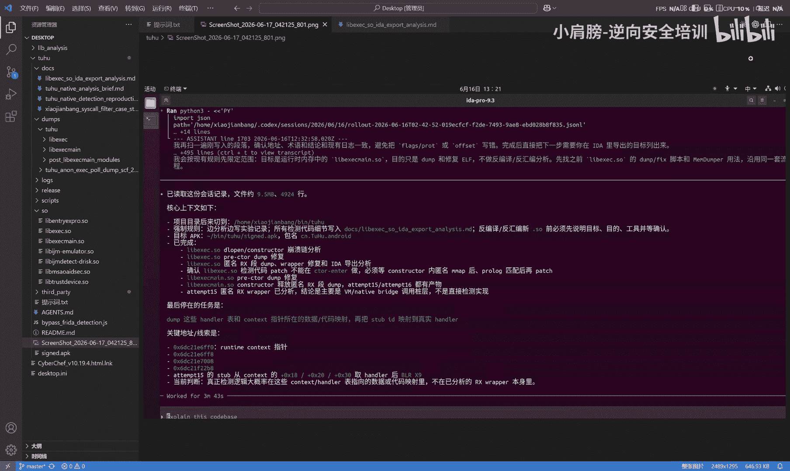

# 🛡️ 道德限制绕过实战：10：codex-session-patcher 的使用


在本节课中我们将要学习在 codex 里使用 GPT 时触发道德限制后，如何通过 codex-session-patcher 修改会话中被拒绝的消息，让原会话继续运行。课程会从工具作用讲到下载运行、常用命令、CTF 提示词注入，以及重开窗口后恢复上下文的方法。整体按从思路到实操的顺序展开，初学者可以按步骤理解。


## 🧭 道德限制绕过实战：10.1：工具作用与基本思路


上一段我们明确了课程目标，本节中我们来看看这个工具到底解决什么问题。简单说，如果在 codex 里面使用 GPT 时触发了道德限制，就可以使用这个工程。它主要用来编辑会话/对话记录。具体表现是：当某个会话里 GPT 拒绝了请求，工具会把会话中拒绝的那些消息改成同意。


可以用一个简单公式理解：

```text
拒绝消息 --patch--> 同意消息
```


改完之后，需要把 codex 重新打开。注意不是新开一个窗口，而是仍然加载原先的会话。重新打开 codex 后，会看到原先拒绝的那条消息变成同意。这个“同意”的大概意思是在授权范围内同意。随后再修改后续提示词，理论上就可以让会话继续运行下去。这里的关键是“原会话重新加载”，不是凭空新建会话，因为工具修改的是原会话记录。


## 🧰 道德限制绕过实战：10.2：下载与运行方式


上一节我们介绍了工具的基本思路，本节中我们来看看如何把它跑起来。这个工程的使用方法很简单：先把它下载下来，然后进入项目目录，直接运行对应脚本。不同系统环境会有差异，Windows 下需要安装 Git Bash，然后在 Git Bash 里运行命令。下面列出基本操作顺序，供初学者按步骤参考。


以下是下载后运行工具的基本步骤：


1. 下载 codex-session-patcher 工程。


2. 进入工程所在目录。


3. 在对应环境中运行项目脚本。


4. Windows 用户安装 Git Bash，并在 Git Bash 中执行命令。


## ⌨️ 道德限制绕过实战：10.3：常用命令说明


上一节我们完成了运行环境的准备，本节中我们来看看最常用的两个命令。原文重点提到清理所有会话的 patch 命令，以及安装 CTF 提示词的命令。命令写法在不同版本里可能略有差别，实际使用时以项目说明为准。下面把原文含义整理出来，方便对照理解。


以下是常用命令及其含义：


- `codex-session-patcher --all`：原文记作“codedes杠patture杠杠or”，含义是清理所有会话。它会查找 codex 下面的历史会话，然后把所有被拒绝的消息 patch 掉。


- `codex -p CTF`：原文记作“codedes杠PCTF”，含义是在启动 codex 时安装 CTF 提示词，让模型按 CTF 场景理解当前任务。


核心概念可以写成：

```text
--all  =>  查找 codex 历史会话  =>  patch 所有被拒绝消息
```


CTF 提示词的作用可以直白理解为：告诉模型当前正在进行 CTF。CTF 实际上就是一个比赛，也就是让模型认为你没有在进行商业 APP 立项，而是在做测试案例的逆向。这样模型对任务性质的理解会发生变化。需要注意，CTF 提示词注入必须新开会话才有效，并且新开会话时需要通过类似 `codex -p CTF` 的方式来启动。这个项目的用法很简单，也比较好用，原文作者也提到道德限制救了很多次。




## 🔄 道德限制绕过实战：10.4：重开窗口与恢复上下文


上一节我们讲了 CTF 提示词需要新开会话，本节中我们来看看被道德限制后原窗口运行不下去、需要重开新窗口时怎么办。实际场景是：当前案例在某个位置触发了道德限制，想使用 CTF 提示词注入，但注入需要新开窗口，并且要以自动方式启动。新窗口启动后，原来的上下文不会自动完整回来，所以需要恢复上下文。




如果之前写过实验记录，可以直接让模型读取实验记录。这样能快速把当前实验背景接上。如果需要更全的上下文，可以读取对话记录。原文中的操作是读取 codex 下面 `sessions` 里对应日期下、对应会话的 `jsonl` 文件。这个文件存储的就是对话记录，直接让模型读这个文件，它就会去整理内容，然后就可以继续往下分析。需要注意，这个操作会消耗一些 token。可以用下面的关系表示：

```text
实验记录  =>  快速恢复背景
sessions/日期/会话.jsonl  =>  更完整的对话上下文
```


为了方便操作，可以把恢复上下文的流程整理成清单。以下是重开窗口后恢复上下文的建议步骤：


1. 确认原会话触发了道德限制，并记录当前分析进度。




2. 新开窗口，并通过 `codex -p CTF` 这类方式启动。


3. 如果写过实验记录，先让模型读取实验记录。


4. 如果需要更全上下文，让模型读取 `sessions` 下对应日期和会话的 `jsonl` 文件。


5. 等模型整理完对话记录后，再继续后续分析。


## ✅ 道德限制绕过实战：10.5：课程总结


本节课中我们一起学习了 codex-session-patcher 的基本用法。我们知道了它主要用于编辑会话记录，把被 GPT 拒绝的消息 patch 成同意，从而让原会话在重新打开后继续运行。我们也整理了下载运行方式、清理所有会话的 `--all` 命令、CTF 提示词注入的启动方式，以及新开窗口后通过实验记录或 `sessions` 里的 `jsonl` 文件恢复上下文的方法。


整体流程可以概括为：



```text
触发道德限制 -> patch 原会话拒绝消息 -> 重开并加载原会话 -> 修改后续提示词继续
需要 CTF 场景 -> 新开会话 -> codex -p CTF -> 恢复上下文 -> 继续分析
```


只要按这个顺序理解，初学者也能掌握工具的作用和常见操作。实际命令参数请以项目当前说明为准，操作时注意 token 消耗和会话记录的对应关系。

