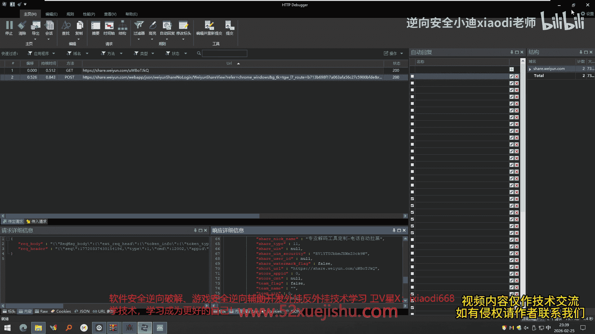
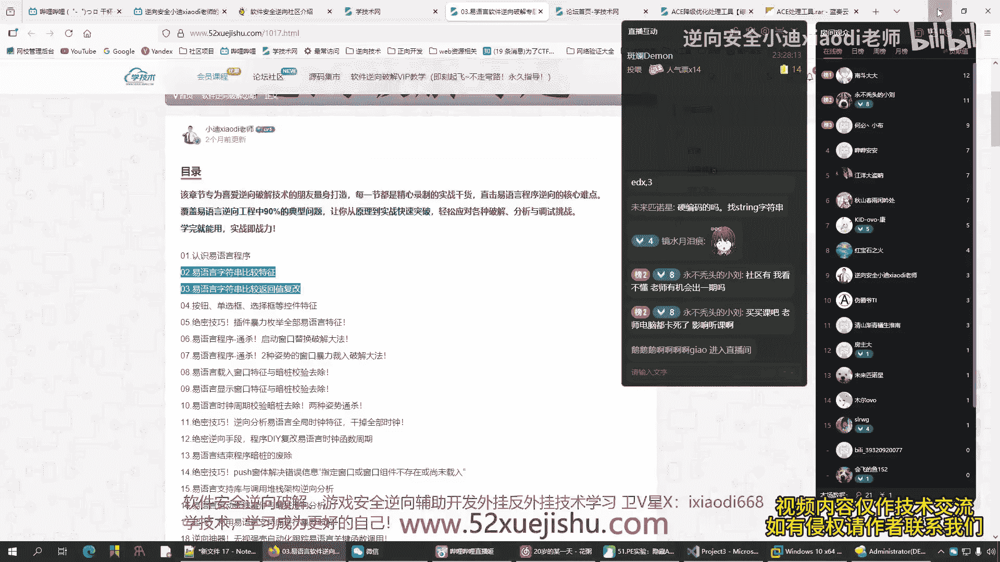
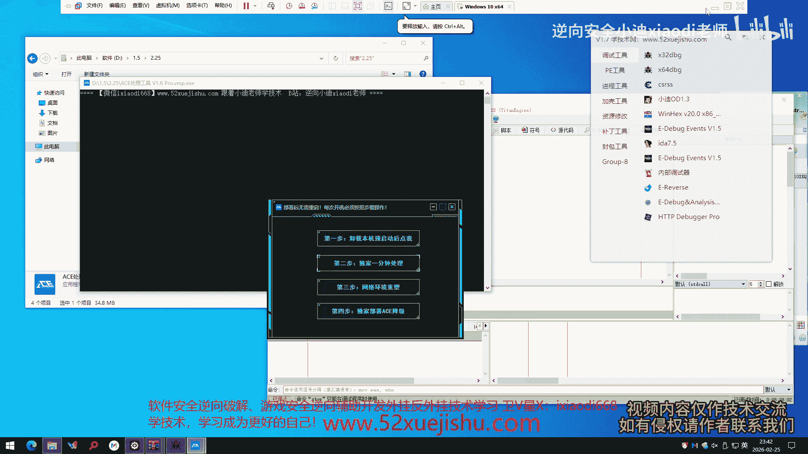
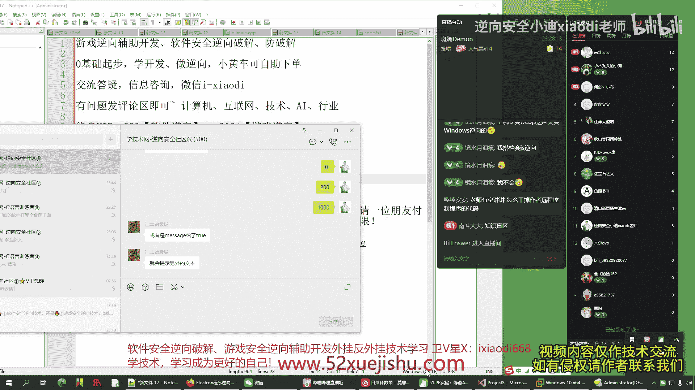
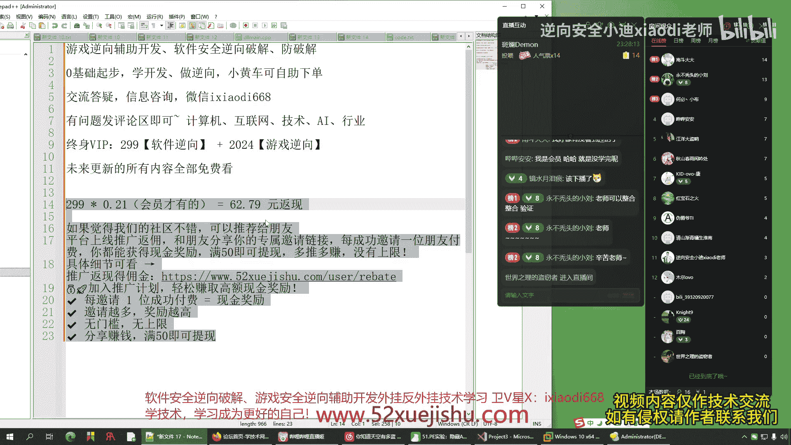

# 软件逆向破解：2.26：VMP强壳代码全VM与群验证突破 🔓


## 概述
在本节课中我们将要学习如何对加固为VMP强壳且带群验证的软件进行逆向分析与破解思路。课程以一次直播回放为案例，从程序启动弹窗开始，到MessageBoxA断点、VMP多层混淆回溯、壳特征识别、网络版本号获取，再到字符串比较与补丁定位，完整演示一种可复用的分析流程。

## 1. 程序启动现象与VMP特征 🖥️
上一节我们介绍了逆向的基本准备，本节先看目标程序的表现。运行程序后启动速度明显偏慢，随后弹出提示最新免费版本已更新，请加群获取最新版本，随后程序退出。

这是典型的VMP保护加网络验证组合。程序并未直接崩溃，而是通过弹窗引导用户加入群组，说明存在版本校验逻辑。VMP壳会将原始代码隐藏在多层虚拟指令中，直接静态分析难以读懂，需要动态调试配合特征识别。

## 2. MessageBoxA断点初探 🪝
面对弹窗类验证，最直接的思路是定位弹窗入口。可以使用x32dbg将程序拖入，运行后对`MessageBoxA`设置断点。

运行程序后断点命中，说明弹窗调用被捕获。此时通常会尝试F9返回或F8单步，期望找到弹窗前的分支跳转。可尝试Ctrl+F9与F8组合回溯，寻找关键跳过指令。

实际操作中很快发现当前层级没有明显的远跳，代码已接近头部，继续回溯也未出现清晰的判断分支。这是VMP混淆的常见表现，真实决策点被隐藏在更外层。

## 3. VMP多层混淆与回溯 🌀
VMP壳的特征是多层虚假跳转与调用链。以VMP为例，其调用特征往往在更外层才出现。通过反复Ctrl+F9与F8向上回溯，可以看到大量形似`FF 55`、`5F 5E`的指令序列，但并未直接指向关键位置。

在回溯过程中会遇到代码混淆面，指令被拆分成局部短跳，无法一眼看出逻辑。此时需要耐心逐层向上寻找，并结合经验判断是否为壳的特征层。

以下是回溯时常用的观察点：
这是判断是否需要继续上溯的参考。
`MessageBoxA`断点是否命中
当前函数是否包含大量无意义的自增自减
是否出现重复的调用包装模式

## 4. 识别壳特征与get_version释放点 🔍
经过多层回溯，来到壳的领空区域，代码呈现高度混淆。此时需要换一种思路，寻找程序释放原代码的时机。

VMP在执行壳代码后会释放原始可执行代码。原始代码中几乎必然会调用`get_version`函数。因此可以在`get_version`处下断点，等断点命中后再进行分析。


这一思路的原理可描述为：
**壳执行 → 解码释放 → 原始代码运行 → 调用 get_version**
当断点命中`get_version`时，表示原代码已被释放，后续分析才有意义。

## 5. 特征码定位与误打误撞 🎯
在代码释放后，可通过模块特征码搜索定位关键位置。直播中提到的特征模式为：
```
FF 55
FC 5F 5E
```
在释放后的模块中搜索该模式，可定位到疑似入口。设置断点运行后跟进，部分情况下会误打误撞进入未混淆的代码区。


需要注意的是，这种方法不稳定，可能出现窗口创建后仍是混淆代码的情况。另一种运气成分较大的操作是窗口创建完毕后使用Right命令强行进入，此时可能跳过部分混淆。


对比破解前后版本可以发现，误打误撞进入的代码可能不完整，例如皮肤缺失、功能不全，说明定位点并非最优解。



## 6. 网络验证与版本号获取 🌐
弹窗提示加群获取最新版本，说明程序会联网查询版本号。可以通过HTTP抓包工具分析网络请求。



抓包后可以看到请求指向微云网盘等存储，返回内容包含主程序下载链接、配置修改信息、激活系统链接等。程序通过读取文件名或返回字段中的版本号进行本地比对，从而决定是否弹出提示。

由此可推断出验证流程：
`程序启动 → 请求服务器 → 获取版本号 → 本地比较 → 触发弹窗或放行`



如果能找到本地比较版本号的字符串比较逻辑，就可以在该处进行修改。

## 7. 字符串比较与补丁思路 🧩
前文我们介绍了网络获取版本号，本节来看看本地如何利用。字符串比较是版本校验的核心，通常会调用`strcmp`或类似函数进行比对。

在VMP壳下直接找到比较点较困难，但一旦在释放后代码中找到比较入口，即可通过修改跳转指令实现绕过，也可通过特征定位+补丁的方式永久跳过弹窗。




社区中已有现成的Hook框架可以参考，例如在特征位置下断后直接修改EIP跳转，或对MessageBoxA调用进行拦截。实际操作时建议先手动实现理解逻辑，再使用自动化工具。


## 总结
本节课中我们一起学习了VMP强壳程序的整体分析思路。我们首先确认了程序的弹窗验证现象，随后尝试MessageBoxA断点并发现VMP多层混淆，需要持续上溯。随后通过get_version释放点判断代码释放时机，结合特征码搜索定位关键位置，并通过网络抓包确认版本号获取机制，最终指向字符串比较与补丁的破解方向。



逆向分析需要多动手练习，熟悉VMP的特征层与释放时机后，类似的网络验证案例会变得像呼吸一样简单。建议后续持续练习特征定位与动态调试，逐步积累经验。
