# 软件逆向实战：2.27：某游戏外挂脚本网络验证卡密VMP逆向破解 🔓

概述

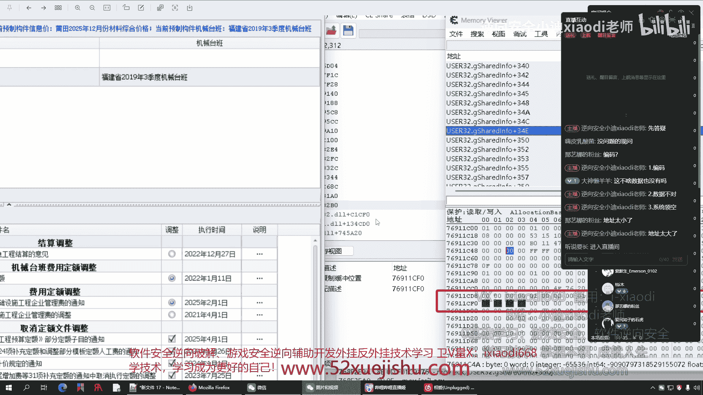

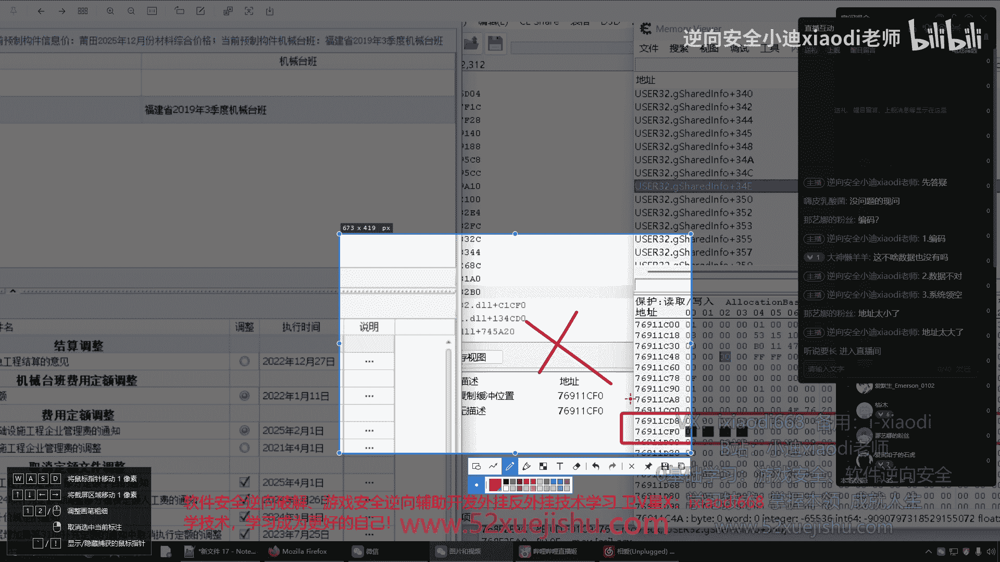

在本节课中我们将要学习某游戏外挂脚本的网络验证卡密软件在VMP壳保护下的逆向分析流程。课程以2026年2月27日直播回放为基础，演示从壳检测、反调试绕过、窗口处理到核心逻辑定位与跳转修改的完整实战。内容覆盖软件逆向、网络验证、卡密校验、反调试识别等基础技术，适合初学者建立系统性的逆向思路。

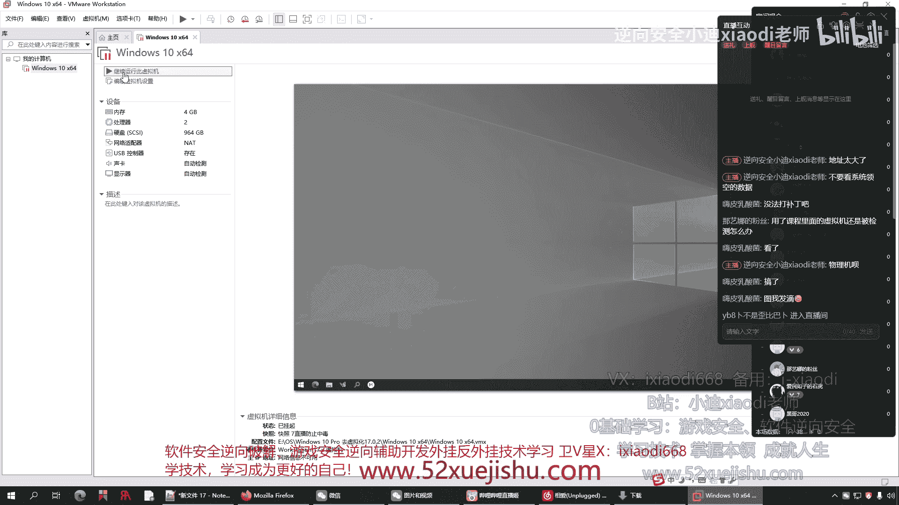

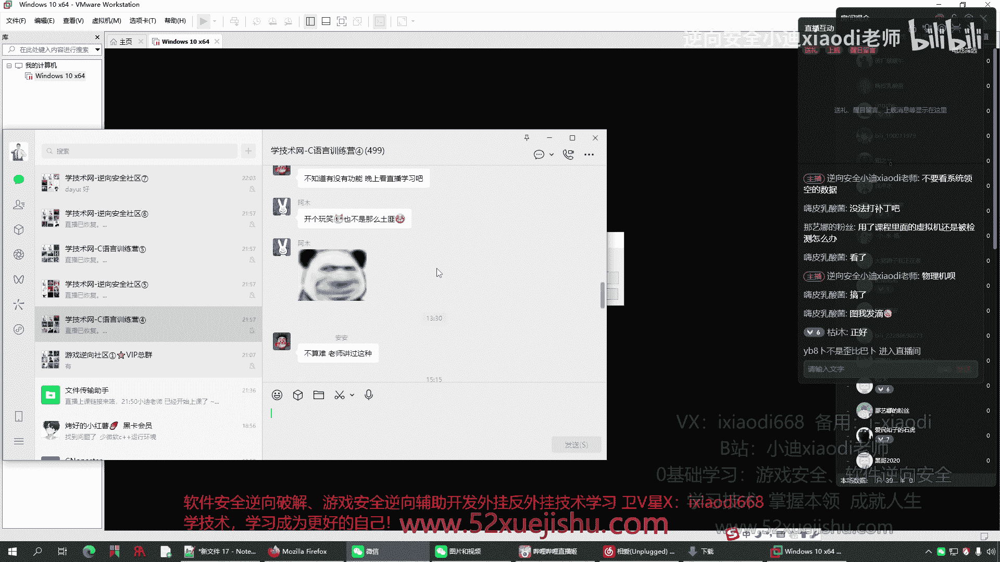

直播互动与答疑

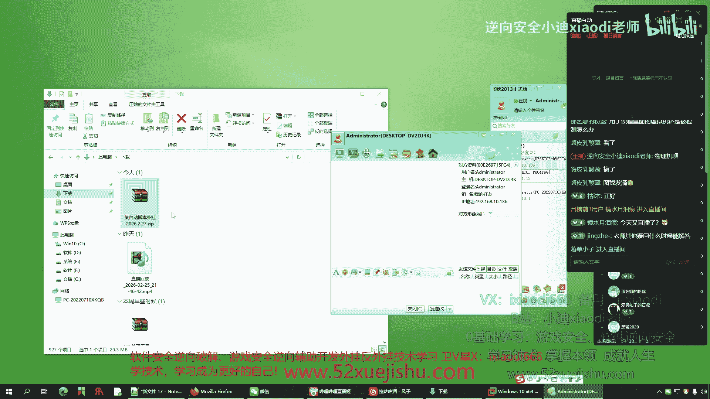

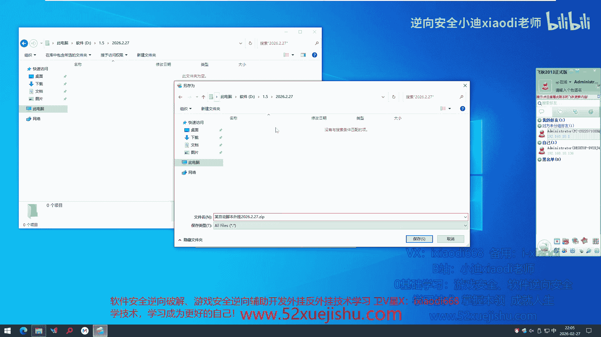

直播开始时进行简单互动确认观众是否能看到屏幕与声音。随后进入答疑环节。  
以下是观众提出的典型问题：

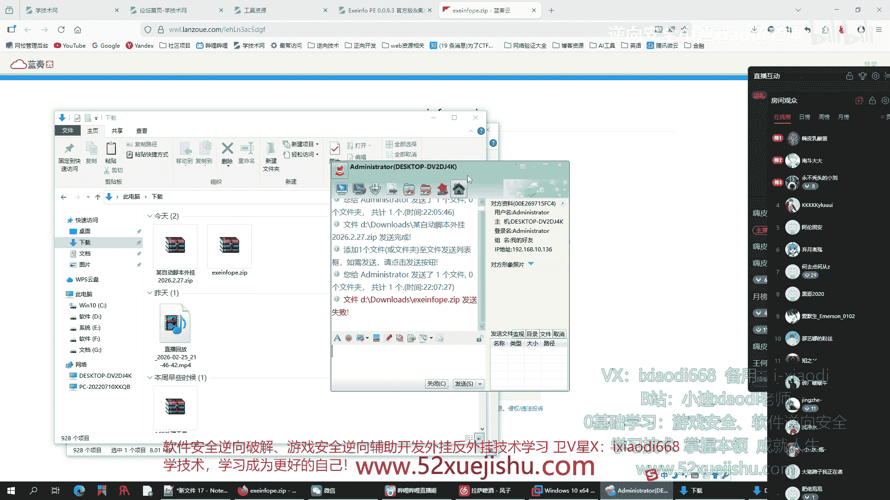

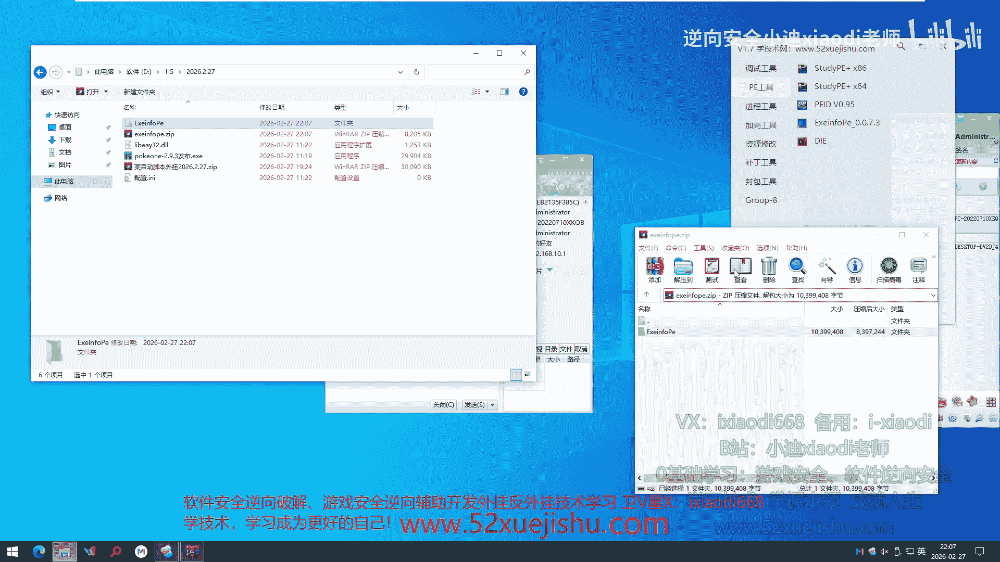

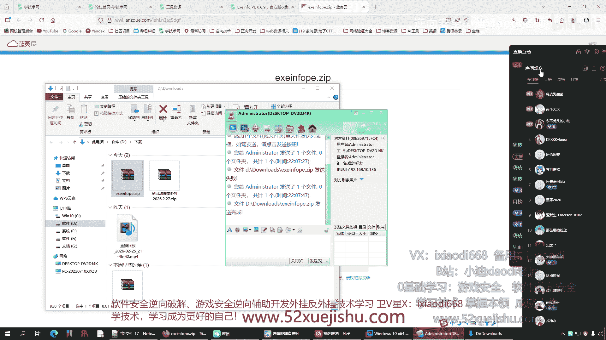

第一，字符串在内存中显示为乱码。原因有两个。编码选择错误会导致显示异常。数据地址错误会导致读取到无效内容。系统领空地址通常以7开头且数值很大，该区域无有效数据，查看系统领空会得到错误结果。

第二，快捷键使用。可以使用 `Ctrl+G` 跳转到指定地址。截图时需要包含完整左侧地址栏，否则无法判断实际查看位置。例如 `CF0` 附近的地址属于系统领空，不应查看。

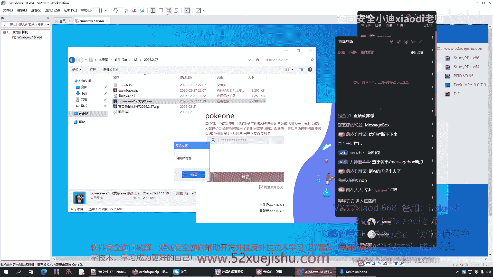

环境准备与程序导入

课程使用虚拟机运行目标程序。首先将目标程序拖入分析目录。程序外观为某自动脚本网络验证卡密软件。分析前需要关闭杀毒软件以免干扰。  
常规步骤是先查壳。使用的壳检测工具为专用脱壳工具。检测结果显示目标加壳为 VMProtect 3.6 版本。该版本具备强保护特性，常规打补丁难度较高。

壳检测与行为观察

在进行逆向前先观察程序行为。双击运行程序，点击登录按钮会弹出卡号不存在的提示。此时常见的分析思路有以下几种：

网络抓包分析，卡密软件必然存在网络数据传输。
设置 `MessageBoxA` 断点定位提示来源。
搜索字符串定位相关逻辑。
由于程序存在反调试，`MessageBoxA` 断点无法直接命中。

反调试识别与绕过

正常程序中 `MessageBoxA` 的调用栈为 `MessageBoxA` → `MessageBoxTimeoutW` 等。目标程序对 `MessageBoxA` 进行了明目张胆的修改，属于反调试或防破解手段。  
绕过方案有两个：

通过 PEB 结构检测调试器存在。
直接断内部实现函数。
内部函数断点方式更简单。`MessageBoxA` 最终由 `MessageBoxTimeoutW` 实现，直接对 `MessageBoxTimeoutW` 下断即可。  
在未加壳的测试程序中验证该方法有效。先附加调试器，再对 `MessageBoxTimeoutW` 下断，能够成功拦截弹窗。

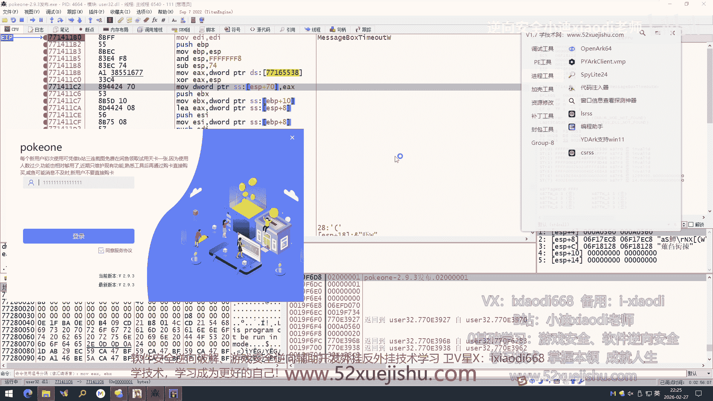

VMP 程序中的调试器使用

对 VMP 保护程序使用普通调试器可能出现闪退。解决方案是使用具有反反调试能力的调试器加载程序。调试器启动后附加到进程，取消原有 `MessageBoxA` 断点，仅保留内部函数断点。点击登录后成功断在 `MessageBoxTimeoutW` 处，弹出卡号不存在提示。至此第一步绕过完成。

窗口置顶干扰处理

调试时发现程序窗口置顶，严重干扰操作。可以使用窗口管理工具取消置顶。具体操作为查看进程窗口可见性，找到目标窗口后执行取消窗口置顶。处理后窗口不再强占焦点，调试流程更顺畅。任意置顶窗口均可使用相同方法处理。

断点定位与逻辑跟踪

在 `MessageBoxTimeoutW` 处断住后，使用 `Ctrl+F9` 和 `F8` 单步执行。程序经过多层调用后到达关键跳转位置。该跳转跳过了卡号不存在的逻辑。可以在该位置将条件跳转改为无条件跳转，使用 `G` 修改指令。  
随后程序继续执行，出现 `VIP time` 相关字符串。可定位到会员到期时间相关的代码片段。代码中多次获取输入的卡号与密码信息，并拼接机器码、CPU 信息、网卡信息等用于校验。

核心逻辑梳理

执行流程可概括如下：

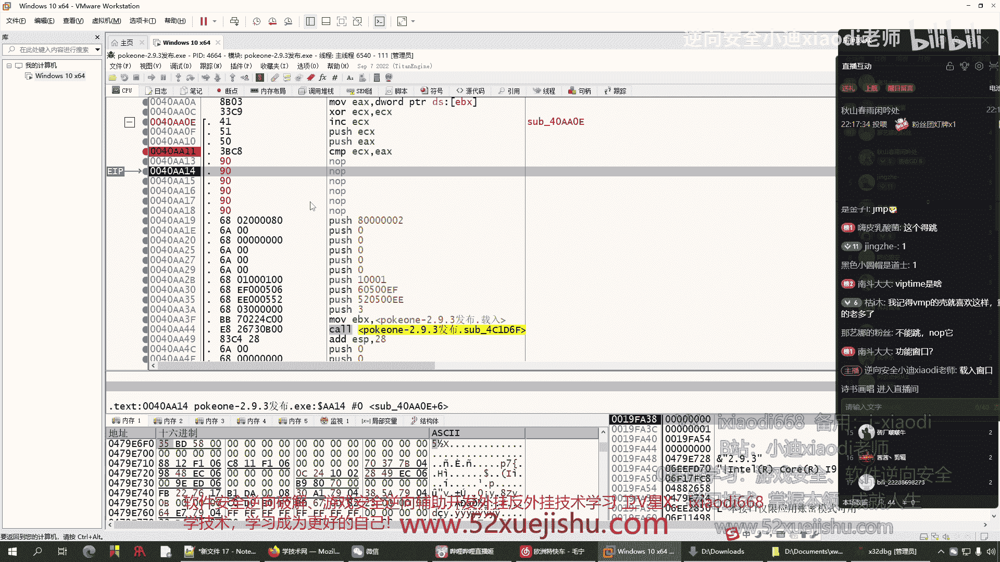

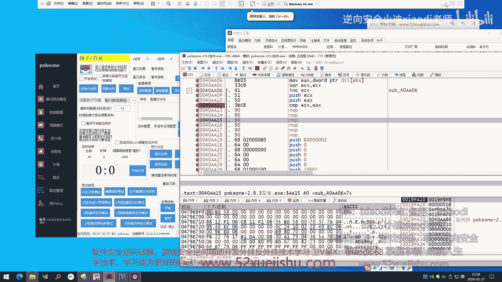

获取用户输入的卡号与密码。
拼接机器码、CPU 信息、网卡信息、卡密。
发送至服务器进行网络验证。
根据返回结果显示登录成功或失败。
在分析过程中可观察到程序使用了 OCR 识别库 `Tesseract OCR` 用于验证码识别。配置文件中包含 OCR 文本识别配置、卡号卡密配置、指定坐标暂停等参数。程序窗口类名为 `WT_Window`，属于典型的某语言编写特征。

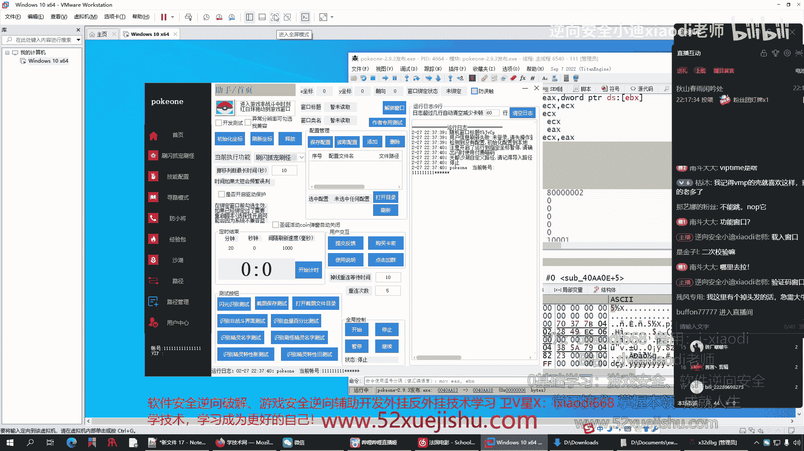

总结

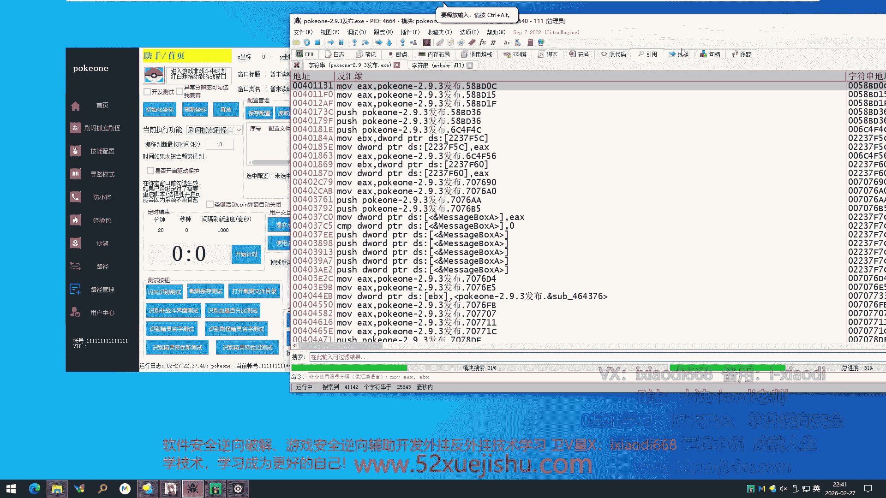

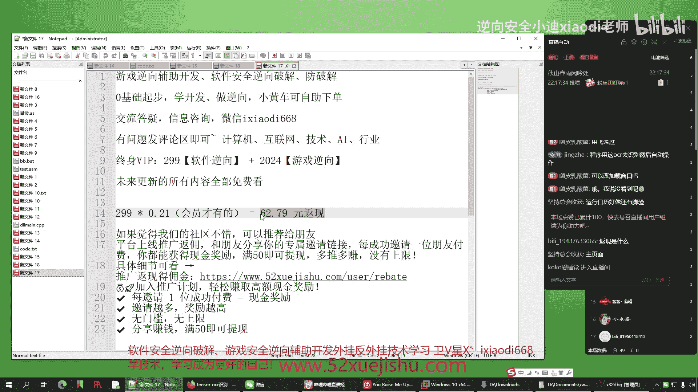

本节课中我们一起学习了 VMP 3.6 加壳的网络验证卡密软件的逆向流程。我们了解了壳检测方法，识别了程序对 `MessageBoxA` 的反调试修改并通过断内部函数绕过。解决了窗口置顶干扰问题，并在调试器中定位到卡号不存在的跳转点并修改跳转逻辑。最终梳理出程序的机器码采集、网络验证和会员时间校验的整体逻辑。后续可在此基础上深入分析加密通信和卡密生成机制。
