## 易语言软件防破解实战：01：课程概述与攻防边界 🛡️

本节课我们将要学习易语言软件作者如何利用 TMD 保护壳保护软件不被破解。课程由小刘老师讲解，起因是收到粉丝留言：粉丝写了一个小软件，没过几天就被破解，而他是一名易语言软件作者。因此本节围绕“易语言软件作者如何防破解”展开，先说明使用的工具是 TMD 保护壳，再说明保护目标是更大可能不被破解，而不是百分之百不被破解。

课程先对比未保护程序和保护后的程序，再从攻击角度分析现象。这里先明确一个边界：攻防没有绝对，不存在绝对安全的系统。TMD 也不是万能盾牌。下面的公式可以直白表示课程目标：

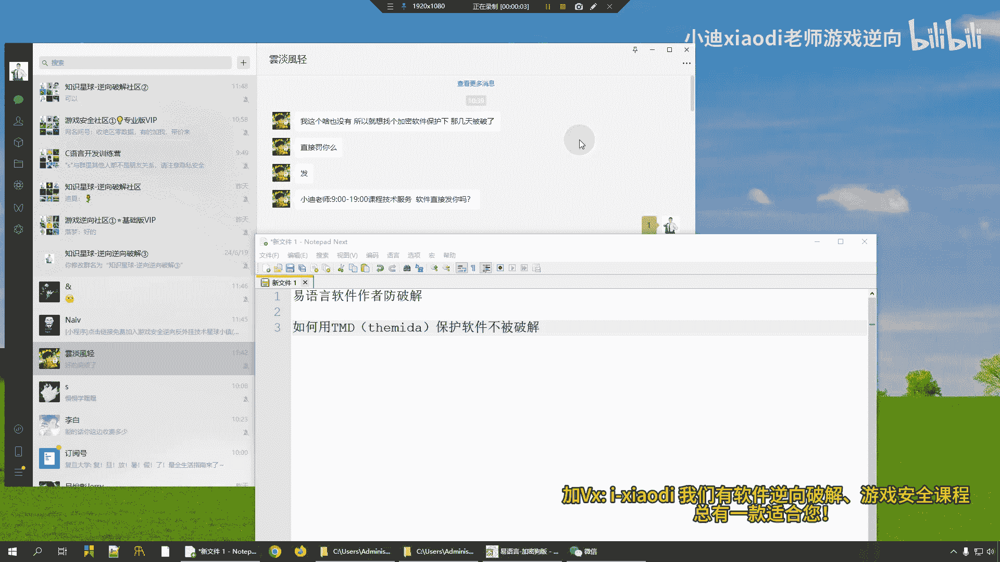

```text
保护目标 = 提高破解成本 ≠ 绝对无法破解
```

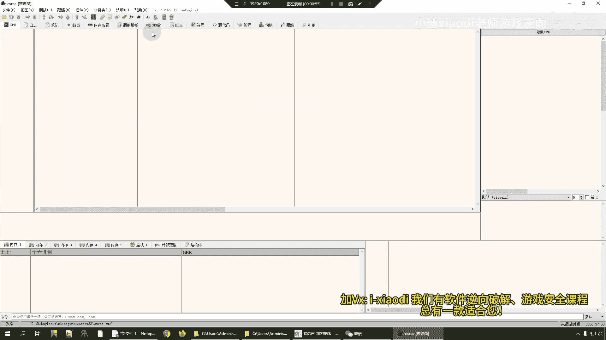

> 攻防无绝对，没有绝对安全的系统。

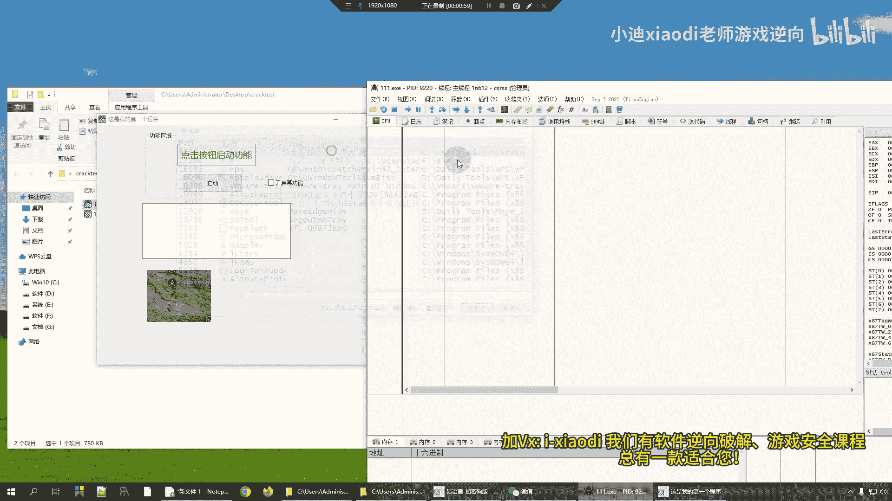

也就是说，保护壳的作用是让普通攻击者难以直接看懂和修改程序，而不是承诺永远破不开。上一段说明了攻防边界，本节接下来从攻击者视角看未保护程序会暴露什么。

## 易语言软件防破解实战：02：未保护程序的攻击演示 🔍

这一节我们来看看没有保护的程序。原文演示的是一个易语言程序，先打开调试工具。一般流程是先运行程序，再点击“文件”，点击“附加”，把调试器附加到正在运行的程序上。

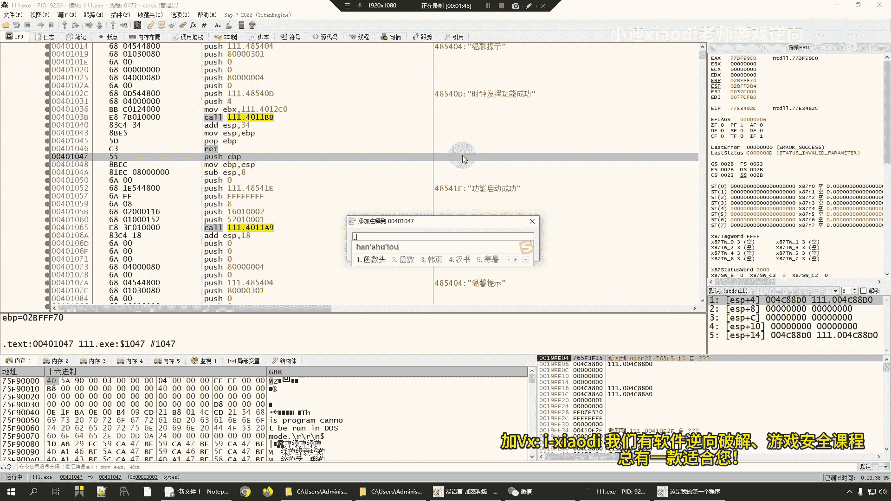

附加后可以看到，程序里所有功能启动相关字符串都能看到，例如“功能启动成功”“功能发挥成功”“登录成功”等信息。下面列出未保护程序暴露出来的关键信息：

- 功能相关字符串直接可见，攻击者能知道程序在干什么。
- 搜索当前模块的字符串，可以看到“功能启动成功”等提示。
- 双击字符串可以跳到对应代码段，定位到函数位置。
- 典型函数头可以看到 `push ebp; mov ebp, esp` 这类汇编指令。
- 在函数头下断点后，按 F8 单步执行，可以观察程序流程和提示信息。

可以看到，未保护程序给攻击者提供了非常大的便利。攻击者搜到字符串后双击进入代码段，在函数头下断点，按 F8 单步走，界面出现“温馨提示”，随后出现“功能启动成功”。这说明攻击者不仅能看懂功能，还能尝试修改提示内容。下面用流程表示这种攻击路径：

```text
运行程序 -> 文件附加 -> 搜索字符串 -> 双击定位代码 -> 函数头下断 -> F8 单步 -> 修改指令或数据
```

原文还演示了修改字符串：攻击者重新运行程序，使用二进制编辑，把“功能启动成功”改成“小迪启动成功”之类的内容。再次启动并断下执行，可以看到提示被改成“小迪启动成功”。这非常可怕，因为所有东西一览无余，攻击者想怎么改就怎么改。上一节看到未保护程序的问题，本节接下来看保护后的程序能否挡住同样的操作。

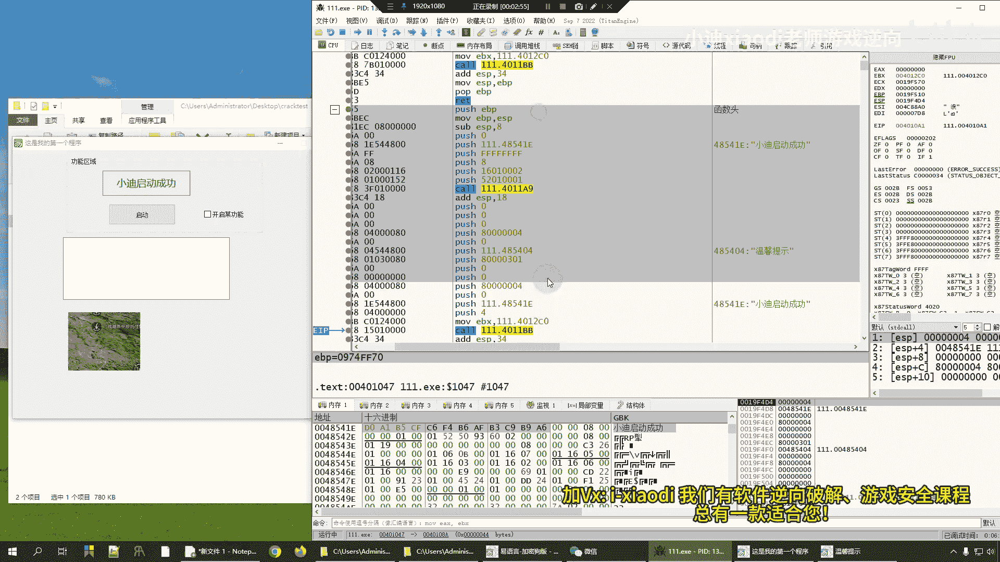

## 易语言软件防破解实战：03：保护后程序的攻击演示 🛡️

这一节我们来看保护后的程序。原文只保护了启动按钮这个功能按钮对应的功能，然后再次用调试工具点击“文件”、点击“附加”，打开程序符号并切换到主模块。原文演示中提到，此时有一处没有保护；同时可以看到之前见过的函数头位置，函数头下面的代码已经看不懂了。

下面列出保护后攻击者遇到的情况：

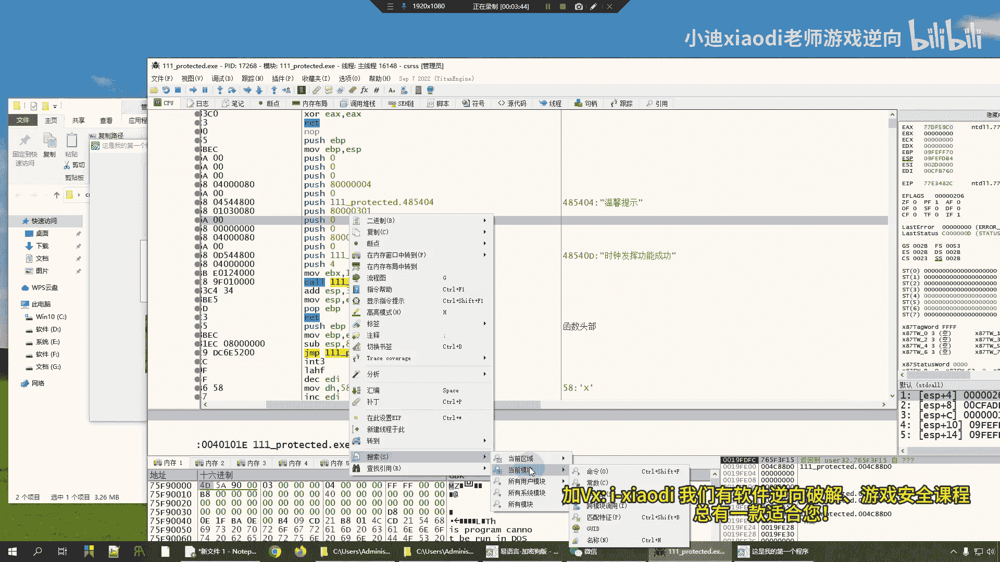

- 函数头下面的代码难以阅读，无法直接理解功能逻辑。
- 尝试修改时不能实现原来的修改效果。
- 搜索当前模块的字符串也做不到，字符串信息不再直接暴露。
- 攻击者无法从本地轻松分析程序，心理上会受到很大打击。

原文用直白的话说，攻击者可能会想“这个软件怎么这样”，心里失衡。也就是说，保护壳从这一层面给了攻击者非常大的打击。用公式表示保护前后的差异：

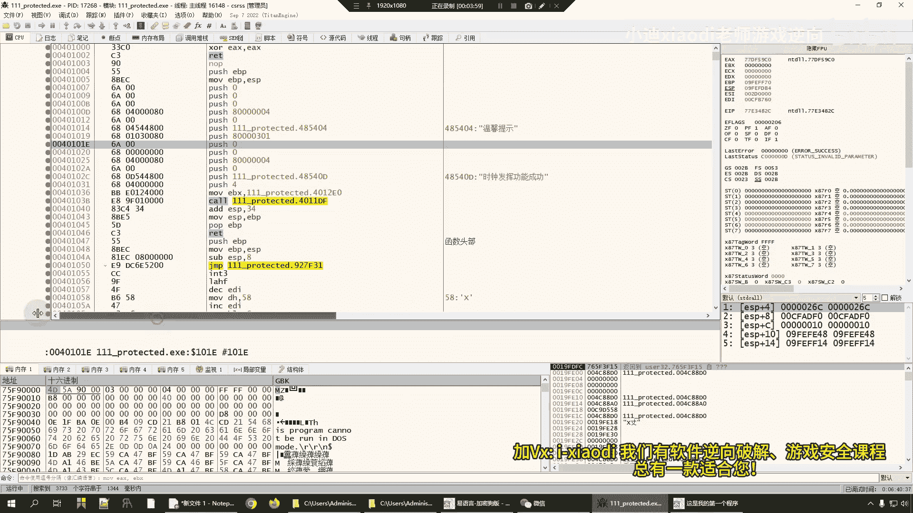

```text
未保护：字符串可见 + 代码可读 + 可定位修改
保护后：字符串不可见 + 代码难读 + 本地分析困难
```

上一节我们看到了保护后的效果，本节接下来从易语言作者最熟悉的源代码层面，说明这种保护是怎么加进去的。

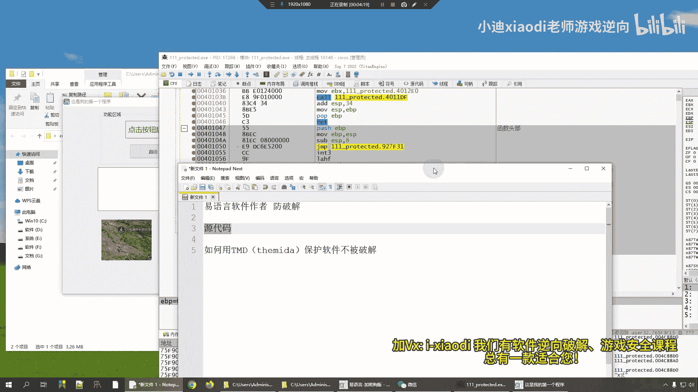

## 易语言软件防破解实战：04：源码层添加保护标记 🧩

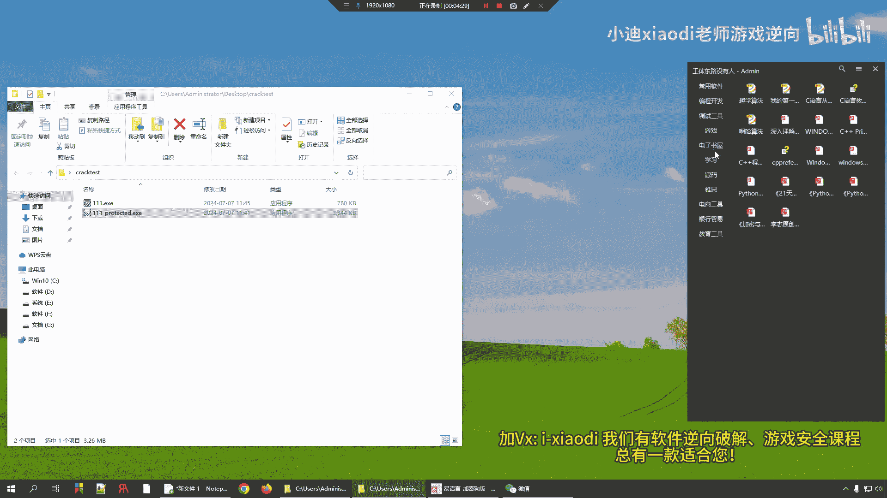

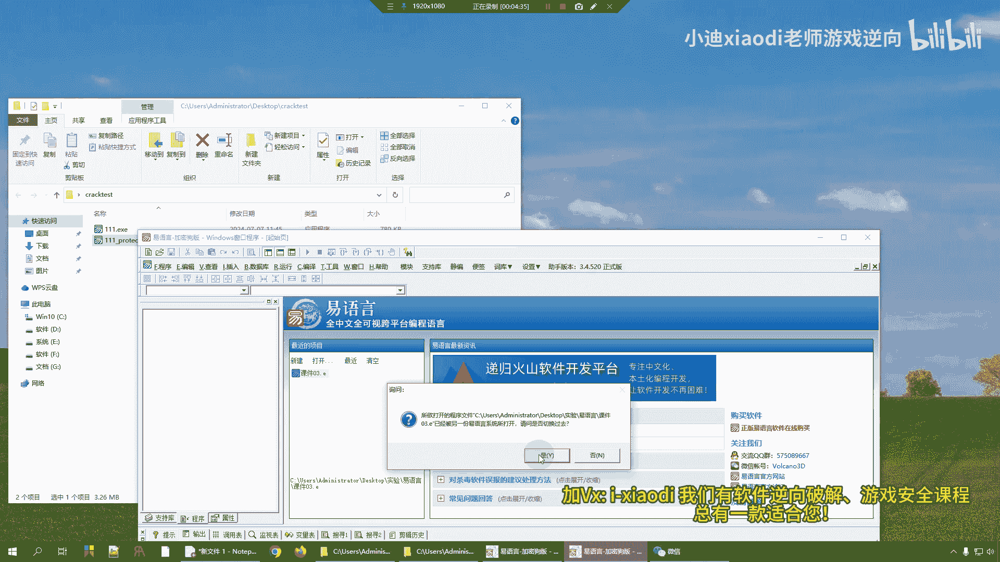

这一节我们来看看易语言作者如何从源代码层面解决防破解问题。因为课程针对易语言软件作者，作者手里有源代码，所以可以从源码入手。先关掉程序，打开易语言源代码，准备两个东西：一个是易语言开发环境，另一个是待保护的按钮功能。原文作者已经打开开发环境，并在此点击启动。

原文以保护“按钮一”为例。第一步是在函数头部和函数尾部添加保护标记代码。函数头部就是函数第一行附近，函数尾部就是函数结束位置。下面用代码示意这种结构：

```text
' 函数头部
置入代码(保护标记)

' 原有功能代码

' 函数尾部
置入代码(保护标记)
```

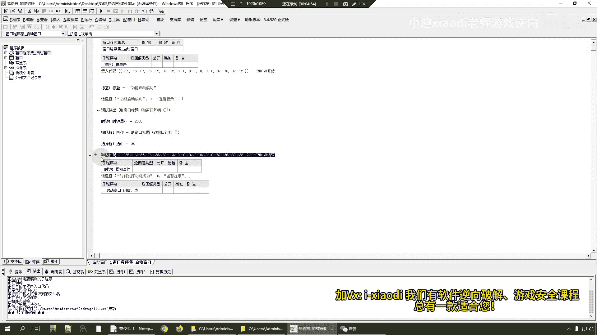

添加这两句代码后，先进行静态编译，把程序编译到指定目录，并给程序起名，例如“222”。这样得到的“222程序”比原来的“1一程序”多了“置入代码”相关内容。到这里，源码层的第一步就完成了。上一节完成了源码标记，本节接下来打开 TMD 保护壳，把标记过的函数保护起来。

## 易语言软件防破解实战：05：TMD 保护壳操作流程 ⚙️

这一节我们来看看 TMD 保护壳怎么操作。先运行准备好的保护壳，把刚才编译出来的程序直接拖到保护壳窗口里。拖过来后，点击保护选项，把原文提到的“123”三个保护选项勾选上。

勾选后点击 `protection macros`。如果出现 `YM` 对号或者 `OK` 提示，就说明可以继续。其他选项不用管，直接点击 `protect` 开始保护。保护的对象就是刚才在源码里加了标记的函数。原文称这一步为第一步保护。下面列出操作步骤：

- 运行 TMD 保护壳。
- 把目标程序拖进保护壳窗口。
- 勾选三个保护选项。
- 点击 `protection macros`，确认出现 `YM` 对号或 `OK`。
- 点击 `protect` 开始保护。

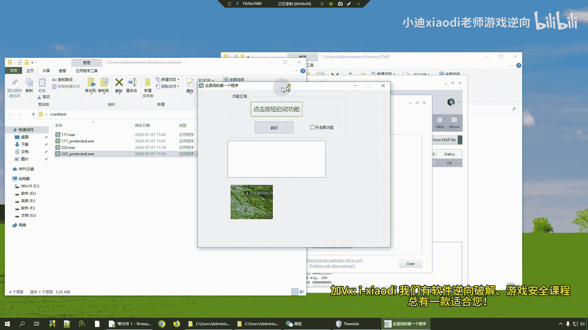

保护完成后先运行程序，确认程序运行没有问题。原文演示中程序功能正常，然后关掉程序重新运行。接着打开调试工具，攻击者点击“文件”、点击“附加”附加过来，可以看到对应位置已经被保护起来。上一节完成了单函数保护，本节接下来看多个函数如何一起混淆和保护。

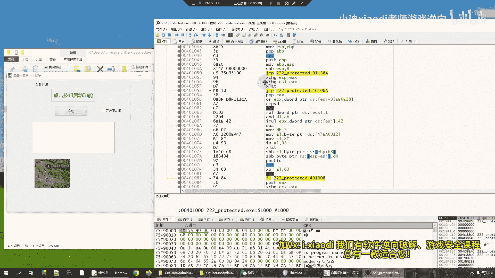

## 易语言软件防破解实战：06：多函数混淆与效果验证 🧪

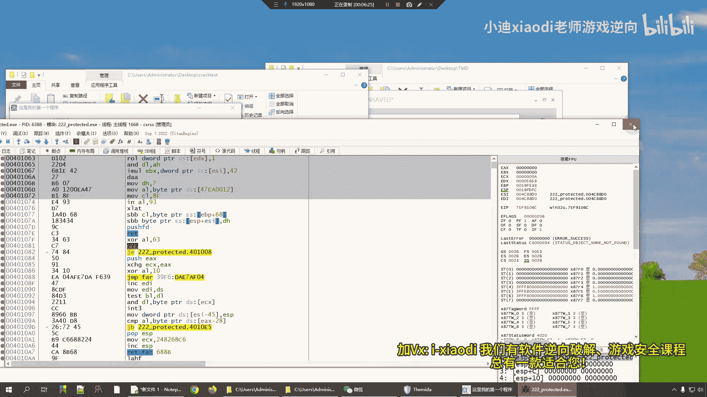

这一节我们来看看保护壳为什么能识别 VM 标记，以及多个函数如何一起保护。原因是源码函数头部和尾部添加了保护标记，保护壳能识别这些标记并把对应函数做混淆或虚拟机保护。如果想混淆某个函数，就在该函数的头部和尾部添加标记。

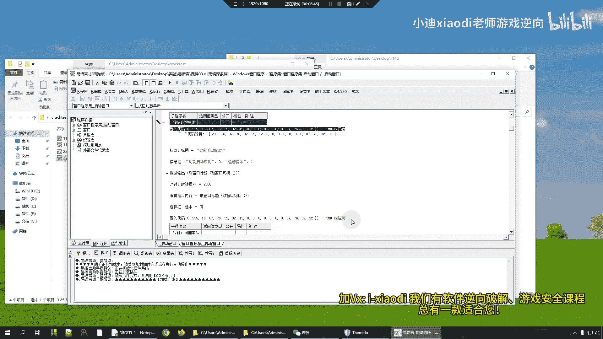

原文举例说，如果想把“时钟功能启动成功”相关功能也混淆，就找到这个功能的开始和结束位置，在开始和结束之间做处理，并添加结束标记。然后静态编译，把程序改名为“333”，再把“333”拖进保护壳。下面用代码示意多函数标记：

```text
函数A头部: 置入代码(保护标记)
函数A尾部: 置入代码(保护标记)

函数B头部: 置入代码(保护标记)
函数B尾部: 置入代码(保护标记)
```

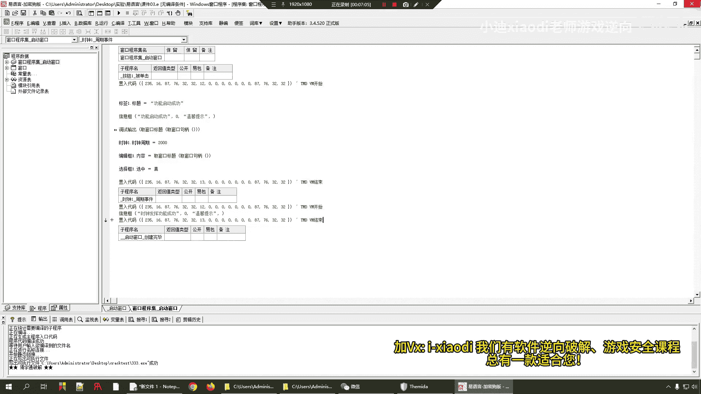

把“333”程序拖进保护壳，勾选保护选项。原文提醒有一个选项不要选，因为一选程序就跑不动。保护壳里可以看到两处函数，说明两个函数都要混淆，然后点击 `protect` 保护。保护后点击 `close` 关掉保护壳，运行程序检查功能。程序功能没有任何问题。

接着验证破解效果：打开调试工具，点击“文件”、点击“附加”，双击符号进入主模块，可以看到所有东西都看不到，全部都看不到。这样攻击者就没有办法从本地进行分析。下面用公式表示效果：

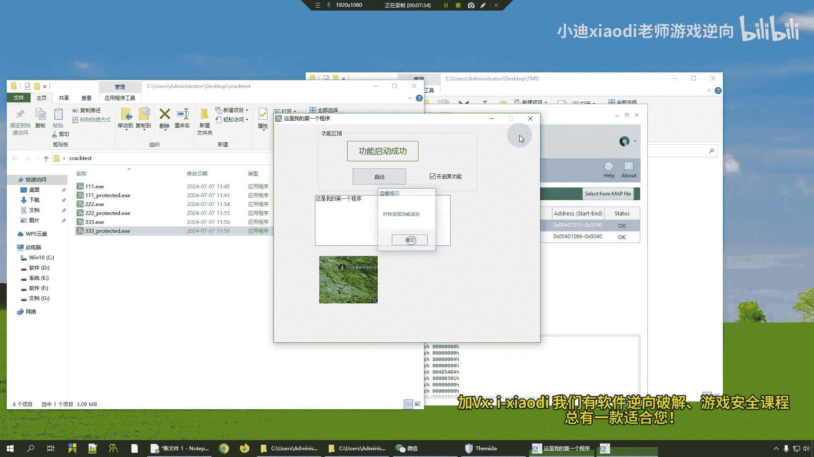

```text
源码标记 + TMD 保护 -> 函数代码被混淆/虚拟化 -> 本地分析难度显著提高
```

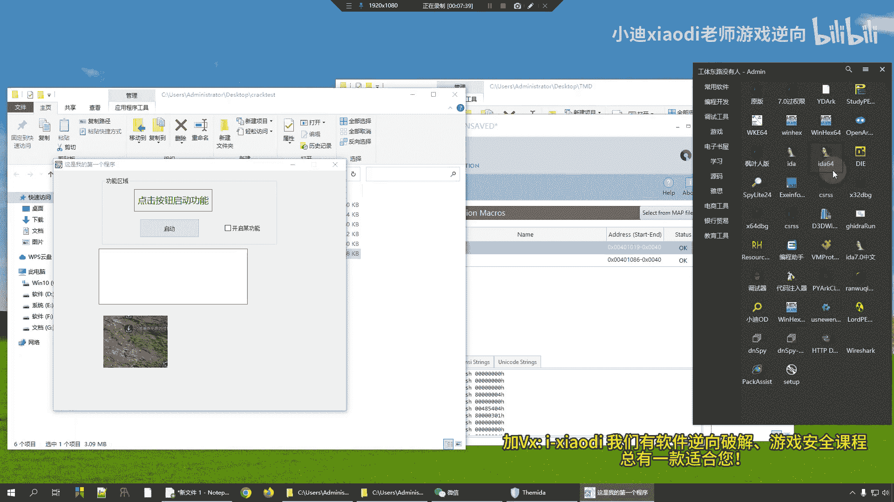

上一节验证了保护效果，本节最后说明这种方法的边界和课程总结。

## 易语言软件防破解实战：07：效果边界与课程总结 📌

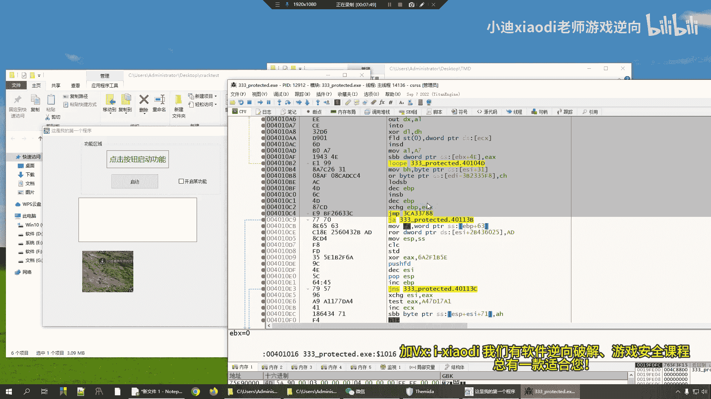

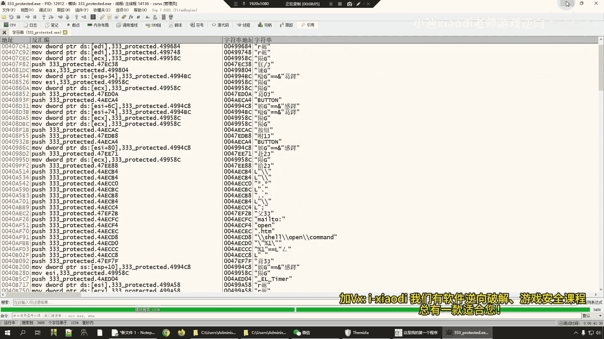

这一节我们总结保护效果和边界。原文说，对易语言作者来说，这是一种非常好的保护方法，课程今天做科普。使用这种保护方式，大约可以防住 80% 的破解者，因为其中 80% 的人是入门级攻击者，也就是原文说的菜鸟、小白级别。当然，这种保护也不是绝对不能破，仍然可以被破开，只不过需要更高的技术水准。公式可以写成：

```text
普通保护效果 ≈ 防住约 80% 的入门级破解
高强度破解 = 需要更高技术水准
```

所以它可以防住大部分常见破解点，但不能把它当成绝对安全。原文最后提到，如果想学习软件逆向、软件逆向破解以及游戏安全辅助开发，可以联系微信 `I杠小D` 或 `I杠小迪`，课程方有相关学习内容，欢迎大家学习，并表示下期再见。

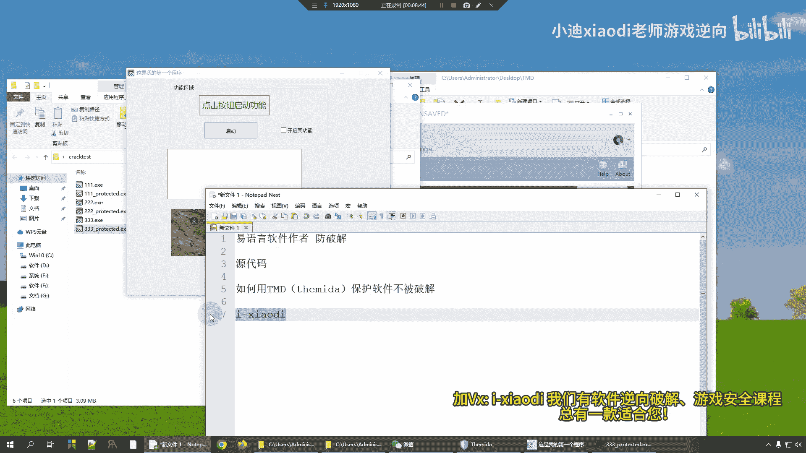

本节课中我们一起学习了：从攻击者视角看未保护易语言程序会暴露字符串和代码，保护后字符串和代码难以分析；易语言作者可以在函数头部和尾部添加保护标记，静态编译后用 TMD 保护壳勾选选项并执行 `protect`；还可以对多个函数做混淆保护，从而挡住大部分入门级破解。需要记住，攻防无绝对，保护壳提高的是破解成本，不是承诺百分之百安全。

