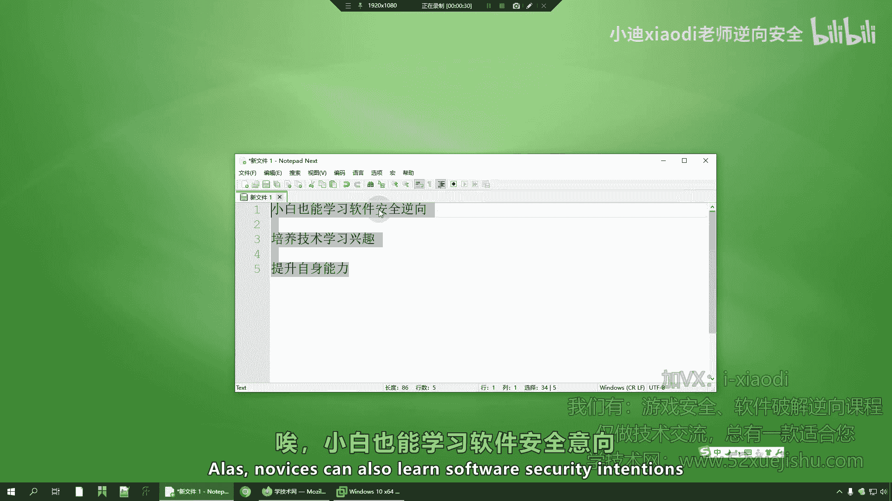
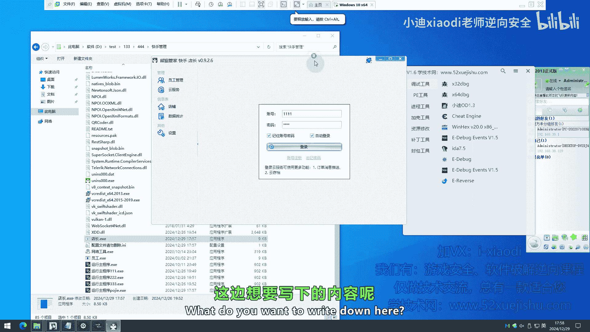
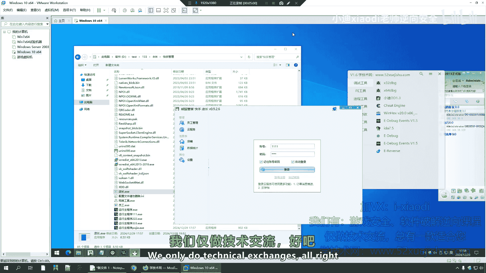
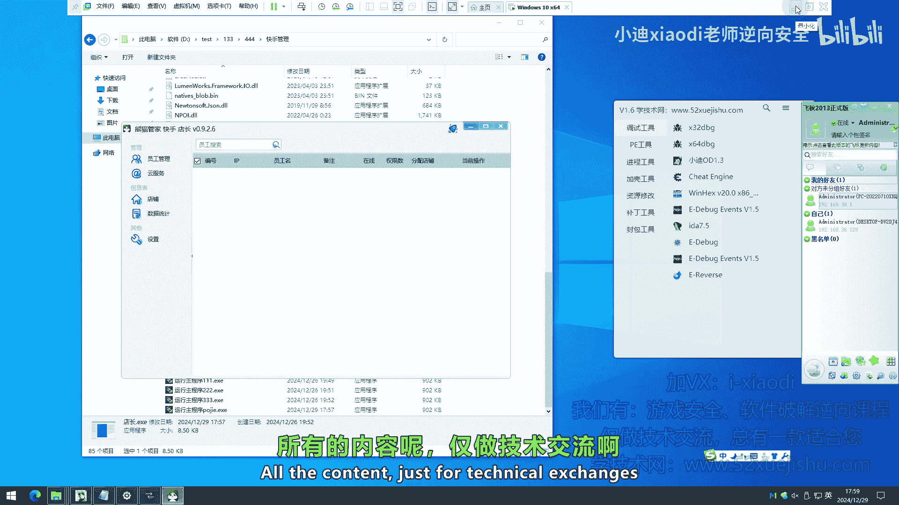

# 🧭 软件逆向入门实战：01：课程概述与学习目标

在本次课程中，我们将要学习软件逆向破解的基础流程，重点是通过分析一个小软件的登录提示，找到错误的代码逻辑，并把它改成可以通过的逻辑。大家好，我是小李老师，今天继续讲软件逆向破解。很多同学会问，为什么那么多人听你讲，逆向破解到底能干什么。实际上，逆向破解可以用来分析一些小软件，例如软件里存在登录权限时，通过分析可以突破“密码错误”这种限制，从而进入软件。这里需要强调，这些内容仅做技术交流。课程内容小白也可以学习，小白也能学习软件安全意向，培养技术学习兴趣，提升自身能力。下面介绍今天课程的整体思路。



以下是本次课程要掌握的核心思路，先用一个公式概括：

```text
分析流程 = 运行程序观察提示 → 搜索提示字符串 → 定位错误分支 → 修改跳转逻辑 → 保存补丁 → 验证效果
```

> 以上内容仅做技术交流。

上一节我们说明了学习目标，本节中我们来看看实际程序怎么分析。

# 🚀 软件逆向入门实战：02：运行程序与定位关键提示

首先运行程序的主程序，程序会要求输入账号密码。输入后点击确认，程序提示“密码错误”。“密码错误”就是一个关键切入点，因为错误提示能帮助我们定位程序中的判断逻辑。打开逆向工具，点击“文件”，点击“附件”，找到目标程序，然后点击“符号”切换到当前程序模块。所谓程序模块，就是与程序名字相一致的模块。因为程序有错误提示，所以一般要搜索这个提示字符串。当然也有例外情况，想学习例外情况怎么处理，可以加入社区学习。随后搜索当前模块的字符串，就可以把提示搜出来，例如“密码错误”之类的提示。

以下是搜索和定位提示时需要重点关注的字符串类型，初学者可以先记住这些常见提示：

- “密码错误”
- “机器码错误”
- “到期续费”
- “已到期请续费”

在搜索结果中可以看到“密码错误”“机器码错误”“到期续费”等很多提示，这些提示都是需要处理的。上一节我们找到了错误提示，本节中我们来看看如何把错误分支改成通过分支。

# 🧩 软件逆向入门实战：03：修改跳转逻辑绕过错误提示

先处理“密码错误”。往上看有一个小箭头，此时小箭头是虚线。逆向破解分析逻辑，实际就是把错误的代码逻辑用实线跳过去。具体做法是把对应的跳转指令改成 `JMP`，也就是无条件跳转，让虚线变成实线。点击确定后，虚线变成实线，“密码错误”这个分支就被跳过去了。然后点击引用，这是第一个“密码错误”。接着处理“机器码错误”，同样把虚线直接改成实线，用 `JMP` 变成实线。这个过程很简单，小白一听就能听懂。当然，很多深入性的内容需要加入社区学习。

以下是本环节反复使用的核心修改方式，先给出一个简化代码描述：

```asm
; 将错误分支改为无条件跳转
JMP 通过分支
```

继续往下看，还有一个“到期”检测，把虚线改成实线，虚线可以看最左边，改成 `JMP` 后就变成实线。再往下看，又有一个“密码错误”，也把它改成实线并点击确定。回到上面，又有一个“机器码错误”，说明这个程序的校验非常多，有二次、三次、多次校验。继续改成 `JMP` 并点击确定，再点击引用，还能看到“已到期请续费”，把续费检测也干掉，使用 `JMP` 并点击确定。随后往下翻一翻，查看有没有其他关键性信息，好像没有其他信息了，程序好像可以了，这时就可以做最终保存。上一节我们修改了多处校验，本节中我们来看看如何保存补丁并验证破解结果。

# 💾 软件逆向入门实战：04：保存补丁与验证程序释放

保存时点击“补丁”，在哪个窗口补丁没有关系，随便点哪里都可以。然后补丁一下修补文件，点击修补这个文件。接着拖到最下边运行主程序，在这里写一个“破解”，已经应用后点击“OK”，再关掉程序即可。这个就是破解后的版本，需要验证它能不能执行。运行程序后随意输入账号密码，点击确定，稍等一下，程序实际上已经释放出来了。这个软件实际上是一个释放型软件。例如把释放出来的程序删掉，因为相关内容已经分析过、处理过。由于这是正版，并且已经破解过，再运行时会没有任何错误提示，然后释放一个“店长”程序，点 `ESC` 后可以看到这个“店长”就是它的核心程序。它实际上是一个套壳程序。接着运行这个“店长”，此时会提示账号或密码错误，这个错误可不可以突破，可以突破。详细内容社区有讲，这里不做更加深入的演示，因为公开视频里演示会涉及很多问题，所以仅做技术交流。课程中暂停视频，让大家看一下效果。上一节我们完成了补丁保存，本节中我们来看看处理后的登录效果和额外检测。

# 🔐 软件逆向入门实战：05：登录效果与余额修改演示

现在回来，让我看一下。刚才提示账号密码错误，现在程序已经处理完了，是处理过后的程序。点击登录，可以看到直接登录上了，余额还成为 `100`。这个 `100` 是自己修改的，可以随便改。这里还有一个“程序异常中断”，说明程序有一个检测。这个检测可以教大家怎么处理。重新运行“店长”，这个检测的处理非常简单，它是有一个线程在跑的。查看进程，可以看到一个定时器，把这个定时器也干掉即可。这样软件就可以随便使用，随便使用都没有什么问题。



以下是本环节涉及的状态变化，用一个简单公式表示：



```text
处理结果 = 绕过账号密码错误 + 修改余额显示 + 结束定时器检测
```

上一节我们看到了登录效果，本节中我们对课程内容做一个小结。

# 📝 软件逆向入门实战：06：课程总结与学习提醒

本节课中我们一起学习了软件逆向破解的基础分析流程：运行程序观察错误提示，搜索当前模块字符串，定位“密码错误”“机器码错误”“到期续费”等校验点，把虚线错误分支改成 `JMP` 实线通过分支，修补文件保存破解版本，并验证程序释放后的登录效果。课程还演示了余额修改为 `100`，以及处理“程序异常中断”检测时查看进程中的定时器并将其结束。今天的内容就是这些。

> 所有内容仅做技术交流。



想学习可以加入社区，但如果是求破解的，并不欢迎。本次教程到此结束。

