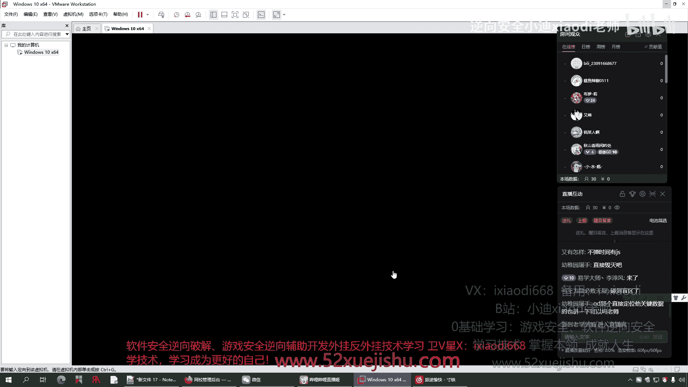
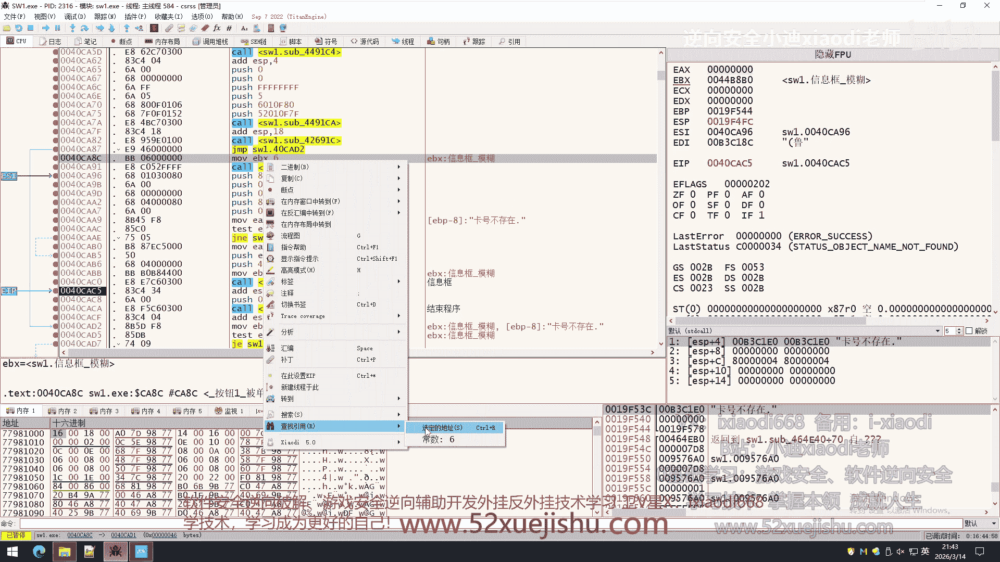
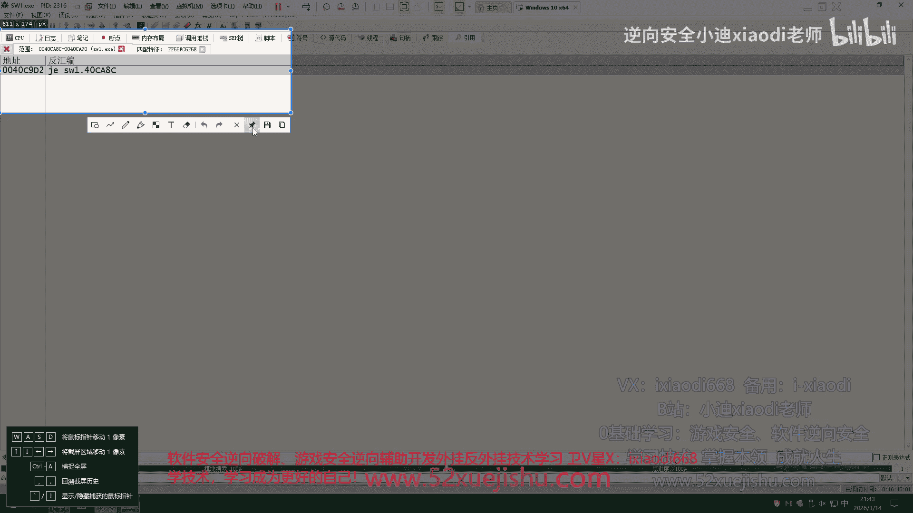
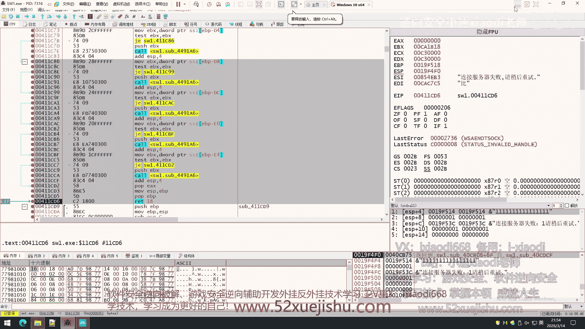
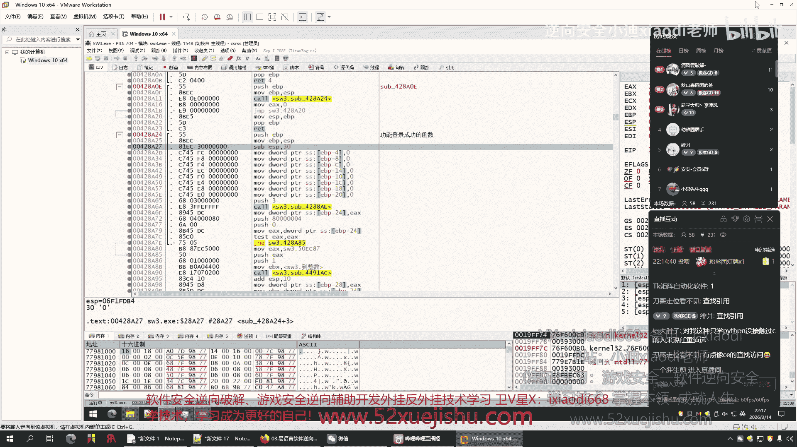
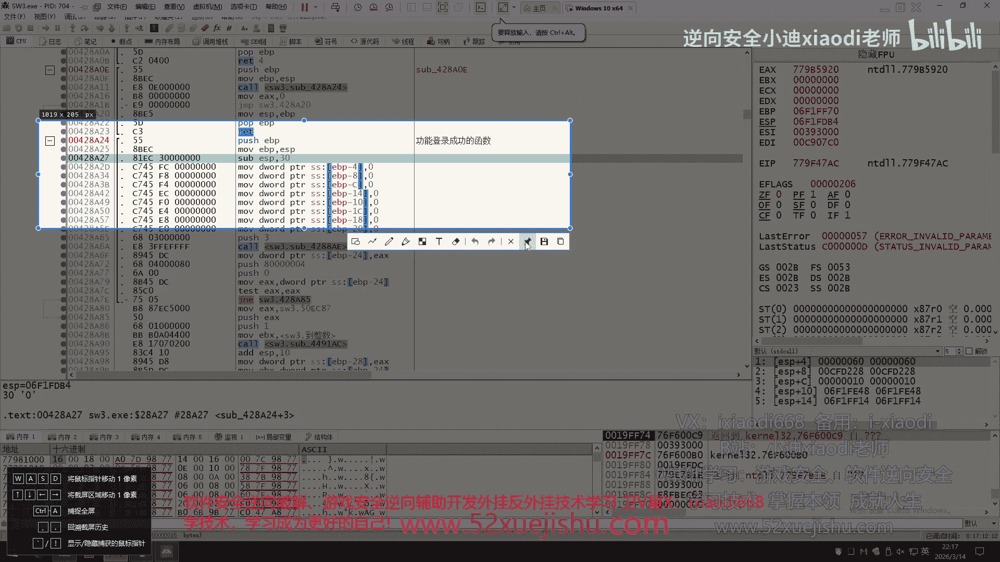
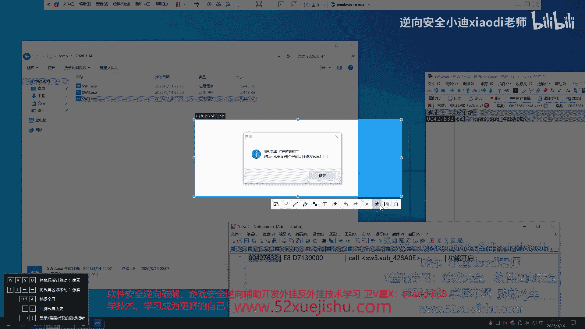
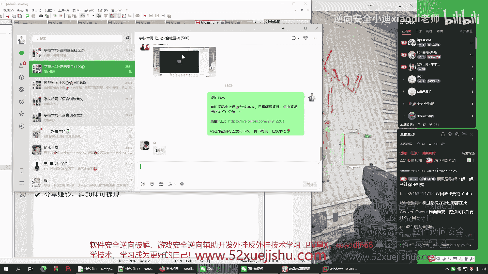

# 🛡️ 游戏安全与软件逆向基础：3.15：网络验证软件逆向案例的防御性分析教程




在本节课中我们将要学习如何把一个直播回放中的软件安全逆向案例，整理成适合初学者理解的防御性分析教程。课程围绕实验程序、登录失败提示、断点、调用回溯、查找引用、函数返回值、合法性校验、功能入口和驱动加载等概念展开。这里需要先说明的是，本教程仅用于授权教学、CTF比赛、软件安全防御研究和合规技术交流，不提供具体地址、二进制修改步骤、绕过授权方法或外挂开发指导。我们重点理解“分析思路”和“防御视角”，而不是复现破解过程。

> 学习原则：只在自有程序、授权样本或合法CTF环境中做实验；不传播破解工具；不把技术用于破坏软件授权、游戏公平或网络安全。

## 🎯 游戏安全与软件逆向基础：3.15.1：案例背景与学习目标

上一节是课程概述，本节我们来看看这个案例的背景和学习目标。直播中展示了一个实验程序，运行后点击登录会出现“卡密不存在”，随后程序退出。直播还提到虚拟机、实验机器、工具包、非法工具提示、反调试选项和网络验证软件等环境信息。对初学者来说，先不要急着修改程序，而要先观察程序的行为：输入什么、提示什么、程序是退出还是卡死、后台是否还在运行。这里需要多说明一点，观察现象比盲目操作更重要，因为后面的断点、回溯和查找引用都建立在“现象”之上。

以下是本节需要先了解的几个基础点。

- 实验程序是一个网络验证类样本，登录失败会给出提示。
- 程序可能退出，也可能卡死或隐藏到后台运行，需要区分。
- 工具环境可能触发“非法工具”提示，应先检查工具配置和反调试选项。
- 第三方支持库和软件自带核心支持库不是同一个概念，不能混为一谈。
- 直播中提到的“按钮特征”“消息框断点”“信息块断点”都是观察入口。

核心概念可以用下面的公式表示。


```text
输入卡密 -> 验证流程 -> 失败提示 -> 退出或继续运行
```




本节末尾需要过渡一下：理解了程序表面行为之后，下一节我们进入第一个分析入口，也就是从失败提示反推消息框和断点。



## 🧭 游戏安全与软件逆向基础：3.15.2：从失败提示切入消息框与断点

上一节我们介绍了案例背景，本节我们来看看如何从“卡密不存在”这类失败提示切入分析。直播中展示了点击登录后出现提示，然后程序退出。分析时可以围绕消息框、按钮事件和断点来观察调用关系。这里要强调，断点不是“万能钥匙”，它的作用只是让程序执行到某个位置时暂停，方便我们观察上下文。对初学者来说，先理解断点的含义，再谈后续分析。

以下是本节涉及的几个观察点。

- 点击登录后关注提示内容，例如“卡密不存在”。
- 可以围绕消息框设置断点，观察程序在哪里弹出提示。
- 按钮特征可以作为入口线索，但不能只凭一个特征下结论。
- 工具环境中的“非法工具”提示需要先排查配置，不一定代表样本本身必然检测。
- 反调试相关选项应只为合法实验环境服务，不应用于规避授权。


断点的基本概念可以用代码描述。


```text
断点：当程序执行到地址A时 -> 暂停 -> 观察寄存器、栈和调用链
```

本节末尾过渡：观察到消息框断点后，下一步就是回答“谁调用了它、从哪里来”，因此下一节我们学习调用回溯。

## 🔁 游戏安全与软件逆向基础：3.15.3：调用回溯与函数框架识别

上一节我们通过消息框和断点找到了观察入口，本节我们来看看如何从当前位置回溯到上层调用。直播中用“从西天取经找东土大唐”的比喻说明“从哪来到哪去”的思路：程序已经停在消息框位置，我们要找是谁把它调到这里。常用操作是使用回溯快捷键，在调试器里回到上一层调用。过程中会看到典型的软件框架函数层，再往上层往往就是功能代码区域。这里需要多解释一句，回溯不是乱跳，而是沿着调用链一层层看，避免把自己绕晕。




以下是调用回溯中需要掌握的步骤。


- 先确认当前停在消息框或失败提示附近。
- 使用回溯快捷键观察上一层调用。
- 识别典型框架函数层，不要把框架层误认为业务功能。
- 继续往上层走，寻找业务功能代码区域。
- 看到“结束程序”等逻辑时，要判断它是否只是失败分支。
- 已知某行代码被跳转执行时，可以用“查找引用”反查来源。

可以用下面的公式概括回溯思路。

```text
当前位置：失败提示/消息框
调用链上层：框架函数 -> 业务函数 -> 关键判断
目标：找到决定成功或失败的关键跳转来源
```

本节末尾过渡：回溯到关键区域后，我们会遇到“谁跳到这行代码”的问题，下一节就进入查找引用和关键跳转判断。

## 🔍 游戏安全与软件逆向基础：3.15.4：查找引用与关键跳转判断


上一节我们学习了回溯调用链，本节我们来看看如何用“查找引用”定位关键跳转。直播中反复演示了鼠标右键选择“查找引用选定地址”，用来看有哪些代码跳到当前地址。这个方法的优点是直观：如果某行代码是失败分支，那么查到它的引用后，就能看到是谁决定跳过来。分析时要判断这个跳转是否决定失败，如果它一跳就进入失败提示，那么它大概率就是关键跳转。这里需要提醒，具体地址和二进制修改步骤不在本教程展开，我们只理解判断方法。

以下是查找引用和跳转判断中的要点。

- 对当前关注地址使用“查找引用选定地址”。
- 观察引用来源，判断是谁跳到了失败分支。
- 如果跳转成立就进入失败提示，则该跳转可能是关键跳转。
- 如果找不到引用，可能说明当前地址不是被直接跳转过来的。
- 函数返回值通常可观察寄存器，例如成功和失败可能对应不同值。
- 修改程序二进制存在风险，可能导致闪退、卡死或栈不平衡。
- 不提供具体修补文件、伪造返回值和绕过校验的操作步骤。

核心概念可以用公式表达。

```text
关键跳转：条件成立 -> 进入失败分支
          条件不成立 -> 继续验证流程
返回值观察：EAX = 1 表示成功（示例）; EAX = 0 表示失败（示例）
```

本节末尾过渡：即使找到了失败分支，程序还可能因为合法性校验进入卡死状态，下一节我们专门讨论这个现象。

## 🧱 游戏安全与软件逆向基础：3.15.5：合法性校验与程序卡死

上一节我们判断了关键跳转，本节我们来看看程序卡死与合法性校验的关系。直播中提到某网络验证软件，并提到“GS合法性校验”失败时程序可能卡死，表现为界面不退出但功能不可用，后台进程仍在运行。这里需要说明，卡死不等于程序退出，也不等于分析结束。对初学者来说，先学会区分“退出、闪退、卡死、后台运行”这几种状态，再谈后续处理。直播也提到部分深入内容只在授权课程中讲解，公开直播不展开具体绕过方法。

以下是本节需要理解的几个现象。

- 程序提示失败后可能没有真正退出。
- 任务管理器中可能仍能看到后台进程。
- 卡死可能来自合法性校验失败形成的死循环。
- 搜索字符串可以帮助识别网络验证类型和提示信息。
- 登录限制、合法性检测、反调试都属于防御机制。
- 合法实验中应记录现象，不提供绕过校验的具体步骤。

可以用下面的公式描述现象。

```text
合法性校验失败 -> 程序卡死/死循环 -> 功能不可用
程序退出 -> 进程结束
程序卡死 -> 进程可能仍在后台运行
```





本节末尾过渡：理解卡死现象后，我们还需要知道软件真正“功能开启”的位置在哪里，下一节讨论功能入口、驱动加载和模块初始化。


## ⚙️ 游戏安全与软件逆向基础：3.15.6：功能入口、驱动加载与模块初始化


上一节我们讨论了合法性校验导致的卡死，本节我们来看看功能入口和初始化流程。直播中提到程序会加载完毕、取运行目录、取执行文件名、初始化驱动、进行认证、显示登录成功和剩余时间，然后进入游戏全屏弹窗提示。对于外挂类程序，常见流程是先加载驱动，再进行驱动读写和环境初始化，之后才开放功能。这里需要多说明一点，功能入口往往成块出现，加载驱动、认证、登录成功、进入游戏提示可能都在同一片区域。初学者不要随意跳过初始化，因为初始化失败可能导致功能不可用。


以下是功能入口分析中的几个概念。

- 功能入口通常集中出现在一块代码区域。
- 加载驱动和驱动初始化失败提示说明后续要依赖驱动环境。
- 取运行目录和取执行文件名说明程序后续可能执行相关文件。
- 登录成功与剩余时间可能属于业务逻辑，但是否二次校验需要观察。
- 查找引用可以反查“谁调用了功能函数”，不必只靠调试到达。
- 函数头常见形式是 `push ebp; mov ebp, esp`，用于识别函数边界。
- 修改跳转最好在同一函数内考虑，避免栈不平衡。
- 修改后出现闪退或卡死，说明还可能存在二次校验或其他保护。

核心概念可以用下面的流程表示。

```text
驱动初始化 -> 环境准备 -> 登录成功 -> 功能入口 -> 游戏内效果
函数头识别：push ebp; mov ebp, esp
调用关系：功能函数 <- 查找引用 <- 上层调用者
```


本节末尾过渡：到这里我们已经把案例中的主要方法论串起来了，下一节做一次总结，并给出合规学习路径。




## 🧠 游戏安全与软件逆向基础：3.15.7：方法论总结与合规学习路径


上一节我们梳理了功能入口和初始化流程，本节我们对整个案例做总结。这个直播案例的核心并不是“记住某个地址”，而是掌握一套分析顺序：先观察现象，再用断点暂停，再回溯调用链，再用查找引用找来源，再观察返回值、函数边界和关键跳转，最后理解合法性校验、功能入口和驱动加载之间的关系。这里需要多强调一句，技术本身是中性的，但使用场景必须合法合规。直播中还提到软件逆向和游戏逆向两个学习板块、汇编基础、课程价格和答疑服务等信息，这些属于课程介绍，具体以官方说明为准。

以下是建议的学习路径和合规注意事项。

- 先学习汇编基础、函数调用、栈和寄存器等基础概念。
- 在授权样本和CTF环境中练习断点、回溯和查找引用。
- 理解消息框、失败分支、关键跳转和返回值的分析方法。
- 理解合法性校验、反调试和程序卡死等防御现象。
- 区分程序退出、闪退、卡死和后台运行。
- 学习驱动加载、模块初始化和功能入口的识别思路。
- 不传播破解工具，不提供绕过授权的具体操作。
- 不将技术用于外挂、作弊、破坏软件授权或非法牟利。
- 课程和价格信息以官方渠道为准，技术交流仅限合法范围。

本节课中我们一起学习了如何把该直播案例整理成防御性分析教程，包括案例背景、消息框断点、调用回溯、查找引用、关键跳转、合法性校验、程序卡死、功能入口、驱动加载和合规学习路径。希望初学者先建立“观察现象、理解调用关系、判断关键逻辑、遵守法律边界”的整体框架，再逐步深入底层细节。



> 总结：分析能力越强，越要守住合规边界；只做授权实验，只做防御研究，只做合法技术交流。

