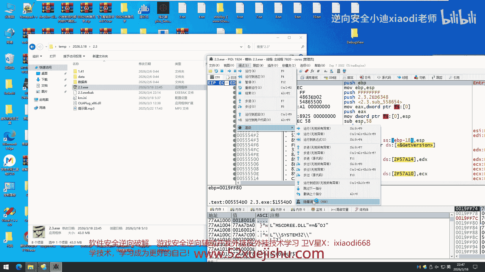
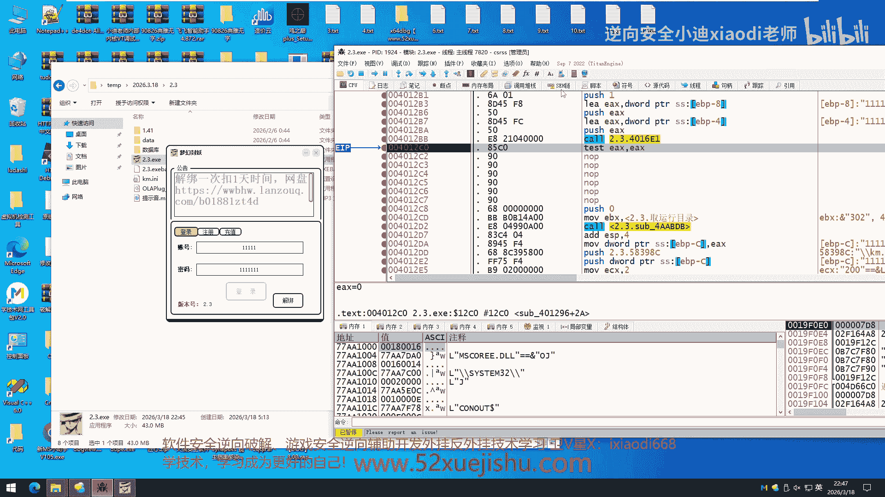
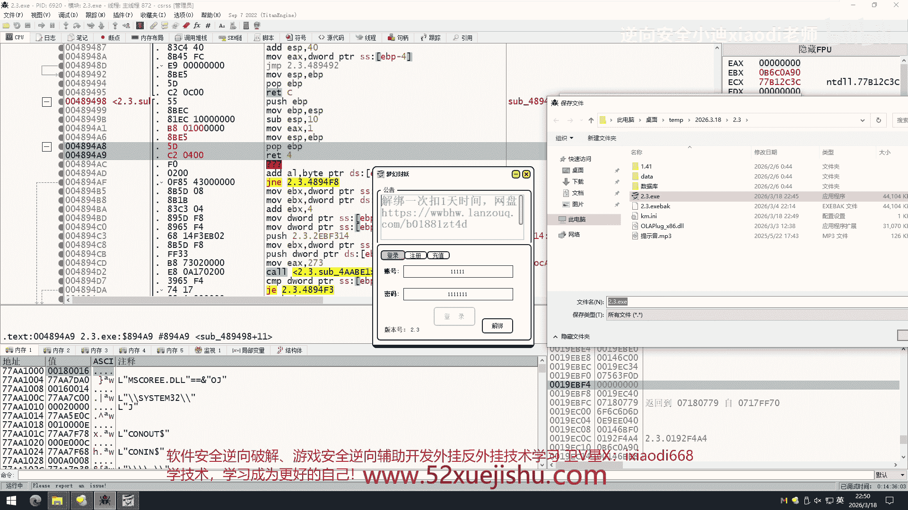
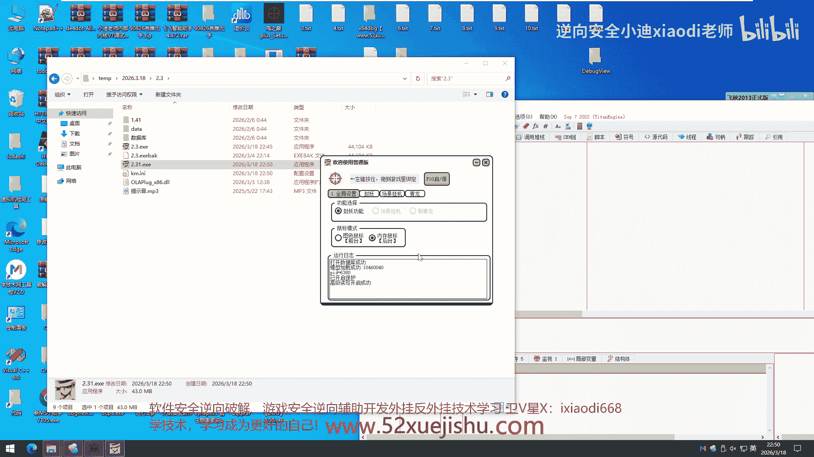
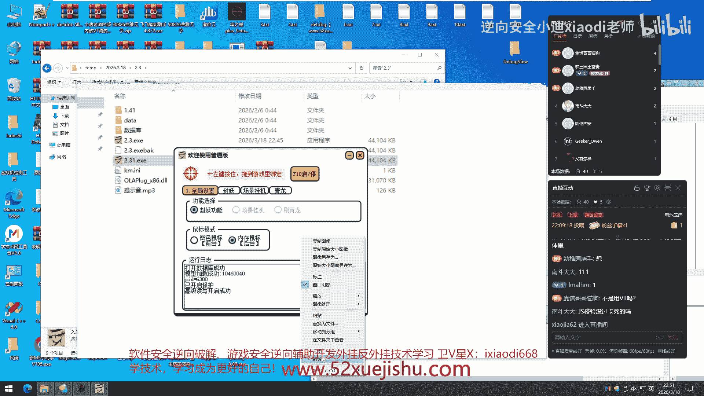
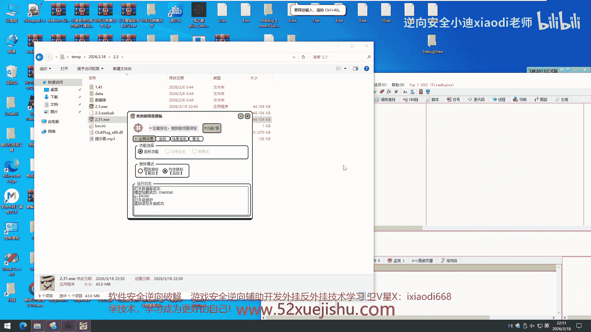

# 游戏安全逆向分析：3.18：反调试与网络验证排查入门 🛡️

> 课程主题：某游戏外挂软件逆向分析全流程，围绕游戏安全、软件安全、网络安全与 CTF 基础展开，强调打击外挂与授权安全研究。  
>   
> 本教程仅用于合法授权环境下的安全学习与教学，不提供可直接复现的破解参数；涉及关键地址、寄存器值和具体绕过配置均做抽象处理。

在本节课中，我们将学习一次游戏外挂软件逆向分析的直播回放内容。课程从附加调试器后程序崩溃的现象讲起，逐步讨论反调试标志检测、PEB 相关检测思路、普通版功能限制、关键调用点跟进、寄存器赋值与 GS 校验等概念。课程还讨论了网络验证软件的保护强度与改进空间。整体目标是让初学者理解逆向分析的基本观察方法，同时明确这类技术应只用于授权测试、安全研究和 CTF 学习。

## 🔍 课程背景与目标

上一节我们明确了课程主题，本节来看看这门课到底想讲什么。课程标题强调“0 基础可学”，并把它放在游戏安全、软件安全、网络安全和 CTF 比赛必备基础的背景下。它并不是单纯讲某个工具怎么点，而是通过一个真实样本，把“现象观察、原因猜测、验证思路、结果判断”这条分析链路串起来。

以下是本课程涉及的主要学习目标。

- 理解附加调试器后程序崩溃这一常见反调试现象。
- 认识调试标志检测与 PEB 相关检测的基本概念。
- 观察普通版软件的功能限制和加载流程。
- 学习记录关键调用点并用单步跟进观察程序行为。
- 理解寄存器赋值、GS 校验和网络验证的基本关系。
- 建立“只做授权分析、不做非法破解”的安全意识。

用一句话概括分析模型，可以写成下面这样。

```text
逆向分析流程 = 观察现象 -> 提出假设 -> 验证假设 -> 记录关键点 -> 判断保护机制
```



## 🧩 附加调试器后崩溃的现象

上一节我们介绍了课程目标，本节来看看附加调试器后的第一类现象。课程一开始就演示了目标程序被调试器附加后立即退出的情况。这个现象说明程序很可能在动态检测“是否被调试”，一旦发现异常调试状态，就主动结束进程。

以下是附加调试器后可以观察到的现象。

- 调试器一附加，目标程序就崩溃或退出。
- 程序可能检测了附加调试相关的标志。
- 这种检测不是静态写死的，而是运行过程中动态判断。
- 课程提出“如何处理这种崩溃”的问题，并把它作为后续分析入口。

可以把这种现象抽象成下面的判断模型。

```text
崩溃条件 = 调试器已附加 AND 目标进程检测到调试标志
继续运行条件 = 调试状态被合法处理 AND 未触发退出逻辑
```

课程中提到，把目标程序拖入调试器后，可以通过调试器中与反调试、PEB 隐藏相关的设置来观察现象变化。本文只保留这个概念，不展开具体可复现配置。处理后再次附加，程序不再立即崩溃，说明前面的判断方向基本正确。



## 🛡️ PEB 相关检测与处理思路

上一节我们看到了“附加即崩溃”的现象，本节来看看课程如何解释它。课程判断，这类崩溃大概率与 PEB 相关，也就是进程环境块相关的状态被动态检测。程序可能读取某些调试状态字段，再根据结果决定是否退出。处理之后再次附加，程序恢复正常，这进一步支持了“反调试检测”的假设。

以下是课程中提到的反调试处理思路，具体参数已抽象。

- 先确认崩溃是否只在附加调试器时出现。
- 再判断检测是否与 PEB 等进程状态相关。
- 通过调试器的相关选项观察隐藏调试状态后的变化。
- 如果附加后不再崩溃，就说明检测点大概率命中。
- 处理完成后继续分析后续业务流程。

可以用下面的伪代码表示这个思路。

```text
IF 附加调试器:
    目标进程检查调试状态
    IF 检测到调试标志:
        退出或崩溃
    ELSE:
        继续运行

处理后:
    附加调试器 -> 调试状态被处理 -> 目标进程继续运行
```

课程在这一部分的语气比较直接，认为处理起来并不复杂，类似常规操作。这里需要强调，实际工作中只有在获得授权的情况下，才可以对目标程序做这类分析。

## 📦 普通版功能限制与加载流程观察

上一节我们处理了附加崩溃现象，本节转向普通版软件的功能表现。课程观察到普通版存在无法使用某些场景的问题，体验上类似被打补丁限制。程序会跳过部分流程，并提示普通版无法使用场景和克隆功能。这些提示本身就是重要线索，说明程序内部存在版本判断或功能开关。

以下是普通版与加载流程中的几个观察点。

- 普通版无法使用某些场景功能。
- 普通版也无法使用克隆功能。
- 程序过程中出现“跳过”现象。
- 课程尝试装载 DM 目录，观察是否触发异常。
- 装载后没有出现明显跳转或崩溃。
- 随后出现模型降载成功、加入文本、模型验证成功等提示。
- 课程判断当前提示对应的位置就是关键点之一。

可以把功能可用性抽象成下面的公式。

```text
功能可用性 = f(版本类型, 场景模块, 克隆模块, 加载状态)
普通版 -> 场景模块受限 AND 克隆模块受限
```

课程表示，到这里可以先不继续深入分析；如果再往后跟，就会来到下一个卡死点。这个卡死点被记录为后续分析入口，原文给出了一个具体地址，本文用占位符表示。

```text
关键地址 = ADDR_KEY  // 原文给出具体十六进制地址，本文隐去
```

## 🔎 关键调用点与单步跟进

上一节我们观察了普通版的功能限制和加载提示，本节进入关键调用点的跟进。课程点击登录后，程序再次在某个位置卡死。此时记录关键地址，再用调试器单步跟进，就能进入相关代码区域。跟进后可以看到，程序调用了一个子程序，而这个子程序与第三方组件有关。

以下是关键调用跟进时涉及的步骤概念。

- 记录卡死位置对应的关键地址。
- 点击登录，复现卡死现象。
- 使用单步跟进进入调用内部。
- 观察当前代码区域和子程序调用关系。
- 识别第三方组件调用，例如课程提到的 VIPproctor 相关保护组件。
- 继续观察子程序返回值和寄存器状态。

可以用下面的流程表示。

```text
记录关键地址 ADDR_KEY
点击登录 -> 程序卡死
单步跟进 -> 进入子程序
观察调用关系 -> 发现第三方保护组件
继续跟进 -> 查看寄存器赋值与返回值
```

课程提到，命令提示或附加信息不影响分析，重点是把调用链看清楚。到这里，程序卡死的原因逐渐聚焦到子程序内部的状态处理上。

## 🧮 寄存器赋值与 GS 校验概念

上一节我们跟到了关键子程序，本节来看看寄存器赋值和校验逻辑。课程观察到程序会对 EX 相关寄存器进行赋值，原文提到类似“把 EX3P 和等于 1EX”的操作。具体值本文不展开，只保留“对寄存器状态进行设置”这一概念。课程评价这个处理过程非常简单，类似常规操作。



以下是寄存器与 GS 校验相关的概念。

- 子程序内部会对寄存器状态进行赋值。
- 赋值结果会影响后续判断流程。
- 课程认为该处的保护强度不高。
- 尝试处理后，程序可以继续进入。
- 如果 GS 校验没有通过，程序会卡死。
- 校验通过后，流程可以继续往下走。

可以用下面的伪代码表示。



```text
寄存器状态 = 目标值  // 具体值省略
IF GS校验(进程状态) == 通过:
    继续执行
ELSE:
    卡死或退出
```

课程在这一段多次评价“像呼吸一样简单”，意思是该样本的保护逻辑并不复杂。处理之后程序能够进入，说明校验点和赋值点之间存在直接关系。

## 🧠 网络验证软件的安全改进讨论

上一节我们理解了寄存器与 GS 校验的关系，本节讨论课程对网络验证软件的评价。课程认为，这类卡密软件或网络验证软件的保护强度较低，对初学者来说难度不大。它提到“小白网络验证”还有很大提升空间，并表达支持作者继续开发验证机制。

以下是关于网络验证软件改进的讨论点。

- 当前样本的保护逻辑较简单。
- 卡密软件和网络验证软件仍有很大进步空间。
- 课程支持作者继续开发更完善的验证机制。
- 如果听众没有理解相关内容，可以查看前几天的回放。
- 回放中已经讲过相关基础内容。

可以把保护强度抽象成下面的表达式。



```text
保护强度 = 反调试能力 + 校验复杂度 + 调用链混淆程度 + 服务端验证强度
```

课程的核心态度是：分析归分析，安全机制本身也需要不断改进。对于学习者来说，更重要的是理解分析思路，而不是只记住某个具体地址或某个具体值。

## ✅ 总结



本节课中我们一起学习了游戏外挂软件逆向分析直播回放的主要内容。我们从附加调试器后程序崩溃的现象出发，讨论了调试标志检测和 PEB 相关检测思路；随后观察了普通版功能限制、DM 目录装载、模型验证提示等流程；接着记录了关键调用点，使用单步跟进进入子程序，并理解了寄存器赋值与 GS 校验的关系；最后讨论了网络验证软件的保护强度和改进空间。

回顾整个分析链路，可以用下面的公式做总结。

```text
完整分析链路 = 现象观察 + 假设提出 + 调试验证 + 关键点记录 + 校验判断 + 安全改进思考
```

需要再次强调，本教程只用于授权环境下的安全学习和 CTF 基础训练，不提供可直接复现的破解参数。掌握观察方法和分析思路，比记住某个具体地址更重要。

