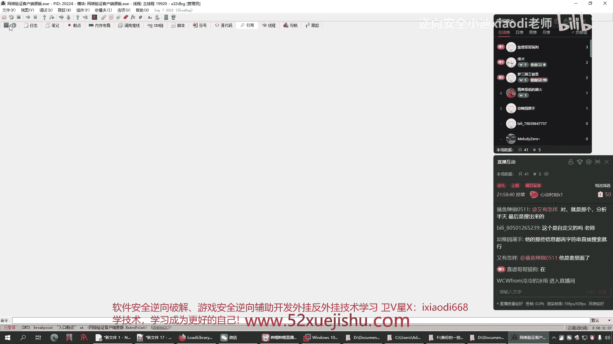
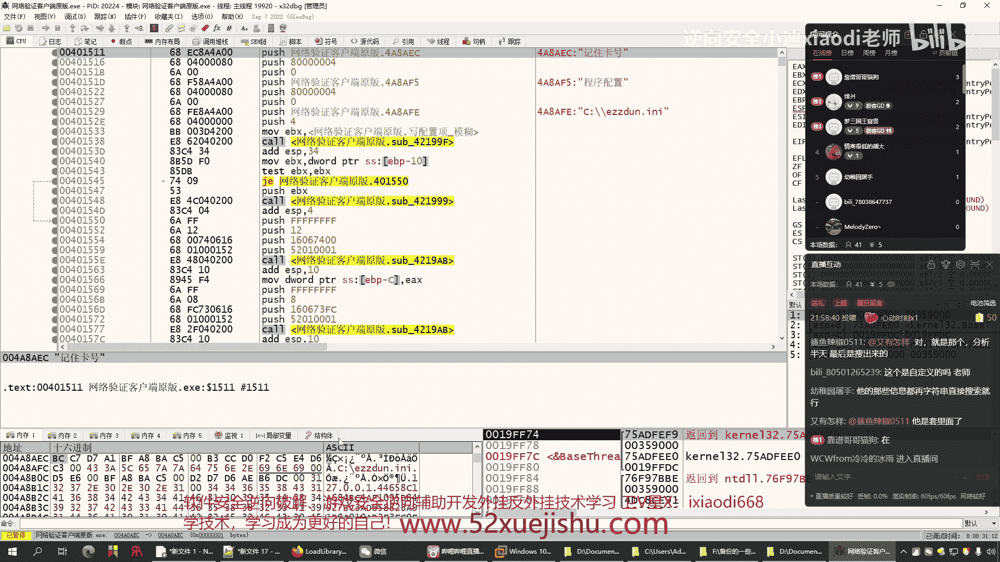
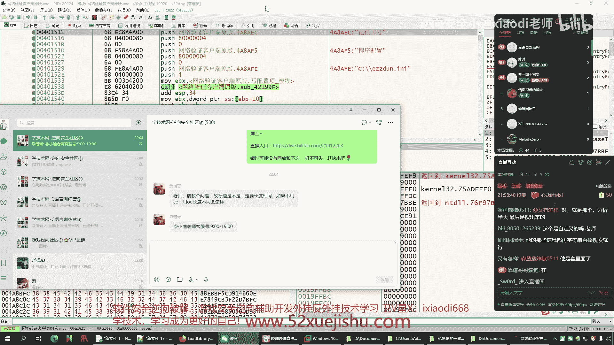
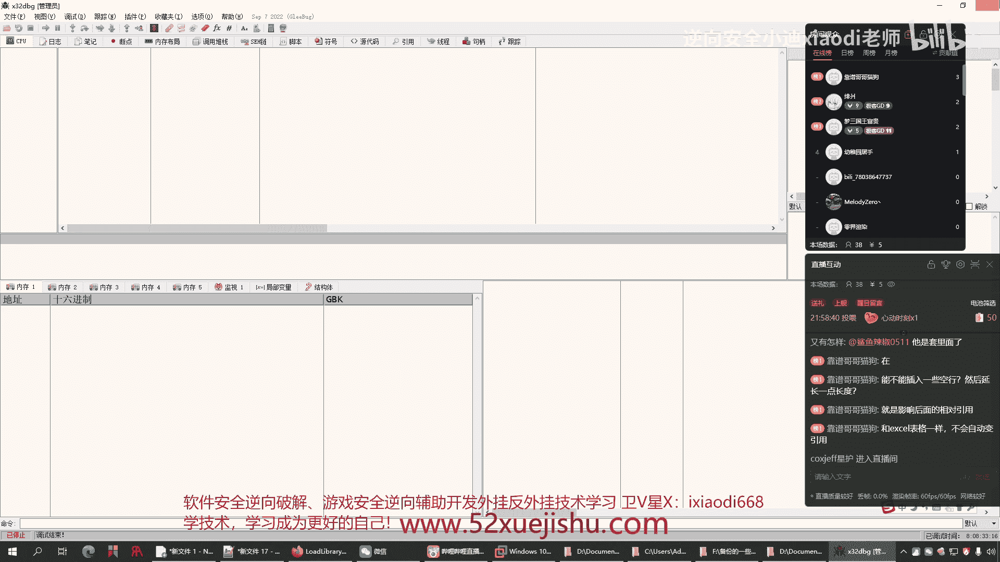

# 软件逆向破解基础：3.4：修改标题时字符串长度的注意事项

## 🎯 概述

在本节课中，我们要学习一个软件逆向破解中的基础问题：修改软件标题时，字符串的长度到底要不要跟原来保持一致？

很多初学者在练习改标题的时候，都会遇到这样一个疑问：我改的标题长度是不是一定要和原来相同？这个问题看似简单，但背后涉及内存布局、地址引用等核心概念，搞不懂的话，改出了问题都不知道是怎么回事。

## 🔍 核心问题：长度相同还是不同？

先直接说结论：**改标题时，字符串长度最好相同**。



为什么这么说？道理其实非常简单。改标题只是一个例子，我们不必非得以标题作为案例，其他字符串，比如"记住卡号"这样的配置项，道理也是一样的。



在内存中，字符串是连续存储的，程序在运行时，会按照这个字符串所在的内存地址去读取它。如果你把字符串改了，而且新字符串比原来的长，那多出来的部分就会往后蔓延，把后面的内存数据给覆盖掉。

## ⚠️ 覆盖问题的严重后果：牵一发而动全身

下面我们来详细看看，如果字符串太长，会发生什么具体的问题。

假设你要修改"记住卡号"这个字符串。如果长度控制不好，把它改得太长，它就会覆盖掉后面紧跟着的数据。这样一来：

- 程序配置内容被覆盖
- 如果再往后，IP地址等关键数据也会被覆盖
- 内存中数据的连续性被打乱

我们来看一个具体的例子。假设原始代码中，"记住卡号"这个字符串被引用在一个固定的内存位置。以汇编代码为例，它的地址可能是类似于这样的：

```assembly
00484A8E: 引用 "记住卡号"
```



这个地址是程序在编译时就已经写死（硬编码）的。如果你把字符串改长了，后面的数据就要往后挪。往后挪的话，这个地址就要改；这个地址改的话，下一个相关地址也要跟着改；下一个地址改了，再下一个还要改……一层层传下去，所有的相对引用全部失效。

在内存中，数据存储是有连续性的逻辑和规则的。程序在调用这些数据时，地址早就已经写死了。既然地址写死了，你就不应该去动这些内存布局，一旦动了，后面全都会错。

## ✅ 正确做法与验证方法

那么，实际操作中应该怎么做呢？其实很简单：

- 新字符串的长度尽量和原字符串保持一致
- 如果实在无法保持一致，宁短勿长，因为短了可以补空字符，长了就会覆盖其他数据
- 修改后，仔细观察程序是否还能正常运行

你可以这样验证：改完标题后，主动去测试程序的功能，看看是否受到影响。你试过了发现行，那就是行；你试过了发现不行，那就是不行。实践出真知，你自己说了算。

## 🧠 核心原理总结

整个问题的核心就一句话：**长度不同会导致内存覆盖，破坏程序原有的相对引用关系**。这个道理可以用一个公式来概括：

```
新字符串长度 > 原字符串长度 = 覆盖后续内存数据 = 程序功能异常
```

字符串在内存中是连续存放的，程序通过硬编码的地址来访问它们。修改字符串长度会让后续数据偏移，所有写死的地址都会失效，这就叫牵一发而动全身。



## 📝 总结

本节课中，我们一起学习了修改软件标题时字符串长度的注意事项。核心要点是：改标题时字符串的长度最好与原来相同，如果长度不同，特别是变长，就会覆盖后面的内存数据，破坏程序的相对引用关系，导致程序功能异常。在实际操作中，修改后一定要主动测试程序功能，确认没有受到影响才可以。记住，在内存中数据是有连续性的，牵一发而动全身，不要乱改。
