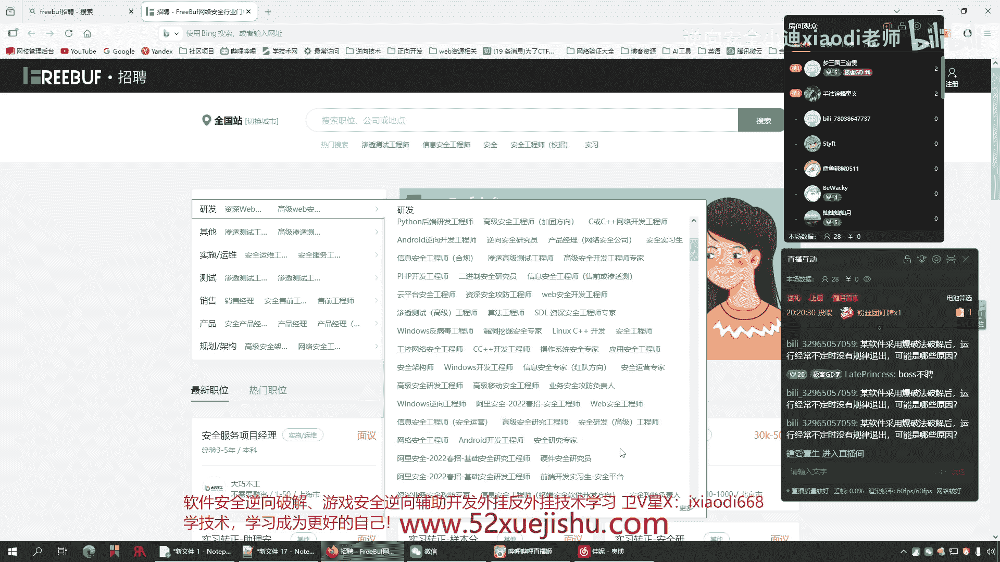

# 🔍 逆向工程求职指南：第1章：招聘渠道概览

在本节课中，我们将要学习逆向工程方向找工作时的几个常见渠道。内容整理自一次直播回放，重点解决“逆向工作怎么找”的问题，并简单介绍了几个实际可用的渠道。对于刚入门的初学者来说，明确招聘渠道和岗位方向是第一步，这节课会围绕这两个方面展开。同时，我们也会顺带提到后续向漏洞方向发展的可能性，让大家在求职时心里更有底。

首先看一下，有哪些地方可以找到逆向相关的工作。逆向岗位通常不会像普通开发岗那样遍地都是，但集中在几个综合招聘平台和安全垂直社区里。下面这个公式列出了主要的渠道：

\[
\text{渠道} = \{ \text{58同城}, \text{Boss直聘}, \text{看雪招聘}, \text{FreeBuf招聘} \}
\]

接下来逐个说明。58同城和Boss直聘是大家非常熟悉的综合招聘平台，上面有不少公司发布安全岗位。在这两个平台搜索“逆向”、“安全”或“Windows逆向”等关键词，通常能发现一些机会。由于是综合平台，岗位质量参差不齐，需要自己花时间筛选，但胜在数量大。如果你平时习惯用手机刷职位，这两个平台的App体验也比较方便，可以设置关键词订阅，让机会主动送过来。

看雪招聘是安全圈子里比较垂直的招聘渠道。看雪社区本身以逆向工程和漏洞研究闻名，因此上面的招聘岗位很多都与逆向直接相关。如果你不想在浩瀚的综合岗位里大海捞针，看雪招聘会是一个更精准的选择。社区里还有大量技术帖子，投简历前先逛一逛，也能加深对逆向行业的理解。

FreeBuf招聘则依托于FreeBuf这个网络安全媒体与社区，它也有自己的招聘站。在FreeBuf上直接搜索“招聘”，就能看到不少网络安全相关的职位，里面既有安全工程师，也有研发类岗位。值得一提的是，FreeBuf之前开过很多峰会，有没有人去过？这些峰会积累了大量企业和安全从业者资源，所以招聘信息也比较丰富。

为了让你看得更清楚，以下是上述渠道的简要对比：

- 58同城：综合平台，岗位多，需要筛选。
- Boss直聘：综合平台，可以直聊，效率高。
- 看雪招聘：安全垂直社区，逆向岗位集中。
- FreeBuf招聘：安全媒体旗下，网络安全职位丰富。

当然，除了这四个，还有一些其他渠道，不过核心入口基本集中在上面几个。看完了渠道，接下来就要关心“能投什么岗位”。逆向方向其实并不只叫“逆向工程师”，岗位名称五花八门。以下公式给出了常见的逆向相关岗位：

\[
\text{逆向岗位} = \{ \text{安全工程师}, \text{病毒分析师}, \text{逆向安全研究员}, \text{Windows反病毒工程师}, \text{Windows逆向工程师} \}
\]

具体来说，安全工程师的岗位范围很广，很多公司都需要，尤其是在乙方安全公司或大厂的安全部门。病毒分析师和Windows反病毒工程师主要面向恶意代码分析，这个方向天然适合逆向技术，因为分析病毒样本时需要反汇编、脱壳、动态调试等技能。如果你本身的逆向底子不错，病毒分析师完全是可以做的。逆向安全研究员则更偏底层研究，通常需要深入理解操作系统原理和汇编。Windows逆向工程师则专注于Windows平台上的程序逆向，工作内容可能包括算法还原、协议分析、软件破解对抗等。

另外，如果你的后期规划是往漏洞方向走，那么也有不少路子。用映射来表示就是：

\[
\text{漏洞方向} \to \{ \text{漏洞挖掘}, \text{应用安全} \}
\]

漏洞挖掘需要很强的二进制分析能力，这正好和逆向技术重合，你可以从简单漏洞的复现开始，逐步学习模糊测试和补丁对比。应用安全则偏向软件开发生命周期的安全，但也需要逆向能力来理解已编译代码。除了这两个方向之外，继续做Windows逆向工程师也是一个常见选择。简单来说，无论走哪条路，逆向基础都是地基。

最后，给初学者一点实操建议：先别急着投简历，可以到上面提到的几个平台把逆向相关的岗位说明都翻一遍，观察它们要求什么技能，再对照自己的情况查漏补缺。这样准备起来更有方向感，面试时也能少踩坑。

本节课中我们一起学习了逆向找工作的主要渠道，包括58同城、Boss直聘、看雪招聘和FreeBuf招聘；同时梳理了常见逆向岗位，比如安全工程师、病毒分析师、逆向安全研究员、Windows反病毒工程师、Windows逆向工程师；还介绍了向漏洞挖掘和应用安全方向发展的可能路径。希望这份整理能帮初学者快速找到入口，迈出逆向求职的第一步。

