# 🛠️ 软件逆向破解实战：3.27：某加速器软件去除更新与HOOK时机分析

## 📖 软件逆向破解实战：3.27.1：课程概述

在本节课中我们将要学习如何分析某加速器软件的更新逻辑，如何判断程序是否在线程中执行检测，如何定位打开网页的API，如何识别OD反调试与UDD检测，以及如何选择HOOK时机来完成去更新和绕过弹窗。课程内容会从现场调试过程出发，先观察程序行为，再定位关键函数，最后给出两种可落地的HOOK方案。整个过程会尽量用大白话解释，让刚开始接触逆向的学员也能跟上思路。

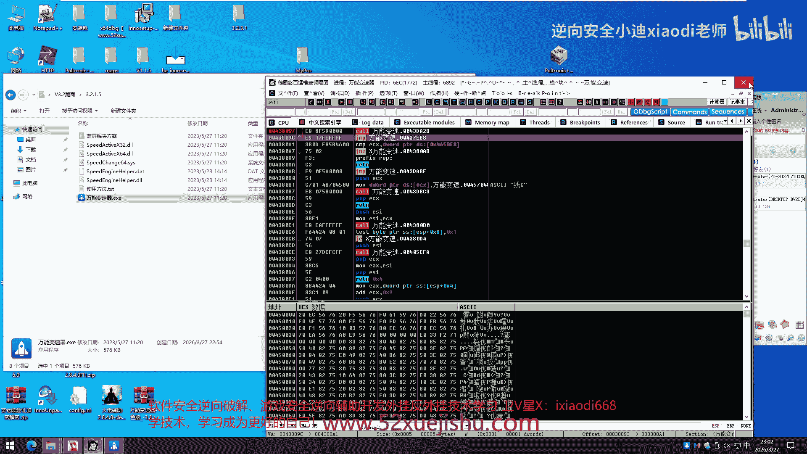

上一节内容涉及注入与线程相关的基础观察，本节中我们来看看如何从一个具体程序入手，把“它在哪里检测、在哪里弹窗、在哪里退出”这些问题一步步拆开。学习本节课时，重点不是死记某个地址，而是理解分析顺序：先看调用，再看跳转，再看线程，最后决定是改代码还是HOOK。

## 🔍 软件逆向破解实战：3.27.2：观察程序行为与可疑跳转

直播开始时先提到了“还有1XQ的W”这一处调用，结合后文可以理解为与ShellExecuteW相关的调用位置。现场先尝试下断点，断点成功断下后，发现代码看起来有混淆迹象，于是等待符号表加载，并走出当前区域继续观察。这里得到的第一个经验是：不要急着改代码，先把调用关系和跳转关系看清楚。

接着在某个位置看到程序发生了调用，现场提到“ZE”这个位置可以观察一下。进一步观察发现程序跑了一个线程，也就是说它不是在主线程里直接完成检测，而是把检测逻辑放到了额外创建的线程中。若某个条件检测符合，程序会执行后续动作，这一点对后面的去更新非常关键。

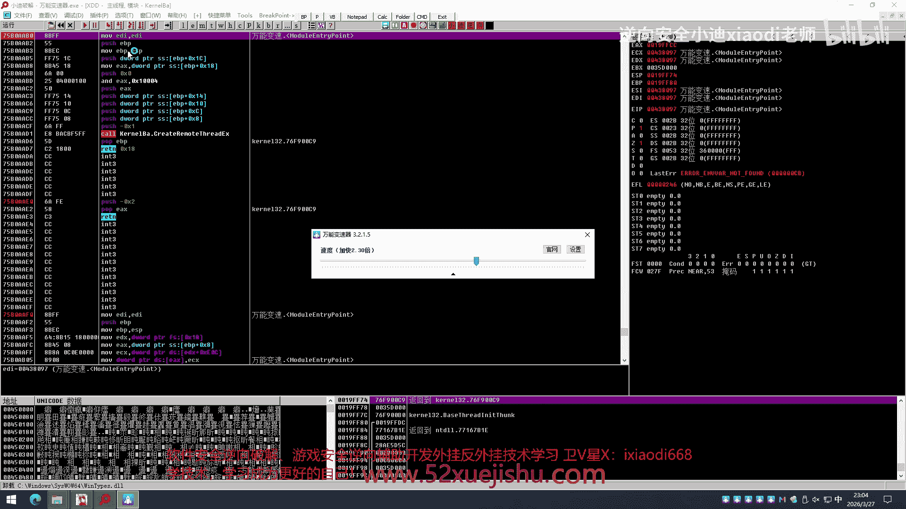

随后看到地址348处的跳转：程序会跳到348，而348处执行的动作与打开网页有关。现场判断这个函数“好像就不能要了”，意思是这个函数一直在负责打开网页，行为很可疑。原文还提到“get a three local这个函数好像就不能要”，说明这个函数也需要重点标记，因为它持续参与打开网页相关逻辑。

接下来用OD查看，确认相关调用是ShellExecuteW，于是基本可以判断：程序通过ShellExecuteW打开网页，而且这个动作是在线程中执行的。现场还提到使用“奶油版OD”，程序能够跑起来，表面看没有明显问题，但随后出现挂起现象。这里提醒我们，程序表面的“能跑”不代表没有反调试，挂起和异常都可能是检测逻辑在起作用。

## 🌐 软件逆向破解实战：3.27.3：定位打开网页的API

上一节我们确认了程序会在线程中打开网页，本节中我们来看看打开网页通常会调用哪些API。现场先尝试在ShellExecuteW处下断点，随后提出一个更简单的思路：直接断MessageBox，因为弹窗往往比网页调用更容易捕捉。实际调试中看到MessageBox相关断点后，可以更快定位到弹窗逻辑。

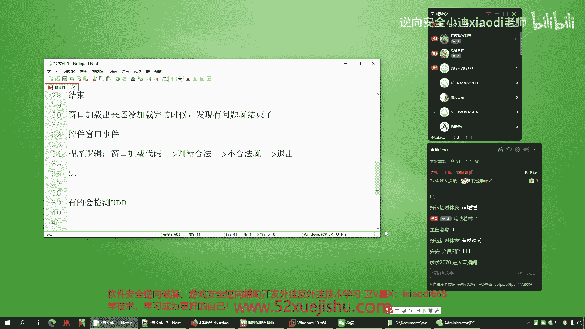

这里总结一个知识点：如果程序打开网页，一般会调用ShellExecuteA或ShellExecuteW。现场用“shaXW”“筛SWW”等口语描述，实际对应的就是ShellExecuteW这一类API。若程序打开浏览器并访问网页，基本上就会走到这个API附近。直播中提示学员理解后扣1，目的就是把这个知识点记住。

对应的核心API可以简单写成下面的形式：

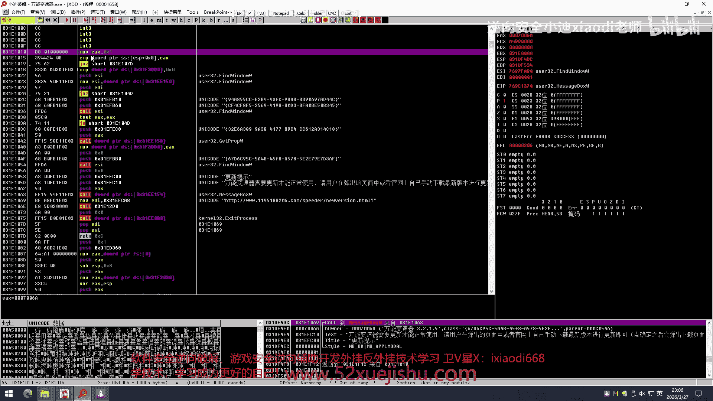

```c
ShellExecuteA(NULL, "open", url, NULL, NULL, SW_SHOW);
ShellExecuteW(NULL, L"open", url, NULL, NULL, SW_SHOW);
```

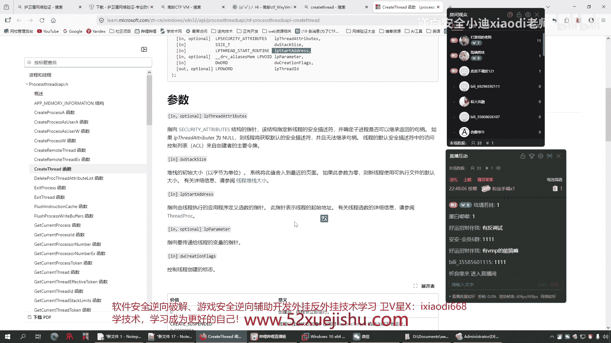

随后现场关掉当前调试，重新来一遍，并决定改断MessageBox。这里出现了MessageBoxA与MessageBoxW两种可能，因此分别在MessageBoxA和MessageBoxW附近下断点。运行后程序被终止，说明程序不让下断，或者检测到了调试行为。现场判断这可能还是与ShellExecute相关，也可能是程序检测到了UDD。经过处理后又可以继续调试，说明前面的判断方向是对的。

## 🧪 软件逆向破解实战：3.27.4：OD检测与UDD反调试

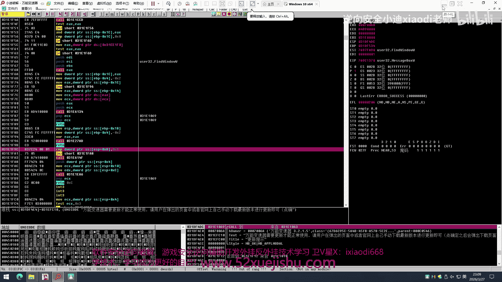

上一节出现了“下断后被终止”的现象，本节中我们来看看这类现象背后的常见原因。现场判断程序可能检测了UDD，也就是OD运行时生成的UDD文件。原文提到“有的会检测UDD”，这属于一种反调试手段。对于OD来说，确实能过掉一部分检测，但不是全部都能过。

如果遇到一种情况：刚开始OD能正常调试，调了两三次后就不能调了，那么可以考虑检查UDD。处理方式很直接：把UDD相关文件删掉即可。现场把这类内容称为“小知识”，意思是平时不容易注意到，但实际调试中很有用。直播中提示学员学到后扣1，再扣一波1，说明这个点值得记录。


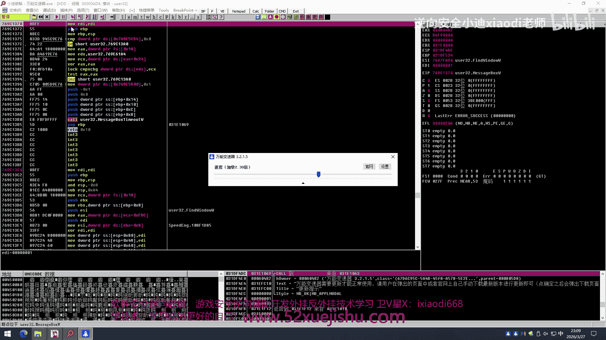

下面用伪代码表示这类检测的大致思路：

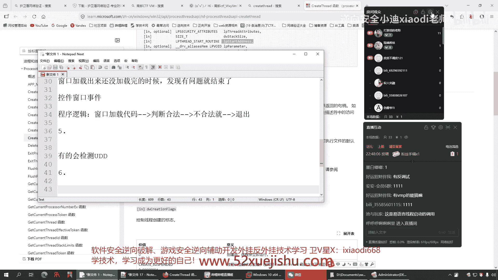

```c
if (检测到调试器或UDD痕迹) {
    终止进程();
}
```

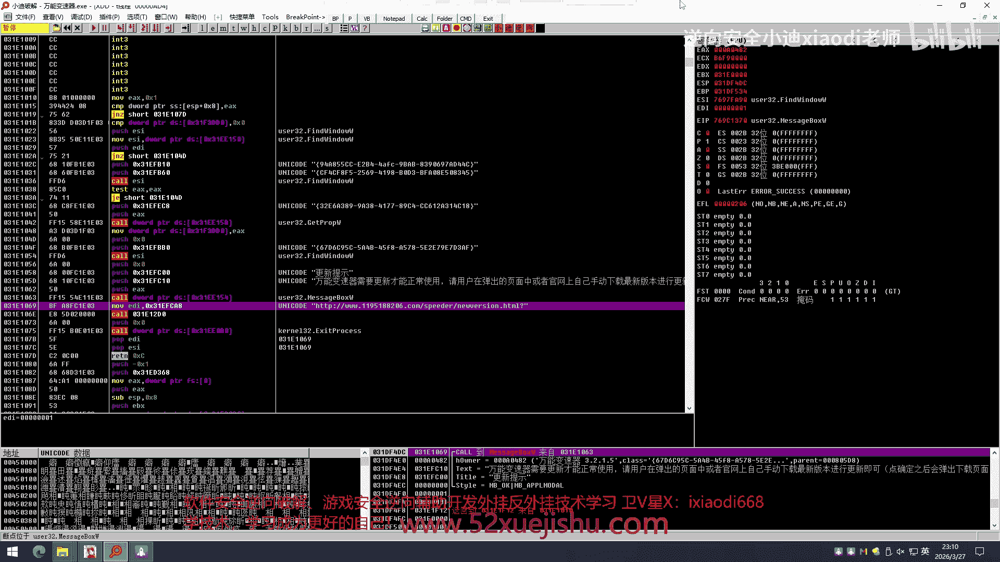

这类检测不一定在程序入口处发生，也可能在运行一段时间后触发。因此调试时要留意“第一次能调、后面不能调”的变化，不要只盯着当前断点，还要考虑调试环境本身是否被标记。

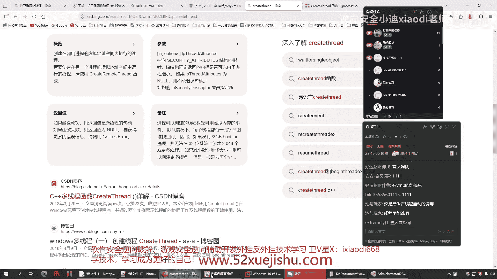

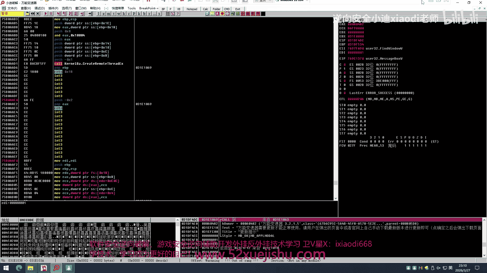

## 🧵 软件逆向破解实战：3.27.5：分析线程创建与线程套线程

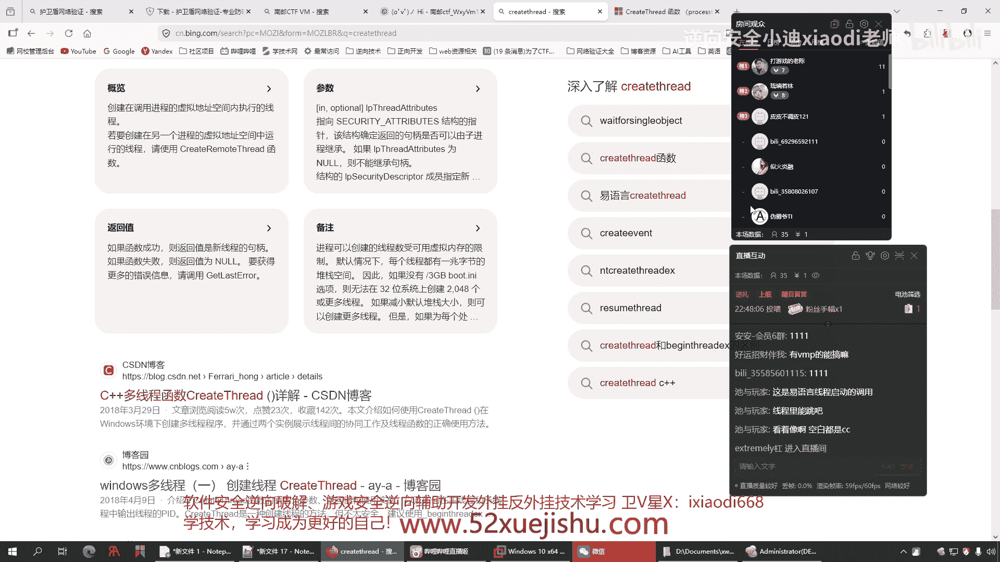

上一节处理了OD检测问题，本节中我们来看看程序如何创建线程。现场确认程序还是在线程里跑，说明它创建了额外线程。若要去掉更新逻辑，就需要关注线程起始地址，因为线程地址可能是随机的，不能只靠固定地址下断。于是选择断CreateThread，观察它如何使用。

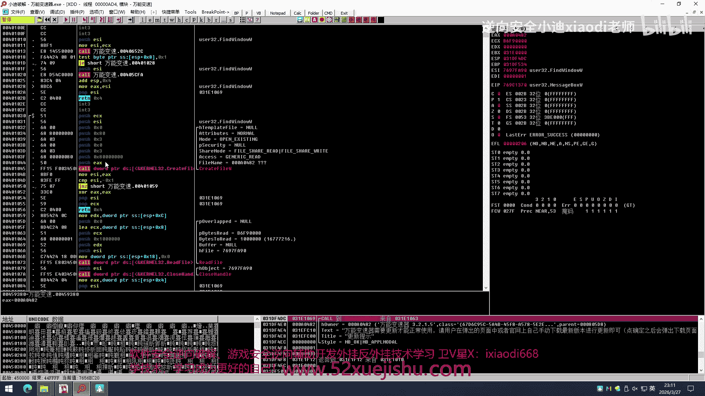

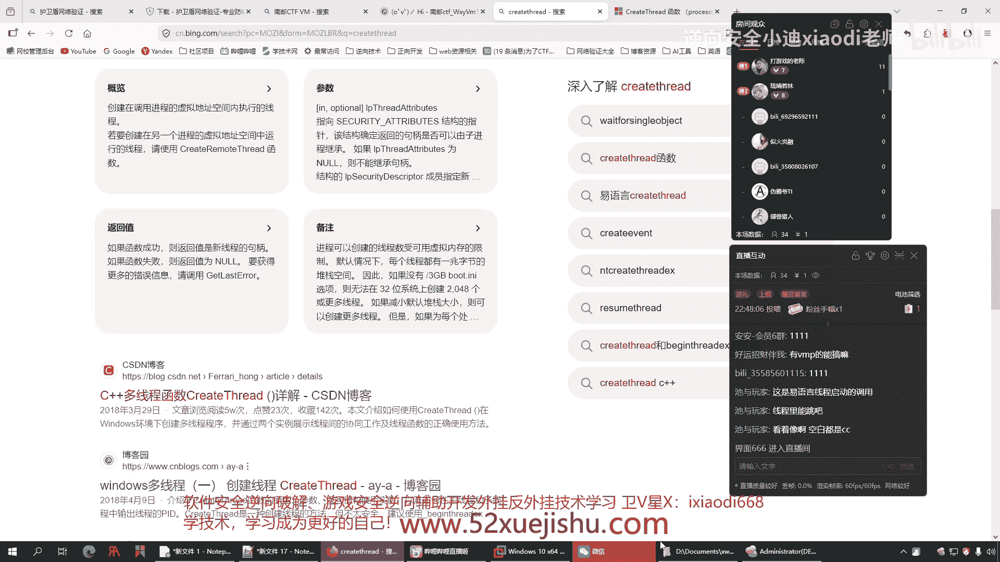

CreateThread的参数可以简单理解为：第一个参数是相关指针，第二个参数与大小或参数数量有关，第三个参数是函数指针，表示线程的起始地址。核心概念可以用下面的代码描述：

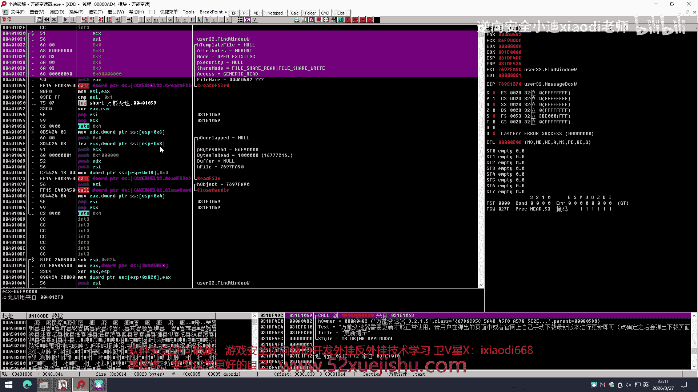

```c
HANDLE hThread = CreateThread(
    NULL,              // 安全属性
    0,                 // 栈大小
    lpStartAddress,    // 线程起始地址，关键参数
    lpParameter,       // 传给线程的参数
    0,                 // 创建标志
    NULL               // 线程ID
);
```

现场看到线程执行某个操作后，提出一个直接思路：线程启动之后把它杀掉即可。随后又发现这里也是线程，而且存在“线程套线程”的情况，也就是一个线程里又创建了另一个线程。现场评价“它不是一个省油的灯”，意思是这个程序在线程创建上做了额外处理，不能只看一层。

## 🧬 软件逆向破解实战：3.27.6：判断易语言与黑月编译特征

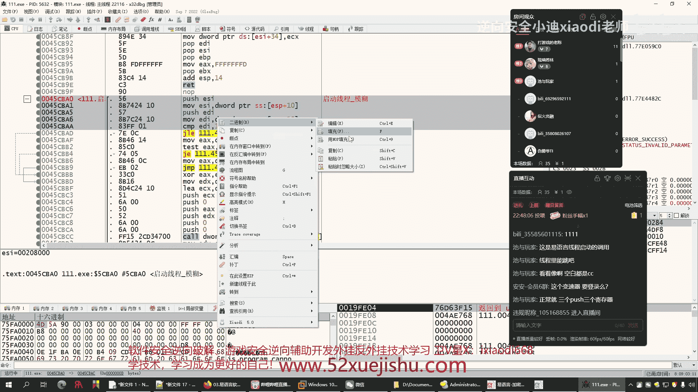

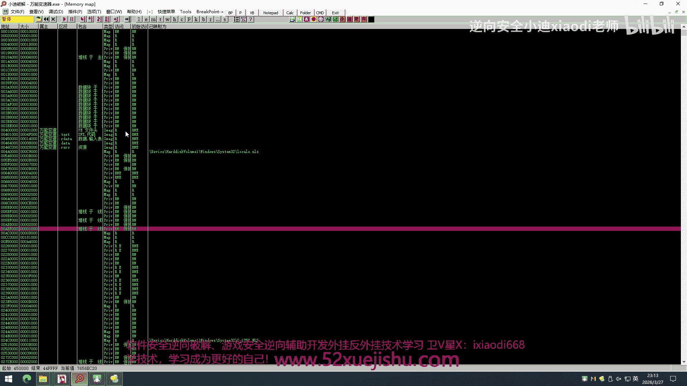

上一节看到线程套线程，本节中我们来看看程序的编译特征。现场先怀疑这是不是易语言程序，查看后发现代码空白处都是CC，地址附近出现8000这类特征，于是判断它很像易语言程序。原文中“是语言是语言”可以理解为确认它是易语言。

随后问题变成：这个易语言程序是怎么编译的。现场猜测可能是黑月编译，也可能是“黑哥编译”这类说法，本质都是在讨论非标准编译方式。正常易语言启动线程时，现场尝试回忆其线程启动特征，提到“按钮一被单击”“启动线程”等关键词，并尝试用二进制复制特征码的方式去匹配。

核心判断可以用下面的伪代码表示：

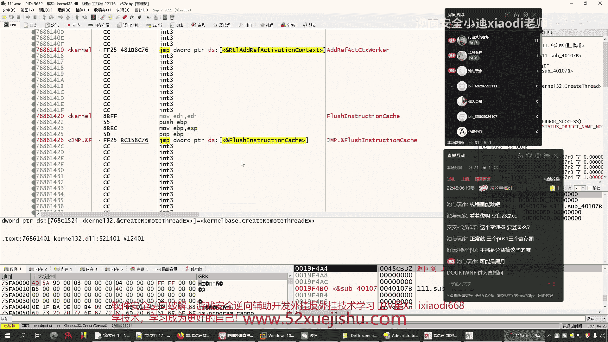

```c
if (程序调用启动线程()) {
    预期断在 CreateThread;
}
```

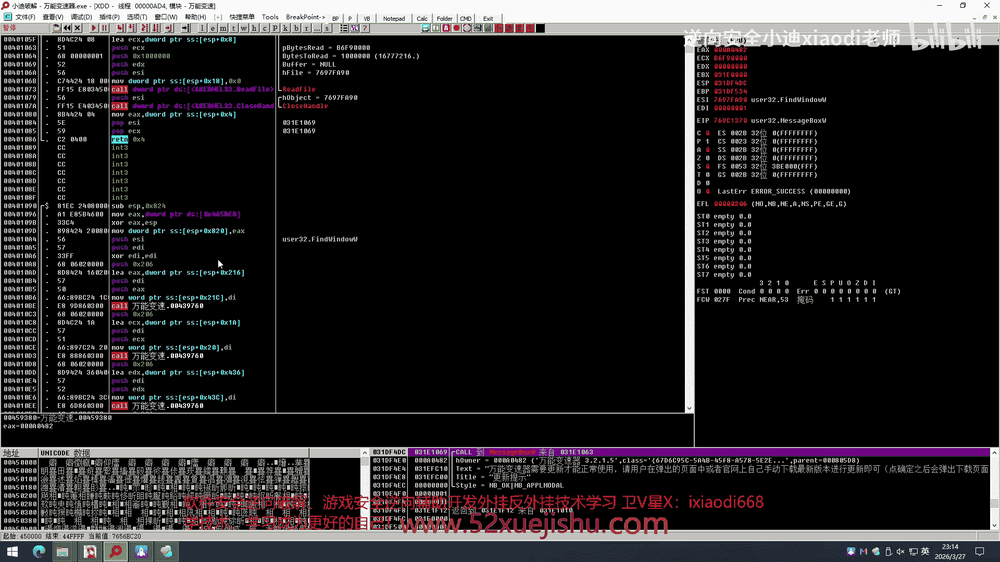

但实际调试中，虽然程序确实能跳转，却没有断在CreateThread，现场下了断点也没有断下来。现场强调：如果它启动线程，理论上一定会走CreateThread，但这里并没有走，所以编译手法很古怪。易语言玩家能理解这个顾虑，因为即便使用黑月编译，启动线程也应该走CreateThread，但实际没有走，这就是诡异之处。

继续观察后发现，程序最终调用的是ZwCreateThreadEx。也就是说，它没有走常见的CreateThread，而是走了更底层的线程创建实现。现场提到后面讲注入相关技术时会更清楚，这类底层调用里面“还是有所猫腻”。随后继续跟踪返回值，观察它转了几次，发现断点可能不止一次，第二次才来到目标模块。

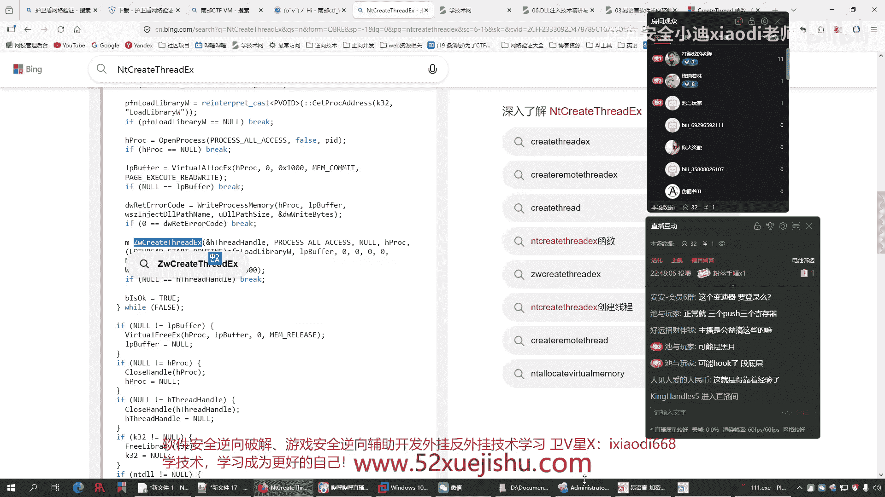

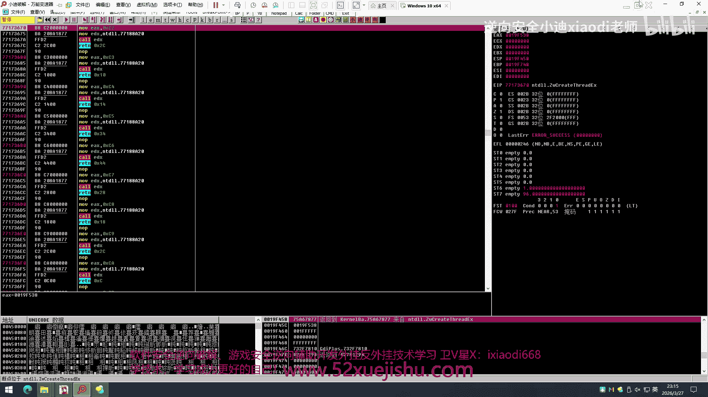

## 🧱 软件逆向破解实战：3.27.7：为什么不能直接改代码

上一节跟踪到ZwCreateThreadEx并来到目标模块，本节中我们来看看能否直接改代码。现场观察到模块中出现“speEN”或“enghelper”这类标识，判断检测逻辑就在这个模块里。但进一步查看发现这边被混淆了，现场连续确认“是不是被混淆住了”，说明直接阅读代码已经很困难。

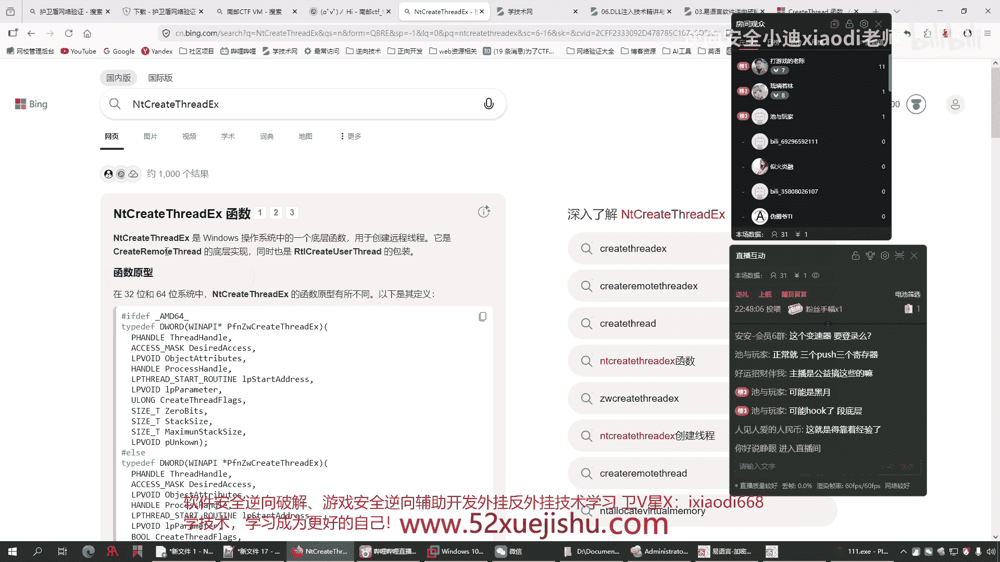

随后尝试查找参考、选择命令，现场用“掰扯”来形容顺着调用关系去梳理。结论是：直接干代码好像不太可行。也就是说，面对混淆后的代码，硬改指令并不是最优方案。原文明确说“直接干这个东西不太可行”，因此需要换思路，用HOOK来处理。

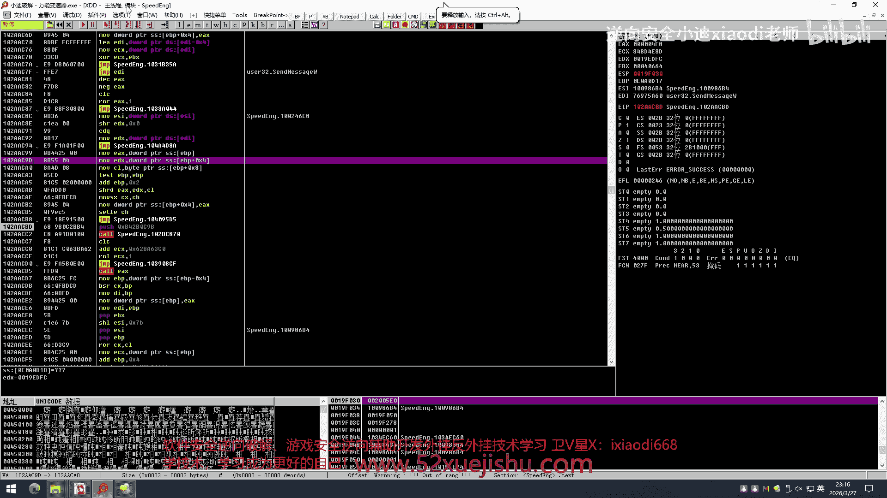

## 🪝 软件逆向破解实战：3.27.8：方案一：Hook线程启动地址

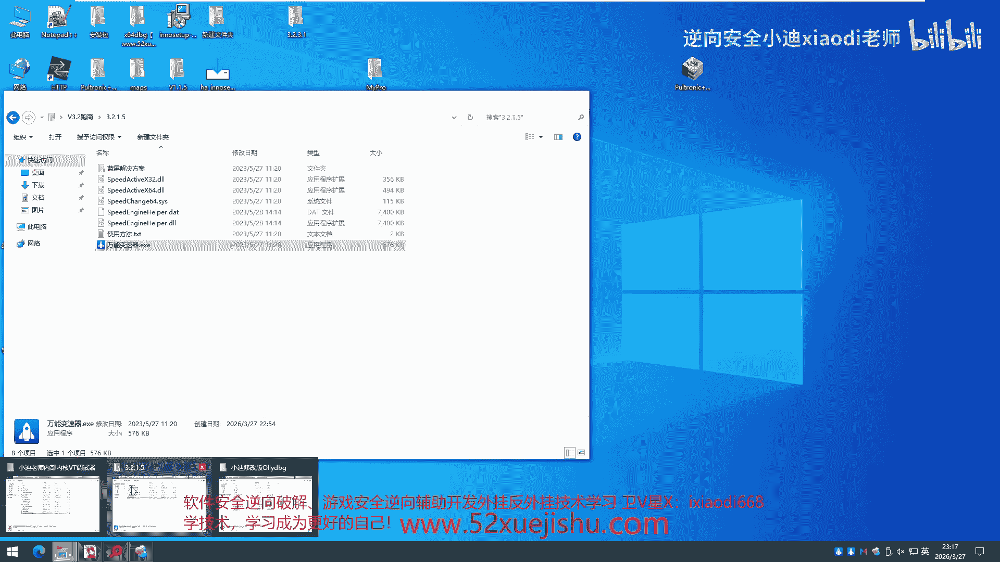

上一节确认直接改代码不可行，本节中我们来看看第一个HOOK方案。现场给出第一个方子：去HOOK它。HOOK的时机要等到第七章节，第七节会讲到Inline Hook或手动Hook。现在可以先理解思路：HOOK之后把参数改一改，尤其是把远线程启动的地址替换掉。

原文看到的是程序要启动、要调用的一些代码，其中包含远线程启动的地址。处理方式是把该地址替换成一个比较合规合法的地址。前面的内容不要动，因为如果顺着原有逻辑走，可能会造成一些错误。程序其他地方也可能在创建线程，所以只处理一个关键点即可。

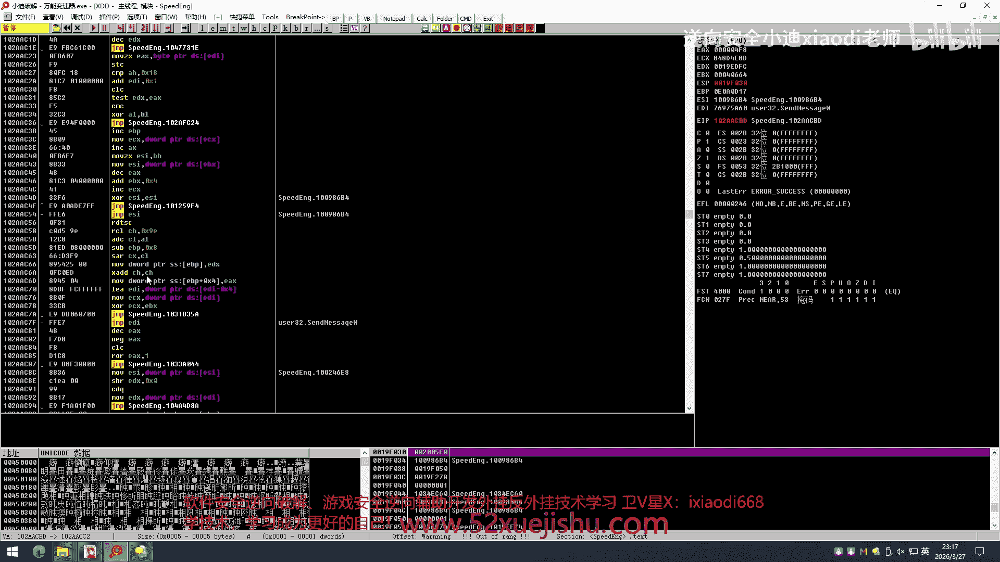

核心思路可以用下面的伪代码描述：

```c
// HOOK 线程创建相关函数后，修改线程起始地址
lpStartAddress = 合法地址;
```

现场还提到“信息框的前面直接跳”，但当时认为没有合适时机。随后讨论到可以在信息框前面的数据处做处理，寻找信息框前面的地址，然后直接跳转。易语言玩家提出的这个思路被现场确认是正确的。这个方案的重点是：不要大面积修改，只替换关键地址或关键跳转，避免影响其他线程创建逻辑。

## 🪝 软件逆向破解实战：3.27.9：方案二：Hook信息框、ShellExecute与退出函数

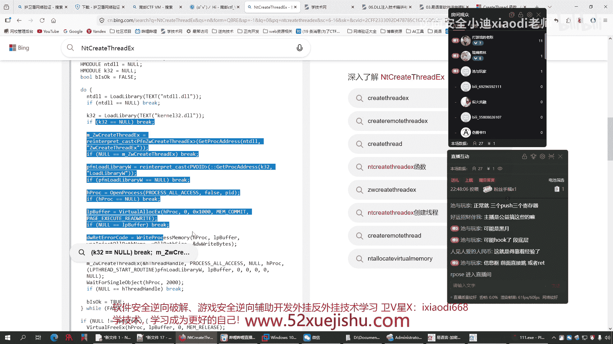

上一节给出第一个HOOK方案，本节中我们来看看第二个更轻松的方案。现场说还有一个方案不打字，让学员自己听。原文中有一句“人见人爱的人民币走了”，这是直播中的口语化调侃，与具体技术无关，可以忽略。技术上的核心是：把信息框HOOK掉。

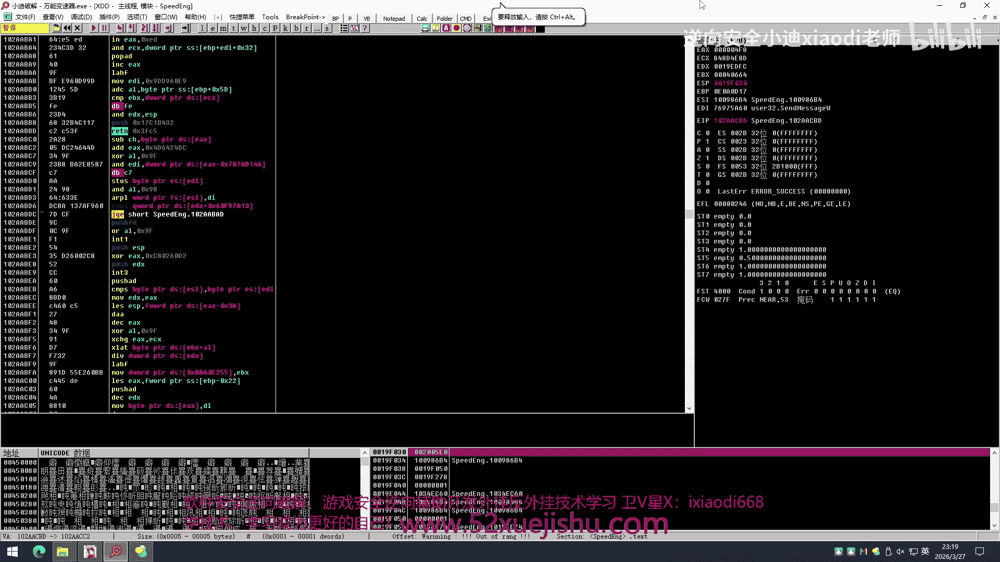

信息框HOOK之后，直接返回空即可，也就是“眼不见为净”。这样弹窗不会出现，用户看不到提示。对应的伪代码如下：

```c
MessageBoxA = Hook后返回0;
MessageBoxW = Hook后返回0;
```

接着再HOOK ShellExecute。把ShellExecute清空之后，程序就不会打开网页。对应思路如下：

```c
ShellExecuteA = Hook后直接返回;
ShellExecuteW = Hook后直接返回;
```

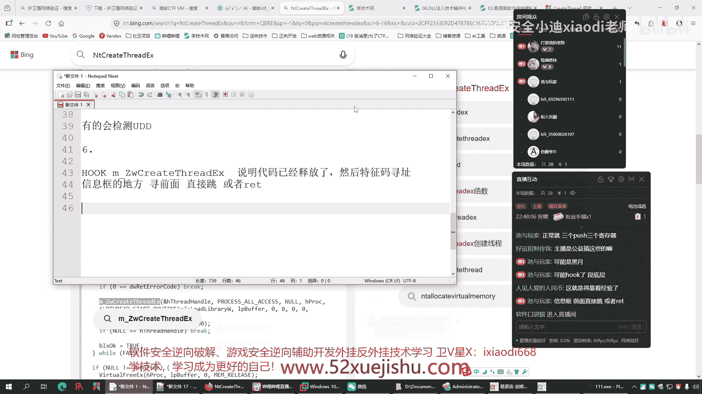

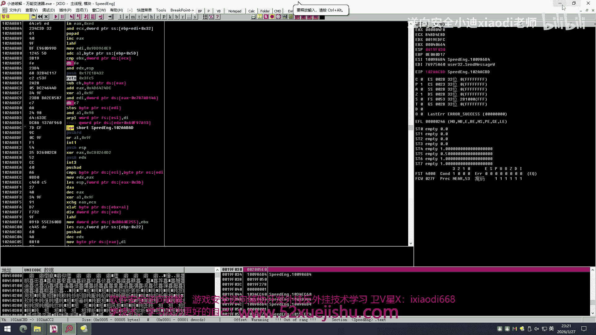

但是程序还是会退出，因此还要做一个退出相关的HOOK，把退出函数干掉。现场给出两个方子，让学员自己看着来。比较之后发现第二个方案更轻松，因为程序不退出后，可以把那边所有代码控制住。单纯HOOK信息框、ShellExecute这些函数，最后程序还是会退出，所以还是要分析线程里怎么检测、在哪里退出。

进一步的处理是：直接一个JMP，或者直接一个RET。核心概念可以写成：

```asm
jmp 目标地址
; 或者
ret
```

直接RET之后，信息框也不弹，网页也不开，退出也没有，逻辑都被干掉，再在头部RET即可。现场结论是：HOOK这里最简单，所以先讲这个方案，其他方案相对麻烦。最后一句“就这样HOOK它”就是对方案二的总结。

## ✅ 软件逆向破解实战：3.27.10：课程总结

本节课中我们一起学习了如何从直播调试过程整理出完整的逆向分析思路。我们首先观察程序行为，确认它在线程中执行检测并打开网页；然后定位ShellExecuteW和MessageBox等关键API；接着处理OD检测与UDD反调试；再分析CreateThread、ZwCreateThreadEx以及线程套线程现象；随后判断易语言与黑月编译特征，并确认混淆导致直接改代码不可行；最后给出两种HOOK方案，一种是HOOK线程启动地址并替换参数，另一种是HOOK信息框、ShellExecute和退出函数，配合JMP或RET完成处理。

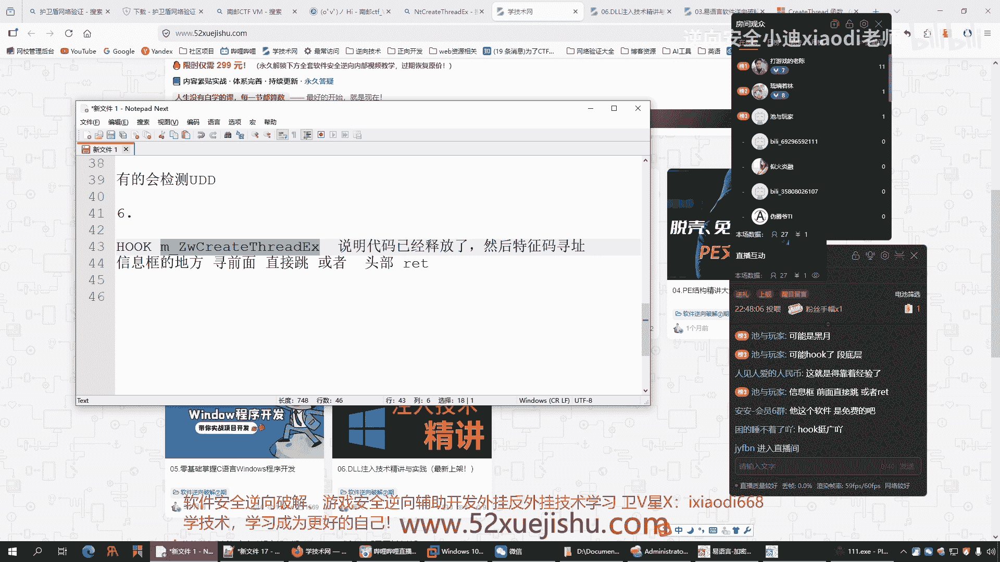

回顾整个流程，最重要的是分析顺序：先看调用关系，再看线程创建，再看编译特征和混淆情况，最后选择改动最小的HOOK点。直接改代码不一定可行，HOOK也不一定越复杂越好，能让程序不弹窗、不打开网页、不退出，并且不影响其他正常线程，才是更稳妥的做法。后续第七章节讲HOOK时，可以再把本节提到的Inline Hook和手动Hook细节补上。

