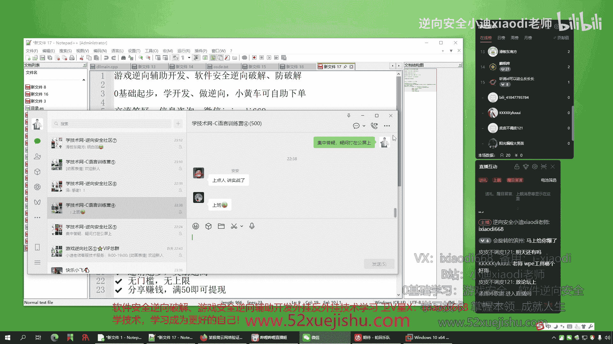

# 软件逆向实战：3.4：代码HOOK修改网络验证卡密软件时间戳 🧩

## 软件逆向实战：3.4.1：课程概述 📌


在本节课中我们将要学习如何用代码Hook修改网络验证卡密软件的时间戳，并借此理解软件逆向破解补丁的基本思路。这个内容来自3.4直播回放，主题是“代码HOOK修改网络验证卡密软件时间戳”，同时包含真实逆向实战分析，属于游戏安全、软件安全、网络安全和CTF比赛必备基础，直播回放编号为BV1pkPszvE71-。为了让初学者能跟上，本教程会先解释关键函数和调试动作，再讲时间戳覆盖和API Hook，最后说明破解效果和课程后续安排。你可以把整节课理解成一条线：先找到能拦截网络信息的函数，再在调试器里下断点观察数据，接着用代码取当前时间并覆盖原时间戳，最后用Hook库把拦截和覆盖做成自动流程。下面按这个顺序展开。


## 软件逆向实战：3.4.2：确认调试目标与关键函数 🎯

上一节我们说明了本课要解决的问题和整体目标，本节中我们来看看调试前需要确认的目标和关键函数。直播开始后，讲师先确认正在调试哪个程序，原文提到的是Old程序，这个细节说明实战前要先锁定目标进程，不要一上来就乱改。接着要记住一个能拦到目标信息的关键函数，直播中明确提到用InternetReadFile这个函数，并在这个函数上下断点，因为它可以拦截到信息。这里用大白话解释：Hook就是让程序本来要调用的函数先跳到我们自己的函数里，我们处理完再决定是否回到原函数。核心流程可以用公式表示：

```text
Hook流程 = 找到目标函数地址 -> 保存原函数 -> 把入口跳到自定义函数 -> 自定义函数处理数据 -> 需要时调用原函数
```

以下是本节需要记住的关键点：

- 调试目标先确认为Old程序，原文中提到“我看一下调的是哪个程序，Old”。

- 能拦截信息的关键函数是InternetReadFile，直播中提示在这个函数上下断。

- 这种Hook思路要记录关键函数，核心是知道“用的是什么函数”。


- 直播中提示“学到的扣1”，这是课堂互动，表示确认自己已经理解关键点。

记住这些点以后，后面下断点和看数据就不会迷路。下一节我们进入调试器，看看断点命中后能观察到哪些卡密相关信息。

## 软件逆向实战：3.4.3：下断点观察卡密信息 🔍

上一节我们确认了关键函数和Hook思路，本节中我们来看看实际下断点后如何观察卡密信息。操作上，直播中随便点击输入并触发网络请求，断点命中后可以看到mark code等信息都出现在调试器里，说明网络验证相关的数据已经暴露在断点位置。直播中还提到尝试发送操作时程序卡住，DBG卡住，系统太卡，并反复提示赶快加入社区学习，甚至用“再不学我就得卡死”来调侃直播环境。随后直播换到新电脑，启用断点，点击登录后断点命中，再用F8单步一次一次执行，观察程序接下来做什么。这里解释一下：断点就是让程序运行到指定位置停下来，F8单步就是一次执行一行代码，适合初学者慢慢看清程序顺序。这里要注意，调试环境卡顿会影响节奏，但核心动作不变：下断点、触发登录、命中后单步、查看寄存器或内存里的字符串。下一节我们在这个观察结果上继续，看看怎样获取秒数并覆盖时间戳。

## 软件逆向实战：3.4.4：获取秒数并覆盖时间戳 🕒

上一节我们通过断点看到了网络返回的数据，本节中我们来看看如何获取秒数并用代码覆盖时间戳。直播中在调试位置查看并获取秒数，随后写代码获取当前秒数，获取完成后再把原时间戳字符串取出来，用内存复制进行覆盖。原文提到“memmosme copy”，可以理解为memcpy一类内存复制操作；覆盖完成以后，原时间戳就被伪造成当前时间。直播中展示，覆盖后里面的数据会被实时时间戳替换，能看到这是卡密，这是实时时间戳，而时间戳会在某个位置进行组合。也就是说，程序会把卡密和实时时间戳拼在一起做校验，我们通过相关API函数获取实时时间戳，再把原值覆盖即可。下面用伪代码描述这个核心动作：

```c
// 时间戳覆盖伪代码
time_t now = time(NULL);
char new_ts[32];
sprintf(new_ts, "%lld", (long long)now);

// 找到原时间戳字符串所在缓冲区
memcpy(原时间戳缓冲区, new_ts, strlen(new_ts) + 1);
```

这段代码的重点不是死记函数名，而是理解“取当前时间、转成字符串、复制到原缓冲区”的顺序。直播中还提到两种修改思路，后面会单独列出来。下一节我们把这套覆盖动作放进Hook流程，让程序每次走到网络读取函数时自动完成修改。

## 软件逆向实战：3.4.5：使用API Hook与mhook库 🪝

上一节我们完成了时间戳覆盖的基本思路，本节中我们来看看用API Hook和mhook库把这件事做成自动流程。直播中说明，这里用的是API Hook，用到的库是mhook库，这个库可以自己去找，网上有很多类似实现。mhook可以比较轻松地创建x86和x64的函数钩子，直播中展示了现成代码，拿过来就可以用，也建议初学者自己试一试。核心概念可以用代码表示：

```c
// mhook 思路伪代码
Mhook_SetHook((PVOID*)&pInternetReadFile, MyInternetReadFile);

// 自定义函数里先处理数据，再决定是否调用原函数
BOOL WINAPI MyInternetReadFile(HANDLE hFile, LPVOID lpBuffer, DWORD nBytesToRead, LPDWORD lpNumberOfBytesRead) {
    // 在这里获取实时时间戳并覆盖原值
    return pInternetReadFile(hFile, lpBuffer, nBytesToRead, lpNumberOfBytesRead);
}
```

以下是两种常见修改思路：


- 手动修改时间戳：找一个和当前时间比较相近的时间戳，直接改原值，适合临时验证。

- 代码Hook修改：用InternetReadFile之类的函数拦截网络信息，在自定义函数里获取实时时间戳并覆盖原值，适合做成自动流程。

直播中评价mhook挺好用，并再次强调最核心的是要知道目标函数是什么，函数记不住，后面的Hook和覆盖都无从谈起。下一节我们看看破解完成后的效果，验证这套思路能否让卡密验证直接通过。

## 软件逆向实战：3.4.6：破解效果展示 ✅

上一节我们介绍了Hook的实现方式，本节中我们来看看破解完成后的实际效果。直播中展示，破解完成以后程序启动成功，随便输入卡密后进入修改后的流程，卡密验证成功并直接进入软件，不需要再手动点击，当然手动点击也可以。这个效果说明前面的时间戳覆盖和API Hook已经作用到网络验证环节，程序拿到的实时时间戳符合校验逻辑，所以卡密验证被绕过。对初学者来说，这里要重点观察“启动成功、输入、验证成功、直接进入”这四个现象，理解它们分别对应前面的哪个步骤。看到效果以后，直播转入课程说明和后续安排，下面把这些信息整理出来。


## 软件逆向实战：3.4.7：课程说明与后续学习 📚

上一节我们看到了破解效果，本节中我们来看看课程说明、后续安排和工具相关信息。直播中明确提到要卖课，接下来要学习VIP内容，网上那些免费内容没有这些内容；如果错过直播，就错过太多内容，而且没有回放，想学习相关知识只能在这个地方学。直播内容后续会放到VIP内容里，后续还会做直播讲“奇淫技巧”，一些逆向技巧会放进去，因为这类内容不属于系统性知识，全是零散内容，无法系统化学习，全是实战的零散知识。直播中反复提示想学就抓紧，抓紧加入；直播中确认有学员是会员，有学员问一个月能否学完，答复是学得快也可以，主要看个人学习能力，一个月可以，但取决于学习能力。有人问能否破解会员，答复是想得美，不可以。以下是课程说明和后续安排相关信息：


- 课程定位：直播回放对应3.4，主题是代码Hook修改网络验证卡密软件时间戳，属于真实逆向实战分析。


- VIP内容：直播内容后续会放入VIP内容，免费内容没有这些知识，回放不提供。

- 后续直播：后续会讲“奇淫技巧”，把零散的逆向技巧放进去，这类内容偏实战，不适合按系统课程方式学习。

- 学习建议：想学就抓紧加入，一个月能否学完看个人学习能力，学得快可以学完。

- 会员限制：有人提出破解会员，答复是不可以，原文用“想得美”回应。

- 直播安排：明天估计没有直播，因为讲师有其他事情，除非有特殊情况；课程结束时提到可以去睡觉了。

以下是工具、实战软件和下单相关信息：

- 实战软件：直播中实战的是社区里的极简云网络验证软件。

- 下单渠道：在爱小迪668下单，加微信下单。

- 工具评价：WDN也好用，PE工具也好用，类似工具很多，很多都挺好用。

- 学员来源：直播间里很多是学员，很多从直播间和群里来，放心来，马上给你报。

- 直播调侃：直播中提到“太坏了，人太坏了”，这是对互动内容的调侃；同时明确不想给回放，因为不想让太多人知道。

- 回放态度：回放免了，原文再次强调回放免了。

这些说明不影响前面的技术主线，但原文中确实包含这些信息，所以一并整理在这里。下一节我们对整节课做总结，把技术流程再串一遍。

## 软件逆向实战：3.4.8：本课总结 🧾



前面几节我们完成了原理、调试、覆盖、Hook和效果展示，本节中我们来做一个整体总结。本节课中我们一起学习了用代码Hook修改网络验证卡密软件时间戳的完整思路：先确认调试目标Old程序，记住InternetReadFile这个能拦截信息的关键函数，在函数上下断点并用F8单步观察卡密和mark code信息；然后写代码获取当前秒数，把原时间戳字符串取出来，用memcpy一类内存复制进行覆盖，让程序拿到实时时间戳；接着使用API Hook和mhook库创建x86与x64函数钩子，把拦截和覆盖做成自动流程；最后验证破解效果，程序启动成功、输入卡密后验证成功并直接进入。课程还说明VIP内容、后续直播、学习建议、实战软件极简云网络验证、下单渠道爱小迪668以及WDN和PE工具等信息。整体来看，这节课的核心就是抓住关键函数，理解时间戳组合位置，再用Hook把实时时间戳覆盖进去，从而完成网络验证卡密软件的时间戳修改实战。

