# 软件逆向实战：3.4：直播回放——破解网络验证时间戳校验

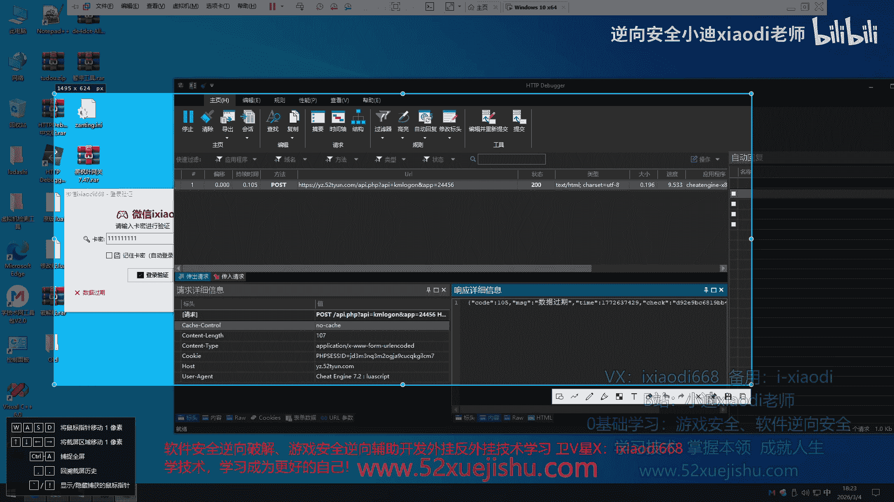

## 🎯 本节概述

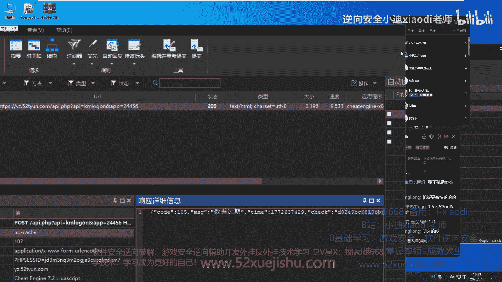

在本节课中，我们将通过一个真实的Lua外挂脚本网络验证卡密软件案例，学习如何利用抓包、伪造响应、修改时间戳等手段，一步步突破软件的时间戳校验机制。通过这个实例，你将深入理解网络验证的基本原理以及常见的绕过思路，为后续的软件安全、CTF比赛打下基础。整个过程基于B站视频BV1ZTPpzDEkq-的直播实战内容整理而成。

## 📡 抓包分析：查看登录返回内容

一开始，我们先按照既定的步骤来操作。我们打开了HTTP调试器（如HEP Debugger）进行抓包，然后点击软件中的登录按钮，观察服务器返回的内容。这里的关键是查看返回的数据包内容，分析服务器到底给了客户端什么样的响应。通过抓包，我们能看到客户端发送了什么请求，服务器又返回了什么数据，这些数据往往包含了验证结果的关键信息。比如，它会告诉我们卡密是否有效、是否过期，或者存在哪些异常状态。我们聚焦于返回内容本身，就像平时做逆向分析一样，先看响应体里有什么字段，再判断下一步怎么做。这一环节是整个逆向过程的基础，因为只有弄清楚了网络交互的逻辑，才能有针对性地进行后续的伪造和修改。

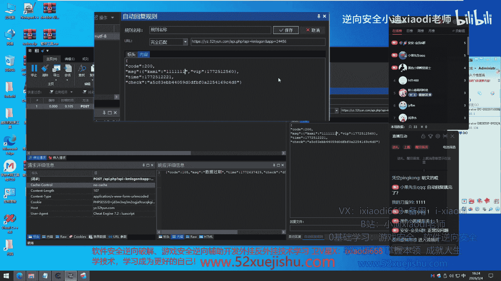

## 🃏 伪造正版卡密：格式正确即可

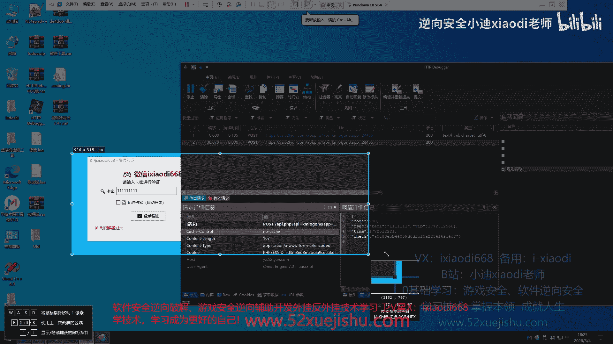

在破解过程中，有同学提到OD（OllyDbg）没有爆破窗口。确实，OD本身并没有提供一个现成的爆破窗口，这种思路在某些情况下可能不太适用。那怎么办？我们不妨试试伪造的方式。什么是伪造？就是直接伪造一个正版卡密的明文数据，冒充正版用户。我们直接告诉答案：答案就在正版卡上。正版卡的数据在论坛里就能找到，我们直接把正版卡的卡密拿过来用。这里重点强调一下：其实只要格式正确就可以了，只要卡密的格式符合软件的要求，就能通过验证。也就是说，我们不需要真的拥有一张正版卡，只需要构造一个格式合法的卡密字符串，让服务器认为它是一个有效凭证。我们在软件里随便输入一个符合格式的卡密，然后观察返回结果。一般情况下，这种做法就能奏效。在正常的网络验证设计中，如果服务器只校验卡密格式而不校验具体内容，那么这种伪造方式就可以直接骗过验证。但这只是简单的情况，别高兴得太早，后面还有更有挑战性的东西等着我们。

## 🔄 设置自动回复：匹配卡密并替换

那么接下来一步，我们需要设置自动回复。这个自动回复的作用，就是在客户端向服务器发送请求时，自动拦截并返回我们预设的伪造数据。首先，我们要配置一个匹配规则，让调试器识别出登录请求。然后，将返回内容替换为我们准备好的正版卡密数据。具体操作就是：把正版卡密放到自动回复的响应体里，然后开启规则。这样，当客户端发起登录请求时，它收到的响应就是伪造的正版验证结果。我们将这个规则保存并启动，然后再点击登录。这时候，我们收到了一个提示。这个提示内容是什么呢？它提示的是：“数据偏差过大”，这是一个完全不同的新情况。这说明前面的简单伪造在这个软件面前已经行不通了，我们需要进一步分析这个偏差是什么，以及如何应对。

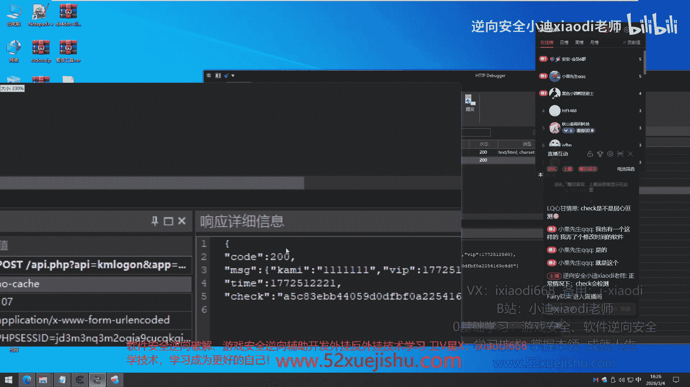

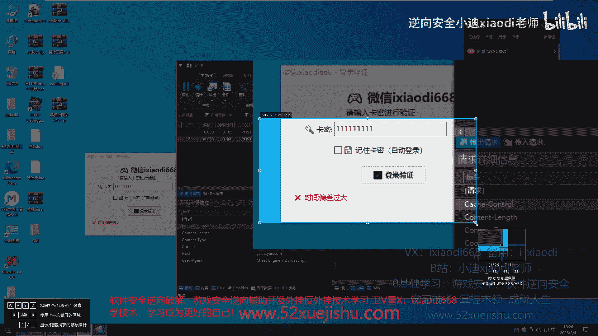

## ⏰ 时间戳校验：服务器端的新防线

我们来看这个“数据偏差过大”的提示。其实这个校验本身没有什么大问题，这个check并没有做强校验。如果它做了强校验，我们还得用同样的方式去处理它。正常情况下，check会检测很多东西，但这一次它并没有检测太多。尽管如此，它依然可以在某些方面做动作。除了check之外，它还能检查什么？我们截个图看看提示的具体内容。它提示的是什么呢？它提示的是时间戳的问题。时间戳是以秒为计次的，目前的情况是客户端时间与服务器时间偏差过大。时间戳是秒级别的，它是一串秒数。那这个东西怎么处理呢？现在的问题是，时间偏差过大，我们不可能用零点几秒的时间去完成操作。我们又不是闪电侠，手速没那么快。虽然可能有的同学手速很快，但正常情况下做不到。所以这个问题需要动脑思考。那么，这个情况怎么办？怎么伪造？伪造是一个技术活，需要大家自己动脑思考。这里有一个思路：有人提出，先扩大时间范围，然后疯狂点击，卡准那个时间点。这个思路确实很巧妙，它实际上是通过高频率的点击请求，让某个请求恰好落在服务器允许的时间窗口内。另外，更直接的做法是写一个程序，自动修改显示时间窗口。换句话说，我们需要在本地把时间戳的值调整到一个合理的范围，然后再发起请求。

## 🛠 手动修改时间戳：在线工具与实操

接下来，我们来实际操作一下。先搜索一下在线时间戳工具，看看有没有实时的。实时的在线时间戳工具显示的时间是不断往上加的，每一秒都在变化。因为本机时间可能有些问题，所以需要先同步一下本机的时间，然后再去尝试。这里先插播一段背景：有一位观众反映，他之前的某个软件就是通过抓包然后修改时间就能破解，结果后来作者发现了这个漏洞，把验证方式改成了服务器时间。这说明，时间戳校验确实是很多软件作者用来对抗破解的手段，但正如我们即将看到的，它并非无懈可击。我们等本机时间同步成功。本机时间是23点25分，时间同步成功之后，我们就可以开始测试了。打开目标软件，随手输入一个卡密，点击登录，提示“时间偏差过大”。这就是预期的结果。然后，我们观察抓包工具中显示的时间戳，当前值大概是某个秒数，比如1772636262。我们需要把这个时间戳改到更接近当前时间的数值。比如，当前是63秒，我们改到80秒，或者直接改到90秒。修改完成之后，再疯狂点击登录按钮。有趣的是，疯狂点击这个操作其实是一种容错机制，因为只要有一次请求通过了校验，就能进入系统。但更根本的原因在于，我们将时间戳调整到了合法的范围内。实际上，都不需要疯狂点击，直接就进来了。这个思路非常绝妙：只要敢想敢干，没有什么事是干不成的。想出了方案就要去执行，执行力到位，自然就成功了。就这样，我们成功突破了时间戳校验，进入了软件内部。

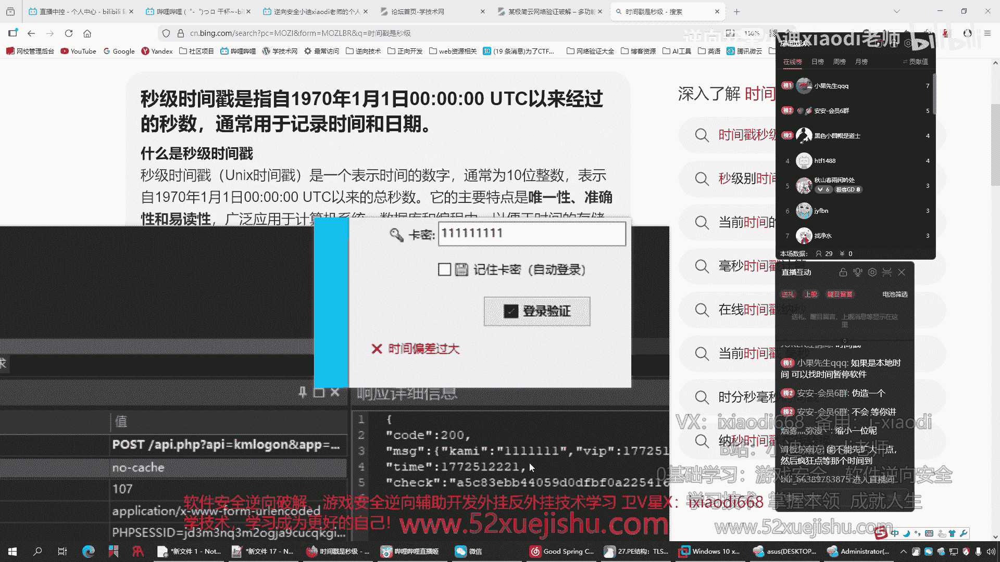

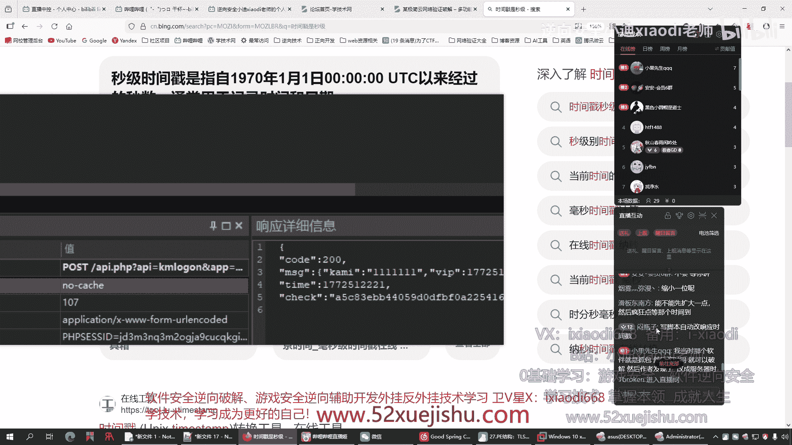

## 📱 进程名称验证与最终爆破

进入软件之后，我们还需要处理另外一层机制。这个软件会通过进程名去检测某个特定的程序，比如检测微信小程序的进程“wechatapp.exe”。我们随便找一个程序，然后伪造一个微信小程序的进程名，也就是将进程名修改为对应的名称，以通过检测。伪造完成后，查找这个进程的进程ID，假设是2072，然后在软件中填入这个ID，点击确定。这时提示“进程匹配成功”。匹配成功之后，就进来了，破开了。这样一来，我们通过一步步的分析，向大家科普了一些相关的知识，又通过观众的奇思妙想，成功地将这样一个软件破解开了。整个过程回顾起来，就像是剥洋葱一样，每遇到一层校验，就找到对应的绕过方案，直到最终完全突破。在面临一个看似不可能绕过的验证机制时，跳出常规思维，换一个角度去思考，就往往能找到突破口。

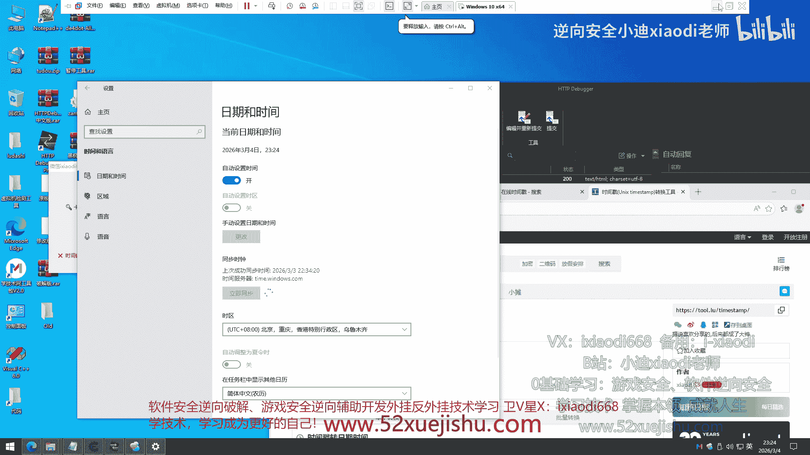

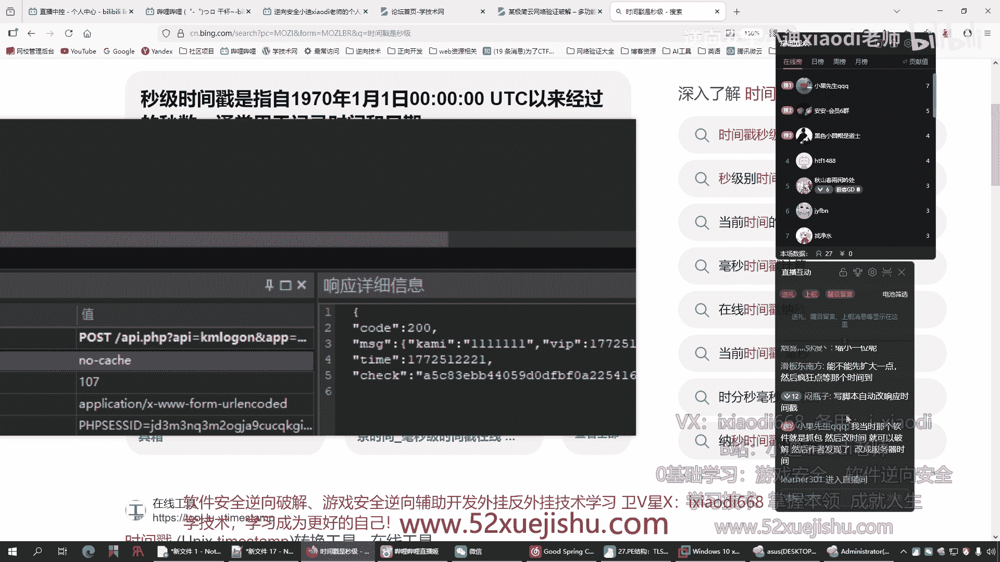

## 💻 代码实现逻辑：自动化改时间戳

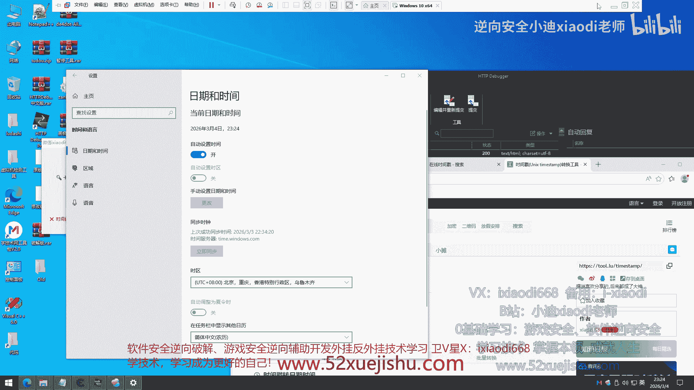

最后，我们再讲一讲怎么用代码去实现这个破解过程。其实代码写起来也很简单，其核心逻辑可以用下面的伪代码来描述：

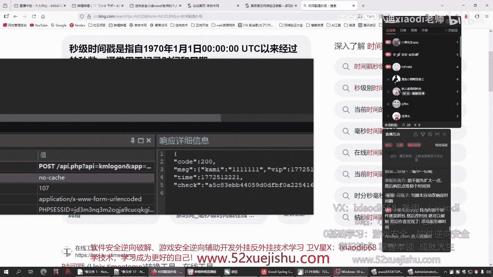

```python
import time
import requests

def login_with_timestamp(card_key, true_server_time):
    # 伪造本地时间戳，将其设置到服务器时间附近
    fake_timestamp = int(time.time())  # 或者直接截获服务器返回的时间戳
    
    # 发送包含伪造时间戳的登录请求
    response = requests.post(
        url="http://target.com/api/login",
        data={
            "card_key": card_key,
            "timestamp": fake_timestamp
        }
    )
    
    return response.json()

# 核心公式：通过本地时间同步绕过后端校验
# 服务器端校验逻辑可表示为： |server_timestamp - client_timestamp| < threshold
# 其中threshold为允许的最大偏差阈值，通常为60秒或更小
# 破解思路是：截获请求中的timestamp字段，将 |timestamp - server_timestamp| 缩小至阈值内
```

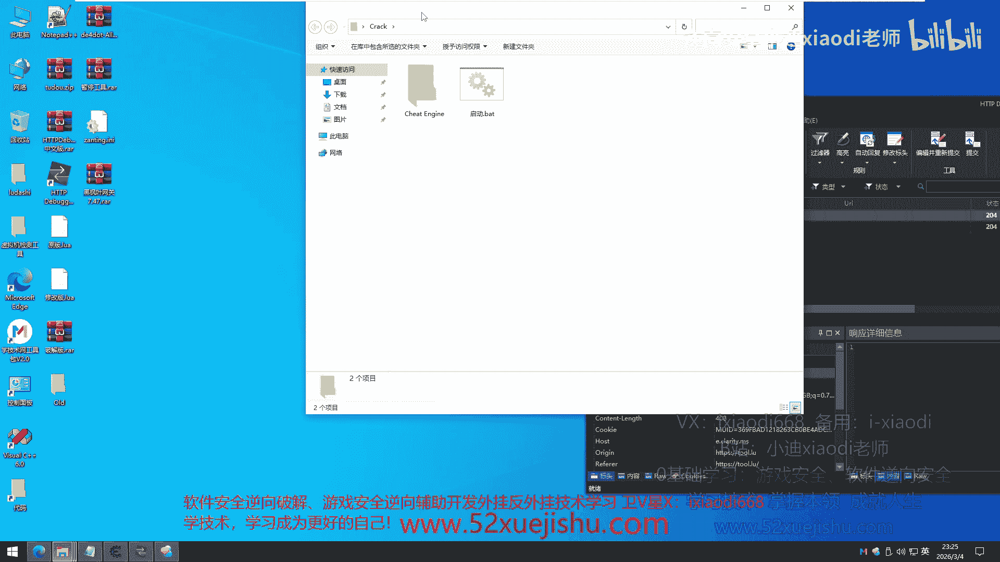

具体的代码逻辑可以归纳为以下几个核心步骤：

1. **拦截请求**：通过抓包工具或中间人代理，截获客户端发送的HTTP请求，提取其中的时间戳字段。

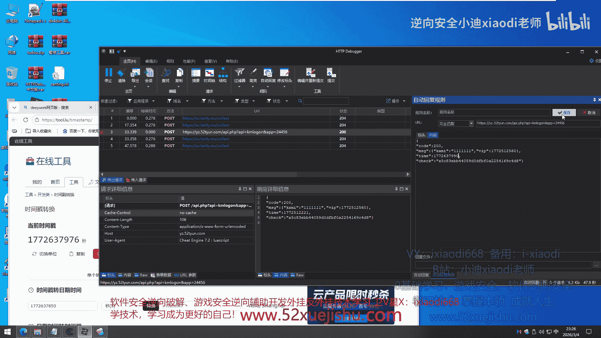

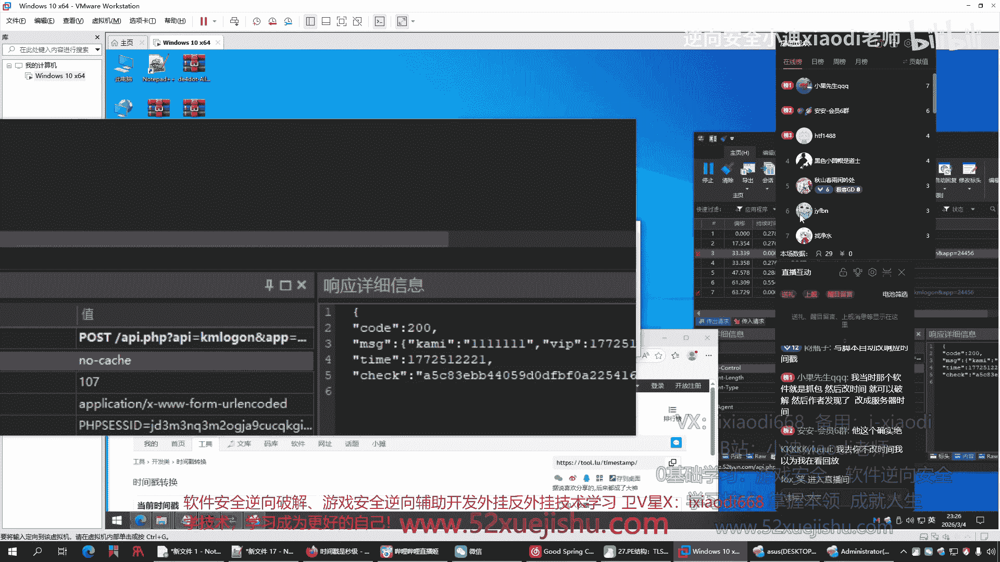

2. **计算偏差**：获取服务器当前的时间戳值。这个值可以从服务器响应头（如Date字段）中解析，也可以从API返回的JSON数据中提取。

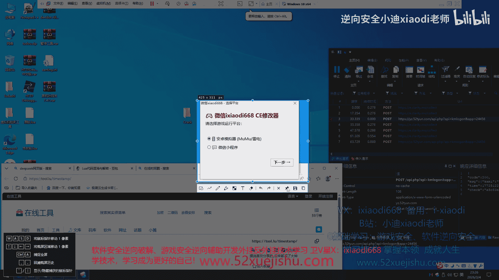

3. **修改时间戳**：将请求体中的时间戳字段修改为当前服务器时间附近的某个值，确保本地时间与服务器时间的差值在允许范围内（比如不超过60秒）。

4. **重放请求**：将修改后的请求重新发送给服务器，完成登录验证。

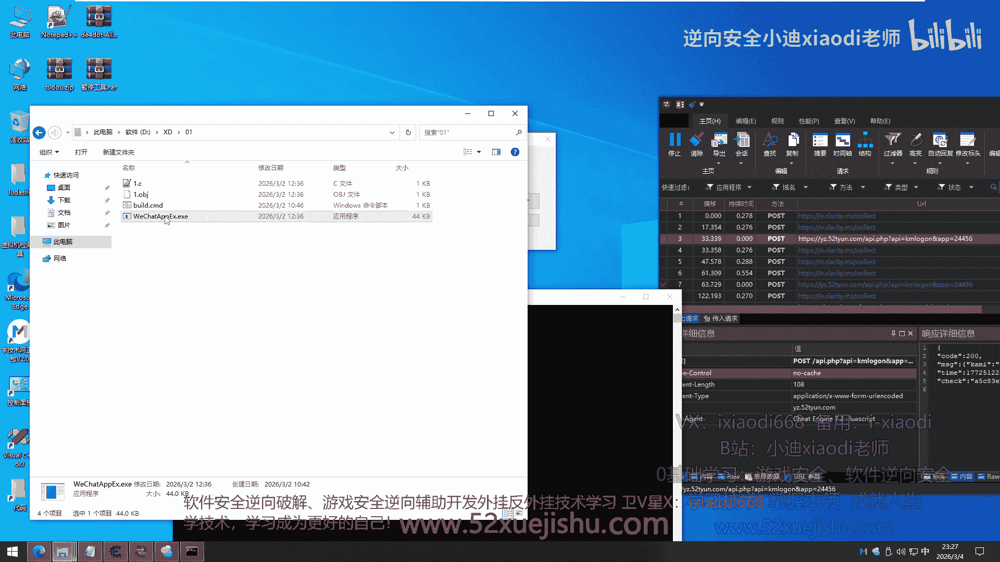

这个公式表示的是服务器端的校验逻辑，它反映了我们的破解思路：当一个请求中携带的时间戳与服务器当前时间相差过大时，服务器会判定为非法请求。通过将客户端的时间戳值修改到合理的区间内，就能骗过服务器的时间校验机制。

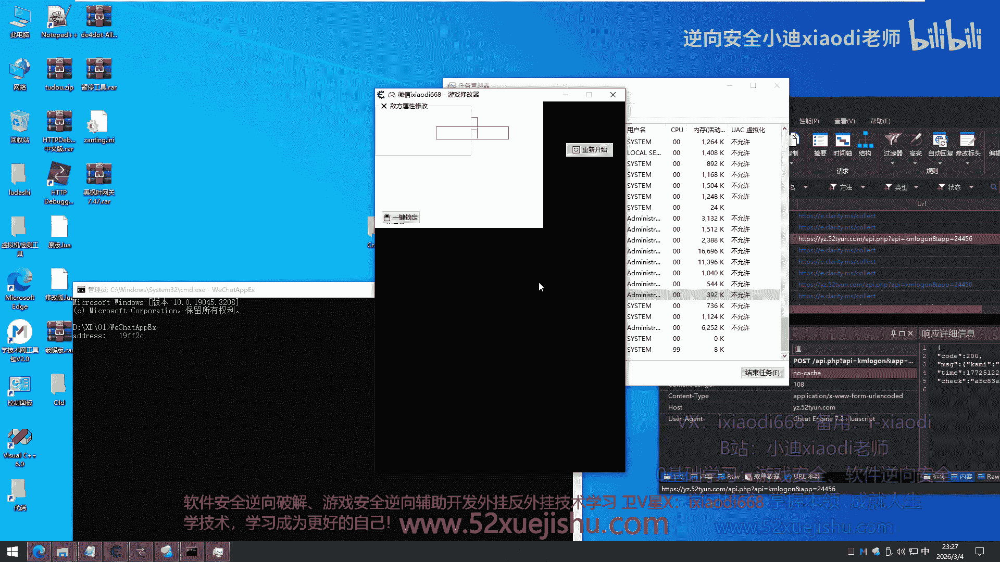

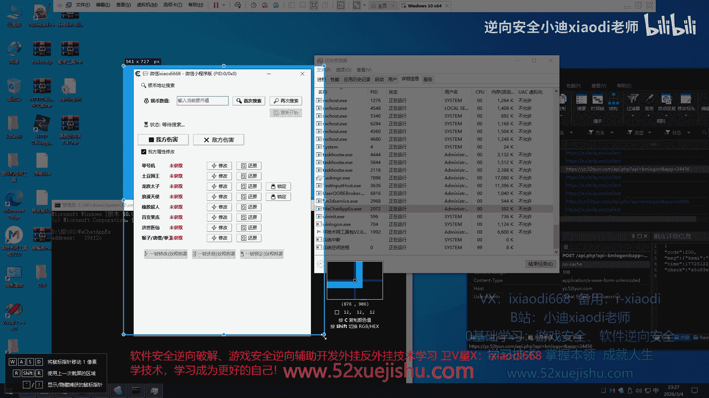

## 📝 本节总结

本节课中，我们一起学习了如何通过抓包分析、伪造正版卡密、设置自动回复以及修改时间戳等手法，成功绕过了一个Lua外挂脚本软件的网络验证。我们首先抓包查看了登录返回数据，理解了验证流程；然后利用格式合法的卡密数据伪造正版响应；接着遇到了时间戳校验这一新防线，并通过将时间戳修改到当前时间附近的方法成功突破；最后还了解了进程名称验证的简单绕过方式。此外，我们还讨论了用代码自动化实现这一破解过程的逻辑框架。整个实战案例告诉我们，面对层层校验机制时，既要掌握常规的逆向手段，也要敢于发散思维，从意想不到的角度寻找突破口。希望这节课的内容对你理解网络验证机制和逆向思维有所帮助。
