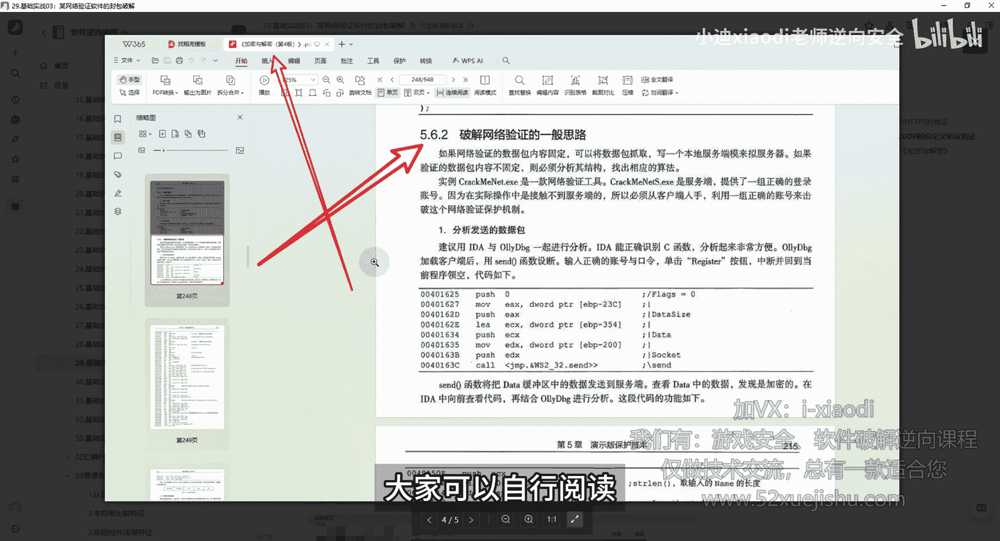
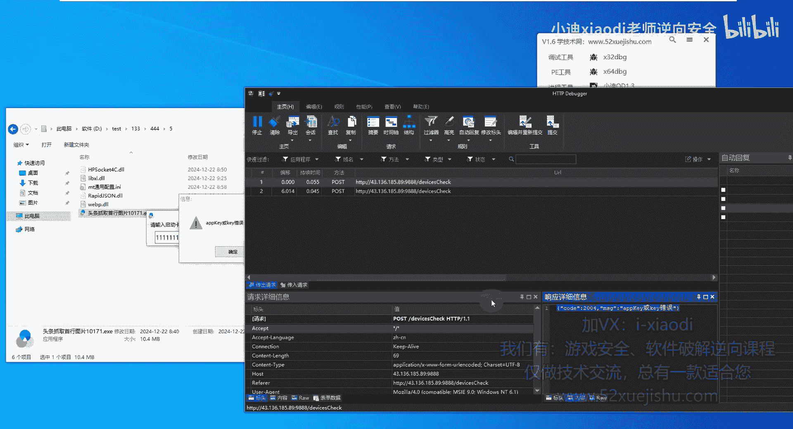
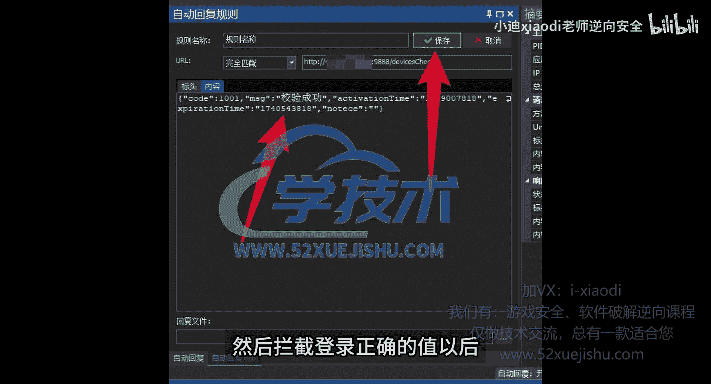
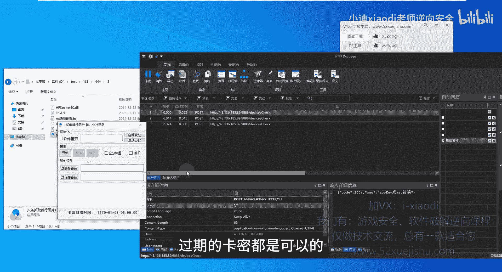
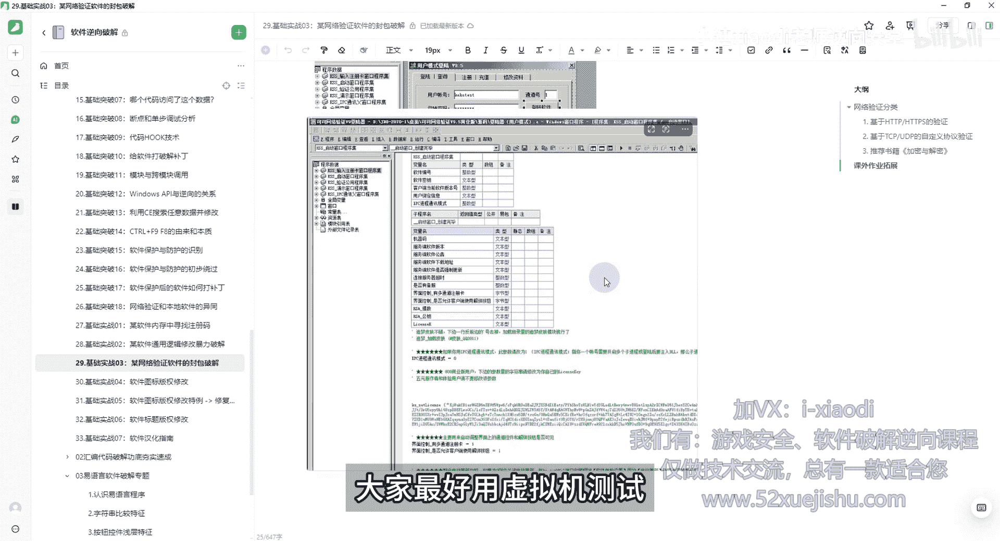

# 🎯 软件逆向安全入门：01：课程概述与学习目标

大家好，我是小菊老师。在本节课中我们将要学习某网络验证软件的封包破解，带大家尝鲜网络验证的封包破解。本课会先讲网络验证的分类，再讲如何识别协议型网络验证，如何定位关键状态码，如何用自动回复修改响应，最后留作业和安全提醒。关于网络验证更多细节分析，可以看IP网络验证专题或P内部视频专题。需要注意，本课内容用于理解软件保护和安全测试，学习后要保护好自己的软件。

以上是课程概述和学习目标。下一节我们来看看网络验证的分类。

## 🧩 软件逆向安全入门：02：网络验证的分类

上一节我们介绍了课程概述，本节中我们来看看网络验证的分类。先讲网络验证分类。按照大致的协议类型，可以先把网络验证粗略分为“基于的验证”和“基于CP的自定义协议验证”两类。这里用公式表示这种粗略分类：

$$
\text{网络验证（按大致协议类型）}
\rightarrow
\begin{cases}
\text{基于的验证}\\
\text{基于CP的自定义协议验证}
\end{cases}
$$

本课主要讲第一种。这一类很常见，新手非常容易上手，利用工具就能轻松处理。第二种可以自行阅读一些课外网站资料，这里推荐《加密与解密》一书，里面有相关内容讲解，可以自行阅读。切换回主题。介绍完分类后，下一节我们来看看如何识别协议型网络验证。

## 🔍 软件逆向安全入门：03：识别协议型网络验证

上一节我们介绍了网络验证分类，本节中我们来看看如何识别软件是否属于协议型网络验证。现在我准备了一款软件，它属于第一种网络验证程序。可以打开工具进行验证。判断思路不复杂：点击注册或登录后，观察工具里是否出现新的访问，再根据访问情况判断协议类型。以下是判断软件是否属于协议型网络验证的操作顺序：

- 打开工具，准备对软件进行验证。
- 点击注册或登录之类的按钮。
- 观察工具里面是否产生新的访问。
- 如果产生新的访问，说明这个软件属于协议型网络验证；这一类是重点观察对象。

识别出协议型网络验证后，下一节我们来看看如何定位关键状态码。



## 🔑 软件逆向安全入门：04：定位关键状态码

上一节我们识别了协议型网络验证，本节中我们来看看如何定位关键状态码。软件响应里面的内容，例如这里的2004，这个值实际上是服务器返回的关键值。可以把状态码理解成门锁的反馈信号，只有把这个状态码改成成功的值，才能登录成功。这里用公式表示关键判断：

$$
\text{登录成功}
\quad \Longleftrightarrow \quad
\text{服务器返回状态码} = \text{成功值}
$$

问题在于，怎么知道什么数字代表登录成功？方法很简单。可以自己拿一张天卡或试用卡，然后拦截登录正确的值，之后一直返回正确的数据即可。通过正确登录时拦截到的响应，就能知道成功值长什么样。定位到关键状态码后，下一节我们来看看如何通过自动回复修改响应。

## 🛠️ 软件逆向安全入门：05：使用自动回复修改响应

上一节我们定位了关键状态码，本节中我们来看看如何通过自动回复修改响应。具体操作是，对着关键服务器地址鼠标右键添加自动回复，然后把错误的内容改成正确的内容。这样操作就完成了。为了更直观，可以用下面的流程表示：

```text
右键关键服务器地址 -> 添加自动回复 -> 把错误响应内容改成正确响应内容
```

也可以用伪代码表示：

```text
if 收到登录请求:
    返回正确响应内容
```

进行测试，测试没有问题。这就是网络验证破解的一种方法。它可以直接破解，也可以复活过期卡密。完成自动回复修改响应后，下一节我们来看看作业和安全提醒。

## 📝 软件逆向安全入门：06：作业与安全提醒



上一节我们完成了自动回复修改响应的演示，本节中我们来看看作业和安全提醒。给大家留一个作业，可以多去网上找一些开源、开放源代码的网络验证。查看它们的代码实现，就能知道怎么破解。知道怎么开锁，肯定知道怎么关锁。注意，盗版网络验证代码可能包含后门，最好用虚拟机测试。以下是本课留下的作业和安全提醒：



- 多去网上找一些开源、开放源代码的网络验证。
- 查看它们的代码实现，理解怎么破解。
- 理解“知道怎么开锁，肯定知道怎么关锁”的思路。
- 注意盗版网络验证代码可能包含后门，最好用虚拟机测试。

作业和安全提醒介绍完后，下一节我们来总结本课内容。



## 🧾 软件逆向安全入门：07：课程总结



前面几节我们完成了网络验证分类、识别协议型网络验证、定位关键状态码和修改响应，本节中我们来总结本课内容。本节课中我们一起学习了某网络验证软件的封包破解入门，了解了网络验证的粗略分类，知道了如何通过点击注册或登录观察新访问来识别协议型网络验证，知道了关键状态码代表服务器返回的关键值，也知道了可以用天卡或试用卡拦截正确登录值，再通过关键服务器地址添加自动回复，把错误内容改成正确内容。本课还留下作业，建议多找开源开放源代码的网络验证查看代码实现，理解开锁和关锁的关系，并注意盗版代码可能包含后门，最好用虚拟机测试。本课全部内容到这里，下集再见，欢迎继续跟进。

> 小迪老师学习软件逆向安全技术。

