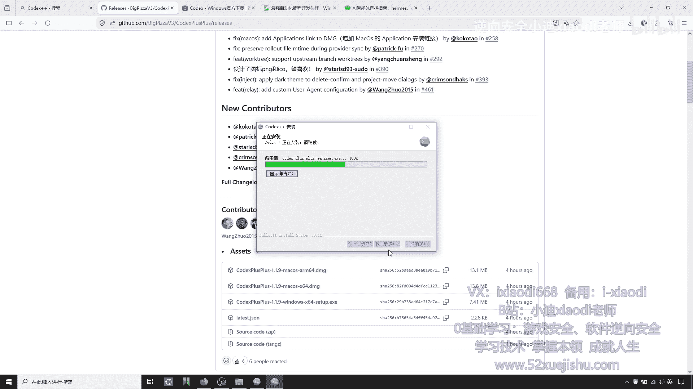
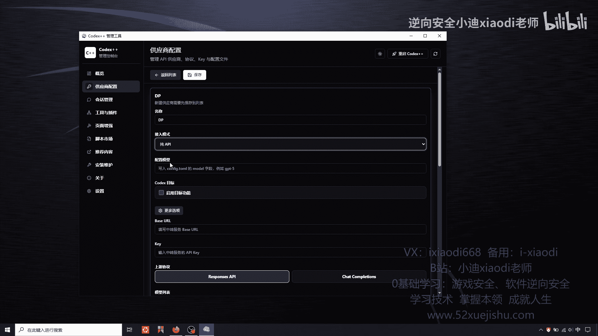
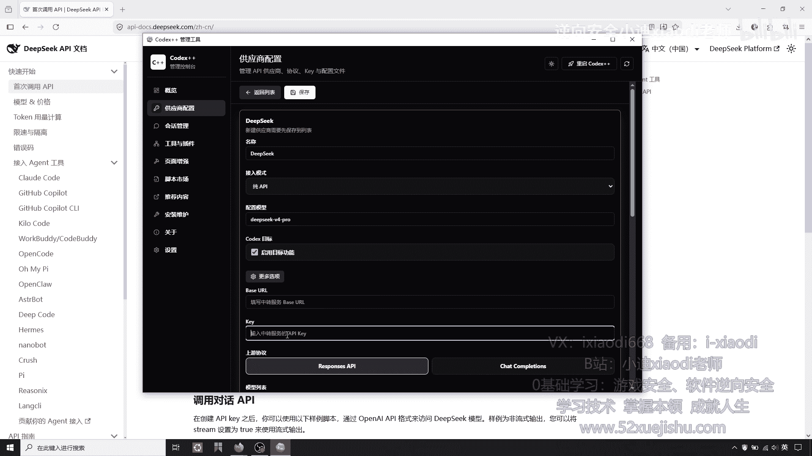
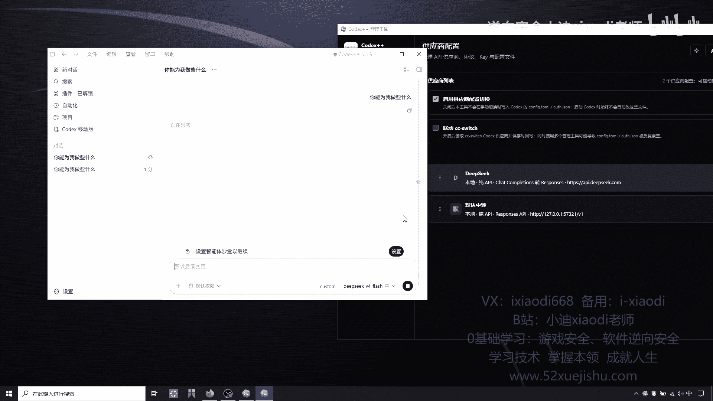
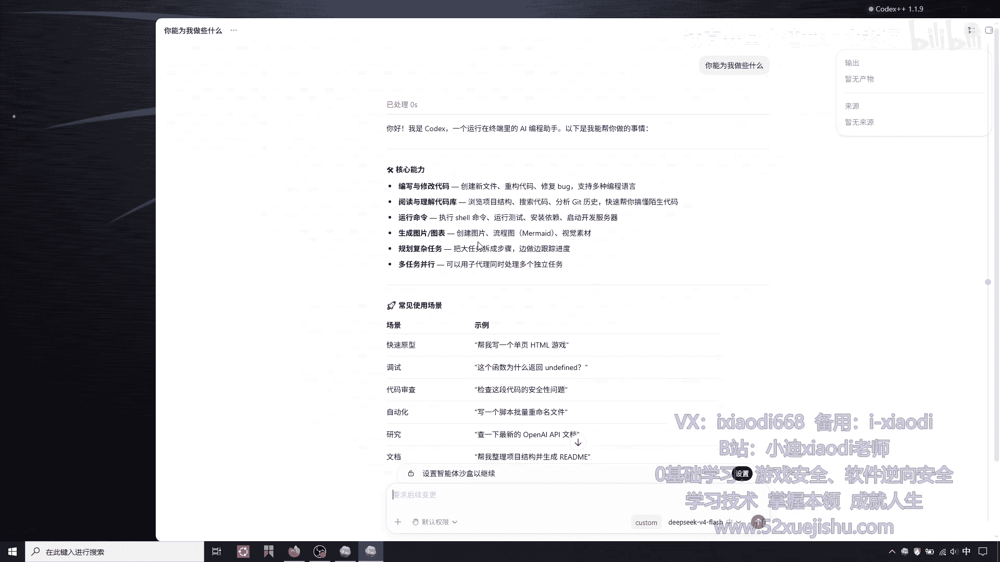
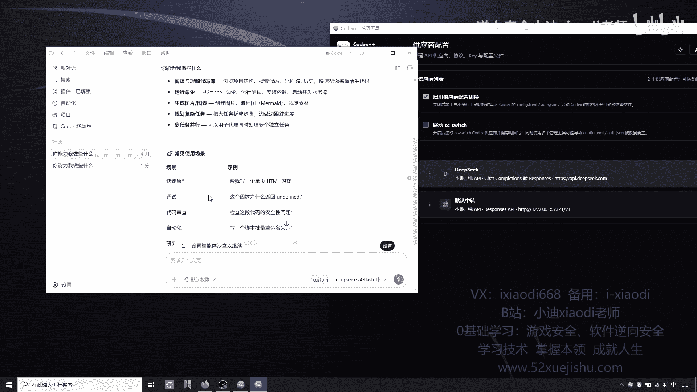
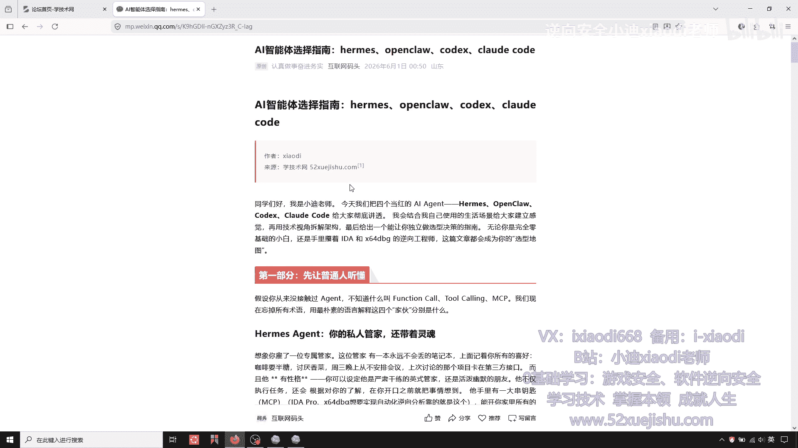

## 🚀 Codex智能体编程教程：01：课程概述与工具定位


在本节课中我们将要学习在Windows下下载安装Codex，搭建智能体AI自动化编程环境，并把Codex对接国产大模型dep4pro（配置名deep4pro），最终能够用Codex对话和开发项目。本教程整理自夏迪老师的讲解，开场问候是：大家好，我是夏迪老师。原文还提示，观看小迪老师视频的读者是社会精英人士，请在弹幕扣一。


今天原文的核心内容是在Windows下下载安装Codex，目标是“一条龙到精通Codex”，原文口播也出现“一条棱道精通codeex”的说法，意思是从下载安装到熟练使用。Codex是最近比较火的智能体之一。今天凌晨发布的文章《AI智能体选择指南》中就有Codex；原文总结是：如果需要轻量级、轻便快捷、简单好用的编程助手，Codex是不二之选。这篇文章发布在公众号“互联网码头”，感兴趣可以去看。下面用一段代码概括课程目标与工具定位，帮助初学者先建立整体印象。

```
目标 = Windows 下下载安装 Codex + 一条龙到精通 Codex
定位 = 轻量级 + 轻便快捷 + 简单好用 + 编程助手
```


下面是原文中提到的资料与工具定位摘要，方便快速抓住重点。

- 文章名称：《AI智能体选择指南》
- 文章发布时间：今天凌晨
- 公众号名称：互联网码头
- 工具定位：轻量级、轻便快捷、简单好用的编程助手，Codex是不二之选
- 课程目标：在Windows下下载安装Codex，一条龙到精通Codex


这些信息能帮助我们明确为什么要安装Codex，以及它适合什么场景。原文说废话不多说，直接讲解下载；下一节我们来看看在Windows应用商店里怎么下载和安装Codex。


## ⬇️ Codex智能体编程教程：02：应用商店下载与安装


上一节我们介绍了Codex的定位、文章背景和课程目标，本节中我们来看看怎么把Codex下载并安装到Windows电脑上。原文强调下载方法非常简单，直接在微软应用商店里下载即可，不需要绕很多弯路。下面是应用商店下载安装的具体动作，按顺序操作即可。

- 下载方法：直接打开微软应用商店，搜索 `Codex`，然后点击下载
- 原文讲解时已经下载完成；下载下来之后直接点击运行
- 点击运行后程序会自动进行安装；原文演示时因为已经下载完成，所以提示已安装最新的版本


为了更直白地理解安装流程，可以把它看成下面这条路径。

```
安装路径 = 微软应用商店搜索 Codex -> 点击下载 -> 运行安装程序 -> 完成安装
```


到这里，Codex已经通过微软应用商店完成下载和安装，但软件本身还不能直接打开。原文在这里留下一个问题：安装完成之后软件没有办法直接打开。下一节我们来看看原因，以及怎样用Code加管理工具解决这个问题。


## 🧩 Codex智能体编程教程：03：无法直接打开与准备管理工具


上一节我们完成了Codex在Windows应用商店的下载和安装，本节中我们来看看为什么安装完成后不能直接打开，以及需要准备什么工具。安装完成之后，这个软件没有办法直接打开；原文这里只写到“因为它需要”并带一个表情，接着解释原因是连接国外官方服务器需要国外账号，而且还需要外国手机号。原文反问：生活在这片土地上，难道就没有享受国外科技的权利？办法还是有的。对于我们大多数人来讲，只需要一个工具就可以解决这些问题。这个工具就是Codex，也可以叫它Code加。下面用代码概括问题与解决思路。

```
无法直接打开 = 连接国外官方服务器 + 国外账号 + 外国手机号
解决方案 = Codex（Code加）管理工具
```


下面是解决无法直接打开问题的准备步骤，注意名称和下载来源。

- 问题原因：安装完成后软件不能直接打开；连接国外官方服务器需要国外账号，还需要外国手机号
- 解决思路：对于大多数人来讲，只需要一个工具就可以解决这些问题；原文把这个工具称为Codex，也叫Code加
- 获取方式：在网上搜索，搜索完成后找到GitHub，直接往下拉，点击对应位置，在这里展开
- 下载安装：下载Windows版本，下载下来后按默认路径安装到盘，安装完成后就可以运行这个管理工具


完成管理工具的下载和安装后，我们就具备了继续配置的条件。下一节我们来看看怎样在管理工具里添加供应商，并填写国产大模型dep4pro的相关参数。


## ⚙️ Codex智能体编程教程：04：配置国产大模型供应商




上一节我们准备好了Code加管理工具，本节中我们来看看怎样配置供应商，让Codex能够通过纯API模式调用国产大模型。运行管理工具之后，点击供应商配置，再点击添加供应商，选择纯API模式。纯API模式可以理解为让管理工具通过接口调用模型；K就是API Key，相当于调用模型的通行证；Base是接口地址。使用国产大模型dep4pro时，模型名称直接填入deep4pro即可，然后勾选启用目标功能。Base按照示例填写，K填写你在dep购买或获取的K，选择右边模式，点击从上游获取模型，模型就可以自动获取，然后保存设置。下面是供应商配置的关键参数，照着填即可，注意API Key要在对应平台购买或获取。



- 打开供应商配置，点击添加供应商，选择纯API模式
- 模型使用国产大模型dep4pro，模型名称直接填入 `deep4pro`
- 勾选启用目标功能
- Base按照示例填写；K填写你在dep购买或获取的K
- 选择右边模式，点击从上游获取模型，让模型自动获取
- 保存设置；设置显示在下边时，可以挪动到上边，再点击使用，就可以默认使用dep去对话




这些参数可以用下面的配置摘要表示，方便对照检查。

```
供应商模式：纯 API 模式
模型名称：deep4pro
启用目标功能：勾选
Base：按示例填写
API Key（K）：在 dep 购买或获取的 Key
模型获取：从上游获取模型
```


完成供应商配置后，管理工具已经知道该调用哪个模型，以及怎样调用。下一节我们来看看怎样重启coded加加，并验证功能是否已经注入成功。


## ✅ Codex智能体编程教程：05：重启Codex++与验证注入


上一节我们完成了纯API供应商配置，本节中我们来看看重启之后怎样确认Codex已经启动、功能已经注入。配置完成之后，只需要点击右上角重启coded加加，就会看到coded已经启动。启动之后右上角显示coded加加1.1.9，原文以此说明我们的功能已经注进去了。然后就可以跟它对话，右下角还可以选择想要的一些模型，这个时候它会迅速回复它能干些什么。下面是重启和验证时观察的几个点，用来确认注入是否成功。

- 点击右上角重启coded加加
- 观察Codex是否已经启动
- 查看右上角版本显示是否为coded加加1.1.9，原文以此说明功能已经注入
- 与它对话，右下角可选择想要的模型；它会迅速回复它能干些什么


验证过程可以用下面的公式概括，看到这些现象就说明配置生效。

```
验证成功 = 重启 Codex++ + 右上角显示 1.1.9 + 可以对话 + 可切换模型
```


到这一步，Codex已经能在电脑上启动，并且可以与模型对话。下一节我们来看看安装完成后的使用结论，以及接下来可以用Codex做哪些开发工作。


## 🛠️ Codex智能体编程教程：06：对话、模型选择与后续开发




上一节我们通过重启和版本显示确认了功能注入成功，本节中我们来看看安装完成后的使用结论，以及后续可以怎样用它开发项目。到这里会发现，Codex已经在电脑上安装成功，并且根本不需要什么复杂的配置，也不需要去敲什么代码。接下来的时间就可以用Codex去开发各种各样的项目，原文也说明今天的主要内容已经讲完。下面是安装完成后的使用结论和后续动作，便于继续练习。

- 安装结论：Codex已经在电脑上安装成功，不需要复杂配置，也不需要敲代码
- 后续开发：接下来可以用Codex开发各种各样的项目
- 内容收尾：今天的主要内容已经讲完




使用状态可以用下面的公式概括，便于初学者记住最终效果。



```
可用状态 = 安装成功 + 无需复杂配置 + 无需敲代码 + 可开发项目
```


到这里，安装、配置、启动、验证和后续开发的方向都已经讲完。下一节我们来看看原文给出的延伸阅读入口，并对整篇教程做总结。


## 📚 Codex智能体编程教程：07：延伸阅读与课程总结




上一节我们得出了Codex安装成功、无需复杂配置和敲代码的结论，本节中我们来看看原文给出的延伸阅读入口，并总结整篇教程的重点。如果对Codex还有其他想要了解的内容，可以来到网站52学技术点com，找到对应帖子去阅读浏览。如果对智能体的选择还无从下手，可以来到公众号，把《AI智能体选择指南》这篇文章阅读一下。原文收尾是：以上就是今天全部的内容，我是小迪老师，下期再见，拜拜。下面是原文给出的延伸阅读入口和收尾信息，方便继续查资料。


- Codex延伸了解：网站 `52学技术点com`，到对应帖子阅读浏览
- 智能体选择：公众号“互联网码头”，阅读《AI智能体选择指南》这篇文章
- 课程收尾：以上就是今天全部内容，我是小迪老师，下期再见，拜拜


本节课中我们一起学习了在Windows应用商店下载安装Codex，准备Code加管理工具，配置纯API供应商并填写deep4pro模型与K，重启coded加加验证1.1.9，最后用Codex对话、选择模型和开发项目。原文还给出网站与公众号作为延伸阅读入口。到这里教程结束，原文收尾是：以上就是今天全部内容，我是小迪老师，下期再见，拜拜。

