# 软件逆向破解之路：第6讲：网络验证本地化——卡密破解如何不留痕迹

## 🧭 课程概述

在本节课中，我们将要学习一个非常关键的技术——**网络验证本地化**。具体来说，就是解决一个困扰许多初学者的难题：当我们破解了卡密软件的封包验证之后，如何做到不被软件作者的服务器发现。

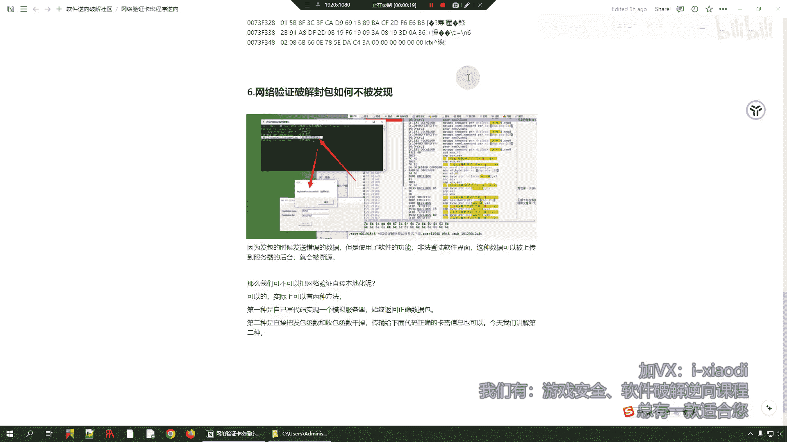

上节课我们已经成功地修改了封包数据，让程序以为我们输入了正版卡密，从而进入了付费功能界面。但这里有一个隐患：程序仍然会向服务器发送一些错误信息，服务器通过这些信息可以追踪到我们。本节课的核心目标，就是彻底切断程序与服务器之间的联系，实现真正的“本地化”破解。

我们首先会回顾一下上节课遗留的问题，然后分析两种不同的本地化方案，接着会深入调试器，一步步演示如何修改关键代码逻辑，最终让大家看到一个完全不上报任何数据、本地就能完成验证的破解效果。我们还会探讨如何防范作者的CRC完整性检测，以及为什么建议通过编写代码来实现这一整套补丁逻辑。

## 🔙 回顾：上节课遗留的“登录信息错误”

上一节课程中，我们成功地把正版卡密对应的封包数据填充到了程序里。也就是说，即使我们输入了一个错误的卡密，程序依然会“放行”，让我们注册成功并进入主界面。这是一个令人兴奋的成果，意味着我们绕过了卡密验证。

但是，这里出现了一个新的问题。我们来看看具体的现象，为了看得更清楚，我们把界面上的文字换个颜色，比如换成一个醒目的绿色。你会发现，虽然功能可以进入了，但在界面的某个位置，依然会显示“登录信息错误”。

这个“登录信息错误”是从哪里来的？实际上，它是服务器返回给我们的。回顾一下我们的操作：我们修改了服务器返回的数据，把这部分返回数据替换成了“允许登录”的内容。我们让本地的客户端误以为服务器已经允许我们登录了，但实际上并不是服务器允许的，而是我们通过修改程序逻辑，直接赋予了我们自己登录的权利，或者说，是直接赋予了这个软件本地付费功能的使用权。

问题到这里还没有结束。如果你进入了程序的付费界面，并且软件作者本身编写了相关的记录功能，那么当你非法进入系统后，软件会记录一些数据。这个数据会与服务器上的记录进行比对校验，服务器可以凭此溯源到你的IP地址。明白我的意思吗？你的IP地址会被记录下来。

那么，这是否意味着我们很容易被抓住呢？对于个人用户来说，如果只是单独查个人，这种风险可能不算特别大，因为为此去追究一个个人的成本比较高，在实际中不太现实。但如果你是在一家公司里使用，情况就完全不同了。作者可以直接向你的公司发送律师函，这个后果就比较严重了，对吧？

## ⚠️ 风险分析：为什么“发包”会暴露我们

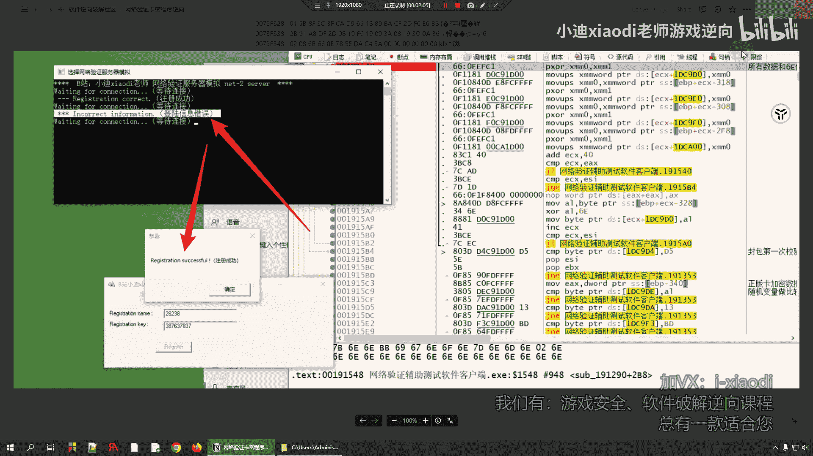

我们通过上一节课的操作，已经摸清了底层的通信过程。让我们来梳理一下：在程序发出网络请求的时候，它发送的是错误的数据。但程序通过我们修改后的逻辑，依然使用了软件的功能，并且实现了非法登录。在这个过程中，那个“登录信息错误”的数据，以及你可能使用了某个功能的数据，都会被上传到服务器的后台，这样就会被服务器追溯到。

那么，我们有没有办法避免这种溯源风险呢？

让我们想一下。要完全杜绝风险，最根本的办法是什么？其实很简单，就是**不发包**。只要程序不再向服务器发送任何网络数据，服务器端自然就接收不到任何信息，也就无从进行溯源了。这个逻辑非常直接：没有数据包，就没有证据。

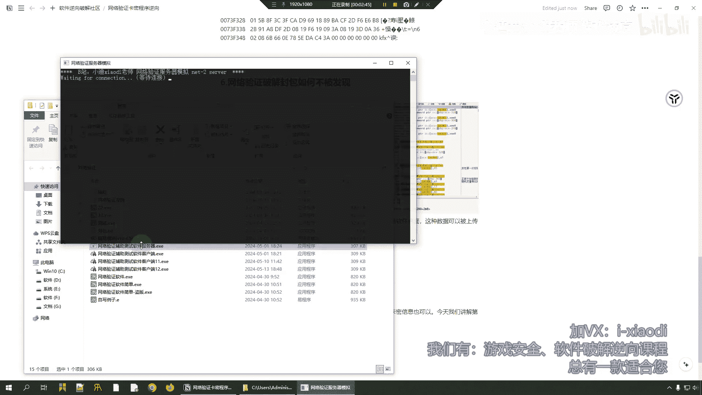

## 💡 核心思路：将网络认证“本地化”

基于“不发包”这个根本原则，我们自然就会思考这样一个问题：可不可以把整个网络认证过程直接本地化呢？也就是让程序完全不依赖服务器，在本地就完成所有验证。

答案是肯定的。实际上，主要有两种实现方法。

第一种方法，是自己编写代码实现一个模拟的服务器。这个模拟服务器的程序运行在我们自己的电脑上，然后我们用调试工具修改目标软件，把它原本要连接的IP地址改掉，指向我们本地的模拟服务器。例如，原本软件连接的是作者的服务器IP，我们把它改成`127.0.0.1`。然后，我们在这个本地服务器上，编写一个可以响应数据包的服务端程序。这个服务端程序的设计目的很纯粹：无论收到什么请求，都始终返回正确的数据包。这样一来，整个验证过程就在本地愉快地闭环了。

第二种方法，则更加简单粗暴一些。不需要单独搭建服务器，而是直接对软件程序本身下手，把负责发送数据包（发包）的函数和负责接收数据包（收包）的函数都干掉。然后，直接把正版卡密解密后的正确数据传递给程序的下方代码。这样，程序就以为验证通过了。

今天这节课，我们重点讲解并演示第二种方法，因为它更加直接地体现了“不发包”和“本地化”的核心思想，对于后续编写自动化补丁也更有意义。

## 🛠️ 方法一：模拟服务器（方案简介）

在我们聚焦于第二种方法之前，先简单看一看第一种方法的操作思路，方便大家理解两者的区别。

要找到软件连接的服务器IP，方法非常简单。打开我们的调试工具（例如x64dbg），点击**文件**菜单，然后选择**附加**，选中目标进程。附加成功后，点击**符号**标签页，然后我们需要搜索一下当前模块的字符串。一般来说，当你搜索当前模块的字符串时，是能够看到它连接的那个IP地址的，这个地址会以一个长字符串的形式存在，如图所示。

现在我们来分析一下，这个IP地址在内存中是怎么存放的。它其实就放在某个地址里。当你看到它的时候，只需要把这里的内容修改成你自己的服务器IP就可以了。

那自己的服务器上要写点什么呢？很简单，你需要去写一个可以响应网络发包的服务器程序，这个程序的核心逻辑就是：无论接收到什么数据包，都返回一个合法的、正确的数据包。只要实现了这个，第一种方案就完成了。

## 🔬 方法二：干掉发包/收包函数（本节实操核心）

现在进入今天的重头戏——第二种方法的实际操作。之所以选择这种方法，是因为后续代码会进行解密操作。我们将发包和收包的函数全部填充掉，然后把加密过的正版卡密数据，直接传输给下方需要校验数据的代码。程序下方收到这些正确数据后，就会认为卡密验证通过了。

为了理清思路，我们把目标流程用伪代码表示一下：

```
原逻辑：
账号密码 -> 发包向服务器验证 -> 等待 -> 收包接收服务器结果 -> 验证结果 -> 决定是否放行

补丁后逻辑：
（跳过发包和收包）
正版卡密数据 -> 直接传给下方代码 -> 解密验证 -> 放行
```

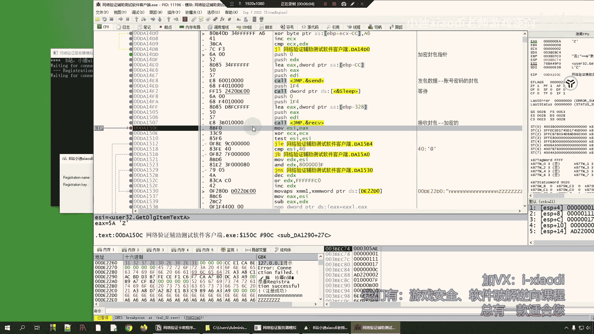

这种方案的核心操作包括以下两个步骤，它们是整个补丁过程的基础：

1. **找到发包和收包函数**：在调试器中通过分析函数调用，定位这两个网络通信函数。
2. **将其填充为空操作（NOP）**：用机器指令`0x90`（即NOP指令）将这两个函数连同其参数全部填充覆盖。

现在，让我们打开调试器，对目标程序进行实地演练。这个程序，我们之前应该已经下过一些断点，我们先来定位一下关键代码的位置。还是像上节课一样，我们分析的是接收封包并进行解密的那一段代码。接收到的封包内容是加密的。那么，在这个接收动作之前，程序做了什么？它当然是先把账号密码的信息发送出去，这是一个直接的“发包”动作。

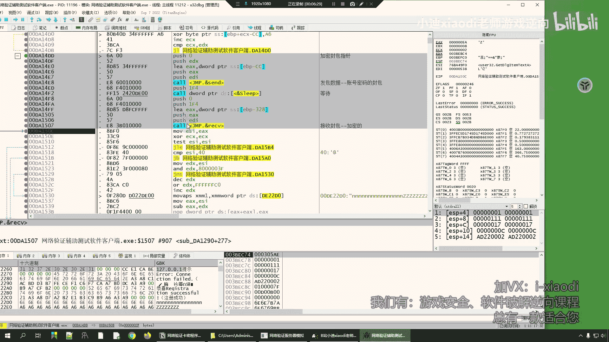

我们需要分析清楚这个过程，用流程框图来表示就是：

```
[程序启动] -> [输入账号密码] -> [发包函数（发送账号密码封包）] -> [Sleep(等待)] -> [收包函数（接收服务器响应）] -> [解密验证]
```

大家可以看到，程序在这里会发包，在另一个地方会收包。我们这次的补丁策略是：把这两处关键调用的函数连同其参数，全部用`0x90`（NOP空指令）填充覆盖掉。这样，函数就不会被调用，参数也不会被传递，网络通信就此中断。

不过，先不要太着急去修改数据。在动手之前，我们先仔细观察一下。在接收封包的函数下面，有一些跳转指令，这些跳转指令会根据返回值决定程序的走向。因此，我们必须先用正版卡密完整地跑一遍程序的流程，观察正常情况下的数据走向，以免改动了不该改的地方。

我们再一次使用之前用过的正版卡密来运行程序，看看正常运行会出现什么情况。在关键位置按下`F2`下好断点，然后点击“登录”按钮。程序会停在第一个断点处。之前我们分析过，`EBP-340`这个位置存放的是随机变量，它是由一个随机数生成的。

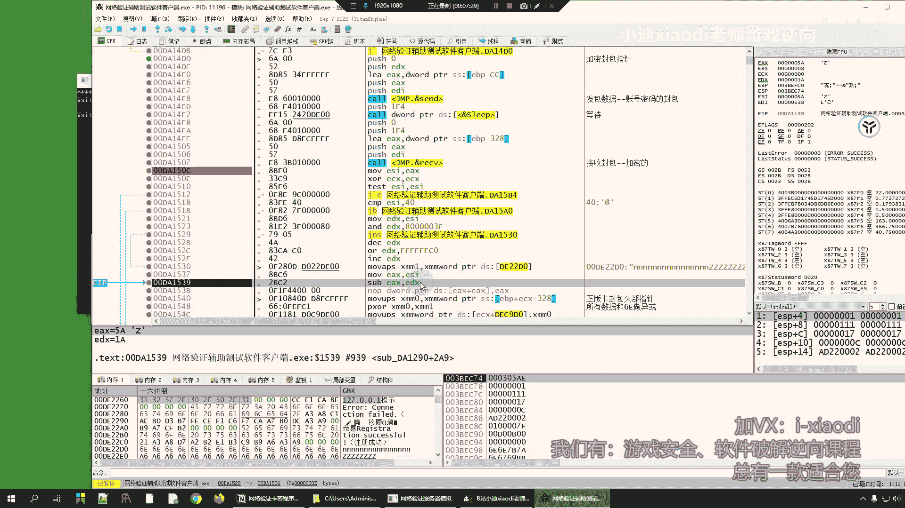

我们现在继续单步执行。按`Ctrl+F9`可以让程序直接运行到函数的返回处。执行完收包函数后，我们看到一个关键的中间结果：寄存器`EAX`的返回值是`0x5A`。这个`EAX`寄存器，在C语言的标准调用约定中，通常是函数Asm的返回值寄存器。接下来它被赋值给了`ESI`，而`ESI`在后面的一系列判断逻辑中被反复使用。

这个`0x5A`到底代表着什么？我们来计算一下，十六进制的`0x5A`转换成十进制就是90。这90其实就是我们接收到的封包数据的字节数。它是一个至关重要的数据，因为后续的解密循环完全依赖这个长度值。

继续向下单步执行，我们分析这些指令：

```
mov esi, eax          ; 把收包函数的返回值(0x5A)保存到ESI
test esi, esi         ; 判断返回值是否为0
je ...                ; 如果为0则跳转（返回失败）
...                   ; 后续解密循环中会用到ESI作为计数器
mov edx, [ebp-xxx]    ; 取出密文数据
xor edx, esi          ; 与长度或随机数进行异或运算
```

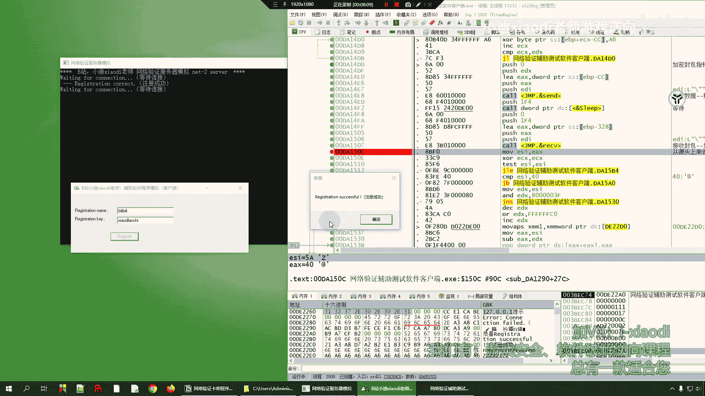

我们看到`ESI`被用于判断，也参与了后续数据的异或操作，其源头就是`EAX`。从整个解密流程的源头来看，`ES`最为关键。因为它决定了封包数据的字节数。这个信息对于我们的补丁来说是有用的。我们知道这个5A是收包函数的返回值，所以分析流程时，要将这个关键值记录下来。

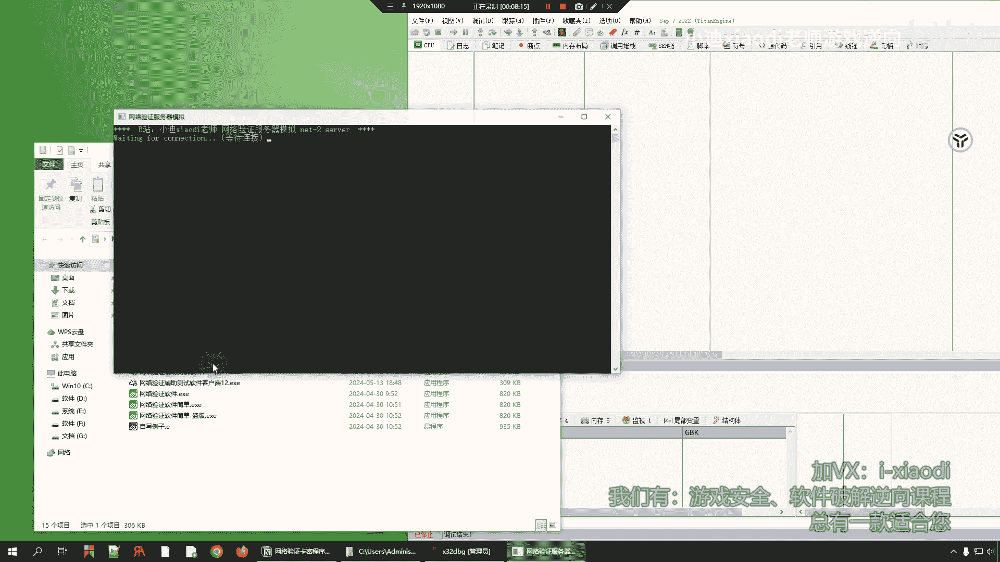

现在，我们已经搞清楚状态了。这一次，我们直接运行程序，使用正版卡密跑完整个验证流程。确认程序可以正常进入主界面后，我们关闭程序，把所有设置恢复原样，重新开始我们的补丁工作。

我们重新打开这个客户端程序。在调试器中点击**文件**，选择**附加**，再次附加到这个程序上。点击**断点**标签页，找到我们之前下过的断点位置。为了方便接下来的操作，我们可以将其他的断点都先禁用掉，只保留我们需要的这一个。比如在`0x401xxx`地址处的断点。

现在，是时候对关键代码区域进行修改了。将程序中发包和收包函数上方的所有代码内容，全选后填充为二进制`0x90`，即NOP空指令。

填充之后，我们需要手动设置关键寄存器的值。因为`ESI`（也就是`EAX`）在后续代码中有用，我们需要让这个逻辑继续走下去，所以我们必须把`0x5A`这个封包长度值手动赋值给它。在调试器中，我们执行`mov eax, 0x5A`这个指令。

接下来，我们要处理封包数据。经过分析，封包数据的指针存放在`EBP-0x38`这个位置。记住这个地址：**`EBP-0x38`**。另外，通过之前的分析，我们知道随机变量存放在`EBP-0x340`这个位置。

整理一下思路，关键的地址和变量如下表所示：

| 变量 | 内存位置 |
| :--- | :--- |
| 封包指针 | `EBP-0x38` |
| 随机变量 | `EBP-0x340` |
| 访问密钥 | `0x5A` (90字节) |

这个思路很清晰了。我们在哪个位置下断点呢？我们随便输入一个错误的账号密码，然后让程序运行到解密数据的位置，也就是我们准备NOP掉的代码块之后。在这里下断点。程序停在了这个位置，`EAX`的值已经被我们设置成了`0x5A`，没问题。

现在，找到`EBP-0x328`这个位置。看到没有，就是这里。这是我们定位封包数据的位置，在这个地址上，我们把之前获取的正版卡密信息直接粘贴进来。我们打开二进制的编辑器，全选之前复制的正版卡密数据，粘贴到这里。

在这段数据中，有一个字节`0xB5`非常重要，因为它直接相关于那个随机变量。偏移量要算好，比如随机变量值存放在`EBP-0x340`，它的值刚好是`0x7F`。那我们就把这个随机变量原值`0x7F`找出来。这个`0x7F`会与`0x6E`进行异或运算，得到一个结果`0x11`。我们把这个计算结果`0x11`直接写入到该变量原本在栈上对应的位置。

现在，见证奇迹的时刻到了。我们点击“运行”。屏幕上出现了什么？**注册成功！** 而且，这一次和上一次不同。程序完全没有向服务器发送任何数据，服务器端也接收不到任何关于我们破解的请求，自然也就无从知晓我们做了什么。我们没有留下任何可被追溯的网络痕迹。

## 🛡️ 进阶探讨：如何豁免CRC检测

到这里，我们已经暂时达成了目标。但问题并没有结束。有同学会想：难道这样做就露不出一丝一毫的蛛丝马迹了吗？

当然可以。尽管网络层已经断开了，但文件本身和行为依然可能被检测。如果作者有很高的安全意识，他可能会在软件中加入对关键代码段的完整性校验。这种校验机制，在我们的技术领域通常被叫做**CRC检测**（循环冗余校验）。

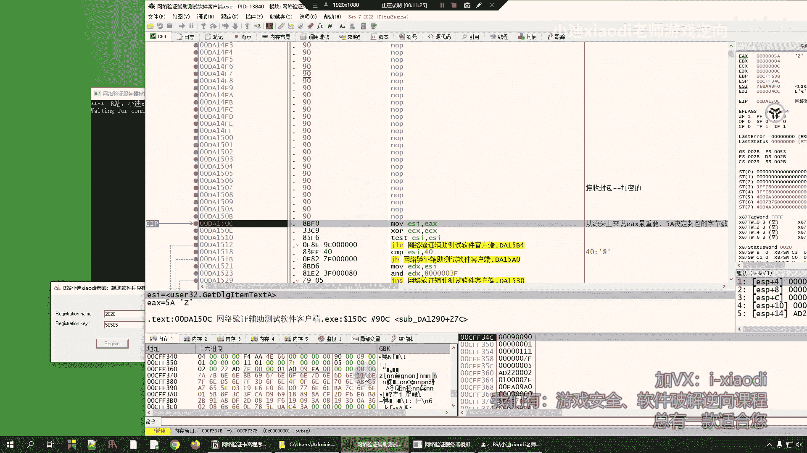

具体原理如下：

```
软件发布时记录原始CRC值 → 每次运行时计算当前代码段的CRC值 → 对比两个值是否一致 → 如果不一致说明程序被修改
```

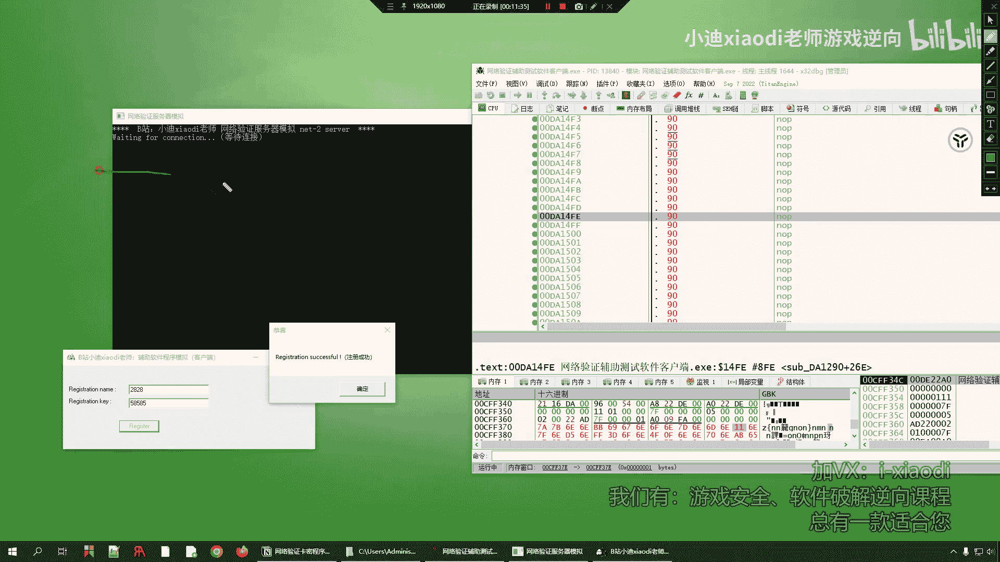

如果作者写了这种*CRC检测*，他就可以检测出我们的代码段是否被修改。这就好比是在代码的必经之路上设下了一个陷阱，引诱我们跳进去。我们可以修改代码逻辑，但一旦修改，就会触发报警，服务器就会收到这个报警信息。他照样可以把我们的IP信息发送过去。

不过，大家不用担心。按照不同层次的游戏规则，如果作者有CRC检测，我们也有应对策略——我们同样可以把CRC检测代码本身也干掉。只要把检测的跳转指令也NOP掉，CRC检测就失效了。干掉之后，服务器那边就彻底收不到任何信息了。

这就是所谓的“道高一尺，魔高一丈”。虽然作者可以用各种手段来构建防线，但只要我们掌握了底层原理，就总是有办法应对。只不过，如果软件作者真的要构建一套完善的防破解体系，他可能需要投入很大的时间和精力，而对于与我们斗智斗勇来说，这些时间可能恰恰给了我们充分的破解窗口。

## 💻 实战建议：用代码而非手动汇编实现

那具体大家要怎么去弄这个东西呢？我们把自己的思路整理一下。在整个流程中，最关键的一步是，将程序上方发包相关的所有位置全部NOP填充掉。这样一个重复性高、且容易出错的工具，很明显不适合每次都用调试器去手动操作。

那怎么办？我们要学会写代码来打补丁。我们需要编写一个补丁程序，它可以自动完成以下操作：

```python
# 补丁逻辑伪代码（以Python为例，演示思路）
def apply_patch():
    target_address = 0x403000  # 要修改的代码起始地址
    with open("target.exe", "rb") as f:
        data = bytearray(f.read())
    for i in range(0, 0x100):  # 假设要NOP掉256个字节
        data[target_address + i] = 0x90  # 写入NOP指令
    with open("target_patched.exe", "wb") as f:
        f.write(data)
```

在具体业务层面，我们需要完成以下几件事：

1. 将目标程序的代码段读取出来。
2. 将指定范围内的所有机器码替换为`0x90` (NOP)。
3. 然后，通过编写代码模拟出那套关键逻辑：先复制上`0x5A`这个长度，再解密数据，然后传递数据。
4. 这里非常推荐使用*Hook技术*。通过Hook `sleep`、`send`等网络或延时函数，我们可以在运行时直接拦截并修改程序行为，而不用直接去修改文件。

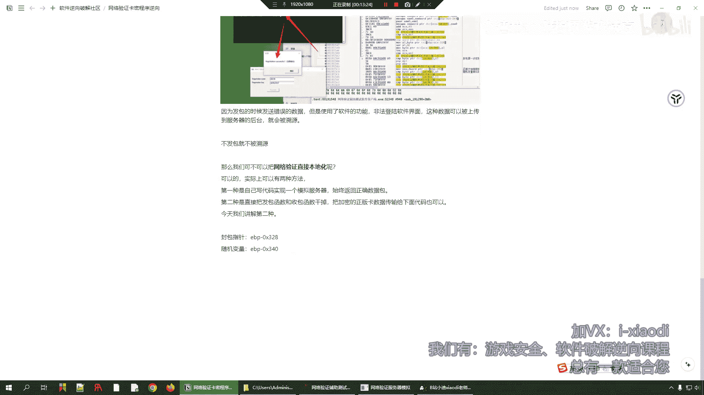

一句话解释Hook技术的核心：

```
Hook技术 = 拦截消息/函数调用 + 插入我们自己的逻辑 + 选择性放行原逻辑
```

这些操作通过汇编指令去手工写是很复杂的，牵扯到很多地址和机器码，容易出错。但通过代码，比如我们高级班讲的C语言、Windows API开发，这些工作就变得轻松而高效。如果大家看到这里，感到自己的代码基础薄弱，理解和编写这些逻辑还有困难，建议加强学习Windows客户端开发相关的内容，或者直接加入我们的软件逆向破解社区进行系统性学习。只有学会了这些，你才能真正拥有写出自己的补丁工具的能力。

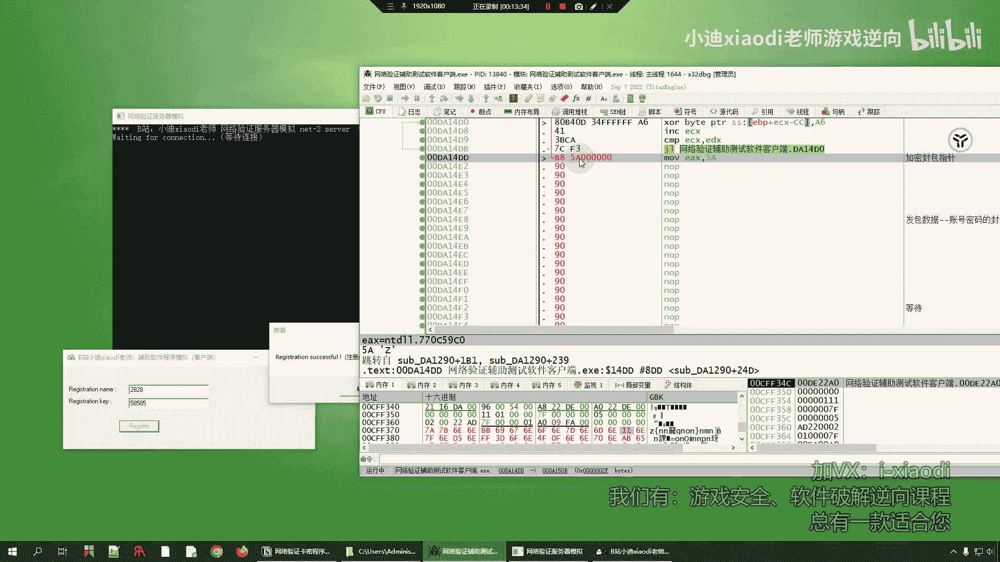

## 📝 总结

本节课中，我们一起学习了**网络验证的本地化**破解技术，并成功地在不发送任何数据包的情况下，让软件误以为我们使用了正版卡密。我们首先回顾了上节课遗留的“登录信息错误”问题，并分析了其根源是伪造返回数据。接着我们提出了“不发包”的解决思路。然后我们详细演示了如何通过修改内存数据、NOP掉关键函数、以及手动设置寄存器与变量，最终达到了“本地化”的效果。

我们还一起探讨了防范CRC检测的方法，以及如何使用代码代替手工操作来固化这个破解成果。整个过程的核心可以归纳为：

```
不发包 = 无数据可查 = 无法溯源
本地化 = 绕过服务器 = 实现完全离线破解
```

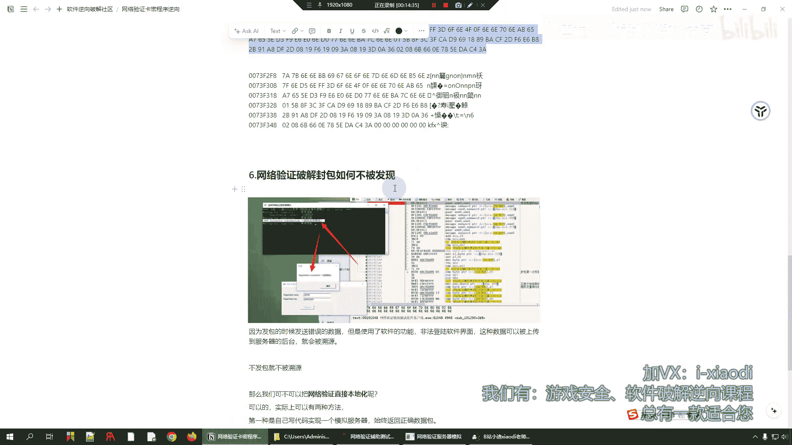

逆向工程的攻防博弈从未停止，但掌握底层原理，永远是我们的核心优势。我们下期再见。
