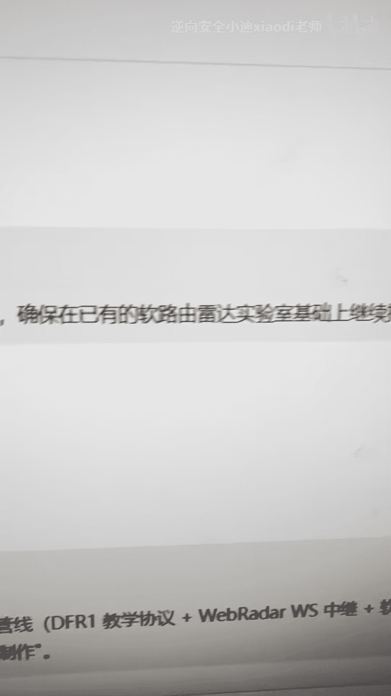

# 🧭 AI智能体远程搭建：01：课程概述与目标

在本节课中我们将要学习一套AI智能体远程搭建的演示流程，核心是让最新部署的AI智能体模型帮忙制作一个“三角周网页微弹”。这个教程会从整体认识开始，逐步说明它如何在已有软路由雷达实验室基础上继续推进，并展示从自动开发到访问页面、再到交互验证的完整过程。对初学者来说，可以先把它理解成“用自然语言把需求交给AI，让AI自动完成制作和部署”的一套方法。

这套内容面向日常研究单机游戏的人，也面向自己喜欢玩的游戏、想制作辅助脚本的人。原文强调游戏辅助脚本自动化开发、自动化逆向，并以“无需学习、解放双手”作为卖点。它还可以作为二进制安全逆向、游戏安全、软件安全、网络安全、CTF比赛必备基础和封包技术方向的学习素材。下面先列出本课程的整体目标，方便你建立学习地图。

以下是本课程的目标清单：

- 认识最新部署的AI智能体模型能做什么。

- 理解如何用一句话让AI制作“三角周网页微弹”。

- 了解软路由雷达实验室基础和三角肉雷达管线的关系。

- 观察AI智能体从开发到启动、访问、交互验证的流程。

- 知道后续搭建同类AI智能体时可以联系小李老师。

上一节是课程概述，本节中我们来看看基础环境与核心概念。要先说明，这个演示不是完全从零开始，它强调在已有的软路由雷达实验室基础上具有推进，也就是说原有实验环境是继续开发的前提。

# 🧱 AI智能体远程搭建：02：基础环境与核心概念

这个演示的基础是已有软路由雷达实验室，原文要求在这个基础上继续推进，而不是抛开原有环境重新搭建。演示中提到的管线叫“三角肉雷达管线”，可以把它理解成一条面向雷达页面生成和运行的管线。原文还提到要制作“三角周网页微弹”，这里保留原文称呼，方便你对照演示内容。

为了让初学者更容易理解，可以用一个简化公式来描述核心概念。以下公式把AI智能体、已有实验环境、目标需求和自动部署串联起来：

```text
自动化辅助开发 = AI智能体 + 已有实验环境（软路由雷达实验室） + 目标游戏/网页需求 + 自动生成与部署
```

这个公式说明，AI智能体不是孤立工作的，它需要已有环境作为底座，也需要明确的目标需求作为输入。对初学者来说，不用先系统学习大量前置知识，重点是理解“描述需求、让AI生成、再启动验证”这条主线。以下列出本节需要记住的关键点：

- AI智能体模型是最新部署的。

- 已有软路由雷达实验室是继续推进的基础。

- 演示中的管线名称是三角肉雷达管线。

- 产物是三角周网页微弹和雷达页面。

- 目标是自动化开发、自动化逆向和解放双手。

上一节我们介绍了基础环境和核心概念，本节中我们来看看如何向AI智能体下达制作需求。

# 🛠️ AI智能体远程搭建：03：让AI智能体生成网页微弹

演示中提出的需求很直接：帮我制作一个三角周网页微弹。这个需求对应的场景是日常研究单机游戏，或者研究自己喜欢玩的游戏，并想制作辅助之类的内容。原文说“它就可以去制作”，意思是AI智能体接收到需求后可以直接进入制作流程，不需要初学者先手写大量代码。

为了让需求更清楚，可以把原话整理成一个简单的需求模板。以下代码块展示了一个适合初学者理解的需求描述方式：



```text
需求 = 制作一个“三角周网页微弹”
场景 = 单机游戏研究 / 自己喜欢的游戏辅助
基础 = 已有软路由雷达实验室 + 三角肉雷达管线
要求 = 在已有基础上继续推进，由AI智能体自动开发
```

这个模板的重点是把“做什么、在什么基础上做、由谁来做”说清楚。AI智能体收到需求后，就会开始自动开发。以下列出操作思路，方便你按顺序理解：

- 先确认已有软路由雷达实验室基础。

- 再确认要推进的是三角肉雷达管线。

- 然后向AI智能体描述要制作的三角周网页微弹。

- 最后让智能体自动开发，减少手动操作。

上一节我们完成了需求下达，本节中我们来看看AI智能体如何完成开发、启动服务并给出访问地址。

# 🚀 AI智能体远程搭建：04：开发完成与启动访问

原文描述“他现在是正在去开发”，说明AI智能体正在执行开发任务；随后“就开发成了”，说明任务已经完成。演示中看到效果后评价“太棒了”，并称“这就是3.6雷达”，还说明“它已经启动”。访问地址也在演示中给出，操作方式是复制地址并直接转到浏览器。

为了把启动和访问过程讲清楚，可以用下面的流程公式表示。以下公式展示了从开发到访问的顺序：

```text
开发流程 = 下达需求 -> AI智能体自动开发 -> 开发完成 -> 启动服务 -> 获得访问地址 -> 浏览器访问
```

对初学者来说，关键不是背命令，而是理解每一步的作用：先让AI完成开发，再确认服务启动，最后复制访问地址并打开页面。原文再次强调要在已有软路由雷达实验室基础上具有推进，这说明整个流程是建立在原有实验环境之上的。以下列出本节的操作步骤：

- 等待AI智能体完成开发。

- 确认三角周网页微弹和3.6雷达开发成功。

- 获取启动后的访问地址。

- 复制访问地址。

- 在浏览器中直接转到该地址。

上一节我们完成了启动和访问，本节中我们来看看页面打开后的交互效果如何验证。

# 🖱️ AI智能体远程搭建：05：交互效果验证：护甲、敌方人机与物品

打开页面后，原文称看到的是三角兽雷达。点击页面时，护甲会发生变化，敌方人机会移动，底下的头盔等物品也会显示。演示者还进行了横屏查看，原文提到“会有”，可以理解为横屏后会有更完整的画面展示。最后用“直接雷达”概括效果，意思是页面打开后可以直接看到雷达式展示。

以下列出验证交互效果时需要关注的检查点：

- 点击页面时观察护甲状态是否变化。

- 观察敌方人机是否会移动。

- 查看底部头盔等物品信息是否显示。

- 横屏查看整体雷达布局是否更清楚。

- 确认页面是否直接呈现雷达效果。

可以把交互验证抽象成一个检查公式。以下公式把点击、护甲、敌方人机、物品和横屏布局放在一起：

```text
交互验证 = 点击操作 + 护甲变化 + 敌方人机移动 + 头盔/物品显示 + 横屏布局检查
```

对初学者来说，验证时不用一次看懂所有细节，先确认页面能打开、雷达能直接显示、点击有反馈、敌方人机会动、物品信息可见即可。以下再给出一个更简洁的验证清单：

- 页面能否正常打开。

- 雷达页面是否直接显示。

- 点击后是否有反馈。

- 敌方人机是否运动。

- 物品信息是否可见。

- 横屏下是否更清楚。

上一节我们验证了交互效果，本节中我们对整个教程做总结，并保留原文中的后续联系信息。

# ✅ AI智能体远程搭建：06：总结与后续

本节课中我们一起学习了：最新部署的AI智能体模型可以按需求制作三角周网页微弹；在已有软路由雷达实验室基础上，可以推进三角肉雷达管线；智能体会自动开发，开发完成后启动服务并给出访问地址；复制地址转到浏览器后，可以看到3.6雷达和三角兽雷达页面；点击时护甲、敌方人机会动，底部头盔等物品会显示，横屏查看效果更清楚。

这套内容面向游戏辅助脚本自动化开发、自动化逆向，也适合作为二进制安全逆向、游戏安全、软件安全、网络安全、CTF比赛必备基础和封包技术的学习素材。原文还说明，想要搭建这种AI智能体，可以联系小李老师；本期内容结束，下期再见。以下列出本课程的总结要点：

- AI智能体远程搭建可以降低上手门槛。

- 自动化开发能把需求变成可访问页面。

- 已有实验室基础是继续推进的前提。

- 验证时要关注点击、护甲、敌方人机、物品和横屏布局。

- 后续搭建可联系小李老师，下期再见。

最后用一个公式概括整个课程闭环。以下公式把概述、基础、需求、开发、访问、验证和总结串联起来：

```text
课程闭环 = 概述目标 -> 准备基础 -> 下达需求 -> 自动开发 -> 启动访问 -> 交互验证 -> 总结后续
```

本节课中我们一起学习了AI智能体远程搭建制作三角周网页微弹的完整演示流程，也理解了自动化开发、自动化逆向和雷达页面验证的基本思路。希望你在自己的实验环境中先确认已有基础，再逐步尝试需求描述、自动开发和页面验证。

