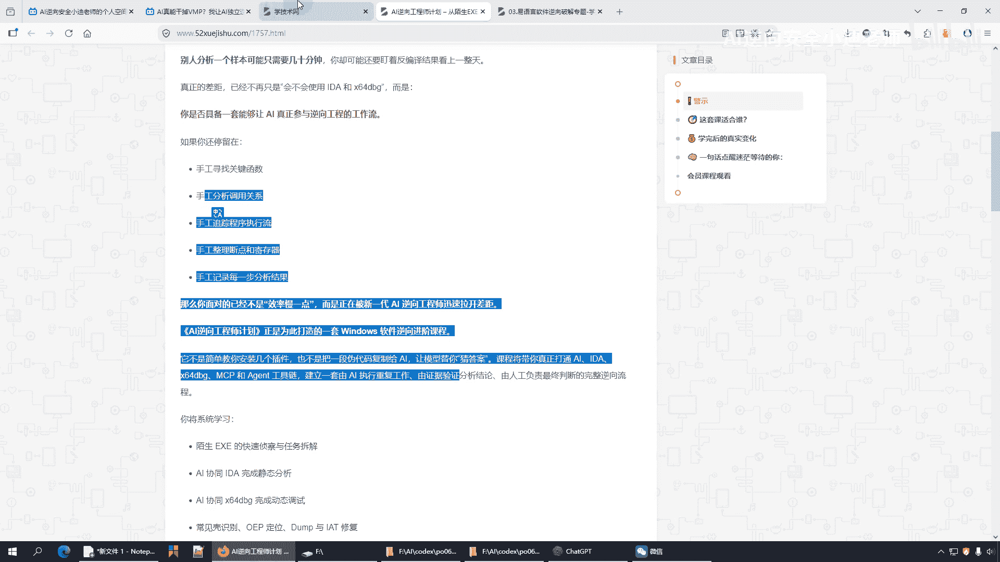

# 🛡️ AI逆向实战：00：AI能否脱掉VMP3.10.x壳

## 📌 AI逆向实战：01：课程概述

在本节课中我们将要学习AI逆向相关的内容，核心问题是AI是否可以脱掉VMP壳，以及用AI做软件逆向破解的整体效果如何。需要先说明，本文内容仅用于技术交流，不用于其他用途。这里讨论的“破解”和“脱壳”都限定在学习和研究范围内，目的是理解VMP虚拟化保护的工作方式，以及AI在二进制安全、游戏安全、软件安全、网络安全和CTF比赛基础中的实际作用。

上一段我们明确了课程主题，本节先交代背景。前段时间发布过一个相关视频，整体效果不错，很多人在看。随后有同学留言表示不理解：长期关注UP主，为什么每次都有避重就轻的感觉，没有把软件不是VMP时推荐的正确处理流程讲清楚；也有同学认为，如果只讲非最新版VMP，也就是3.8.x，要挑毛病能挑出一堆。这里需要说明，VMP的原理大体差不多，无论最新版还是老版本，只要是3.x版本，原理都大差不差，核心都是做虚拟化，只是内部可能升级了更多加密。

接下来看测试版本。原文提到3.10.6这个版本手头没有，但手头有3.10.4，两者差别不是特别大，因此用3.10.4做测试。这个测试之前就已经做好，时间很久之前，文件创建时期是8月17日，现在已经是9月份，已经过去很久。测试目标是入口点超级变异加虚拟化，入口点也做了变异和虚拟化，程序是64位，并且开启随机基址，因此难度算是比较难的。随后让AI进行脱壳，中间产物放在指定路径下，文件夹格式为“序号-中文说明”，最终交付成功，已经破解完成。

> 注意：以下内容仅用于技术交流与学习，请勿用于非法用途。

上一节我们介绍了课程背景和测试目标，本节中我们来看看测试对象的具体特点和难度构成，方便初学者理解为什么这个样本不算简单。

## 🧩 AI逆向实战：02：测试对象与难度说明

先看测试对象的整体情况。VMP 3.x的常见做法是把原始指令转换成自己的字节码，再由虚拟机解释执行，可以用一个简化公式表示：


\[
原始指令 \rightarrow 虚拟化字节码 \rightarrow VM解释器执行
\]

上一段给出了虚拟化的基本概念，本节继续看样本特点。这个样本不是随便找的小程序，而是入口点做了超级变异和虚拟化，程序位数是64位，同时带有随机基址。对初学者来说，可以先把它理解成“门锁更多、钥匙更难找”的程序。以下是该测试样本的主要特点。

- 入口点做了超级变异和虚拟化处理。
- 程序为64位，不是32位程序。
- 开启了随机基址，地址布局不固定。
- 壳版本接近3.10.x，实际使用3.10.4做测试，因为手头没有3.10.6。
- 测试文件创建于8月17日，到9月份已经过去很久，说明测试不是临时拼凑。

上面的列表说明了样本的基本难度。随后进入脱壳交付环节，需要观察查壳结果、区段状态和交付文件位置。上一节我们了解了测试对象的特点，本节中我们来看看AI脱壳流程和交付结果，重点确认测试不是空口说明，而是有文件和时间记录。

## 📦 AI逆向实战：03：脱壳流程与交付结果

先看脱壳的整体流程。可以把加壳程序看作输入，把脱壳后的程序看作输出，用简化公式表示：

\[
P_{packed} \xrightarrow{AI\ 辅助脱壳} P_{unpacked}
\]

上一段给出了脱壳的基本目标，本节继续看实际交付。查壳结果显示版本范围涉及3.5.1到3.4.6，程序为64位。这样的查壳结果用于证明测试过程没有说谎，也没有必要做额外自证，主要是给大家看一下实际状态。此时区段基本上被清空，全部是在动态运行时进行解密，这也是VMP类保护的常见表现。交付文件放在对应文件夹中，打开所在文件夹即可看到结果。包括名为ski的文件也是8月17日创建，已经过去很久。这里要说明，不是没有处理，也不是处理不了，而是之前没有录视频，现在补录视频展示过程。

为了让流程更直观，可以用下面的伪代码描述交付过程：

```text
输入：VMP 3.10.x 加壳的64位程序
处理：AI辅助脱壳，生成中间产物
输出：交付文件夹/序号-中文说明/
验证：查壳、查看区段、运行程序、对照文件大小
```

上一段用伪代码概括了交付流程，本节最后看交付结果包含哪些内容。以下是脱壳交付与验证中需要关注的项目。

- 查壳确认版本范围和程序位数。
- 查看区段是否被清空，是否在动态运行时解密。
- 打开交付文件所在文件夹，确认成品位置。
- 检查中间产物是否按“序号-中文说明”存放。
- 记录文件创建时间为8月17日，说明测试早已完成。
- 补录视频，展示脱壳后的实际效果。

到这里，脱壳流程和交付结果已经说明清楚。上一节我们确认了交付文件和查壳信息，本节中我们来看看脱壳前后的区段对照与运行验证，判断程序是否真的恢复并可运行。

## 🔍 AI逆向实战：04：脱壳前后区段对照与运行验证

先做区段对照。新建一个窗口，把加壳程序和脱壳程序拖过来，对比区段情况。加壳程序的区段呈现被清空、动态解密的状态；脱壳程序的区段已经恢复，代码基本都能看到。可以用下面的对照代码理解：

```text
加壳程序：区段被清空 -> 运行时动态解密 -> 代码不直接可见
脱壳程序：区段恢复   -> 代码基本可见   -> 可进一步分析
```

上一段对比了区段状态，本节继续验证运行效果。脱壳后的程序可以正常运行，这一点很关键，因为脱壳不只是让区段看起来恢复，还要保证程序能跑起来。加壳后的程序运行会明显变慢，需要等待观察；脱壳后的程序运行更直接。原程序是加壳状态，脱壳程序是去掉壳后的状态。文件大小方面，一个文件大小是17266，另一个是3940；刚才还有一个文件大小是32642。为什么脱壳文件可能这么大？原因是保留了虚拟化相关代码，虚拟机还在程序里边，所以体积不一定变小。

以下是脱壳前后对照时值得关注的几个现象。


- 加壳程序区段基本清空，动态运行时才解密。
- 脱壳程序区段恢复，代码基本可见。
- 脱壳后的程序可以正常运行。
- 加壳后的程序运行明显更慢，需要等待。
- 文件大小会因是否保留虚拟化代码而不同，脱壳文件不一定更小。

通过上述对照可以看出，AI辅助脱壳在这个样本上是可以搞定的，做逆向的效果也不错。上一节我们验证了脱壳程序可运行、区段可恢复，本节中我们来看看学员使用AI做独立逆向和脱壳的实战案例，了解实际学习效果。

## 🧪 AI逆向实战：05：学员AI逆向实战案例

先说明案例来源。平时不经常发朋友圈，如果发朋友圈，会发大家的学习效果。这里展示的几个案例比较有代表性，能够说明AI在逆向实战中的使用方式。案例之一是一个游戏辅助逆向，登录成功，使用补丁直接补上，补丁成品支持空坎密直接登录，一共三处补丁，完全没有问题。另一个案例是新加入的同学第一天就搞定了一个目标，功能一开始不太好使，后来变得好使，成功破解AI全自动。还有一个同学处理了VMP目标，也成功搞定。整体来看，基本是AI自动搞定，用不着太多手动操作。继续查找其他同学案例，基本上就是这几个，比较有代表性。

为了更清楚地看案例，以下是学员实战成果的简要归纳。

- 游戏辅助逆向案例：登录成功，三处补丁，补丁成品支持空坎密直接登录。
- 新同学案例：第一天完成一个目标，功能后续可用，成功破解AI全自动。
- VMP目标案例：另一位同学也成功搞定VMP相关目标。
- 整体方式：多数流程由AI自动完成，手动介入较少。

这些案例说明，AI不仅能参与脱壳，也能参与补丁和逆向分析流程。上一节我们看了学员案例，本节中我们来看看后续学习路径，并做课程总结。

## 🎓 AI逆向实战：06：学习路径与课程总结

先回顾今天的内容。今天视频的核心结论是：AI可以脱掉VMP壳，做逆向的效果也非常不错。如果大家想学习相关内容，可以直接来到网站，或者直接联系本人。网站可以开通课程，目录也可以点进去查看。例如国内有E语言生态，想学E语言相关内容可以学；如果什么都不想学，直接用AI也可以；如果想学点东西，这边应有尽有。学习路径可以用下面的代码概括：

```text
学习路径 = 网站课程目录 / 联系作者 / 直接使用AI实践
```

上一段给出了学习路径，本节最后做总结。以下是继续学习时可以选择的几种方式。

- 访问网站并开通相关课程。
- 查看课程目录，例如E语言生态相关内容。
- 直接联系本人咨询学习问题。
- 不学理论也可以直接使用AI进行实践。
- 想系统学习时，再结合课程目录选择方向。



本节课中我们一起学习了AI能否脱掉VMP3.10.x壳的实测内容，包括测试对象、脱壳流程、交付结果、区段对照、运行验证和学员案例。核心结论是AI辅助脱壳能够完成目标，逆向效果也不错，但整个过程仍需结合具体样本、版本和验证步骤来判断。今天的内容到此结束，下期再见。

