# AI逆向工程实战：第1章：AI能否干掉VMP？🤖

## 概述 📋

在本节课中，我们将要学习一个非常热门的话题：AI时代，AI到底能不能对VMP（VMProtect）加壳的程序进行逆向破解和脱壳。这个问题在二进制安全、游戏安全、软件安全、网络安全以及CTF比赛领域都是非常基础且重要的内容。我们会把"逆向破解"和"脱壳"分开来讨论，先理清两个概念的区别，再看一个失败的脱壳案例，最后看一个成功的脱壳案例，并给出一个明确的结论。

## 一、逆向破解与脱壳：两个不同的概念 🔍

首先，我们要把"逆向破解"和"脱壳"这两个概念分清楚。这两个词经常被一起提起，但它们是两件完全不同的事情。只有先把概念搞清楚，后面的案例分析才有意义。

### 什么是逆向破解？🛠️

逆向破解，简单来说，就是对加壳程序进行算法分析和动态修改。对于VMP加壳的程序，做逆向破解是完全没有问题的。这一点很多同学都已经亲身体验过了。为什么没有问题呢？因为一般情况下，我们在做逆向的时候，都是在分析程序里边的算法。你只需要把反汇编代码扒出来，直接丢给AI，AI就能看懂这些代码在干什么。

我们来看一个具体场景。如果我们要修改程序里边的代码或者数据，其实也不需要脱壳。我们可以从外部把程序运行起来，然后动态地进行patch。所谓patch，就是修改程序在内存中的代码或数据。程序运行起来之后，我们直接在内存里修改，同样可以实现想要的效果。用公式来描述逆向破解的过程，可以写成：

```text
逆向破解 = 静态分析（反汇编 → AI解读算法） + 动态修改（运行 → 内存Patch）
```

下面是一段动态patch的伪代码，方便初学者理解内存修改的思路：

```python
# 动态Patch伪代码
process = attach("target.exe")          # 附加到已运行的目标进程
patch(process, 0x401000, b"\x90\x90")   # 把0x401000处的两条指令改成NOP
resume(process)                          # 恢复进程运行
```

### 什么是脱壳？📦

脱壳就不一样了。脱壳是你对这个程序有极高的需求时才会做的事情。比如说，你想在修改完之后把结果完全保存到磁盘上，或者你要针对程序做各种复杂的修改，这时候才可能需要脱壳。换句话说，如果只是临时改一下内存，完全不需要脱壳。

```text
需要脱壳 ⟺ 需要将修改持久化保存到磁盘，或需要执行复杂修改
```

这里有一个很实在的结论：**80%的场景都是不需要脱壳的**。大多数情况下，动态patch已经足够解决问题了。明白这一点，你就不容易被"必须脱壳"这种说法吓住。

## 二、逆向破解：AI早已证明自己 ✅

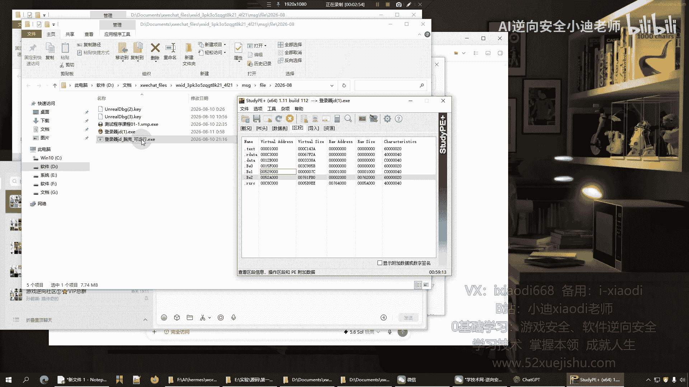

理清了两个概念的区别之后，我们先来看相对简单的部分：逆向破解。今天我们要讨论的核心是可行性，而破解这一侧的可行性已经不需要怀疑了。

关于破解，很多同学已经反馈过了：可以搞。就在昨天，有一位同学按照我文章里边讲解的方法，用AI成功破解了一个VMP双验证的程序。双验证意味着需要绕过两道验证逻辑，这位同学依然搞定了。这足以说明，**用AI做逆向破解是没有任何问题的**。

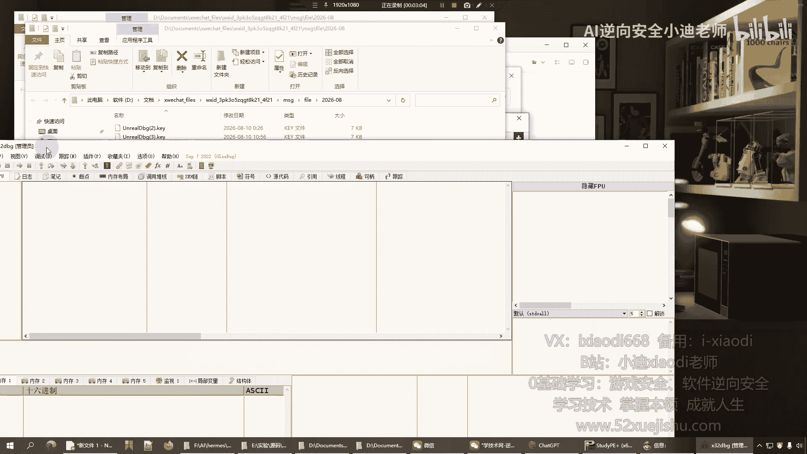

这个结果其实并不意外。逆向破解的核心工作是分析算法和定位关键跳转，这些工作恰好是AI的强项。你只需要把反汇编代码整理好，喂给AI，AI就能帮你分析出程序的控制流和数据流，甚至直接告诉你应该patch哪里、改成什么值。整个过程就像有一个经验丰富的逆向工程师在旁边帮你读代码。

## 三、脱壳失败案例：AI幻觉现场 ❌

破解说完了，我们再来看脱壳。脱壳的情况比破解要复杂得多。为了说明问题，我们先看一个失败的例子。这个例子非常有代表性，因为它展示了AI幻觉在脱壳任务中的典型表现。

有一位同学给了一个程序，声称自己已经脱壳成功了，而且脱壳后的程序可以运行。乍一听很厉害，但实际上，他犯了一个非常严重的错误。我们把这个程序拿过来仔细分析一下。

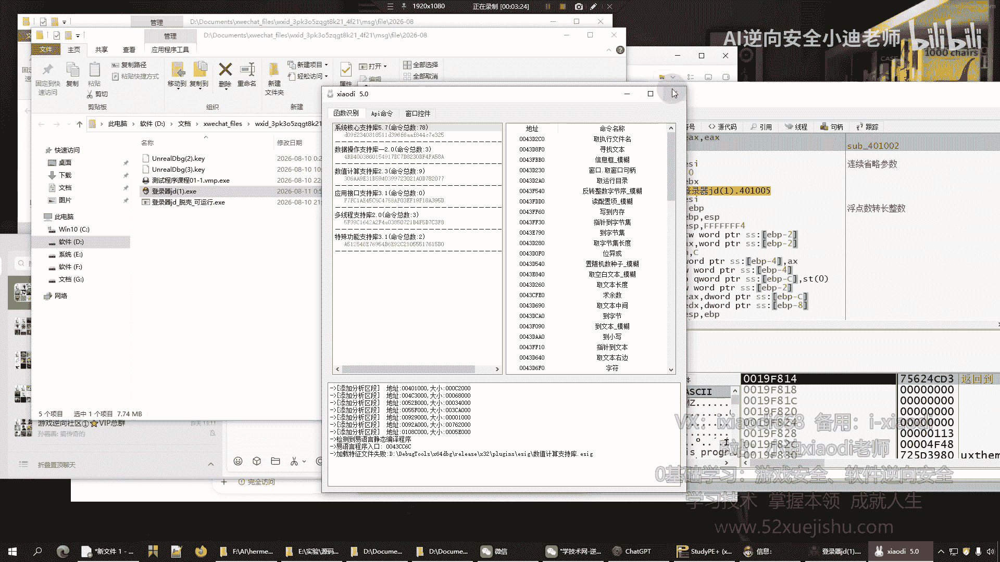

### 壳的特征 🔬

先看这个程序是什么壳。这是一个VMP的壳，判断依据是区段结构。程序里有三个异常区段，这就是VMP壳的典型特征，而且这是一个比较新的VMP版本。我把程序拖进检测工具，工具给出的判定结果是VMP 3.6.0到3.8.1。再用DIE检测一下，同样显示这是VMProtect，只是DIE没有给出具体的版本号。

```text
VMP壳的典型特征：存在3个异常区段
```

### 原程序是什么？🧐

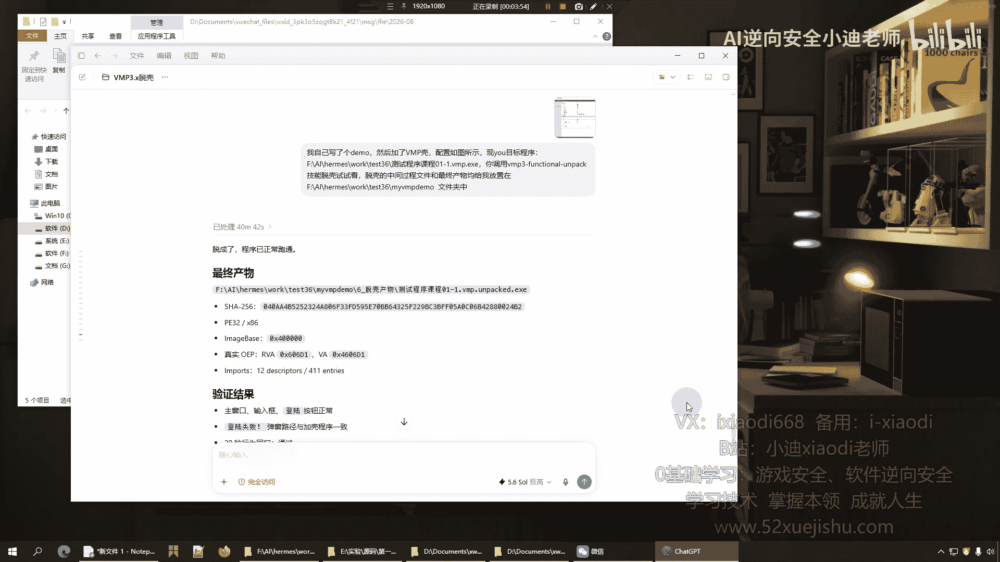

看壳之前，我们先确认一下原程序的身份。这个程序的原始版本实际上是一个**易语言**程序。我们可以直接把它运行起来，运行到一定程度就可以停了，点到为止。然后点击文件，点击附加，查看进程的属性。切换过来之后，能看到非常标准的易语言标记。包括它用到的那个小5.0库，里边的窗口、命令，全都是易语言框架性的东西。可以说，这是一个非常纯正的易语言程序。

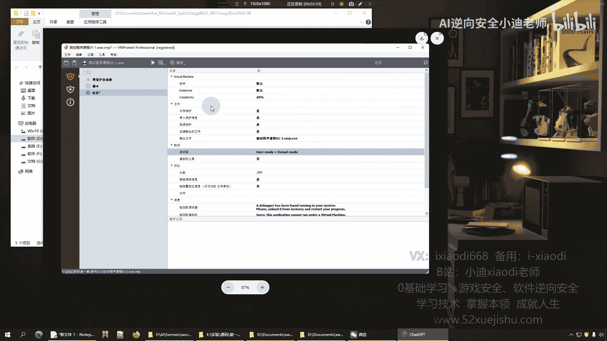

### 脱壳后的产物是什么？🤯

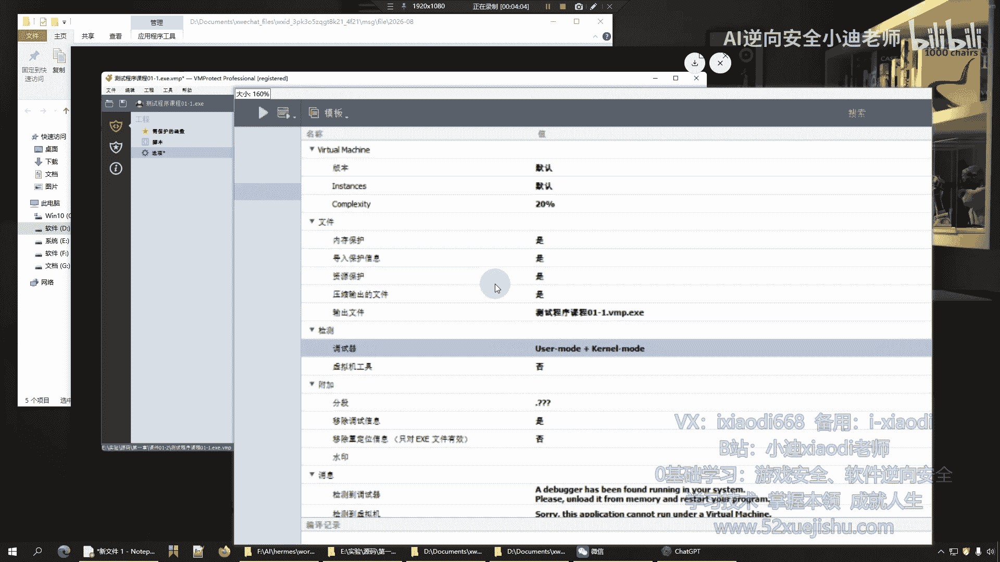

那么，这位同学把程序搞成什么样子了呢？我们来看一下他脱壳后的程序。原本一个易语言程序，脱壳之后竟然变成了一个**.NET程序**。这可能吗？这绝对不可能。易语言程序的底层运行机制和.NET完全不一样，脱壳只负责还原代码，不可能改变程序的语言和框架。所以，这里就产生了典型的**AI幻觉**。

再看一眼文件大小：原程序大小是7928字节，脱壳后的程序是7933字节。大小几乎没有变化，但程序语言却从易语言变成了.NET，这完全不合逻辑。因此我们可以非常确定地说：他的脱壳是失败的。

```text
AI幻觉检测公式：产物属性突变（如程序语言改变）⟹ 脱壳失败
```

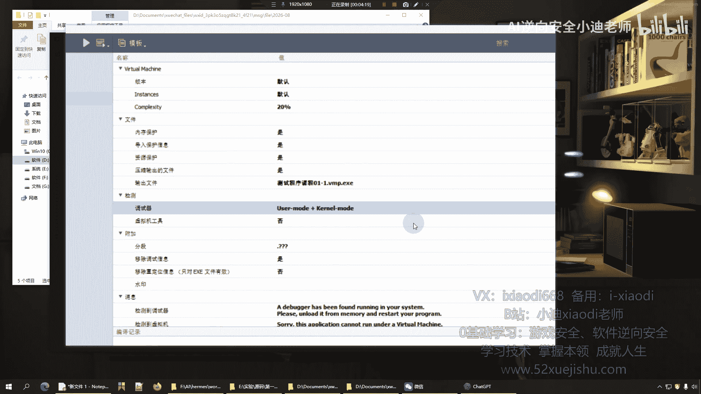

来看一下这个失败案例的关键对比信息，下面是原程序与脱壳产物的属性清单：

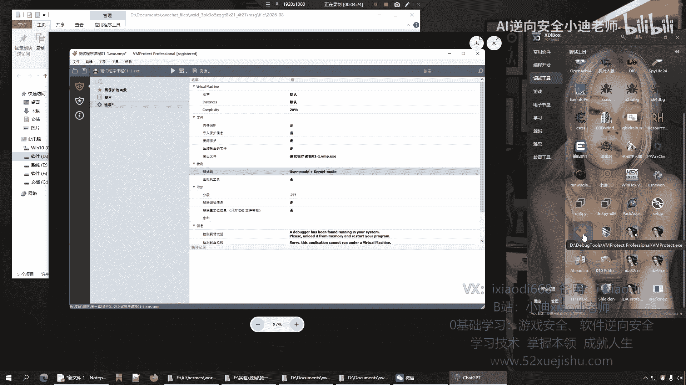

```text
原程序：  易语言程序，大小 7928 字节
脱壳产物：.NET 程序，大小 7933 字节
结论：语言属性发生非法变化 → AI幻觉 → 脱壳失败
```

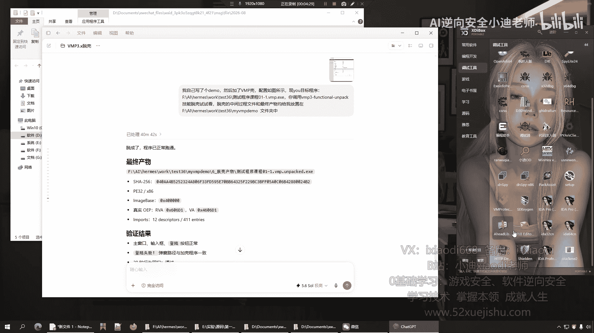

## 四、脱壳成功案例：VMP 3.8.1 被拿下 🎯

失败案例看完了，那么VMP到底能不能脱壳？答案是：当然可以。我自己训练了一个AI，专门用来处理这类脱壳任务。下面我们来看实际的脱壳效果，整个过程都有中间产物作为证据。

### 加壳配置 🧱

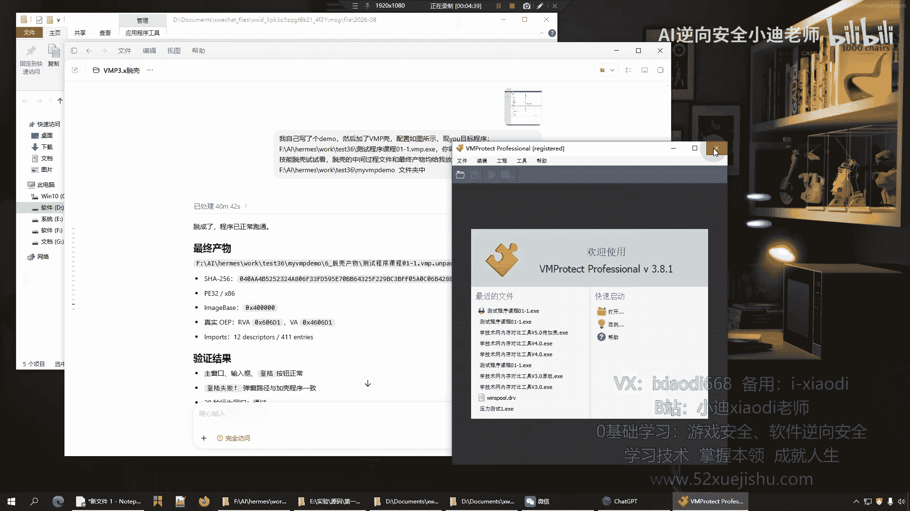

先看一下我给程序加壳的情况。这里我放大一下给大家展示清楚。加壳时启用了**内存保护**、**导入保护**和**资源保护**，这三个选项全都保护上了。反调试方面，用户模式（Usermode）和内核模式（Kernelmode）的反调试选项我都加了。只有虚拟机工具没有开，因为这是一台物理机，没有必要开启。

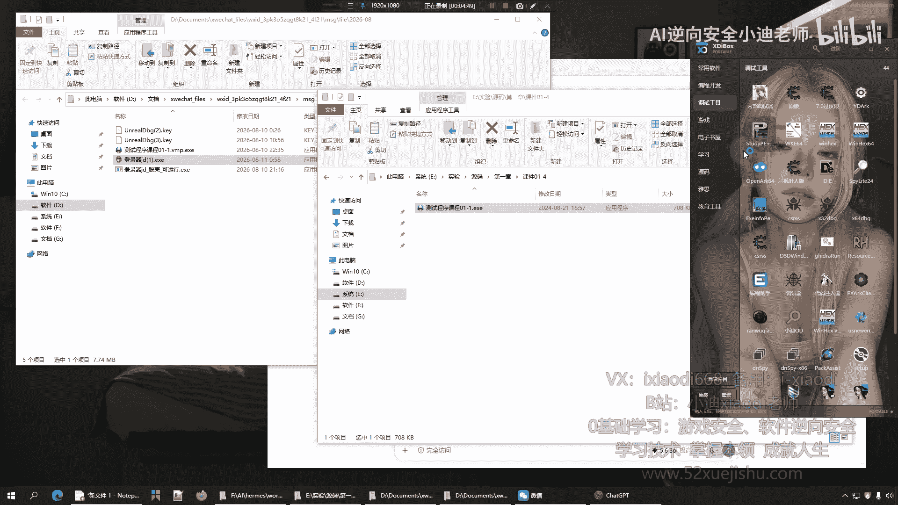

```text
VMP加壳配置：
- 内存保护 ✅
- 导入保护 ✅
- 资源保护 ✅
- 反调试：用户模式（Usermode）✅ + 内核模式（Kernelmode）✅
- 虚拟机工具 ❌（物理机环境，无需开启）
```

### 脱壳过程 ⚙️

使用的工具就是VMP 3.8.1的脱壳工具。运行工具之后，让它去执行脱壳任务。这个工具启动稍微有点慢，耐心等待一下即可。脱壳完成之后，我们再来看原程序和脱壳后程序的对比情况。

先记录原程序的状态。原程序的入口点在 `0x606D1`，区段结构也已经记录在案。脱壳完成之后，把脱壳后的程序拖过来检查，入口点同样是 `0x606D1`。这说明AI非常精准地找到了程序的原始入口点，也就是OEP（Original Entry Point）。入口点找得准，脱壳的第一步就成功了。

```text
OEP（原始入口点）= 0x606D1
脱壳后入口点   = 0x606D1 ✅
```

### 区段的变化 📊

接下来看一下区段的情况。脱壳后的程序里，三个虚拟机的区段依然存在。这是一个正常的现象：如果加壳的时候做了代码虚拟化，那么虚拟化的代码在脱壳之后仍然会存在于程序之中。也就是说，脱壳并不能把虚拟化的代码完全抹掉，但这并不影响程序的运行，也不影响后续的分析和修改。

另外，脱壳后的程序里，部分区段参数（比如一些RVA数值）与原程序并不完全一致，因为它还保留了三个虚拟化的VMP区段，所以它并不是原程序。我并没有欺骗大家，所有的中间产物都摆在眼前，大家可以自己对比验证。

### 反调试与运行效果 🏃

最后来看实际运行效果。先看原程序。原程序是带有反调试的，所以把原程序拖过来之后，只要点击运行，它必然弹出反调试提示，程序直接拒绝调试。有同学会说：我把过反调试的插件搞上，能不能绕过？我们也试一下。结果是插件也过不了，反调试照常触发，完全没有办法直接在调试器里跑起来。

再看脱壳后的程序。把脱壳后的程序拖过来，直接运行。毋庸置疑，反调试已经没有了，程序可以正常使用，一切都非常正常。从被反调试锁死到直接运行，这个对比已经说明问题了。

```text
原程序：  启动触发反调试，插件无法绕过 → 无法调试
脱壳产物：无反调试，程序正常运行 ✅
```

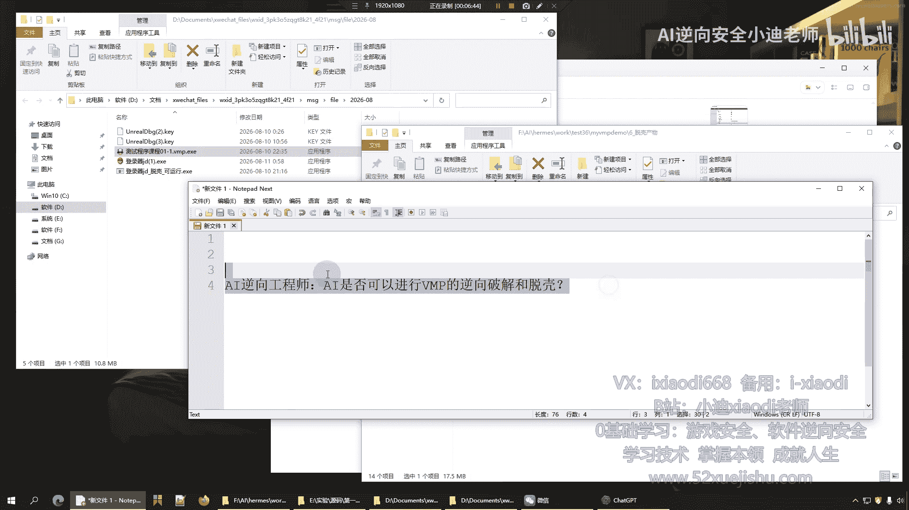

这意味着什么呢？意味着**VMP脱壳也是可以搞定的**，完全没有任何问题。

## 五、总结与学习路线 🚀

看完了成败两个案例，我们来总结一下。最关键的一点是：如果你想要学习AI逆向工程，要知道AI正在以前所未有的速度重塑逆向工程和软件安全这个行业。你不需要懂得太多高深的技术，只需要稍微学一点基础性的东西，然后再学习AI相关的核心内容就可以了。壳、脱壳、自动化逆向分析等等这些内容，在我们的课程体系中都可以一步一步学到。

以下是本节课的核心要点，帮助你快速回顾整节课的内容：

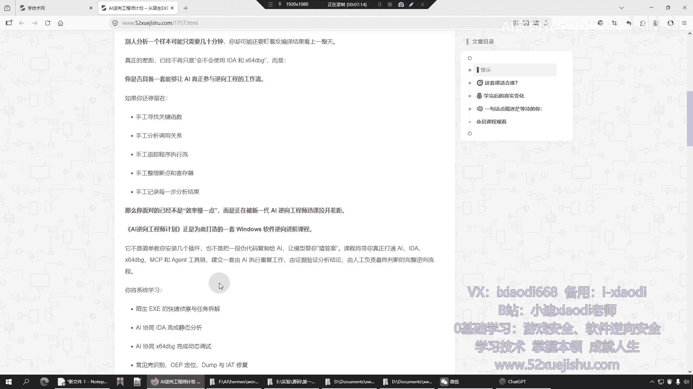

- **逆向破解不等于脱壳**：破解是分析算法加动态patch，脱壳是还原程序并持久化保存。
- **破解可行性**：AI分析反汇编代码、定位关键逻辑、给出patch建议，完全可行。
- **脱壳失败案例**：易语言程序被AI幻觉成.NET程序，文件大小异常，脱壳失败。
- **脱壳成功案例**：VMP 3.8.1加壳程序，AI精准找到OEP（0x606D1），去除反调试，程序正常运行。
- **虚拟化区段**：脱壳后虚拟化区段仍然保留，这属于正常现象，不影响分析。

本节课中，我们一起学习了AI逆向工程中两个核心概念——逆向破解与脱壳的区别，通过一个失败的案例看到了AI幻觉的典型表现，又通过一个成功的案例验证了VMP 3.8.1可以被AI完美脱壳。希望这节课能让你对AI逆向工程有一个清晰的认识，并且在今后的实战中少走弯路。我们下期再见。👋

