# 🤖 AI编程教程：01：认识AI编程与Cursor

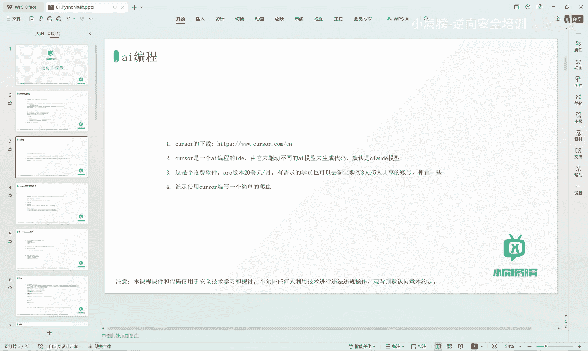

在本节课中，我们将了解什么是AI编程，以及如何借助一款名为Cursor的开发工具来自动生成爬虫代码。课程会从一个简单的爬虫项目出发，演示从工具的安装、配置到代码生成、运行和调试的完整流程。无论你是否具备编程基础，通过这节课都可以对AI辅助开发有一个清晰直观的认识。

## 🧠 什么是AI编程

AI编程，说白了就是让AI模型来帮我们写代码。以往我们写程序时，需要自己一个字符一个字符地敲键盘，而现在只需要把需求告诉AI，它就能自动帮你把代码生成出来。这个过程听起来很神奇，但实际上已经不是什么遥远的技术了。我们在这一节课里使用的工具叫Cursor，它是一个AI编程的IDE，也就是集成开发环境。你可以把它理解成一个“包装好”的编辑器，它本身并不是直接生成代码的“大脑”，真正干活的是它背后驱动的AI模型。Cursor做的事情，就是连接你和AI模型之间的桥梁。它把你输入的指令发给AI模型，再把AI模型生成的代码展示在编辑器里。所以你可以简单地记为：**AI编程 = 用户指令 + AI模型生成代码 + 人工验证修改**。这个链条中，AI负责生成，你负责检查和修正，两者配合，最终形成可以运行的代码。另外，用公式来表达的话，是这样的：

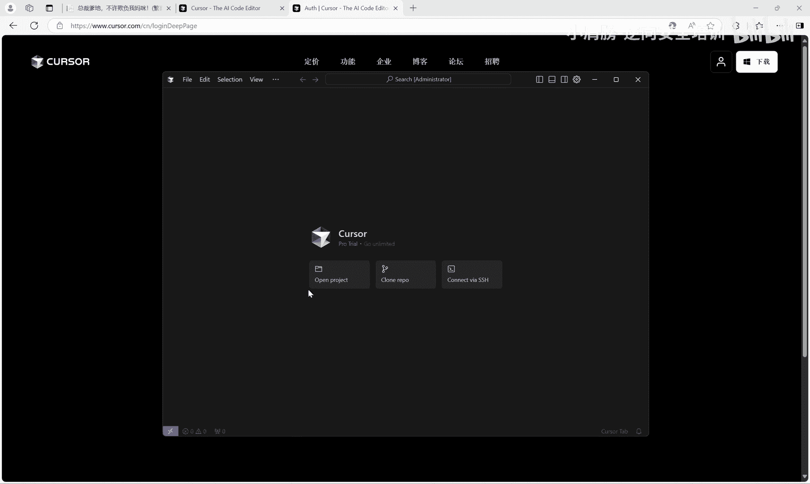

> **代码输出 = f(用户自然语言需求, AI模型参数, 编辑器交互环境)**

其中 f 表示AI模型的推理生成过程。这个过程不断迭代，直到代码满足需求为止。

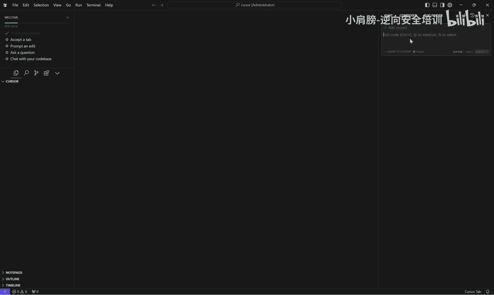

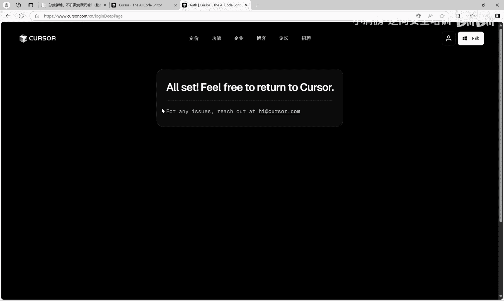

## 💰 Cursor的收费模式

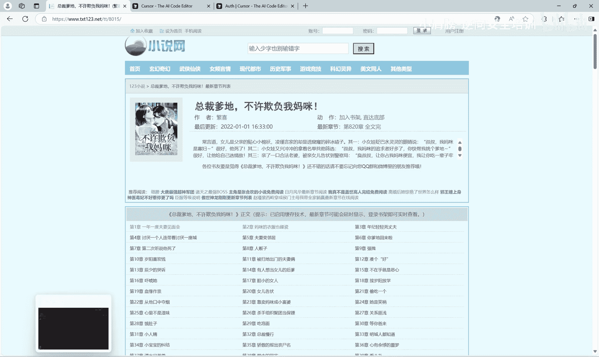

Cursor这款工具默认使用的是Claude模型。目前在大多数情况下，直接使用默认模型就已经足够了，效果也挺不错的。如果你有特殊需求，想要切换成别的模型，也是可以操作的。不过需要留意的是，Cursor是一个收费软件，Pro版本的价格是20美元一个月。如果按照当前的汇率来算，并不是一笔小数目。对于有需求但暂时不想付全款的同学，可以考虑去淘宝购买共享账号。这种共享账号通常有三人共享，也有五人共享的形式，价格会便宜很多。当然，如果你没有这个需求，也可以选择自己动手写代码。说到底，我们本身就是为了学习而来的，自己写代码的过程反而能让我们学到更多东西。所以这里有一条建议：**工具是辅助，能力才是根本**。

## 🔧 下载与安装Cursor

接下来我们看看Cursor是如何下载和安装的。下载地址就在它的官方网站上，具体来说，进入官网后，点击页面上的下载按钮，选择Windows版本即可。下载完成之后，你会得到一个安装文件，通常是一个可执行程序。双击这个安装文件，然后按照安装向导的提示一步步操作就可以了。安装完成后，Cursor会自动打开。首次打开的时候，它会让你选择你习惯使用的快捷键方案。如果你以前常用VS Code，就选择VS Code那一项；如果你更习惯其他的编辑器布局或快捷键，也可以选择对应的选项。这个设置的目的，是让Cursor的使用方式和你的操作习惯保持一致，从而减少上手的成本。

接下来还需要选择你要使用的语言。这个语言选项决定了你用哪种语言和AI沟通，以及AI输出的结果使用哪种语言。也就是说，如果你想用中文提问，并希望AI用中文回复，就选择中文。这个需要你自己手动输入并选择。至于另外两个默认选项，保持默认就好，不用做任何修改。然后点击 Continue 按钮，继续下一步。

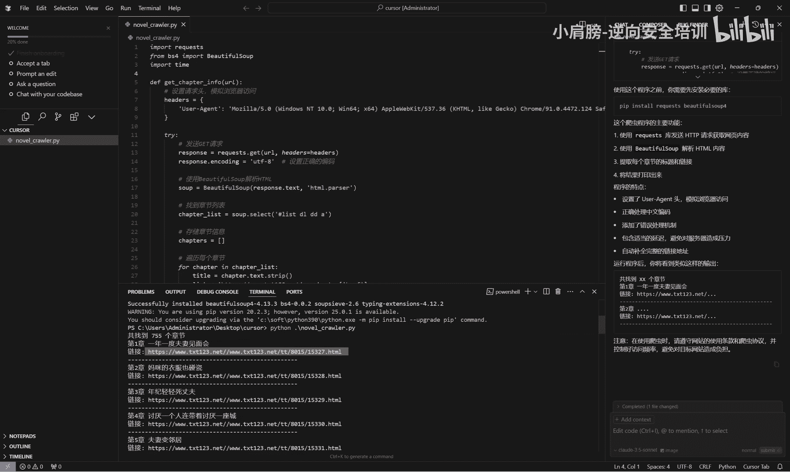

## 🔑 登录账号与网络配置

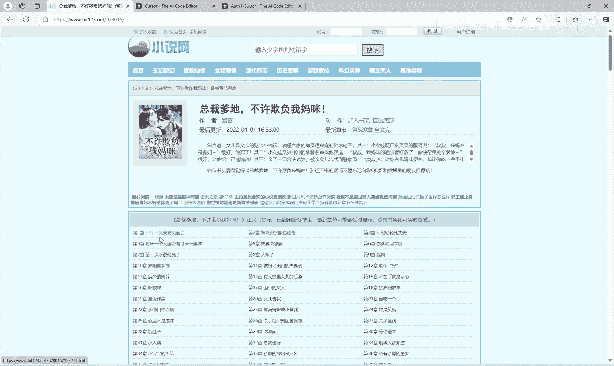

到了这一步，就需要你登录账号了。登录的方式有两种：第一种是自己在Cursor官网上注册一个账号，然后充值购买服务；第二种是直接在淘宝上购买共享账号，然后用这个账号登录。两种方式都是可行的，选择哪种就看你自己的实际情况了。如果你选择的是自己注册并购买，那么登录之后就会拥有完整的使用权限。如果是在淘宝买的账号，只要登录成功，同样也能正常使用。有一点需要提醒的是，在登录的时候最好能科学上网，也就是挂一个代理工具，否则网络可能会比较卡顿，登录过程可能会变得很慢甚至失败。包括你在日常使用Cursor的过程中，也建议开启代理，这样整体的响应速度会更好一些。

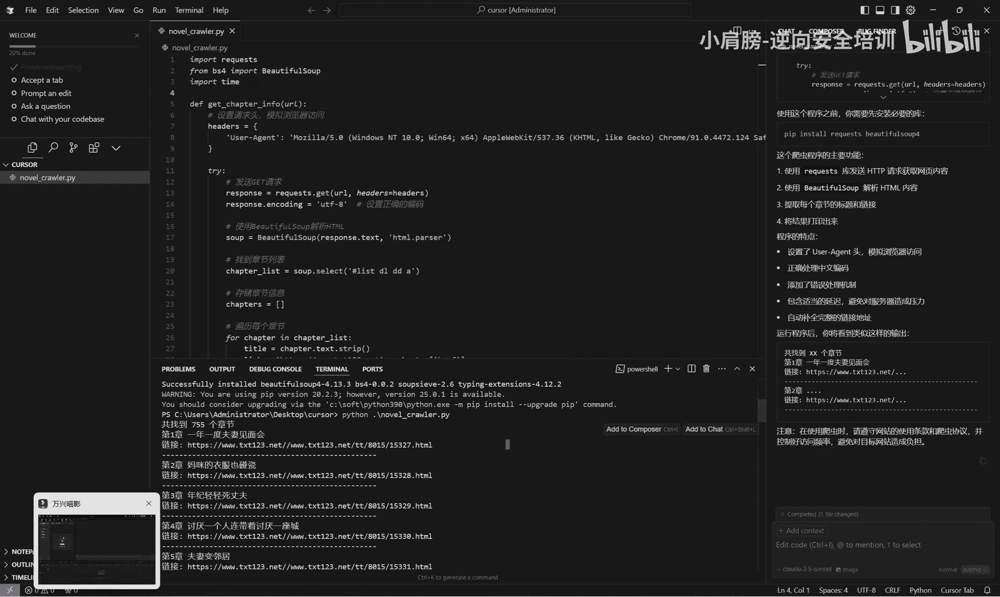

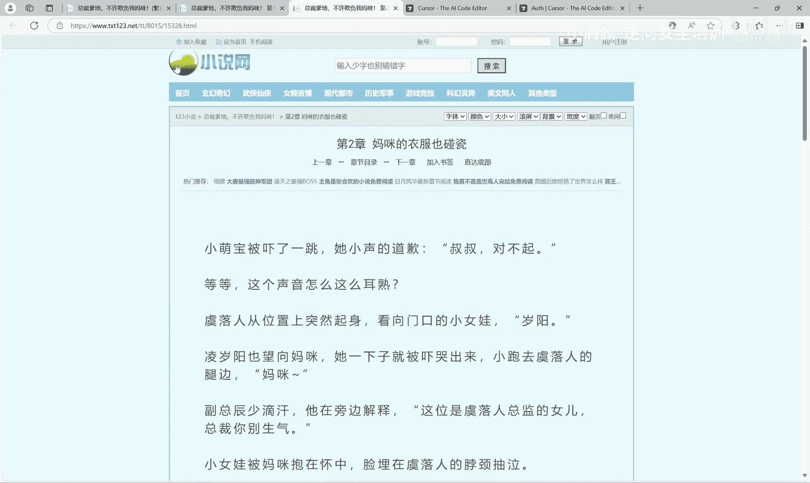

## 📁 创建工程并打开面板

登录成功之后，我们就可以开始创建工程了。在Cursor的界面中，有一个“打开一个工程”的入口，点击之后，你可以去文件系统里新建一个文件夹，作为我们的工程目录。这个文件夹就是将来存放项目代码的地方。你可以按照自己的习惯给它起个名字，比如python_spider、crawler_demo之类的都可以。然后回到Cursor界面，点击侧边栏的按钮，把面板展开。面板展开后，你会看到两个主要的聊天入口，一个是 Chat，一个是 Composer。两者的功能略有差别，但都可以用来和AI进行对话。这里我推荐使用 Composer，因为它在多文件操作和代码生成方面表现更好一些。在 Composer 面板中，你可以直接输入需求，AI会根据你的描述生成相应的代码，并直接展示在项目里。这个过程非常直观，也特别适合初学者去理解和验证AI的能力。

## 🕷️ 编写一个简单的爬虫

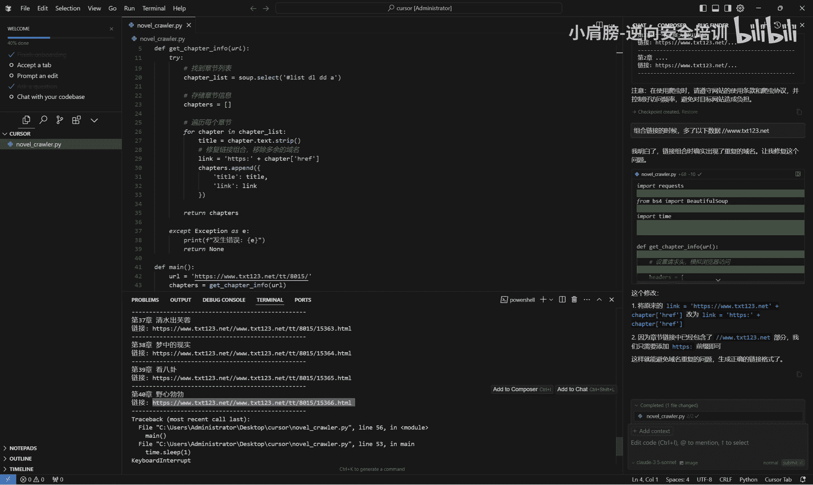

接下来我们进入正题，让Cursor帮我们写一个简单的爬虫。我们要爬取的网站是一个小说阅读页面，目标是把页面上文章的章节标题，以及每个标题对应的正文链接给爬取下来。那么我们该怎么对它说呢？哈哈，其实很简单，你只需要用自然语言描述需求就行。比如你可以这样告诉它：用 Python 写一个爬虫，爬取这个网站里面的章节标题，以及对应章节正文的链接。最好还能告诉它哪一个标题是你所需要的，这样它生成的代码会更有针对性。你把需求写清楚之后，它就会自动开始生成代码。生成速度取决于你的账号是不是Pro版的，同时也依赖于你的网络情况。如果网络通畅，大概率几秒钟之内就能返回结果。生成完毕之后，代码会出现在编辑器里。如果AI生成了多个方案，你还可以选择“Accept”来接受所有更改，把代码正式应用到项目中。


## 🧪 运行爬虫代码并安装依赖

生成完代码之后，我们要自己运行一下，看看结果到底对不对。由于它生成的是一个Python代码，所以我们需要先安装Python解释器。好消息是，在上一节课中我们其实已经安装过Python了，所以这个前置条件已经满足了。但还有一个问题——这段代码里面使用了一些第三方库，比如BS4、requests等等，这些包也需要安装到当前环境中，否则运行时会报模块不存在的错误。那我们就来运行一下代码。运行的时候有一点要注意：如果你访问的是国内站点，最好还是把科学上网给关掉，因为开着代理访问国内网站不但没有加速作用，反而可能会变慢，甚至出现连接不上的情况。接下来，当我们运行代码的时候，系统提示缺少BS4这个模块，那就需要安装一下。安装命令是：

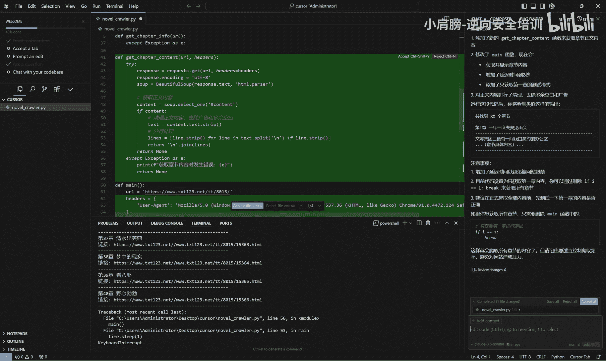

```bash
pip install bs4
```

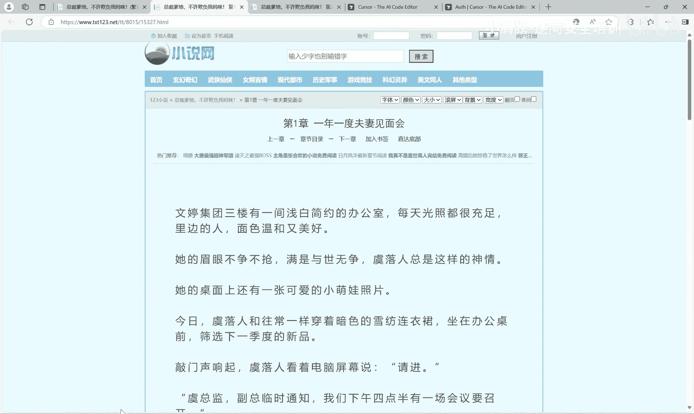

执行完之后，依赖就安装好了。我们再运行一次代码，就可以看到输出结果了。此时，爬虫已经正确地把章节标题和对应的链接提取出来了。比如输出的第一项是“一年一度夫妻见面会”，这个和我们打开网站实际看到的内容是一致的。因此我们可以确认，第一阶段的爬虫运行是成功的。

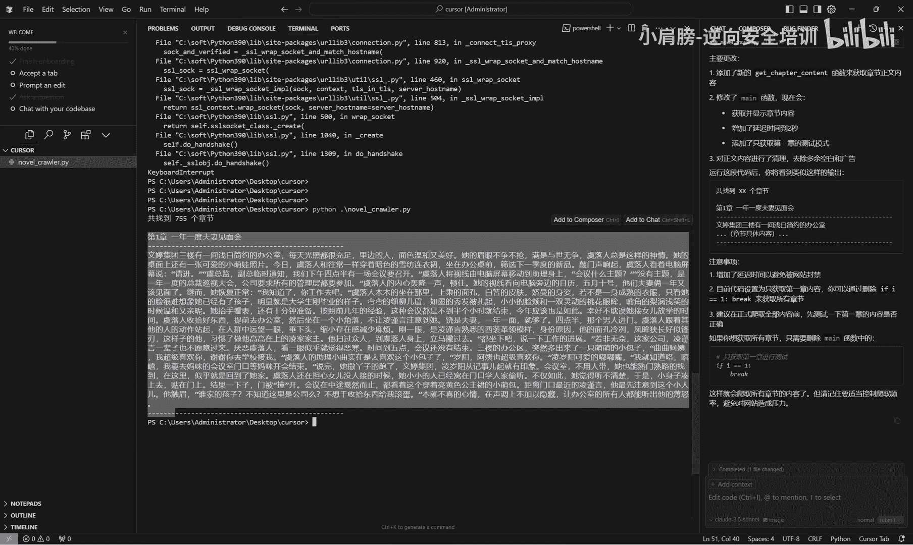

## 🔗 发现链接拼接问题

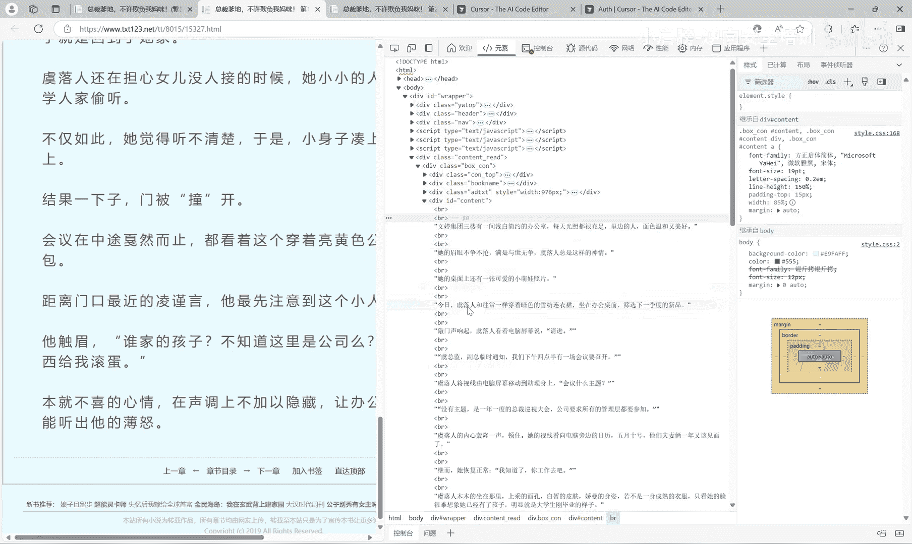

不过，当我们进一步检查爬取下来的链接时，会发现一个问题。比如它生成的某个链接是 `https://www.example.com/1532715328`，但是我们直接去网站看，正确的链接应该是 `15327125328`，但前面多了一截东西。这说明AI在拼接链接的时候，多组合了一些内容进去，导致URL地址不完整或在前面多了一段多余内容。那么怎么解决这个问题呢？很简单，直接跟AI沟通，告诉它这个链接有问题，需要修复。在提示的过程中，你要尽量说清楚问题出在哪里，比如“链接前面多了一段域名，请只保留相对路径部分”。AI收到反馈后，会针对性地调整代码。等它修改完代码之后，它会告诉你具体改了哪些地方。如果你同意修改结果，就点击接受。可以看到，它只改了一处，并给出了修改说明：“修复链接组合，移除多余的域名”。它将原来的字符串拼接方式改成了新的拼接方式，减少了一段多余内容。这一处修改确实把多余的部分去掉了。我们保存一下，然后重新运行代码，现在生成的链接就没问题了。

## 📝 提取章节正文内容

链接修复之后，我们还可以让爬虫更进一步——把每一章的正文内容也爬取下来。我们在Chat中输入新的需求，比如“请为每一章获取正文内容”，同时可以把那个正文容器加上引号，确保定位准确。这里的使用方式，其实我也是自己摸索着来的，不一定是最优解。大家可以自己多试试，看看怎么用效果更好。AI接受指令后，会回复说“我来帮你添加章节正文内容的功能”，并且还会附带说明代码是如何实现的。这段解释我们可以不细看，重点看代码的变化。观察改动的地方，它新增了正文获取的逻辑。具体来说，它是获取了页面中 ID 为 content 的标签里面的内容。我们可以在浏览器里检查一下，确实，正文内容就是放在这个 ID 为 content 的容器里面的。除此之外，它还处理了多余空白字符，比如用 strip 之类的操作把文本清理干净。虽然它说去除了广告，实际上是去除了多余的空白和格式标签。我们关掉代理，再跑一次代码，发现它确实把正文内容获取下来了。不过它似乎只打印了第一个章节的正文。我们看看内容本身，确实和页面上显示的一致，而且比我们自己直接爬取的效果还要好。因为如果让我们自己写的话，正文里面可能会有很多HTML标签，比如 `<p>`、`<br>` 等等，而AI直接帮我们把标签去掉了，只留下了干净的文本内容。

## 🔁 修改循环以获取所有章节

那为什么它只抓取了一个章节呢？我们猜测是不是没有写循环。于是我们去看代码，果然，在解析部分，它似乎只处理了第一个匹配项，而不是遍历全部章节。我们把这个限制去掉，然后重新运行代码。这个时候，输出结果就多了第二个章节的内容。我们一共找到了755个章节，但现在只输出了两个，说明循环还是不完整。于是我们继续让AI去修改。这种通过对话不断修正代码的过程，其实正是AI编程的核心用法。即使你没有编程基础，也完全可以这样操作。只要你能清楚地描述问题，AI就能帮你调整代码。在接下来的修改中，AI删除了 `break` 条件的限制，这样它就不会在第一次循环后跳出了。不过要留意的是，前面某个地方有一个限制性的参数也要删掉，不然它还是只会循环一次。把这两处都改好之后，再运行代码，就可以看到多章内容连续输出了，而且每一章的内容都完整爬取下来了。AI还贴心地给代码增加了“已完成”的提示，以及进度条的输出。到这一步，爬虫的基本功能已经非常完整了。后面要做的事情，就只剩下把这些内容保存到文件里了。这部分我们就不继续深入了。

## 🧭 总结

本节课中，我们一起了解了AI编程的基本概念，并通过一个具体的爬虫案例，走完了从安装Cursor、登录账号、创建项目，到生成爬虫代码、运行调试、修复问题、扩展功能的完整链路。我们看到了AI编程目前已经非常强大，对于一些简单的开发任务，它完全可以胜任，甚至不需要你手写任何一行代码。在遇到报错或者生成结果不满足要求的时候，只要持续和它沟通，不断给出反馈，它通常都能很快调整过来。但这并不意味着编程基础就不重要了。相反，基础仍然很关键。比如说，库要怎么安装，你得知道吧？Python解释器怎么安装，你得知道吧？当程序出现一些小问题的时候，你能不能一眼看出来？如果能的话，其实就不需要再跟AI来回沟通了。另外，AI虽然也能处理多文件项目，但遇到比较大的工程，或者一些更复杂的代码结构时，它生成的代码可能就会出现问题。遇到这种场景，你还是需要自己手动介入，帮助它调整。而且，如果网站有加密参数，爬虫在请求时可能就会被拦截。这种情况下，就需要你自己去分析加密逻辑，还原参数生成过程。

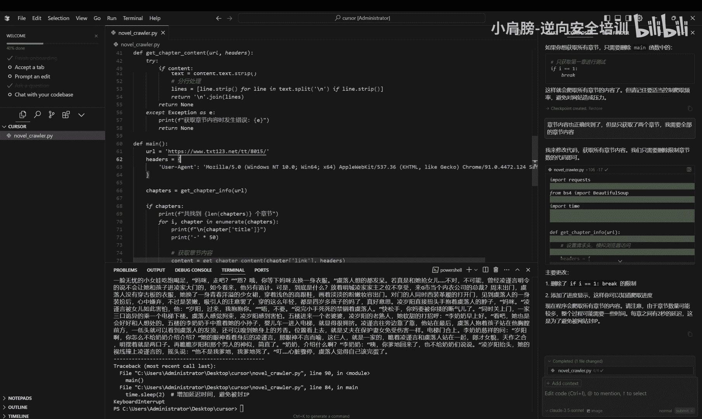

所以，现在我们去学习爬虫，不应该再把精力花在死记硬背这些库的用法上——哪个函数接收什么参数、返回什么结构，这些完全可以交给AI。你只需要做到能看懂代码，大概会修改，或者会跟AI沟通就够了。我们应该把更多精力放在逆向上面，也就是对加密参数的分析和还原上面。这才是爬虫学习的核心方向。好了，这节课我们就先讲到这里，我们下节课再见。

