## 🧭 AI自动化逆向实战：01：课程概述与名词科普

在本节课中我们将要学习 AI 自动化逆向实战中的几个核心内容，包括 VMP 强壳、网络验证卡密软件逆向破解、E盾魔改与 E盾全V压力测试。很多朋友都想看这些内容，因此本期继续做技术分享，也祝愿大家有一个美好的周末。标题里会出现很多看起来奇奇怪怪的名词，小白听起来可能一脸懵，所以先对这些名词做简单科普，避免看完视频都不知道在讲什么。

为了让你不被标题里的术语卡住，下面先对核心概念做通俗解释，以下是几个关键名词：

- **壳与强壳**：在软件安全里，保护软件的东西一般称为壳，这种保护器一般称为壳。特别强、特别难破解的壳，一般称为强壳。

- **VMP**：VMP 壳是独树一帜的代码虚拟化保护技术，它采用代码虚拟化技术实现保护。最有名的产品是 VMProtect，它是一个保护器、保护壳产品，简称为 VMP。

- **网络验证卡密软件**：这类软件通过网络验证卡密，卡密验证和网络通信是分析重点，这一点不用多说。

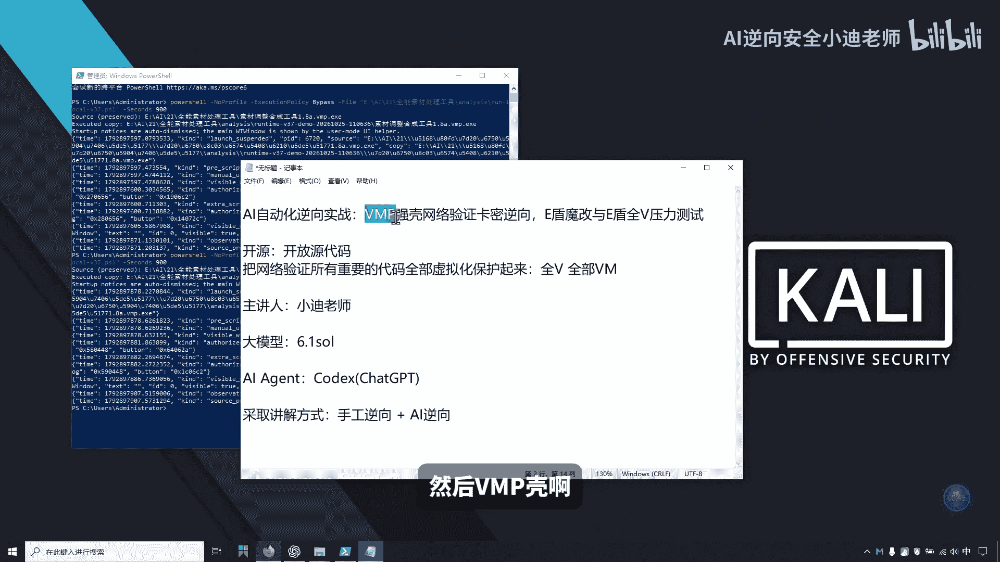

- **E盾**：E盾是网络验证的一种。E盾是开源的，开源就是开放源代码。开放源代码之后，可以参考学习、借鉴、引用，也可以做一些修改。

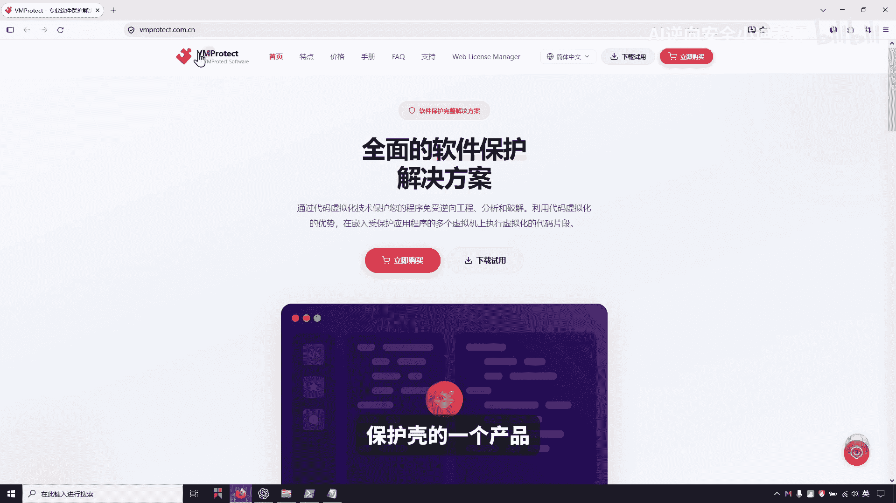

- **E盾魔改**：被修改后的 E盾源代码或框架称为魔改。魔改是很魔性的修改，它把原来的代码框架和逻辑改掉，例如网络验证怎么验证卡密、怎么实现分包，全部改掉。改掉之后破解难度特别大。原版太简单，源代码都开放了，看了源代码就知道程序执行逻辑，很好破解；魔改之后难度就大了。

- **E盾全V压力测试**：在魔改基础上，全V 是什么意思？V 就是虚拟化，把所有关键代码全部虚拟化保护起来，就叫全V，也就是全部 VM 掉。

核心概念可以概括为以下公式：

$$
\text{壳}=\text{软件保护器},\quad \text{强壳}=\text{难以破解的保护器}
$$

$$
\text{E盾魔改}=\text{修改开源 E盾源码或框架}
$$

$$
\text{全V}=\text{关键代码全部虚拟化保护}=\text{全部 VM 掉}
$$

理解了这些名词后，下面我们看看本期使用的主讲方式、智能体环境和两个实验案例。

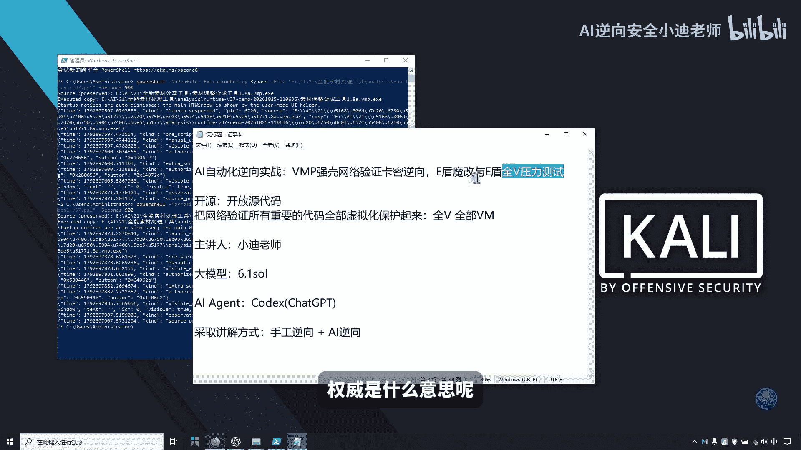

## 🧰 AI自动化逆向实战：02：主讲方式与实验环境

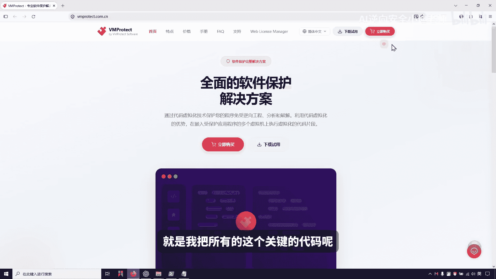

上一节我们科普了 VMP、E盾魔改和全V等名词，本节来看看本期的主讲方式与实验环境。本期主讲人为小李老师，大家应该熟悉；开场由小迪老师做技术分享。大模型版本为 6.1 速，智能体采取 Codex 或 ChatGPT，这两个产品已经合并。讲解方式为手工逆向加 AI 逆向：先手工逆向看看难度和强度，再理解 AI 到底在克服怎样的困难。本期一共准备两个例子，第一个例子是 E盾魔改例子，第二个例子是 E盾全V压力测试例子。

以下是本节需要了解的环境与工具信息：

- 本期准备两个案例，分别对应 E盾魔改和 E盾全V压力测试。

- 演示会使用工具包、调试工具、字符串搜索工具和封包分析思路。

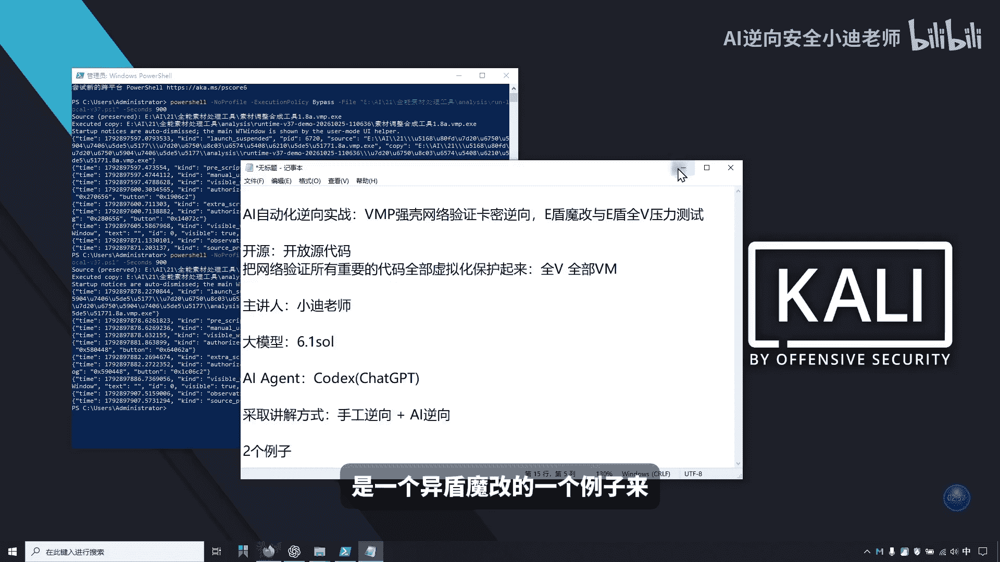

- 调试工具需要附加到程序上，附加就是让调试工具和软件建立联通。

- 字符串搜索可以查看程序中的明文字符串，包括密钥、通信相关内容和封包相关内容。

- 小离物点0可以用于辅助分析部分逻辑。

- 封包是网络请求数据包，后续破解效果会通过封包技术体现。

- 第二个案例有反调试，需要写劫持注入，直接拖回调试器运行不行。

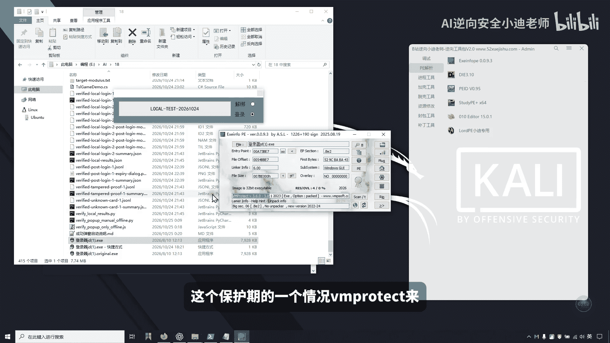

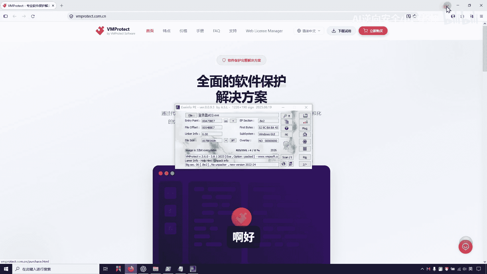

准备好这些环境和思路后，下面进入第一个案例：E盾魔改程序的手工逆向。

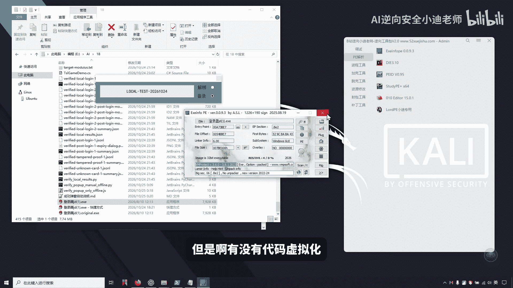

## 🔍 AI自动化逆向实战：03：E盾魔改程序的手工逆向

上一节准备了工具和讲解方式，本节进入第一个案例，查看 E盾魔改程序的手工逆向。程序就在演示环境中，先运行起来，点确定。界面有非常典型的 E盾界面特征，点击登录会提示卡号不存在。打开工具包，先看软件保护情况：点击运行保护检测工具，把程序拖过来，这里会暴露保护器情况。VMpro 眼熟，刚刚看过，它是 3.60 到 3.81 的版本。这个版本很多，所以能查出对应版本，强度不错，但是有没有代码虚拟化是另外一回事。

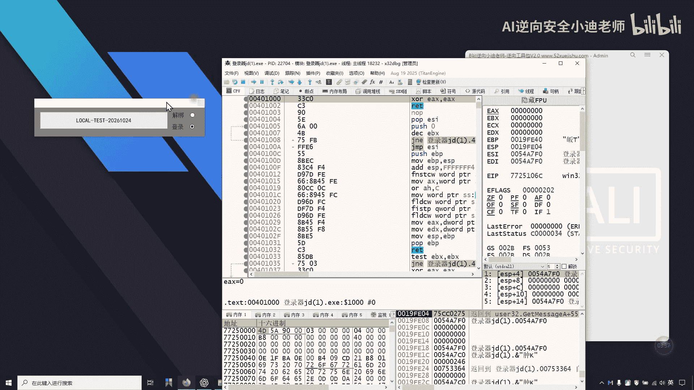

> 保护器是保护器，虚拟化是虚拟化。

接下来手工查看强度。点击文件，点击附加，让调试工具和软件建立联通。然后搜索字符串，可以看到很多明文字符串，包括密钥、通信相关内容、封包相关内容全部暴露出来。如果了解 E盾，会发现这些全是通信相关要用的东西，通过这些内容也可以判断 E盾版本号。所有东西清晰可见，还会释放免费登录等字样，也会出现超级登录。这个破解起来很好破解，包括返回服务器文件、下载内容、解除电脑等，难度很简单。

以下是手工逆向中的关键观察与操作：

- 先单步查看免费登录流程，免费登录走到这里，基本涉及免费登录，在这里下断点。

- 点击登录，把之前下的断点放开，运行到免费登录。

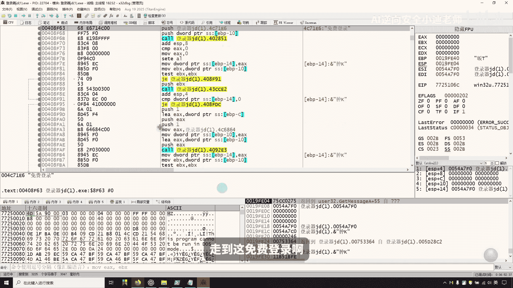

- 程序开始获取卡密，继续走，还没有关键逻辑出现。关键逻辑出现，就是“卡密不存在”必须出现。

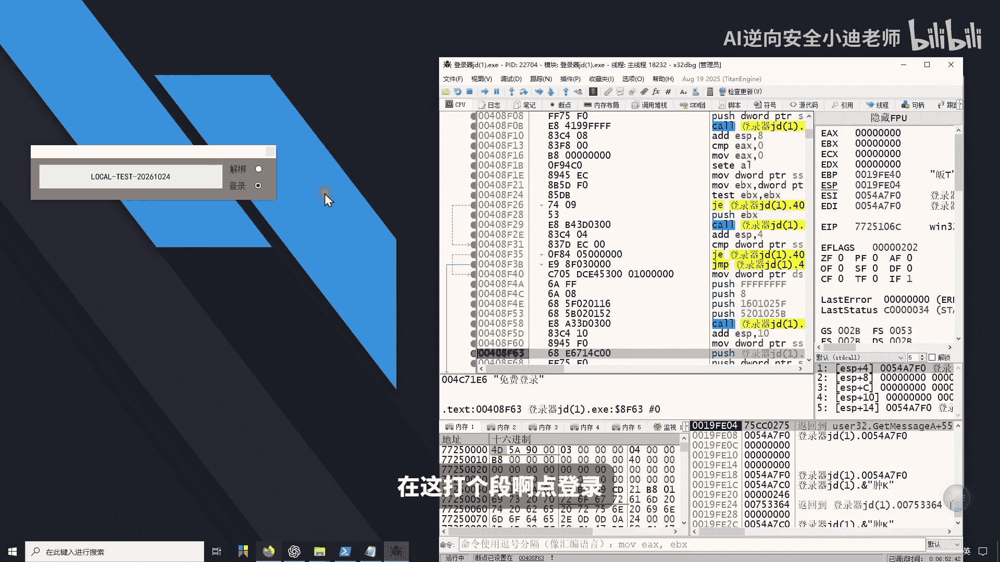

- 结果出现“卡密不存在”，继续往下走。卡密不存在之后，逻辑有一个很大的跳转，这边就不执行。

- 不执行会执行到哪里？跳转的红色箭头跳到“已经过期”或“卡号不存在”。关键逻辑就在这里，不能让它跳，把这处改一改。

- 改完后这边又执行，执行了一个 ESE，又释放了一个 TST。如果觉得不够清晰，可以用小离物点0分析，看到取运行目录、文本相加等操作，然后逐渐登录、写配置项之类。

- 这个程序很好破解，因为它没有代码混淆。

因此，即使一个程序加了 VMP，也未必存在代码混淆。需要明确一个知识点：即使软件加了 VMP，也不要怕，它可能带有代码虚拟化，也可能没有代码虚拟化。这个软件其实有代码虚拟化。往下翻，代码会看不明白，出现类似下面的内容：

```text
F wait
靠ll
靠ll
靠吧靠
```

这些就是代码虚拟化。但这边代码虚拟化不影响上面分析程序大体关键逻辑，不影响。有时软件作者加代码虚拟化，水平也未必很高。关掉分析工具。手工逆向来看，这个软件难度并不是特别大。

手工找到关键跳转后，本节继续查看 AI 能否完成同样的卡密去除目标。

## 🤖 AI自动化逆向实战：04：用AI智能体破解E盾魔改程序

上一节手工分析了 E盾魔改程序，并找到关键跳转，本节查看 AI 能否干掉这个程序。AI 能够干掉。下面是我的提示词，这是自有软件，提示词要求逆向分析它的卡密校验机制并去除卡密，该程序已经运行。程序有强壳保护，可能需要到幕后才能分析，中间文件放置在指定目录。它一步一步去干，干完了，干了好几波。过程中出现过很多错误，下面看最终结果。

提示词可以概括为以下内容：

```text
逆向分析该程序的卡密校验机制并去除卡密。
该程序已经运行。
该程序有强壳保护，可能需要到幕后才能分析。
中间文件放置在指定目录。
```

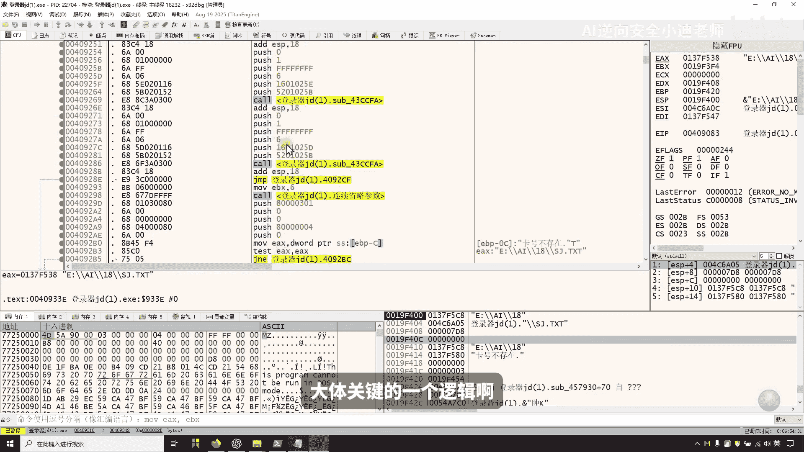

中间出现了一些小问题：它需要游戏，最终测试没有游戏不行。我的电脑确实没有安装 PUBG 游戏。破解是否成功？破解成功，VIP 剩余时间 8760 小时，说明破解成功。大家可能特别想看破解成功的效果。这个程序外观上也会加载驱动，加载驱动后出现蓝屏，可能跟软件或系统不兼容。还有缺少真实游戏内存布局，内核写作出问题，这是没有游戏导致的。

以下是 AI 破解结果与问题：

- 最终测试需要游戏环境，没有 PUBG 游戏会影响部分内核测试。

- 破解结果是 VIP 剩余时间 8760 小时，说明卡密去除成功。

- 程序加载驱动后出现蓝屏，可能与软件和系统不兼容有关。

- 缺少真实游戏内存布局会导致内核写作出问题，这是没有游戏环境导致的。

- 最终到这一步就成功了。

打开破解工具运行，可以看到它全部用封包实现。点击登录，VIP 剩余时间 8760 小时，直接干掉，这是第一个程序。它全部采用封包实现，所以对于 VMP 程序来说，破解可以完成。

第一个案例验证了 AI 的能力，下面看第二个强度更高的程序：E盾全V压力测试。

## 🛡️ AI自动化逆向实战：05：E盾全V程序的手工逆向

第一个案例验证了 AI 的能力，本节查看第二个程序：E盾全V压力测试，这个程序强度更高。查看全能素材处理工具，先看壳的情况：拖入检测工具，显示 VMP 3.0 到 3.5.0。版本有点老，但老奥迪也是奥迪，老车也是车，老车也比步行强。运行起来，点确定。提示服务未开启测试登录功能。没有登录功能怎么办？调试一下。附加，把窗口抢过来，然后用工具分析。

> 老奥迪也是奥迪，老车也是车，老车也比步行强。

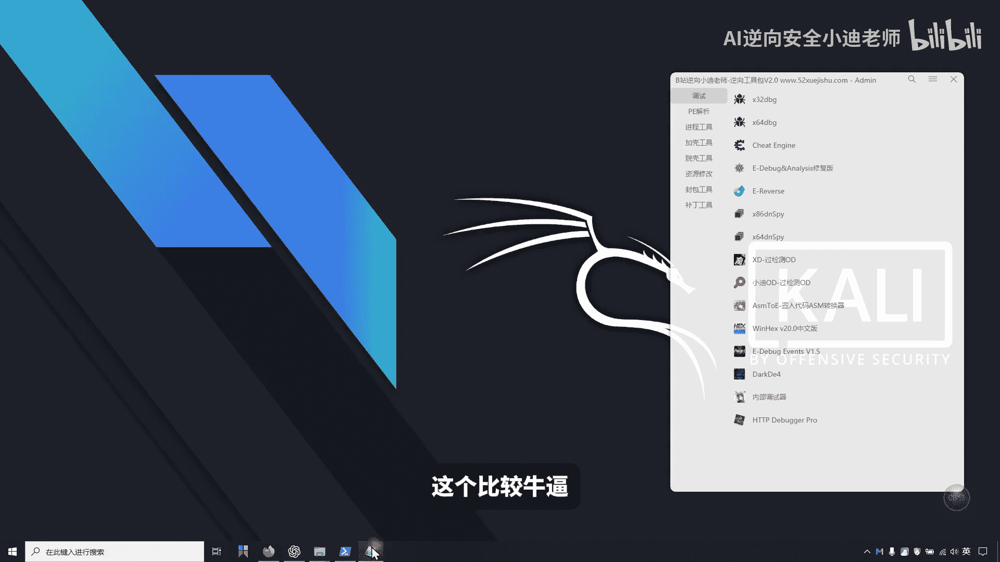

先看字符串。有同学说免责声明出来了，先不要开心，先不要着急。它的所有关键代码全部被混淆，所有关键代码全部混淆在比如这边。一般来说从这里开始执行，先看代码从哪里执行。这边是一个基础调用，执行完之后就开始窗口消息循环。直接窗口消息循环，说明载入功能窗口还是在这里。查看这边弹窗，弹完之后看怎么执行。一行一行看，这还是信息框，然后从这里执行，走到哪里？全部 V 没了。也就是说，从一开始分析的时候，这边就全部 V 掉了。

有同学说能不能爆破窗口，爆破窗口然后分析窗口相关逻辑行不行？查看 52010001、BC2。这个就是功能窗口，控件比较多，应该是一个窗口。5201001。搜索载入窗口，查看载入没有。插件能够暴力枚举程序所调用的一些命令，全部 VM 掉，连查看都没有办法。这就是难度，直接上强度，强度就是这么大。所有关键命令全部混淆，无法看懂，全部是乱码，所以这个难度很大。

以下是第二次手工逆向的关键步骤和现象：

- 运行全能素材处理工具，点确定，提示服务未开启测试登录功能。

- 没有登录功能就调试，附加后把窗口抢过来，再用工具分析。

- 查看字符串时出现免责声明，先不要急，关键代码已经被混淆。

- 基础调用执行完后进入窗口消息循环，说明载入功能窗口仍在附近。

- 弹窗是信息框，弹完之后继续执行，关键代码全部 V 没。

- 尝试爆破窗口、分析窗口相关逻辑时，查看 52010001、BC2，判断功能窗口位置。

- 搜索载入窗口时，插件能暴力枚举程序调用命令，但全部被 VM 掉，无法查看。

- 所有关键命令全部混淆，无法看懂，全部乱码，难度很大。

小迪老师能不能破解？当然能。先看手工逆向破解成果。这个软件有反调试，直接搞不好搞，必须写劫持注入。例如拖回来运行不行，必须写劫持注入。先看小李老师破解成果，我们用的是劫持注入。运行，跟着小李老师学技术，窗口界面直接爆出来。但这个成果建立在很长时间的软件逆向技术基础之上才可以。这些功能都可以用。实验程序最终会打包放给大家，可以自己玩，查看难度。这就是全V，全V就是把全部关键代码、所有重要代码全部虚拟化保护起来。

手工破解全V依赖长期逆向基础，下面查看 AI 在这个案例中的表现。

## ⚙️ AI自动化逆向实战：06：用AI智能体破解E盾全V程序

手工破解全V依赖长期逆向基础，本节查看 AI 能不能干，AI 也能干。查看 AI 的工作内容：再分析一个类似的目标程序。因为知道它也是 E盾，但这个魔改跟上个魔改不一样，而且全 V 了，全部已经 VM 混淆。目标是能够登录成功。查看效果：一共三句提示词，最后出现假死情况，让它修复，它也修了。

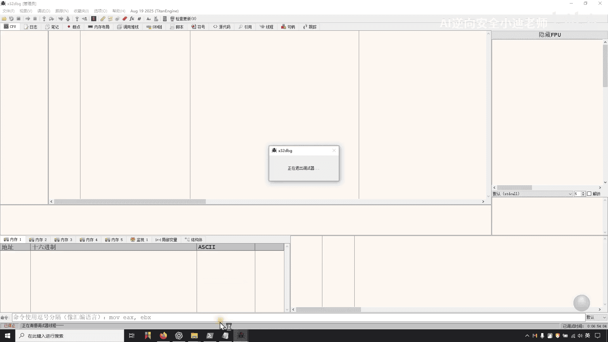

以下是 AI 处理全V案例的过程与结果：

- 目标是分析类似的 E盾目标程序，该程序魔改方式不同，并且全部 VM 混淆。

- 一共使用三句提示词，目标为登录成功。

- 最后出现假死情况，要求 AI 修复，AI 也完成了修复。

- 修复成果就在演示中，给了一个脚本让我们运行。

- 运行脚本后，它会自动点击确定按钮，稍等后程序界面也出现了。

- 程序全部采用封包技术，对应全能素材处理工具。

AI 破解全V案例演示完成后，本节对课程内容做总结，并给出后续学习与联系渠道。

## 📌 AI自动化逆向实战：07：课程总结与学习建议

两个案例演示完毕，本节做课程总结。这是今天视频的全部内容，给大家做了演示，也让大家了解 AI 发展到什么程度。如果想搭建同款 AI 自动化逆向智能体，可以联系小李老师。如果想学习 AI 自动化逆向技术，也可以联系小李老师。网站有很多学习内容，大家都可以学习。想学 AI 逆向、想学手工逆向都可以。在 B站也可以联系小迪老师、小李老师，在对应渠道可以联系到我们。合集里有很多合集，大家都可以查看。

以下是后续学习与联系渠道：

- 想搭建同款 AI 自动化逆向智能体，联系小李老师。

- 想学习 AI 自动化逆向技术，联系小李老师。

- 网站有很多学习内容，可以学习 AI 逆向和手工逆向。

- B站可以联系小迪老师、小李老师。

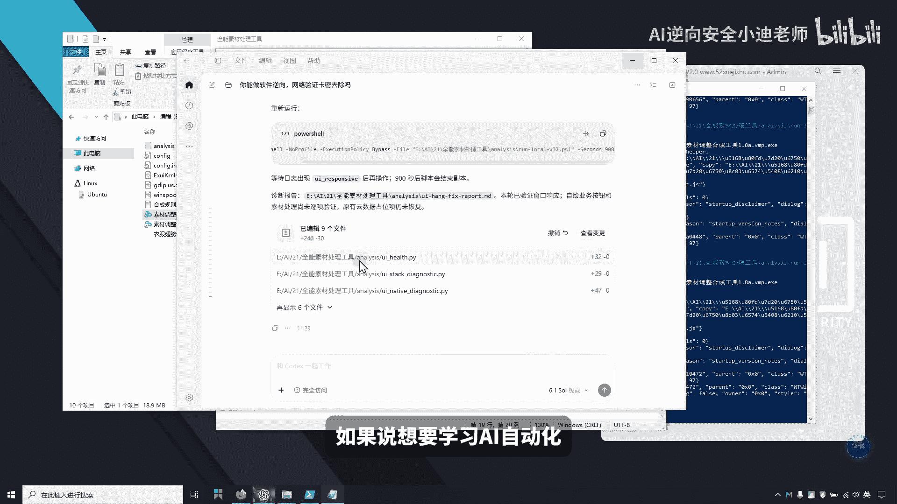

- 合集里有很多合集，可以继续查看学习。

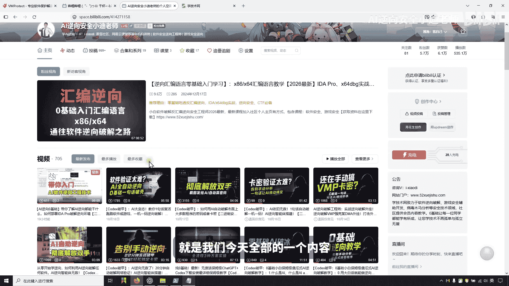

本节课中我们一起学习了 VMP 强壳、E盾魔改、E盾全V压力测试这些概念，也完成了两个案例的手工逆向和 AI 自动化逆向演示：第一个案例通过手工分析关键跳转和封包实现卡密去除，AI 最终实现 VIP 剩余时间 8760 小时；第二个案例在全部 VM 混淆和反调试条件下，手工使用劫持注入，AI 使用三句提示词和修复脚本完成登录演示。本期内容到这里，下期再见。

