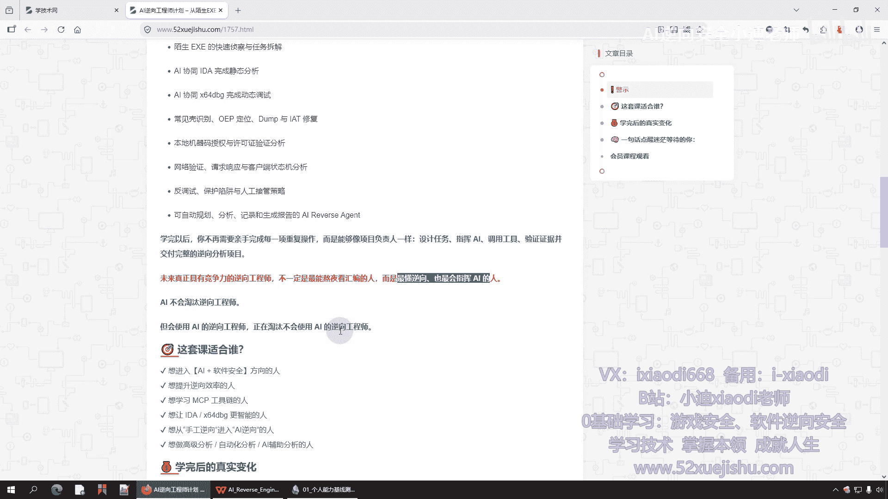
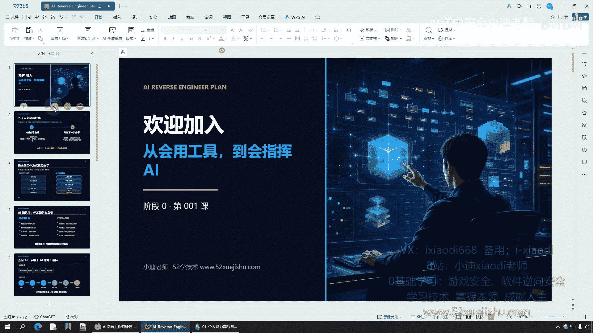
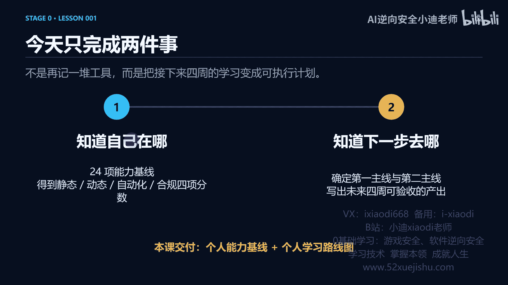
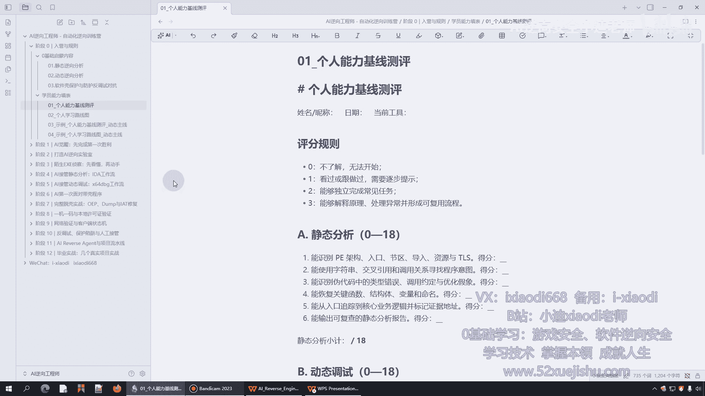
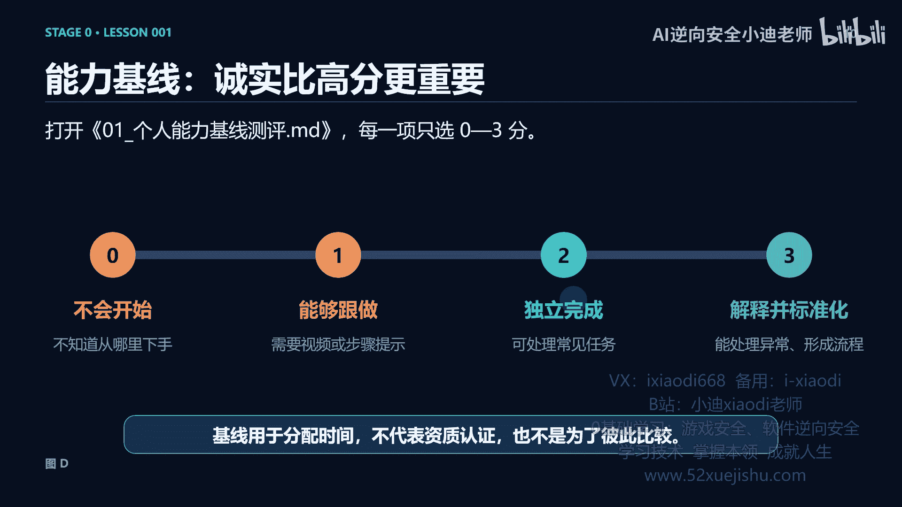
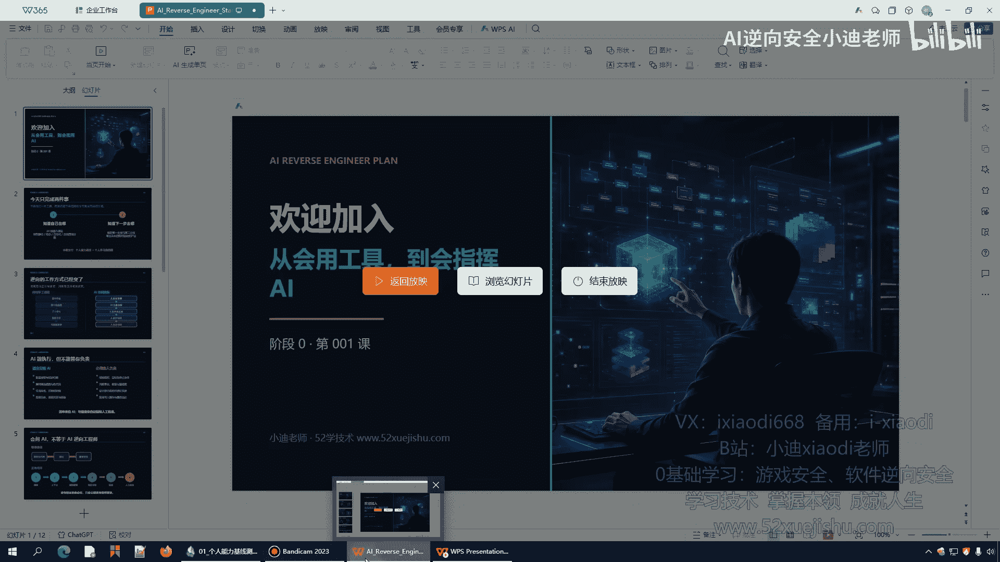
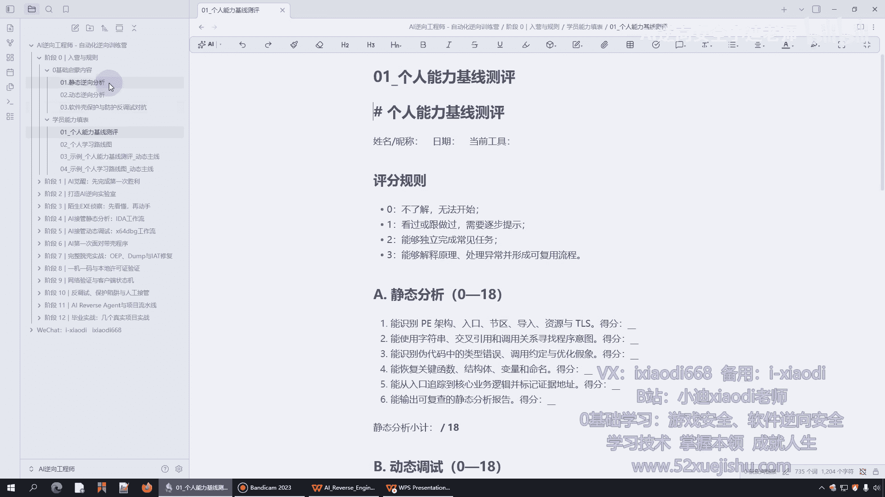
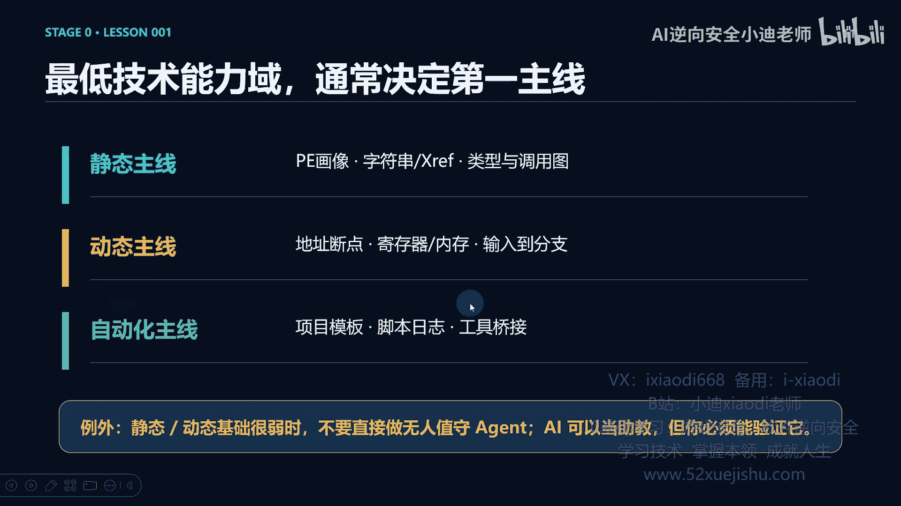

# AI逆向工程师计划：第1章：AI时代的逆向工程 🚀

在本节课中，我们将学习AI如何重塑逆向工程与软件安全行业，以及为什么我们需要成为“最懂逆向、最会指挥AI”的工程师。我们还会了解这门课适合谁、课程的整体结构、学习方法与节奏，以及一套完整的AI逆向工作流。无论你是零基础还是有一定经验，这节课都将为你画出一条清晰的学习路线图。

大家好，我是小迪老师。今天我们来开启一门新课，叫做AI逆向工程师计划。为什么要讲这个东西呢？相信大家已经有所体会、有所感受了。AI正在以前所未有的速度重塑整个逆向工程与软件安全行业。这句话听起来有点大，但只要你观察一下身边的变化，就会发现这是事实。举一个例子，有一个小白，他什么都没有学过，完全零基础，那么他想要去破解一个软件，直接打开某个AI助手，提问：帮我破解这个软件。然后他就真的破了。这在以前是不可能的事情，对吧？在以前，你必须得找人，花个几百块钱，求着别人帮你破。而且有的人还有可能是骗子，你交了钱之后什么也没得到，钱也打了水漂，事情也没办成。面对这样一个时代，AI颠覆了整个行业的逻辑，所以说我们要想办法融入到AI时代浪潮中。如果不融入，就可能被淘汰，这是很现实的事情。

当然了，对于一些简单的软件来说，AI肯定是没问题的。你简简单单提问几句就可以破解开。这个体验很多人应该已经试过了，确实方便。但是对于复杂的程序来说，还是有点难度的。尤其是涉及到反调试，还有一些软件保护壳。像这种东西，AI还不能够完全自动化地处理。所以人类还是需要保持学习的。这里大家要清楚，AI虽然强大，但它不是万能的，至少现在还不是。比如说你丢给它一个加壳的软件，它可能分析半天也给不出一个可靠的结论。因此，未来真正具有竞争力的逆向工程师，不一定是最能熬夜、最会手搓汇编的人。什么叫做手搓逆向呢？就是说完全靠人工一点点看汇编代码，一点点分析逻辑，这种能力当然厉害，但不是唯一的竞争力。真正有竞争力的，是最懂逆向、也最会指挥AI的人。

什么叫最懂逆向呢？就是你懂人类的工作流。这个话听起来有点拗口，我换个方式解释。逆向工程这个领域里面有很多零散的知识，你不需要全部去学。你只需要知道，哦，这个关键词、这个名词是用在哪个场景里面的。然后我们根据对应的场景，给这个AI发送提示词，或者说这个名词，要求它怎样怎样去做。就像查字典一样，你不需要背下整本字典，你只需要知道某个词大概在哪里、怎么用就行了。名词配备对应的动词，配备对应的动作，这样就完成了一个有用的、高效的提示词。然后AI就能够把这件事情给你做好。整个过程的本质是什么呢？就是你的经验加上AI的执行力，结合起来就是一个非常强大的组合。

这套课适合谁呢？零基础是可以的，你有基础也OK。不管你是刚入门的新手，还是已经写过一段时间逆向的老手，这门课都有对应的内容。废话不多说，我们直接进入正题。相信有一部分同学已经接触过IDA、x64dbg，甚至也会有一些同学把伪代码复制发送给AI。但是这个时候，大家可能会产生很强的割裂感。什么割裂感呢？就是工具越来越强，但拿到一个陌生程序的时候，还是不知道先看什么。AI也回答得越来越快，却不知道它说的是事实还是猜测。你问它一个函数，它给你一段解释，但这段解释到底对不对、靠不靠谱，你心里没底。所以一开始我们先做两件重要的事。第一件事，看清你现在处于什么位置。第二件事，确定接下来应该沿哪条路线去提升、去补充知识。

## 自我测评与定位 📋

这里需要大家动手做一个小任务。我在这边给大家做了一个表格，大家可以去填一下。这个表格就是一份自我测评表。如果说你完全零基础，那你填零分就可以了。不要觉得填零分丢人，零基础是所有高手都走过的起点。然后你转过头去看前边的零基础启蒙内容。看完之后，你就可以继续跟着我们这个内容去学习了。这个测评以及这个路线图，是我们根据我们排的这个目录给大家去做的。大家务必自己去填一下，不要跳过去。因为只有你清楚自己的真实水平，后面的学习才有针对性。如果你之前做过逆向，相信大家深有体会。逆向很多时间都消耗在查字符串、查函数、整理命名、复制日志、画调用关系，还有写初步的逆向报告上。这些工作又琐碎又耗时，但又是不得不做的。那么今天，这些重复工作已经可以部分交给AI和脚本，甚至有很多可以完全交给AI了。这确实是一个很大的变化，工作效率可以提升很多倍。



但是，这个变化并不意味着基本功失效，而是基本功的使用方式变了。比如说，你以前要自己手动去识别一个函数的参数，现在你可能只需要知道该让AI去分析哪个地方，然后AI就能帮你完成细节。所以未来拉开差距的，不只是你会不会看汇编，而是你能不能把一个模糊的问题拆解成AI可以执行、工具可以验证、人工可以批准的任务。这个拆解能力，是未来最重要的能力之一。我举个例子，有的人想赚钱，他就问AI：你帮我赚100万。这能实现吗？这不能实现。就这么一个宏大的目标，是不行的。你直接抛一个宏大的目标，AI也拿你没办法。你得给它拆解成很多个小目标。比如说你想做什么行业，那这个行业有哪些可做的商机，然后每一个商机又有哪些玩法。你得让这个AI给你拆解，或者说你本身就有这种拆解的能力才可以。这就是为什么人还得学工作流。工作流是什么呢？就是做一件事的完整步骤和顺序。



## 真正的AI逆向工作流 🔄

所以，AI逆向工程师并不是把一段伪代码直接丢给大模型，然后就把它的回答当成结论了。这种做法是非常危险的，因为AI会产生幻觉，它给出的答案不一定是对的。真正的工作流至少包含这5步。下面我先用大白话把这个五步流程列出来，然后再用公式给大家做一个形式化的总结。

- 定义目标：先想清楚你要分析什么，你希望得到什么结果
- 收集上下文：让AI收集，或者自己收集相关的数据、信息、证据
- AI分析解释：把上下文全部给到AI，让AI去分析并给出解释
- 设计分析验证：根据解释，设计静态或动态分析，进行交互式验证
- 人工编辑批准：由人工负责最终的编辑与批准，确认结论是否可靠

举个实际例子帮助你理解。比如我要去分析一个网络验证卡密的程序。那么，如果它是HTTP协议的，我会把它的错误数据包以及正版卡密的数据包都发给它，包括它访问的地址、响应的信息，我都会发给AI。这就是我对上下文初步的收集。然后我把这些全部给到AI。这个时候让AI去分析、去解释。根据这个解释，再去设计静态或者动态的分析。然后这个AI就会跟我做一些交互性的验证。再然后，它就会产生这次逆向分析的这个证据链。最后是由人工去负责编辑和批准。你会发现，在这个流程中，人始终是最终决策者。如果说在整个链条中缺少验证的话，AI的自动化只会让一个错误传播得更快。这里我用一个公式来说明这个风险。假设单步分析的正确率为p，经过n步之后，最终结果的正确率就是：



\[
\text{accuracy}(n) = p^n
\]



所以只要p小于1，哪怕它是0.95，只要你的步骤足够多，最后结果的正确率也会变得非常低。这里我用几行伪代码来描述这个完整的工作流，让大家看得更清楚：

```
workflow = {
  "step1_define_goal": "定义目标: 明确分析对象和预期结果",
  "step2_collect_context": "收集上下文: 抓包/日志/文件/内存数据",
  "step3_ai_analyze": "AI分析: 输入上下文, 输出解释与假设",
  "step4_verify": "交互验证: 静态/动态分析验证假设",
  "step5_human_review": "人工批准: 检查证据链并批准/驳回"
}
# 缺少验证时:
# err_propagation(n) = 1 - p^n
```

因为你有一个环节跑偏了，那么它就会偏得越来越远、越来越远，离最终的结果也就会更远了。所以验证这个动作，是整个流程的保险丝。

## AI逆向工程师的五层能力 🧬

我们这个课程，把AI逆向工程师的能力分成五层。这五层从底层到顶层，是一个逐渐升级的结构。为了让你更好记，我把这五层用列表的方式呈现出来：

- 第一层：逆向基础，包括P文件结构、汇编、IDA、x64dbg
- 第二层：AI辅助分析，知道怎么提问，从问题到目标再到上下文
- 第三层：AI与工具的协作，让模型读取正确的上下文并执行脚本
- 第四层：自动化验证，每个关键结论都能回到地址、日志、截图
- 第五层：工程化交付，输出逆向分析文档或patch后的文件

先看第一层，肯定还是逆向基础。P文件结构、汇编、IDA、x64dbg这些工具和知识，你不需要学得滚瓜烂熟，但起码要稍微熟悉一点点。因为这些名词性的东西，你稍微了解了之后，你才能知道怎么去提问。你首先要知道你的问题是什么吧。如果连问题是什么都不知道，那你问谁都没用。

然后有了问题就有了目标。有了目标，你就可以让AI去收集相关的上下文或者证据。或者你自己去收集相关的上下文或者证据，然后让它去侦查、假设、实验。这就是第二层的主要内容。第三层呢，就是AI与工具的协作。核心逻辑是什么呢？让模型去读取正确的上下文，脚本写作完成之后，它就会得到相关的内存地址以及数据。然后你再根据这些东西去验证，每个关键结论都能回到地址、日志、截图或者说生成的文件上边。也就是说你得有一个确定性的东西来证明，这个东西到底是对还是错。

对于AI，你可以微信，但是不能全信。为什么说可以微信呢？因为AI确实能帮我们干活，而且干得不错。为什么不能全信呢？因为它还是有幻觉的。幻觉是什么？就是一本正经地胡说八道。它在工作的过程中，像人一样，也会跑偏。这个跑偏有时候你一眼就能看出来，有时候看不出来，所以必须要有验证步骤在。最后就是工程的交付。交付可以是一个逆向分析的文档，也可以是一个patch后的文件或者软件。在这个课程里，我们经常会提到patch这个词，patch就是修改后的意思。有了这个交付物之后，我们就可以去判断，这个AI的工作到底是不是成功的。如果它输出的东西能跑、能用、能解决问题，那就是成功；如果不行，那就需要继续调整。

所以大家会发现，AI自动化逆向并不是说我一句大白话，把所有事都干完了。对于简单的事情，也许可以。但是对于难的事情，每一个环节都需要我们具备相当优秀的素质。这个也不用担心，学就行了。学工作流、学提示词、学这些名词，就可以了。

## 课程路线图与13个阶段 🗺️

我们整个AI逆向工程师的计划，一共是13个阶段，预计是几十节课。路线就是从陌生的EXE侦查开始，然后步入到IDA静态分析、x64dbg动态分析，再到常见的壳、OEP、dump、IAT这些属于深水区的内容，然后是本地授权验证，比如说一机一码的验证破解，还有网络验证以及反调试相关的内容，最后再到训练出你个人的、独一无二的AI智能体的搭建。这里我把整个课程路线用公式来做一个直观表达，方便你理解：

\[
\text{Route} = \text{EXE侦查} \rightarrow \text{静态分析} \rightarrow \text{动态分析} \rightarrow \text{壳与OEP} \rightarrow \text{本地授权} \rightarrow \text{网络验证} \rightarrow \text{反调试} \rightarrow \text{AI智能体}
\]

所以大家会发现，当我们这个课程结束的时候，你得到的是整个作品集和实战的项目，而不是一堆看完的课程。换句话说，这个课程不是让你刷视频刷完就完事的，而是让你真正做出东西来。每一节课所学的知识，都会积累成一个一个的实际产出，最后组合起来就是你的作品集。有了项目作品，你去找工作或者接单，就有底气多了。

## 学习节奏与复盘方法 📌

接下来我来给大家讲一下学习的节奏。跟上节的内容衔接一下，刚才我们介绍了课程的整体路线，本节我们来看看具体怎么学。看懂不等于会做，产出才算完成。这句话是这个课程的核心学习理念。我建议大家不要连续刷课。连续刷课是什么状态呢？就是一节课看完马上看下一节，看得倒是挺爽，但真正到了动手的时候什么都写不出来。正确的做法是什么样的呢？每节课你先看一下这个目标，然后跟着视频完成一次。注意，是跟着做，不是光看。跟着做完之后，关掉视频，你再自己独立复现一下。独立复现的意思就是不再看视频，凭自己的记忆和理解重新做一遍。最后，你自己去复盘一下。复盘什么呢？就是你在自己分析的时候，哪里失败了，哪里没有思路。然后你都记录下来，从而去判断自己哪里学会了、哪里没有学会。这里我用四个步骤来总结一下这个学习节奏，方便你对照执行：

- 看目标：先了解本节课要完成什么任务
- 跟着做：边看视频边动手操作，实现功能
- 独立复现：关掉视频，独立完成同样的分析过程
- 复盘记录：记录失败点和没思路的地方

好，那这个时候呢，大家就可以暂停视频了。然后去打开我们发给大家的这个文档，就是那个测评文档。大家自己去测评一下。有基础的同学，你就自己填一填，真实地填，不要虚报。没有基础的同学，你就直接填零就可以了。等这节课看完，你就回到前边去看前边的启蒙内容。你现在还是幼儿园的小朋友啊，没关系，成长是一步一步来的。先把基础补上，再回来看后面的内容，你会容易理解很多。

## 静态与动态分析的结合 ⚙️

AI自动化逆向的这个路线其实是非常清晰的。你要么是静态分析，要么是动态分析，要么是动静态结合。静态分析的意思，就是不运行程序，直接通过查看代码、伪代码、二进制结构来理解程序逻辑。动态分析的意思，就是让程序跑起来，通过调试器观察它的行为、内存变化、寄存器状态等等。动静态结合，就是把静态和动态相结合，两边一起上，互为补充。





这里我用两个简洁的定义来把静态分析和动态分析的区别说清楚。静态分析就是不动手跑程序，动态分析就是把程序跑起来观察。当这两个东西你都比较熟练掌握的时候，你再在设计自动化的路线，就是让AI去自动化做逆向。前面这两个东西如果说大家从来没有接触，一定要补，否则的话你就无法判断AI到底是对还是错。这里用代码来表达一下这个判断逻辑，方便大家理解：



```
if not static_analysis_skill and not dynamic_analysis_skill:
    print("无法判断AI输出是否正确")
    risk = "HIGH"
else:
    print("可以验证AI的分析结果")
    risk = "LOW"
```

如果说他跑对了，那你很幸运。如果说他跑错了呢，那你不仅白白浪费了token，还并没有真实的项目产出。token就是你在调用AI的时候消耗的计算资源，它跟钱直接挂钩，浪费了就没了。所以说很多东西还是要掌握在自己手中才可以。只有你亲自掌握了核心的判断能力，你才不会被AI带偏。这也是这门课希望你达到的最终状态。

## 总结 📖



本节课中，我们一起学习了AI如何改变逆向工程行业，以及为什么我们需要成为懂逆向工作流并且会指挥AI的人。我们明确了一个核心理念：未来真正有竞争力的逆向工程师，不一定是最能熬夜写汇编的人，而是最懂逆向、最会指挥AI的人。我们还介绍了AI逆向工程师的五层能力模型，从逆向基础到AI辅助分析，再到AI工具协作、自动化验证，最后到工程交付。我们还详细拆解了五步工作流，也就是定义目标、收集上下文、AI分析解释、设计分析验证、人工编辑批准。同时我们也强调了验证的重要性，明确了一个原则：AI可以微信，但不能全信。最后，我们梳理了13个阶段的课程路线图和“看懂不等于会做，产出才算完成”的学习节奏。希望你能按照测评结果，找准自己的起点，一步一步走下去。我们下节课再见。拜拜。
