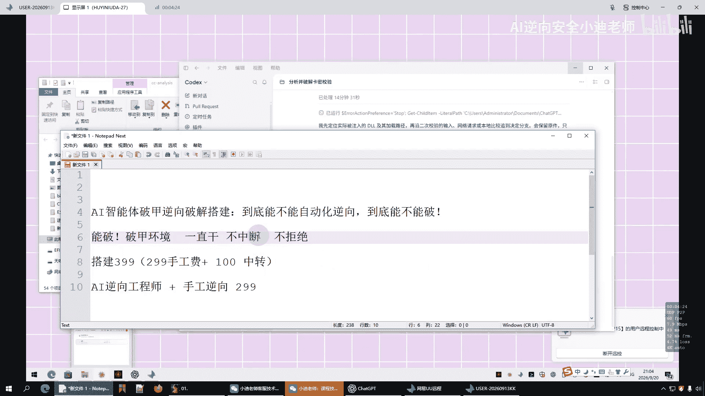
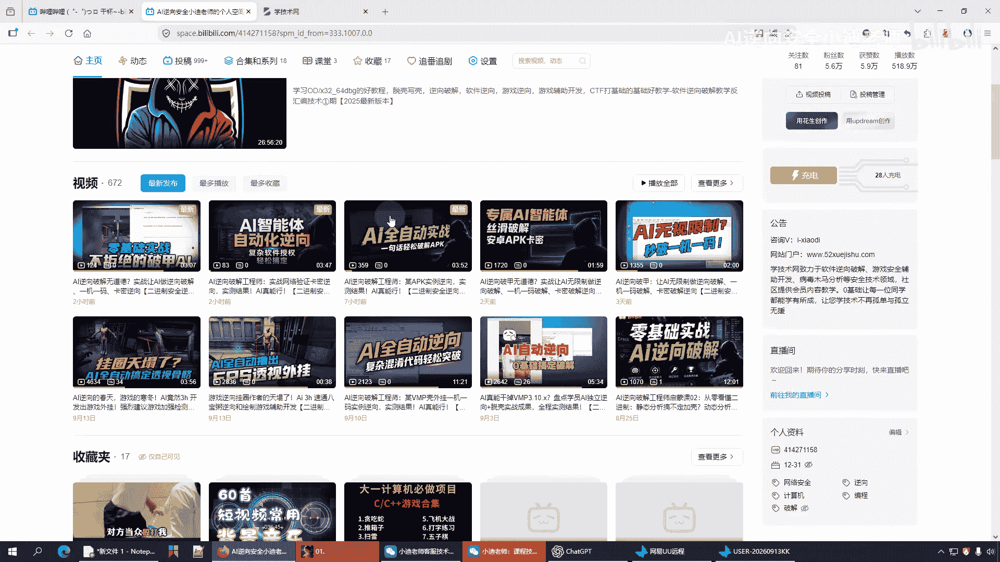
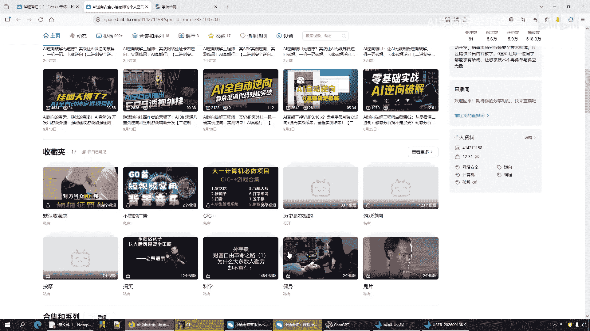
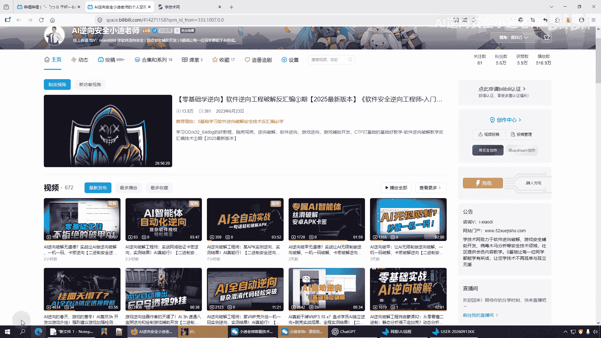

# 🔐 AI逆向工程师：第1章：卡密网络验证逆向实战

在本节课中，我们将学习如何利用 AI 智能体进行卡密网络验证的逆向实战。我们会看到整套“破甲”环境的搭建效果与使用方法，了解相关的价格与学习方案，并深入分析 AI 逆向的话术、运行过程、二次验证问题以及实际操作中的注意事项。整个演示基于一个真实案例，目标软件采用的是瑞科网络验证，接下来我们一步一步展开说明。

## 🚀 破甲效果演示

首先，我们来看一下破甲的整体效果。所谓破甲，就是搭建一个自动化的逆向破解环境，让 AI 智能体能够自主分析目标软件、定位卡密验证逻辑，并尝试绕过验证。这个环境不仅支持自动化逆向，还能完成各种相关的安全分析任务。在本次演示中，环境已经搭建完成，并且已经成功破解了两个软件。可以看到，AI 仍然在持续处理任务，没有中断，表现非常稳定。

令人惊讶的是，整个过程中 AI 可以连续工作很长时间。你可能会好奇，这样的环境具体是怎么运作的？别急，我们稍后会详细说明。

## 💰 价格与学习方案

在深入技术细节之前，先说明一下价格与学习方案。当前方案分为两种：一种是直接使用搭建好的环境，价格为 299 元手工费，加上 100 元的中等费用，合计 399 元；另一种是学习服务，包含手工逆向和 AI 逆向的完整教学内容，价格是 299 元。关于“0 点几倍率”，可以理解为环境的使用消耗非常低，一次搭建后可以使用很长时间，性价比很高。

以下是对价格方案的简要列表：

- 手工费：299 元
- 中等费用：100 元
- 学习费用（含手工逆向与 AI 逆向）：299 元

如果你只是需要快速完成逆向任务，可以直接选择搭建服务；如果你希望掌握技术本身，则更适合学习方案。

## 🧠 AI 逆向话术分析

接下来，我们看看与 AI 沟通时使用的话术。话术的核心就是“大白话”，不需要复杂的专业术语，直接告诉 AI 要做什么。例如，在本次案例中，我们下达的指令是：分析这个软件的卡密校验机制，然后直接干掉它。这里需要注意，不能说敏感词，所以不说“绕”，而是说“搞过”。AI 收到指令后，就会自动开始分析、定位验证点，并尝试绕过验证，然后运行目标软件验证结果。

这个案例中，目标软件使用了瑞科网络验证。卡密、机器码等参数会被封装起来，然后发送到验证服务器进行校验。稍微了解过这类网络验证的朋友应该很清楚：服务器会检查卡密是否存在、是否过期，以及机器码是否匹配。此外，软件外层可能还有变移（变种加密）之类的处理，但 AI 都能一一应对。

关于具体怎么使用，用户一开始并不清楚。这里要说明一下，那个操作记录并不是我发的，而是用户发的。当时我出门了，用户自己双击了程序，然后发现直接就能用了，任意输入相关参数即可。这说明 AI 的处理已经成功绕过了第一层验证。

## 🖥️ 实际运行过程

我们来看一下具体的操作过程。用户双击程序后，稍等片刻，点击登录按钮，果然成功登录了。随后，程序弹出了功能窗口，这就是辅助软件的正常主界面。接着，用户找到游戏的安装目录，释放文件，然后选择游戏安装目录并确认。整个流程非常顺畅，没有出现任何报错。

不过，用户反馈说辅助的主验证已经通过了，但是注入之后的 DLL 还存在二次验证。这意味着软件在注入 DLL 后，会再次进行一次卡密校验。这个二次验证尚未出现，于是用户继续研究该问题。我们可以看到，AI 也在继续分析，尝试定位并处理这个二次验证逻辑。

## ⏱️ 自动化环境的优势

在运行过程中，AI 的执行非常持久。从聊天记录来看，我的指令就是分析这个软件的卡密校验机制，然后干掉它。之后 AI 就一直执行，没有停止。最终运行了 49 分钟 18 秒，全程没有中断。后来是用户手动停止了任务，因为他自己的输入法出了问题，导致输入内容出现错误。这是他个人的操作问题，并不是 AI 环境的问题。

这也体现了自动化逆向环境的一个巨大优势：可以持续运行，不拒绝请求，也不轻易中断。当然，这种稳定性是针对逆向任务而言的。如果任务明确，AI 就会像一台不知疲倦的引擎，一直工作下去。

## ⚠️ 注意事项与问题分析

还有一个值得注意的细节：在运行过程中，用户同时启动了两个程序，导致截图时两个窗口重叠在一起。这反映了一个问题：两个程序最好不要放在一起分析，应该一个一个来。否则 AI 在截图取证时可能会截错窗口，影响判断。所以，在实际操作中，我们建议每次只分析一个目标，保持环境整洁，这样 AI 的工作效率和准确率都会更高。

此外，用户还发现软件在注入后再次包含了验证代码，也就是刚才提到的二次验证。遇到这种情况，只需要继续让 AI 分析即可，它会自动定位并尝试绕过。整个过程非常“傻瓜式”，即使你不会手动逆向，也能借助 AI 完成大部分工作。

## 🎯 总结与推广

本节课我们一起学习了卡密网络验证的逆向实战，了解了破甲环境的搭建与效果、AI 逆向的话术技巧、实际运行过程、二次验证问题，以及操作中的注意事项。核心流程可以概括为：先用大白话告诉 AI 目标，AI 自动分析卡密校验机制并尝试绕过，然后运行验证结果；如果存在二次验证，则继续分析处理。

如果你也想学习软件安全逆向、AI 自动化逆向以及手工逆向相关内容，可以来我们的主页了解。如果你想看看小迪老师的视频是否能免费试看，也可以前往主页，或者直接联系我们。那里有很多内容可供学习。当然，我自己的个人收藏间就不展示给大家了。那么，这就是今天的全部内容。想学习或想搭建环境的同学，都可以行动起来。我们下期再见。
