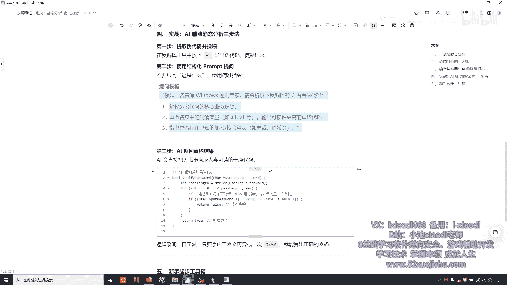

# 🧭 AI逆向破解工程师启蒙课：01：从零看懂二进制——静态分析

> 课程来源：BV1en8b6jEt6-。本课由小迪老师讲解，主题是从零看懂二进制中的静态分析，涉及二进制安全逆向、游戏安全、软件安全、网络安全、CTF比赛必备基础和封包技术等内容。

## 📌 AI逆向破解工程师启蒙课：01-1：本课概述

大家好，我是小迪老师。本课开始科普内容，主题是“从零看懂二进制：静态分析”。在本节课中，我们将要学习静态分析到底是什么、它属于什么技术、为什么它是逆向分析的第一步、静态分析的三大抓手分别是什么，以及如何用 IDA Pro 做基础操作、如何借助 AI 分析反编译伪代码。课程会先讲概念，再讲工具和实操，最后整理新手工具箱，让初学者能够建立一套直白可用的入门思路。

## 🏰 AI逆向破解工程师启蒙课：01-2：什么是静态分析


上一节我们说明了本课的整体目标，本节我们来看看静态分析的基本概念。静态分析属于软件逆向技术。如果把一个 Windows 软件比作一个神秘的机械城堡，那么逆向工程就是搞清楚这个城堡如何运转。逆向分析通常分为两派：一派是动态调试，另一派是静态分析。动态调试是把程序运行起来，像侦探潜入城堡现场一样，跟着齿轮一步步看它怎么转，从而参透里面的规律，拿到里面的关键数据。静态分析则是程序完全不运行，把它的设计蓝图、零部件清单和说明书放在桌上，直接研究结构。一个是动，一个是静。


```text
逆向分析 = 动态调试 + 静态分析
动态调试 = 运行程序 + 观察运行过程 + 获取关键数据
静态分析 = 不运行程序 + 研究文件结构、字符串、导入表、反编译结果
```

## 🛡️ AI逆向破解工程师启蒙课：01-3：为什么静态分析是第一步

理解了静态分析“不运行程序”的特点后，本节我们来看看为什么它常常是第一步。原因可以概括为三个词：安全、全局、省时间。面对未知或可疑文件时，直接双击运行有可能中招。例如，程序可能导致蓝屏，检测电脑是否具备调试器，检测是否具备破解工具，可能蓝屏或者格盘，也可能释放病毒木马。静态分析像看 X 光片一样，不触发任何机关就能摸清底细。动态调试和静态分析各有各自的应用场景，并不是说其中一个完全没有用，而是入门阶段先做静态分析更稳妥。

```text
静态分析的优势 = 安全 + 全局 + 省时间
可疑文件直接运行的风险 = 蓝屏 / 格盘 / 检测调试器 / 释放病毒木马
```

## 🔎 AI逆向破解工程师启蒙课：01-4：静态分析三大抓手总览

明白了为什么先做静态分析，本节我们来看看新手应该盯住哪些线索。面对一个密密麻麻的二进制数据，新手只需要盯三个最直观的线索就可以入门。以下是静态分析入门最值得先看的三个抓手。

- **字符串**：软件里可能存在的提示信息，例如密码错误、注册成功、正在连接服务器等明文字符。
- **导入表**：记录程序用到了哪些 Windows API 的表格，能帮助推测程序想干什么。
- **反编译伪代码**：把看不懂的机器汇编或二进制翻译成类似人类语言的重构结果，便于理解大致逻辑。

## 🏷️ AI逆向破解工程师启蒙课：01-5：第一抓手字符串——软件里的路标

三大抓手总览中的第一个是字符串，本节我们详细看看字符串为什么好用。字符串很好理解，就是软件可能存在的一些提示信息。例如双击程序后，程序提示 `Enter Password`，这个提示就是一个字符串。如果输入错误的密码，程序提示 `Fail`，表示失败，这个提示也是字符串。字符串可以理解为软件里的路标，例如“密码错误”“注册成功”“正在连接服务器”等明文字符，能帮助分析者瞬间定位到核心逻辑附近。以下是一些常见字符串示例。

```text
Enter Password
Fail
Success
Connecting to server...
```

需要特别说明的是，字符串本身是数据，数据需要依靠代码去执行，才会显示出来。后面我们会通过 IDA Pro 的操作看到字符串地址、交叉引用和流程图，从而顺着字符串找到操作它的代码。

## 📚 AI逆向破解工程师启蒙课：01-6：第二抓手导入表——程序用了哪些系统功能

字符串之后，本节我们看第二个抓手导入表。导入表一开始可能不太好理解，导入表实际上就是软件导入到自己程序中的某些函数。函数就是一些功能。程序为什么要导入函数？因为一个程序要想实现相应功能，必须依赖 Windows，也就是微软操作系统提供的功能和接口。一个软件不可能自己创造一个完整操作系统级别的功能，它必须依赖当前运行的操作系统提供的接口，这个接口称为 Windows API。API 全名是 Application Programming Interface，也就是应用程序开发接口。有了接口之后，例如程序想创建文件，就会调用 `CreateFile`；想联网，就会调用 `InternetOpen`；读取注册表也会有对应接口。看到这些函数名之后，哪怕不读代码，也能猜出程序想干什么。今后大家也要多积累 Windows API 的样子，例如看到 `CreateFile` 就知道是创建文件，看到 `Open` 就知道可能和联网有关。一个程序会调用很多 API，不可能只创建文件或者只联网，因此需要一个专门的东西做整理，这个整理的东西就是导入表。导入表就是一张表格，记录这个程序用到了哪些 Windows API。以下是常见 API 与导入表概念的示意。

```text
Windows API = Application Programming Interface
CreateFile   -> 创建文件
InternetOpen -> 联网/打开网络
RegOpenKey   -> 读取注册表等

导入表 = 记录程序调用了哪些 Windows API 的表格
```


相信每位认真学习的同学到这里都能听明白：字符串看提示，导入表看程序用了哪些系统功能，这两个抓手都能在不太深入代码的情况下提供重要线索。

## 🧩 AI逆向破解工程师启蒙课：01-7：第三抓手反编译伪代码——看懂大致逻辑

导入表之后，本节我们看第三个抓手反编译伪代码。伪代码这个东西比较有意思。拿到一个程序时，不可能直接获取它的全部源代码。例如拿到微信、QQ，登上软件并不等于拿到所有源代码，这不可能。Windows 或其他系统在创始时，也不存在这样一种反其道而行之、直接拿回源代码的东西。不过，我们可以大概获取程序的一些逻辑，这个过程叫反编译。反编译出来的代码并不是程序原来的代码，只是能让人看懂它大概的运转逻辑，所以称为伪代码。伪代码就是也能看，但并不是程序原来的代码。微信、QQ 照样可以拿过来分析，但分析出来的并不是以前那种原始代码；如果反编译就能拿到原始代码，那都可以自己开腾讯公司了。反编译工具可以把看不懂的机器汇编，也就是看不懂的二进制，翻译成类似人类语言的内容，一般来说是 C 语言或 C++ 语言。C 语言如果今后有机会，也要了解一下。虽然反编译过来的伪代码可能比较乱，但大致框架还是比较清晰的。以下是伪代码概念的简单示意。


```c
// 伪代码不是原始源码，只是反编译后便于理解的重构结果
int main() {
    print("Enter Password");
    input(password);
    if (check(password)) {
        print("Success");
    } else {
        print("Fail");
    }
}
```

## 🛠️ AI逆向破解工程师启蒙课：01-8：IDA Pro实操——打开程序与查看字符串

伪代码离不开工具，本节我们进入 IDA Pro 的基础实操。首先准备一个实验程序，然后找到 IDA Pro。做逆向时，无论是手搓逆向还是使用 AI，IDA Pro 都是必不可少的工具。打开 IDA Pro 后点击 OK，再点击 Go 继续；然后把程序拖过来，点击 OK；这时会出现加载 PDB 的提示，不用管它，点击 No 或继续加载即可。随后 IDA 开始分析程序。此时看到的代码看不懂是正常的，因为我们最终要获取的是伪代码，而现在看到的只是汇编展示形式。先关注第一个东西：字符串。若使用 AI 辅助，字符串相关处理可以由 AI 自动完成；手工操作时按 `Shift + F12`，会直接显示 Strings 窗口，这个窗口就是字符串窗口。以下是打开程序并查看字符串的基本步骤。

1. 准备实验程序，并启动 IDA Pro。
2. 点击 OK，再点击 Go 继续。
3. 把程序拖入 IDA Pro，点击 OK。
4. 出现加载 PDB 提示时不必处理，点击 No 或继续加载。
5. IDA 开始分析程序，当前看到的是汇编代码，看不懂是正常现象。
6. 手工查看字符串按 `Shift + F12` 打开 Strings 窗口；若使用 AI 辅助，字符串相关处理可由 AI 自动完成。
7. 在 Strings 窗口中可以看到 `Enter Password`、`Fail`、成功、失败等提示。

把程序运行起来，也能看到这些提示，例如 `Enter Password`、`Fail`，以及成功和失败信息。接下来看导入表，导入表在 IDA 的 Imports/导入表窗口中查看。可以看到这个程序导入了很多函数，像一张表格一样显示在那里，这就是导入表。

## 🔗 AI逆向破解工程师启蒙课：01-9：从字符串定位代码——交叉引用与流程图

在字符串窗口看到提示后，本节我们看看如何从字符串定位到代码。例如 `Fail`、`Enter Password` 这些字符串会显示出来，但字符串本身是数据，数据怎么显示出来？实际上是依靠代码去执行的，代码执行后才显示出来。可以双击某个字符串，来到这个字符串的地址。然后点击这个位置，再点击 `X`。`X` 是交叉引用的意思，也可以理解为引用，就是谁引用了这个字符串、谁引用了这个数据。一般是代码去操作数据，数据不可能自己操作自己，所以要么是代码，要么是数据，最终肯定是代码去操作数据。点击 `X` 后，可以看到原来是这段代码操作了这个数据，现在以流程表格或流程图的形式显示出来，非常直观。例如这里是输入密码，输入完密码后出现一个分叉，应该进行了某种判断。如果走这个分叉，就成功了；走右边这个分叉，会有比较复杂的二次校验逻辑，最终也会成功，当然也可能失败。以下是从字符串定位代码的概念示意。

```text
字符串地址 --X(交叉引用)--> 引用该字符串的代码
判断分支 --成功--> 成功逻辑
判断分支 --失败/二次校验--> 更复杂校验逻辑
```

## 🧠 AI逆向破解工程师启蒙课：01-10：查看伪代码与函数命名

定位到代码后，本节我们看看如何查看伪代码。按 `F5` 键，这个工具提供了 `F5` 键来查看伪代码。不过 `F5` 出来的内容看起来不是特别直观，例如 `member set`、某些函数名、`401C85` 这样的地址，看起来像没有意义的数据。这里有一个痛点：90% 的人都倒在反编译窗口前，也就是说需要自己给函数进行命名。例如看到一个东西一看就是输出，就把函数名改成 `printf` 或 `print`，表示打印；另一边是获取用户输入，就改成 `scanf`，表示接收用户输入。稍微不懂 C 语言可能不理解，但 AI 时代可以把这些繁琐工作直接交给 AI，当然基础概念仍然需要大致了解。以下是函数命名前后的简单示意。

```c
// 原始反编译结果可能类似：
sub_401C85(...);

// 人工或 AI 重命名后更容易理解：
printf(...);  // 输出
scanf(...);   // 获取用户输入
```

## 🤖 AI逆向破解工程师启蒙课：01-11：用AI辅助分析反编译伪代码

给函数命名之后，本节我们看看如何用 AI 辅助分析。可以把所有东西直接给 AI。先把提问模板复制一下，然后拿到浏览器中。可以使用专家模式，提示词可以写成：请分析下面这段反编译的 C 语言代码。例如现在分析到登录或注册的关键代码，就把关键代码复制过来，粘贴过来，点击发送，让它深度思考。这里以 DeepSeek 为例，如果有 GPT，也可以用 GPT。发送后等待 AI 分析。AI 会猜，也会分析。它会开始做重命名。DeepSeek 的分析能力没有特别高，但已经不错，可以干很多脏活累活。它思考流程可能比较久，提示词也可能有点复杂；也可以直接让它讲解代码。还可以让它分析有没有混淆变量、有没有加密等；如果没有加密，它可能还要进一步分析。先让它分析着，我们继续往后讲。以下是 AI 辅助分析可用的提示词模板。

```text
请分析下面这段反编译得到的 C 语言伪代码：
1. 说明程序的核心业务逻辑；
2. 对函数和变量进行重命名，帮助理解；
3. 判断是否存在混淆变量、加密或校验算法；
4. 如果存在校验算法，请指出需要继续逆向的函数地址；
5. 给出下一步分析建议。

伪代码如下：
<粘贴伪代码>
```

AI 会返回重构结果，逻辑会瞬间变得一目了然，然后就能知道这个东西怎么解密，一步一步把黑色盒子打开。AI 返回的内容通常包括核心业务逻辑，例如打印标题、输入密码，这些都会讲清楚，让人知道程序大概在做怎样一件事。它还会对函数进行重命名，重构后的代码会更好看，例如 `printf` 是控制台打印，`read formatted` 是读取用户输入并进行格式化。第一层校验成功则直接退出；还有一个彩蛋提示，只提示，不影响成功状态；第二层校验决定最终成功或失败。它还会判断是否存在已知加密，并说明可以强烈推断该校验算法与某个东西有关，常见实现可能包括什么。如果要确认具体算法，需要继续逆向以下函数，例如 `479B9`、`2ECC8`、`2148`、`29B9` 等地址。点进去看，果然能看到算法。这些算法直接看并不好看，手工转换要很久。

## 🧪 AI逆向破解工程师启蒙课：01-12：AI辅助逆向校验算法与密码验证

AI 给出初步结果后，本节我们看看如何继续把校验函数喂给 AI。可以随便拿一个函数，复制一下，直接给 AI，让它分析。分析时要注意上下文：如果是从 `2ECC8` 跳过去的，先把 `2ECC8` 复制过来，让 AI 知道是从 `2ECC8` 调用到 `990`，然后再让它分析 `990`。要把层级关系给 AI；如果一下子只给一个 `990`，它无法建立联系。这个过程以后能不能最终完成自动化？当然能，后面会讲自动化工作流。本课讲的是手搓时让 AI 辅助一下。以下是把调用上下文交给 AI 的示例。

```text
调用上下文：
函数 sub_2ECC8 中调用了函数 sub_990。
我先粘贴 sub_2ECC8 的伪代码，再粘贴 sub_990 的伪代码。
请结合调用关系分析 sub_990 的校验算法。
```

还有一个函数也要给 AI，因为这个函数用到了中间函数，最好也一起给它，不然不能让它自己去猜，猜的话会出错。把这些都交给 AI，分析就比较全面。AI 在思考过程中，密码其实已经解出来了，密码是 `PRNG66`。把程序关掉，运行那个程序，输入 `PRNG66`，可以看到成功了，就这样破开了。正确密码破开之后，大家去逆向分析一些机器码或做算法拼接时，自己拼接算法会很复杂，让 AI 直接拼接就行。DeepSeek 的拼接和思考比较慢，不如 GPT 或 Claude；有条件的、预算足够的可以上 GPT 或 Claude，预算有限的用 DeepSeek 也可以，最终都能达到效果，只是快慢问题。以下是密码验证结果示意。

```text
候选密码：PRNG66
运行结果：Success
```

## 🧰 AI逆向破解工程师启蒙课：01-13：新手起步工具箱


实操流程讲完后，本节我们整理一下新手起步工具箱。以下是新手起步常用工具，按用途整理。

- **DIE**：用于查文件有没有加保护、是什么语言编写的、是否加壳；壳就是保护。
- **PE 工具**：一般用于快速查看导入表、节区、字符串，也可以查看程序位数；一般用 PE 工具查看，因为 DIE 打开比较慢。
- **IDA Pro**：反编译代码常用工具，课程提供绿色版本，可以自行下载。
- **Ghidra**：开源工具，由美国 NSA 开源，也还不错，但 IDA Pro 更强大一点。
- **任意前沿大模型**：可以自行安装或使用 Codex、Claude、Hermes、小龙虾等，只要有一个能帮忙干活的即可。

## 📝 AI逆向破解工程师启蒙课：01-14：本课总结



工具和流程都讲完后，本节我们做总结。本节课中我们一起学习了静态分析是什么，它属于软件逆向技术；学习了动态调试和静态分析的区别，动态调试是运行程序观察过程，静态分析是不运行程序研究结构；学习了为什么静态分析是第一步，因为它安全、全局、省时间，面对未知可疑文件时像看 X 光片一样不触发机关就能摸清底细；学习了静态分析三大抓手，分别是字符串、导入表和反编译伪代码；还通过 IDA Pro 实操了解了打开程序、查看字符串、查看导入表、使用交叉引用、查看流程图、按 `F5` 查看伪代码以及给函数命名的方法；最后学习了如何用 AI 提示词辅助分析反编译伪代码、如何把校验函数和调用上下文喂给 AI、如何验证密码 `PRNG66`，以及新手工具箱中的 DIE、PE 工具、IDA Pro、Ghidra 和大模型。提示词很重要，以后还会讲各种提示词，用来优化大家的工作流。本课到这里结束，下集再见。

