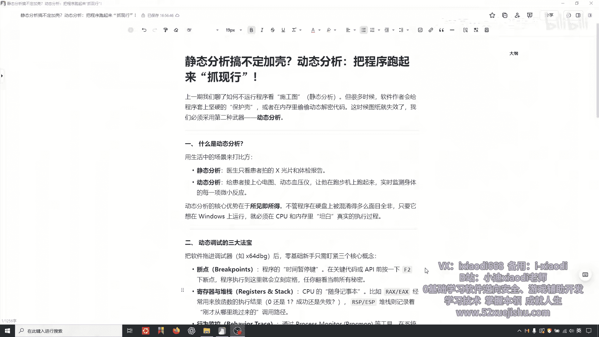

# AI逆向破解工程师启蒙课：02：🔍 动态分析：让加壳程序原形毕露

在本节课中，我们将来学习软件逆向中的动态分析。为什么需要讲解动态分析？因为静态分析有时搞不定它，静态分析存在明显的局限性。我们会先看看静态分析在加壳程序和动态解密代码面前如何失效，再通过对照实验观察加壳前后程序的变化，最后用 x32dbg 演示真实的动态调试过程。本节课以科普为主，不会把每个细节都讲透，但会帮你建立完整的概念。

## 🤔 为什么需要动态分析？

静态分析并不是万能的。它的局限在于，它只能分析程序存放在硬盘上那一份文件的样子。换句话说，如果程序在硬盘上根本没有释放某些关键代码，那么静态分析工具就找不到可以分析的对象。你不可能去分析一个不存在的东西，也不可能凭空捏造，捏造出来的内容一定会偏离程序真实的执行路径。

第一种情况是加壳。加壳就是软件作者给程序套上一层坚硬的外壳。套上壳以后，原始代码会被压缩或加密，静态分析工具在读取磁盘文件时，看到的只有壳本身，原始代码是看不见的。所以加壳可以让静态分析工具直接失效。

第二种情况是程序在内存里偷偷动态解密代码。注意“动态解密代码”这个说法：当程序没有运行起来的时候，一些关键代码不会释放。既然代码根本没有出现在内存里，那么只看磁盘文件的静态分析自然就分析不出来了。只有当程序真正运行起来，关键代码才会在内存中现身。

这时候就需要动态分析。动态分析的做法很简单，就是把程序跑起来，观察它在 CPU 和内存里的一举一动，抓取运行时的真实线索。用一句话来描述：

```text
磁盘中的程序 = 壳代码 + 加密/压缩后的原始代码
运行中的内存 = 壳代码 + 解密/解压后的原始代码

静态分析 = 只观察磁盘中的程序
动态分析 = 观察运行中的内存
```

## 🩺 一个生活中的比喻：体检报告 vs 实时监测

用生活中的场景来打比方会更直白。静态分析就像医生只看患者拍的 X 光片和体检报告。医生一看报告，发现血糖偏高了，出现三高问题了，于是可能会建议患者打替尔伯肽减肥针。这种针大约 800 块钱一个月，是一种生物制剂，据说效果还不错。医生靠体检报告判断三高，就知道大概该怎么治了。


动态分析则更进一步，它像给患者接上心电图和动态血压仪，让患者在跑步机上跑起来，实时监测身体的每一项微小反应。这种方式显然更科学，也更全面。体检报告只能反映患者躺在机器上的那一刻，没办法描述患者在一个阶段里的整体状态。而实时监测可以把每一天的数据都收集起来，再计算平均值、最高值、最低值，从而得到更完整的结论。

所以动态分析的核心优势就是四个字：所见即所得。不管程序在硬盘上被混淆得多么面目全非，只要它还想继续在 Windows 上运行，它就必须在 CPU 和内存里坦白真实的执行过程。这也是动态分析最大的魅力。


## 🧪 实验一：未加壳程序的静态分析

为了让大家体会动态分析的用处，我们来做一组对照实验。工具包里有很多工具，其中有一项是加壳工具。我们随便找一个，比如“北斗程序压缩”，点击运行。这个工具启动稍微有点慢，耐心等一下就好。

这个加壳程序就是今天的目标程序。先不给它加壳，我们随便输入一个密码，点击“破解密码”，程序提示“密码错误”。这说明程序内部肯定存在密码校验逻辑。现在把目标程序拖进 IDA Pro，先分析未加壳的原版，让 IDA 自动分析。等左下角显示分析完成，我们按 `Shift+F12` 打开字符串窗口。

第一次搜索字符串时，能看到很多字符串，但找不到密码。字符串很多，但看不到类似于密码的内容。这可能是因为字符串被加密了，也可能是因为字符串的编码方式在 IDA 里无法直接识别，最终显示成一堆乱码。不管哪一种，都说明静态分析存在很大的局限：你没有办法直接看到密码。


## 📦 实验二：加壳后的静态分析

为了把障碍加得更彻底，我们把目标程序直接拖进加壳工具，点击“压缩”。压缩完成后，看一下文件大小：原来的文件是 684KB，现在变成了 277KB。为什么变小了？因为程序把代码全部压缩了。简单来说，程序在执行的时候才会把代码释放出来，磁盘上不再直接保存原始代码，所以文件体积变小了。


把加壳后的程序再拖进 IDA Pro 分析，结果非常直观：IDA 直接报错，到处都是错误信息，只能分析出很少的几个函数。字符串也变少了，能够看到的代码也变少了，原因就是真正的代码根本没有被释放出来。看到这种情况，你可能会觉得很震惊：核心代码全被藏起来了，静态分析自然就没有价值了。

加壳确实把代码藏起来了，程序在双击运行的时候才进行解密，同时又不影响程序正常运行。这样的程序在静态分析中几乎等于一堵墙，工具根本穿不过去。所以说，静态分析在加壳面前基本失效，这时候我们就必须依赖动态分析工具。

## 🛠️ 动态分析的三大法宝

动态分析主要依赖三样东西：

- 断点
- 寄存器与栈
- 行为监控

断点可以让程序运行到某个位置时暂时停下来，方便观察当前现场。寄存器与栈记录了每一次计算、每一次跳转、每一次函数调用的真实数据。行为监控则负责观察程序调用了哪些 API，访问了哪些文件或注册表。把这三样组合起来，运行中的程序就很难藏住秘密。

本节课不可能把动态分析的全部细节讲完，只能让你建立一个大概认识。这些基础的深入讲解会在 VIP 课程的第二阶段第一、二章中展开。如果你希望让 AI 更好地为你工作，这部分基础最好还是自己打牢。今天先做概念科普，后面还有大量动手内容。

## 🔬 实战：用 x32dbg 动态调试目标程序

下面我们动手演示动态调试。第一步，确认目标程序是 32 位还是 64 位。我们可以用 PE 解析工具，比如 Stud_PE，把程序直接拖进去查看文件头信息。经过确认，这是一个 32 位 PE 文件，所以选择 `x32dbg` 作为调试器。`x32dbg` 面向 32 位程序，`x64dbg` 面向 64 位程序，两者都是 Windows 平台主流的开源动态调试工具。

先把目标程序运行起来，然后在 x32dbg 中建立连接：点击菜单“文件”→“附加”，在进程列表中双击目标程序。再点击“符号”标签，找到主模块。判断主模块的方法很简单：模块名称与目标程序名称一致的那个就是主模块，双击进入即可。进入主模块后，看到的就是程序完整的反汇编代码。

在反汇编窗口中点击鼠标右键，选择“搜索当前模块的字符串”。结果直接出现了“密码正确”和“密码错误”两个字符串。双击“密码正确”，代码窗口会跳到引用这个字符串的位置。代码里有清晰的箭头指向不同分支：一个箭头跳向“密码错误”，另一个分支如果执行则会进入“密码正确”。再往上看，能看到一个字符串“小迪老师”。于是可以推测，密码很有可能就是“小迪老师”。输入“小迪老师”，点击“破解密码”，果然提示“密码正确”。

如果进一步调试，我们可以在关键位置按下 `F2` 下断点。然后随便输入一个密码，点击“破解密码”。这时程序会停在断点处。什么是动态分析？动态分析就是分析程序每一步的执行流程。点击“调试”菜单中的“步过”，或者直接按 `F8`，就能一行一行执行代码。执行过程中，可以看到某个寄存器里出现了 `11`。这个值通常表示程序已经从编辑框里获取了密码输入。获取到输入后，程序把输入和“小迪老师”放在一起。两个值放到一起，往往就要进行比较。所以可以猜测这里调用了比较逻辑：

```c
if (strcmp(input, "小迪老师") == 0) {
    goto 密码正确;
} else {
    goto 密码错误;
}
```

在反汇编代码里，你会看到 `CMP` 指令。`CMP` 就是 `Compare`，它把一个值与另一个值或与 0 进行比较，比较结果会记录在标志位中。如果比较结果不合适，程序就会跳转到“密码错误”分支。对应的汇编逻辑可能是：

```asm
CMP input, "小迪老师"
JZ  密码正确   ; 相等时跳转
JMP 密码错误   ; 不相等时跳转
```

这种跳转逻辑非常直观。我们甚至可以修改它：双击标志位寄存器中的 `ZF` 标志，把它改掉。这样即使输入 `111`，最终运行时也会跳到“密码正确”分支。这就是动态分析非常强大的地方，它不仅能观察程序的行为，还能直接改变程序的运行状态。动态分析的上限很高，这就是它的妙用所在。

## 🤖 AI 辅助与基础学习

那么 AI 在动态分析中如何辅助？这里简单了解一下。你必须先学会使用工具，才能判断 AI 给出的结论是否靠谱。AI 读取的是反汇编文本，如果你不懂汇编基础，AI 给出一段看似合理的结论，你也没有办法分辨对错。所以汇编基础要自己先打一打。

如果不想打基础，也不是不行。后续课程会讲解如何让 AI 自动化实现整个工作流，你可以达到 90% 都依赖 AI。但在依赖 AI 的同时，我仍然希望大家多去学习基础。因为只依赖 AI 的人，说难听点，就是“废物”。为什么这么说？因为 AI 也会犯错，它也会把某个逻辑分析错。当 AI 出错时，如果你没有基础，就根本看不出问题。所以你需要做的不是一个躺平的人，而是一个领导者、一个决策者。你要领导 AI 朝着正确的方向走，而不是把所有事情都交给它。一旦它错了，最终承受损失的人还是你自己。

## 🧰 常用工具一览

关于动态分析工具，我们再简单梳理一下：

- `x64dbg`：面向 64 位程序的 Windows 动态调试器
- `x32dbg`：面向 32 位程序的动态调试器
- Cheat Engine（CE）：内存扫描神器，可以快速定位数值变化背后的内存机制

这三个工具都被我放在比较显眼的位置，因为它们都可以让 AI 自动操控。只要配置好工作流，AI 完全可以代替你完成附加进程、设置断点、读取寄存器、扫描内存等操作。工具是死的，能不能用好，取决于你给 AI 输入的指令是否清晰。

## ⚠️ 安全警告：在虚拟机里做动态分析

最后特别强调一点：如果你要让 AI 对程序进行动态分析，或者自己准备运行未知程序、可疑样本，请务必在虚拟机或隔离环境中执行，否则有可能中毒。最好为虚拟机开启快照备份，万一出现问题，可以一键还原到干净状态。


很多实验工具和实验程序并不是我提供的。有些可能是别人开发的外挂或破解工具，里面可能藏有木马、病毒、远控后门。大家最好不要在个人主机上盲目调试未经验证的程序。动态分析的影响比静态分析大得多：静态分析不运行程序，相对安全；而动态分析只要把程序跑起来，就有失控的风险。安全永远是第一位的。


## 📝 总结



本节课我们一起学习了动态分析。我们先解释了为什么要使用动态分析：静态分析在加壳和动态解密代码面前会失效。接着用体检报告和实时监测的比喻，说明了动态分析“所见即所得”的核心优势。然后通过对照实验，看到未加壳与加壳程序在 IDA 中的不同表现，也理解了加壳为什么会让静态分析失效。随后介绍了断点、寄存器与栈、行为监控这三大法宝，并用 x32dbg 实际演练了附加进程、搜索字符串、下断点、单步执行、观察比较指令、修改标志位的过程。最后还讨论了 AI 辅助、基础学习的重要性以及动态分析的安全注意事项。从今天开始，再遇到加壳程序，你就不会束手无策了。我们下期再见。
