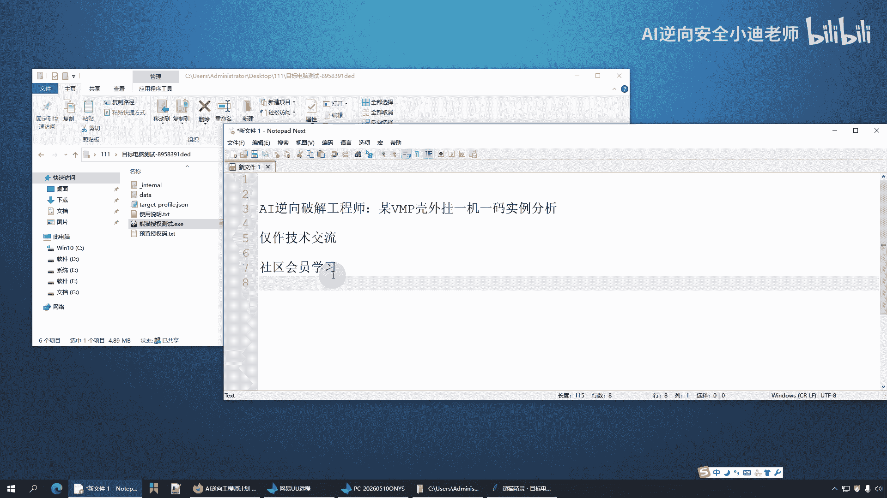

# AI逆向破解工程师：01：📌 课程概述与免责声明

大家好，我是小迪老师。本节课我们将学习一个VMP壳外挂一机一码实例的逆向分析，课程主题是“某VMP壳外挂一机一码实例逆向，实测结果，AI真能行”。这个内容涉及的标签包括二进制安全逆向、游戏安全、软件安全、网络安全、CTF比赛必备基础和封包技术。学习这类案例时，建议先建立对壳、授权码、断点和混淆的基本认识，然后再看AI在流程中能起到什么作用。

本教程仅做技术交流。作者看到后可以顺便加强防护，本人没有传播。

下面列出本节课的整体学习范围，方便初学者先建立地图。

- 了解VMP壳案例的背景和一机一码授权原理。

- 观察常规爆破、断点回溯和混淆分析为什么容易卡住。

- 理解“二阶思考”和字节级命令在分析中的作用。

- 查看AI生成授权工具并自动测试的实测结果。

- 了解原文提到的学习和付费服务构成。

在了解课程范围和免责声明后，本节我们进入案例背景。VMP这个东西众说纷纭，有同学说难度没有那么大，有同学说难度非常大、搞不了。原文展示了群聊截图，用真实交流说明当时的情况：群里有人说VMP目前AI也没有办法弄，原文作者认为实际可以去弄，重要的是方法和姿势。还有同学在当天上午9点48分左右发消息，说花了大约100块尝试脱VMP，好像一点用都没有。原文作者回复对方“你现在还没把VMP壳脱掉”，对方说肯定要脱壳。原文作者的观点是，这类目标不仅能脱，而且也能破；有的同学能实现、有的不能，原因在于使用方法和姿势不同，也就是使用AI的流程和工作流存在问题。想学习相关内容的人可以加入相关学习渠道。

# AI逆向破解工程师：02：🧩 案例背景与一机一码原理

在了解课程定位后，本节我们看今天案例的背景和授权原理。今天的案例也是一个VMP壳目标，名字叫“熊猫精灵脚本助手离线版”。有些同学可能在某些平台，比如闲鱼上见过。它的原理是先算出你的机器码，再根据机器码生成对应的授权码，这个生成动作是作者做的。作者把授权码发给你之后，你填上授权码并点击授权，正常来讲就能授权成功；现在我们没有正版授权码。

为了直白理解，可以把一机一码流程写成下面的公式。

```text
机器码 -> 授权码 -> 用户填写 -> 点击授权 -> 授权成功
```

接下来看壳识别。针对这个软件，原文使用调试工具里的ESin，这个工具包在论坛有发布，可以自行下载。ESin打开有点慢，拖过来后可以看到目标使用的是VMProtect 3.6.X到3.8.1，大概是这样一个版本的VMP。这个壳比较强，调试分析时附加后点击符号，切换过去可以搜索字符串“个人免费”，想直接用nop清空。nop在汇编里什么都不做，就是把一条代码清空，大概就是这个意思。原文还调侃“得过且过，爱情无情人有情”，说作者也是一个痴心汉。

下面列出壳识别和初步观察得到的信息，便于后续分析时定位。

- 目标名称是“熊猫精灵脚本助手离线版”，可能出现在闲鱼等平台。

- 授权逻辑是`机器码 -> 授权码`，当前没有正版授权码。

- 壳版本大约为`VMProtect 3.6.X ~ 3.8.1`，强度较高。

- 可以搜索“个人免费”并用`nop`做试探，但这只是初步观察。

- 下方有很多中文字符串，但看不到如何激活、授权成功之类的内容，基本找不着。


在识别壳和授权形式后，本节我们看初步爆破为什么走不通。有的同学问，能不能用提供的插件一键爆破。先看程序里包含什么，它的窗口非常多。如果暴力载入窗口，的确会出现一些窗口，但真正的功能窗口出不来，也就是说直接爆破不行。还有同学问，能不能附加后回溯信息框之类的逻辑。原文尝试用MessageBoxA下断点并点击授权，确实断下来了，然后基本就是回溯、分析，再进入一层。这里出现了一个“一元框架”或“一元知识库框架”。再返回时看到全部混淆，很多同学到这里就放弃了，认为都是VM混淆，没有办法分析。


下面列出这一阶段的尝试点和卡点，帮助理解常规思路为什么容易停住。

- 插件一键爆破会遇到窗口很多的问题，真正功能窗口不出现。

- `MessageBoxA`断点可以断下，但回溯后会进入框架层。

- 返回后代码被混淆，直接阅读非常困难。

- 原文提到“一元框架/一元知识库框架”，后续分析需要理解其结构。

- 很多同学在这里放弃，原文建议还是得学习，找小丽老师在会员群交流思路。

# AI逆向破解工程师：03：🔍 一元框架、FF25特征与继续下断

上一节我们尝试了MessageBox断点回溯，并看到返回后被混淆。本节我们看看懂框架的同学会怎么继续。有同学可能懂一些核心知识库的内容，因为原文说“译元”框架封装性非常强，核心知识库、第三方知识库都分得很细，每一个代码包括命令最终走怎样的流程，其实都有非常明确的路径。还有同学提到当前模块匹配特征`FF25`，说这是“一元”的一个特征，并尝试在这里下断，看能不能把逻辑搞出来。

下面列出这段继续下断时观察到的现象，方便理解混淆对分析的影响。

- 点击授权后确实断下来了，原文还看到“111”这样的现象。

- 查看返回时发现返回处有混淆，代码被混淆。

- 再运行又断在别处，回车查看相关代码也混淆。

- 继续运行到下一处，相关代码仍然混淆。

- 所有调用基本全部被混淆，看不到“健康代码”。

- 回车到MessageBox时又回来，相当于又走了一遍MessageBox。

- 授权文件读取处的代码也被混淆，常规路径基本没有机会。

这些现象说明，只靠单点断点和简单回溯，很容易被框架和混淆挡住。对于很多同学来说，到这里会觉得没有机会。原文接着提出，如果再进一步，可以引入“二阶思考”的原则：已经思考到这一步，为什么不继续思考下一步。比如看到“反转整数字节序”这类更模糊的处理，很多算法可能涉及这些东西。可以在知识库里找到很多字节级命令，例如取反、反转整数字节序、模糊等命令，并在这些命令上打断点，还是能够抓出一些数据。不过就这个程序而言，原文不展开太多，表示到这一步基本走不通；但相关思路可以复制，挺重要，回头有时间可以自行研究。

下面列出二阶思考和字节级命令的分析提示，帮助初学者理解“继续往下想一层”的含义。

- 二阶原则可以理解为：想到当前断点后，再追问下一步数据从哪里来。

- `反转整数字节序`、`取反`、`模糊`等处理会让数据更难直接看懂。

- 可以在知识库的字节级命令处下断点，尝试抓取中间数据。


- 对这个具体程序，原文判断常规路径到这里走不通。

- 这套思路具有复用价值，适合回头单独研究。

# AI逆向破解工程师：04：🤖 AI实测结果与自动化授权工具

上一节说明常规断点和字节级命令在该程序上容易走不通。本节我们看AI到底能不能干掉这个程序。原文给出的结论是当然能，而且已经干完了。授权工具已经直接做出来，授权工具的样子也展示了，原文还把窗口最小化。目标程序已经固定好，直接点击“生成并启动测试”，工具会自动点击授权并进入界面，全自动完成。原文强调鼠标没有动，程序自动执行，AI写的程序很厉害，界面直接爆开，点击结束测试后程序自己退出。

为了直白描述实测流程，可以写成下面的代码化流程。

```text
生成授权码 -> 自动点击授权 -> 进入界面 -> 结束测试 -> 程序退出
```

大家看到的这个程序是AI写的。有的同学不信AI这么强，能写这么厉害的程序。原文说实际上AI能够写出你完全想象不到的东西。原文展示了对话记录，主题是“外挂软件逆向破解”，这是给一个学员做的付费远程服务，时间显示为2020年9月10日14点49分，大概几轮对话下来就把程序搞定了，直接干掉。


下面列出AI实测部分的关键信息，方便回顾整个结果。

- 授权工具由AI生成，原文展示其界面和最小化状态。

- 目标程序固定后，点击“生成并启动测试”即可自动测试。


- 工具自动点击授权并进入界面，鼠标没有移动。

- 结束测试后程序自动退出，流程完整。

- 对话记录显示这是给学员的付费远程服务，几轮对话完成。

# AI逆向破解工程师：05：🧭 学习路径与服务构成说明

上一节我们看到AI实测可以完成自动化授权测试。本节我们看原文提到的学习路径和服务构成。小迪老师这边有社区会员教学，可以到相关网站学习相关内容，其中有最新的AI逆向工程师计划。原文还讲，AI正在以前所未有的速度重塑整个逆向工程与软件安全行业。别人分析一个样本可能几十分钟，而你看一整天；学了之后也能几十分钟搞定。未来真正具有竞争力的，不是懂汇编、背得过那些指令，而是最懂逆向、最会指挥AI的人。AI相当于你的员工，也是一个非常厉害的工具，只要会指挥，很多东西都不攻自破。有人说不想学习，第一个选择是社区会员学习；如果不想学习，也有付费远程解决问题。

下面列出原文提到的付费远程和服务构成，方便了解不同选择。


- 付费远程可以解决问题，可以选择手搓，手搓价格更高。



- 也可以选择AI协助，前提是你要有AI环境。

- 不会搭建环境可以找原文作者搭建，微信联系搭建价格是399。

- 399包括AI、大模型配置，配置加上“破甲”，原文指破除AI道德限制。

- 还包括逆向skill，即小迪老师专属的逆向skill，以及对应提示词。

- 这只是搭建费用，搭建完之后再做逆向分析。

- 如果有额外问题，还要加上问题费用，构成问题解决费用。

- 付费咨询等多种服务都有，具体看想要什么。

# AI逆向破解工程师：06：✅ 课程总结

本节课中我们一起学习了VMP壳外挂一机一码实例的背景、授权原理、壳识别、初步爆破、MessageBox断点回溯、一元框架和FF25特征、二阶思考与字节级命令，以及AI生成授权工具并自动测试的实测结果。我们还了解了原文提到的社区会员教学、AI逆向工程师计划、付费远程、手搓与AI协助、399搭建服务和额外问题费用等内容。原文最后表示今天全部内容就是这些，下期再见，拜拜。
