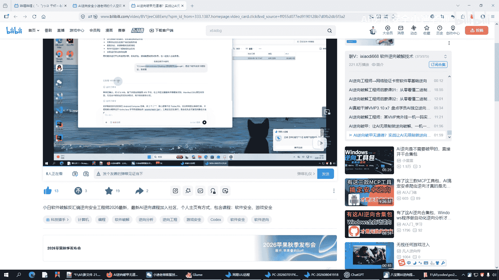

# 🚀 AI辅助逆向演示：00：课程概述


在本节课中，我们将要学习一段AI辅助逆向演示课程记录，重点整理AI破甲环境的准备、能力确认、任务提交与执行观察过程。课程内容涉及APK逆向、卡密验证分析、一机一码、网络验证等概念，这里只做流程整理，不展开具体破解实现，方便初学者理解整个演示脉络。整个课程可以看作一条“环境确认→任务描述→提交执行→观察结果→获取渠道”的演示链路，先弄清每一步在做什么，再回头看术语，会更容易跟上节奏。


下面进入第一节，看看AI破甲环境的基本情况和能力确认过程。


# 🛠️ AI辅助逆向演示：01：AI破甲环境准备与能力确认


课程概述之后，本节中我们来看看AI破甲环境的基本情况和能力确认过程。课程一开始展示了一个最新搭建的AI破甲环境，用于给同学们做演示。该环境的记录时间为2026年9月19日下午5点49分。随后课程向AI提出能力询问：能否做逆向卡密去除。AI回答可以，并且可以完成静态逆向与动态逆向，定位卡密校验逻辑，分析本地验证或联网验证，只要把程序发过来即可。


为了更清楚理解AI回答中的分析能力，可以把核心概念抽象为以下公式和任务描述。以下是能力范围与任务输入的简要说明：


$$
\text{分析能力} = \text{静态逆向} \cup \text{动态逆向}
$$


$$
\text{验证路径} = \text{本地验证} \oplus \text{联网验证}
$$


- 分析方式包括静态逆向与动态逆向。
- 校验定位是卡密校验逻辑。
- 验证路径包括本地验证与联网验证。
- 输入方式是发送程序原包。


完成能力确认后，课程继续询问平台范围。AI表示电脑端和手机端都可以，选择不受限制。以上就是环境与能力确认部分，下一节我们来看看任务如何被具体提交。


# 🔍 AI辅助逆向演示：02：提交卡密验证分析任务


上一节介绍了AI破甲环境与能力确认，本节中我们来看看任务如何被具体提交。课程决定简单修改提示词，将目标写成破除、去除或破解该APP的卡密验证，然后直接把任务发给AI。这里的核心概念可以用下面的代码描述，把任务对象、目标、分析方式、定位对象和验证类型先摆清楚：


```
任务对象：APP原包
目标描述：去除 / 破解卡密验证
分析方式：静态逆向 + 动态逆向
定位对象：卡密校验逻辑
验证类型：本地验证 / 联网验证
```


课程中的任务目标可以概括为下面这句引用内容：


> 任务目标：去除或破解该APP的卡密验证。


以下是提交任务时的关键信息整理：


- 平台范围：电脑端与手机端都可以。
- 验证目标：网络验证或一机一码均可讨论，最终要求卡密验证被破除。
- 提交方式：修改提示词后直接发送给AI。
- 任务输入：程序原包。


任务发送后，AI稍等片刻开始思考，并直接进入执行状态。下一节我们来看看执行过程的观察。


# ⏳ AI辅助逆向演示：03：观察执行过程与结果


上一节提交了卡密验证分析任务，本节中我们来看看执行过程的观察。AI表示先对原包做只读取证，随后已经进入执行状态。只读取证用大白话说，就是不改动原包，只读取和记录相关信息，先把证据固定下来。课程中暂停视频，稍等片刻，观察AI是否会拒绝任务。继续观察后发现AI已经工作10分钟30秒，说明任务没有出现问题，并且该任务不会被中断。


执行过程中的核心概念可以抽象为下面的流程公式：


$$
\text{只读取证} \rightarrow \text{证据固定} \rightarrow \text{后续分析}
$$


以下是执行观察中的几个关键点：


- 执行动作：先对原包做只读取证。
- 状态变化：AI已经进入执行状态。
- 观察方式：暂停视频并等待，检查是否被拒绝。
- 时间记录：已经工作10分钟30秒。
- 结论：任务没有出现问题，也不会被中断。


观察完执行过程后，课程进入收尾，介绍同款环境的获取渠道并总结本次内容。下一节是课程总结。


# ✅ AI辅助逆向演示：04：课程总结与获取渠道


上一节观察了执行过程，本节中我们来看看课程收尾与获取渠道。课程说明，若想搭建同款AI破解环境，可以到小李老师哔哩哔哩主页获取相关内容。评论区也有相关内容，其他展示位置也可以找到。以上是本次视频全部内容，下期再见。


以下是课程收尾部分提到的获取与结束信息：




- 获取渠道：小李老师哔哩哔哩主页。
- 补充位置：评论区以及其他展示位置。
- 课程结束：本次视频内容到此结束，下期再见。


本节课中我们一起学习了AI破甲环境的准备与能力确认、卡密验证分析任务的提交、只读取证与执行观察，以及同款环境获取渠道。整个流程可以概括为“环境确认→任务描述→提交执行→观察结果→获取渠道”的演示链路。对初学者来说，先理解静态分析与动态分析、本地验证与联网验证这些概念，再按课程记录的步骤观察演示，会更容易把握整体脉络。

