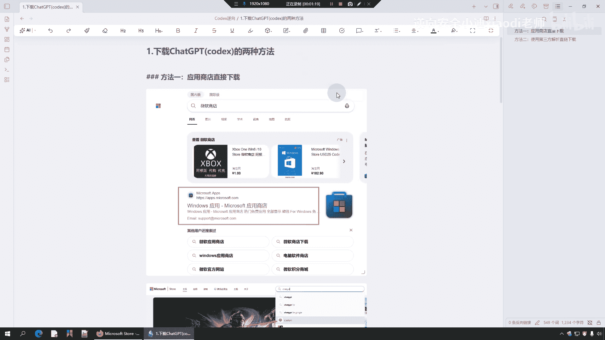
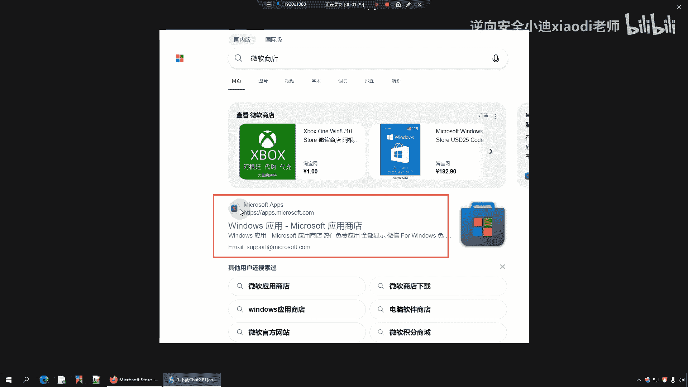
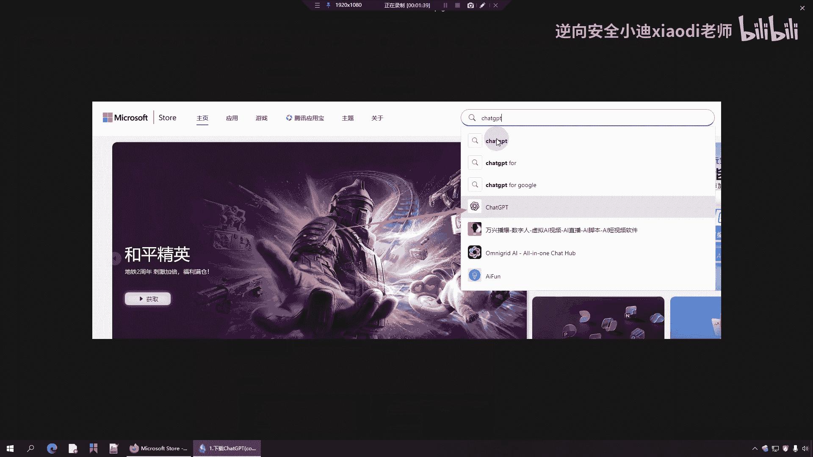
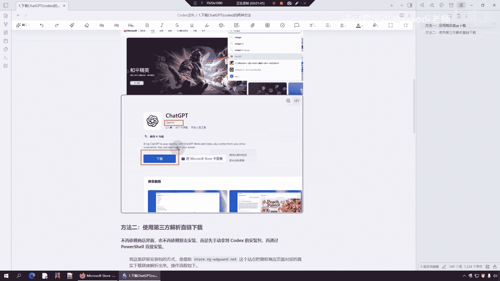
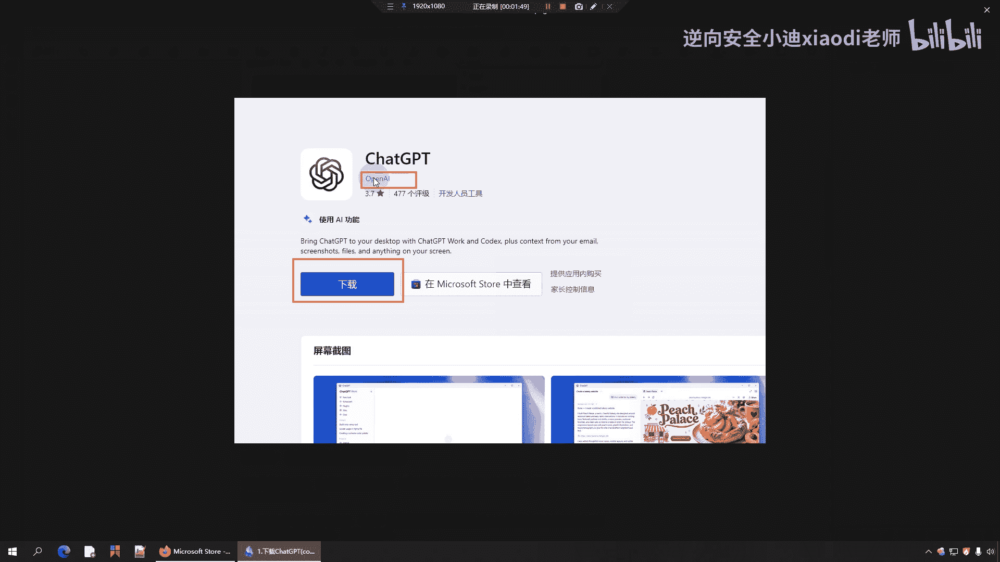
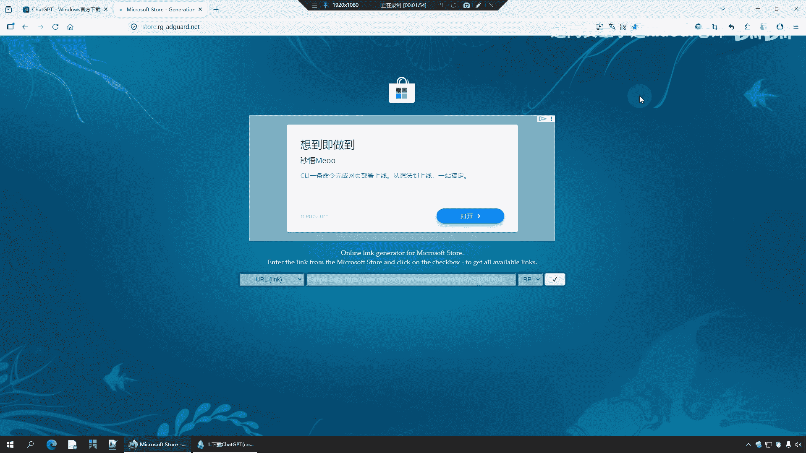
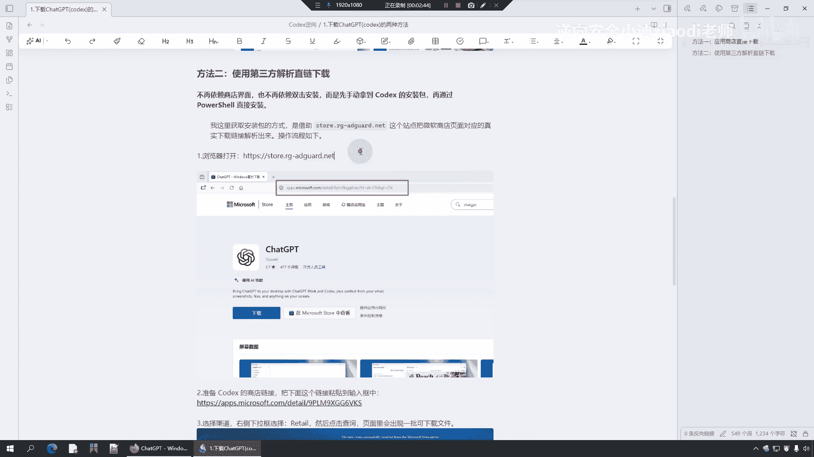
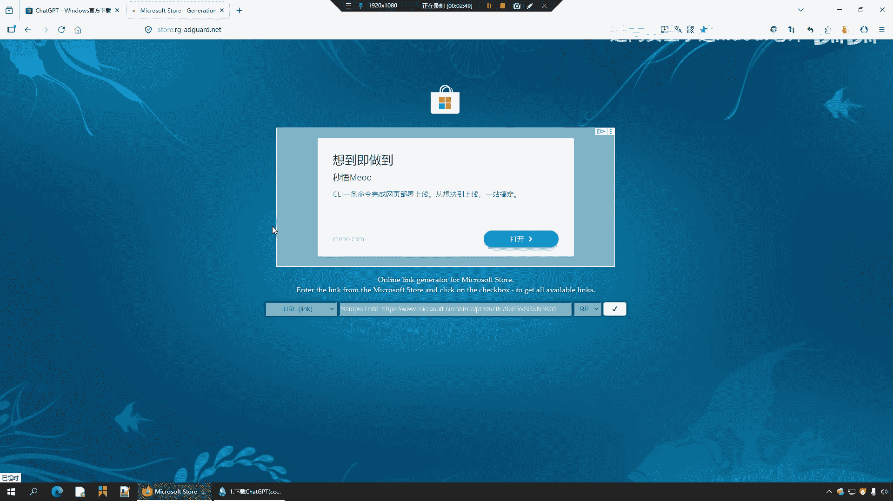
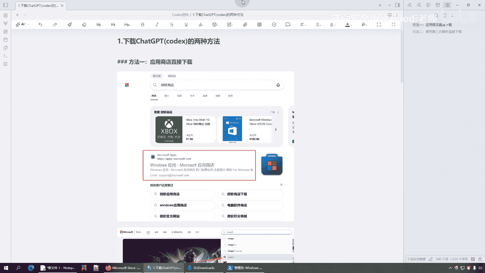

🚀 Codex自动化逆向破解环境搭建：第1章：下载与安装

大家好，我是小迪老师。在本节课中，我们将一起学习 Codex（现已改名为 ChatGPT）的下载与安装。为什么特意讲这个？虽然安装本身很简单，但不少同学的电脑环境比较特殊，下载后无法正常安装。为了确保每个人都能百分之百用上它，我会提供两种安装方法。方法一是通过微软应用商店直接下载，方法二是通过 PowerShell 命令行手工安装。这篇教程会从零开始，逐步拆解每一步，哪怕你是初学者也能跟着操作。

🎯 为什么要安装 Codex（ChatGPT）？

Codex 在软件逆向破解领域非常实用。举个例子，有同学使用 Codex 输入简单几句话，就直接去掉了程序的卡密验证，把程序的验证逻辑干掉了。还有其他的类似案例，也都被它轻松破开。看到这些效果，谁都会着急想试试。所以，先把 Codex 安装好，是动手实践的第一步。

🛒 方法一：通过微软应用商店下载

如果你电脑环境正常，推荐先试试最简单的官方渠道。下面是方法一的具体操作步骤：

1. 打开微软应用商店官网。在搜索引擎搜索“微软商店”，进入带有官方标志的网站。
2. 在商店页面顶部的搜索框输入“ChatGPT”。注意，Codex 现在已经改名为 ChatGPT，搜索旧名字可能找不到。
3. 在搜索结果中找到带有官方图标的 ChatGPT 应用，检查发布公司是否为“OpenAI”。确认无误后，点击“下载”按钮。
4. 下载完成后，浏览器右上角可能会显示下载记录。你可能还需要手动点击安装文件，完成最后的安装过程。

整个流程非常直观。如果这一步能成功，直接跳到最后的运行环节即可。但如果点击安装时出现各种错误提示，那么请使用下面的方法二。

⚙️ 方法二：通过 PowerShell 手工安装

方法二专门解决那些在应用商店安装失败的场景。它不依赖商店的界面，也不依赖双击安装包，而是通过 Windows 自带的 PowerShell 命令行工具，直接调用系统接口安装。下面是方法二的具体操作步骤：

1. 获取 ChatGPT 的商店链接。先按照方法一的搜索方式，在商店中打开 ChatGPT 的详情页面。复制浏览器地址栏中的 URL，只需要保留链接前面的主要部分，后面以 `?` 开头的多余参数可以去掉。

2. 打开一个解析网站。这个网站能解析出商店应用对应的直接安装包。把复制好的 ChatGPT 链接粘贴到解析网站的输入框中，然后在选项里选择 `retail`，点击确认按钮。稍等片刻，页面下方就会列出解析出来的文件列表。

3. 下载正确的 `.msix` 安装包。在解析结果中，找到文件名包含 `x64` 且以 `.msix` 结尾的那一项，不要选择 `ARM64` 版本。点击它开始下载。浏览器可能会弹出“未下载文件有潜在的安全风险”的提示，点击“允许下载”即可。下载完成后，文件大约有 700 多兆。将安装包移动到一个方便访问的文件夹中（比如 `D:\downloads`）。建议选择路径简短、文件名字符数不多的文件夹，这样后续修改命令时会省事很多。并记住这个文件夹的完整路径。

4. 打开 Windows PowerShell。在开始菜单中搜索“PowerShell”，或者点击左下角的开始按钮，找到以“Windows PowerShell”命名的程序并运行。这个工具是 Windows 自带的，不需要额外安装。

5. 执行安装命令。PowerShell 安装 `.msix` 包的核心命令是 `Add-AppxPackage -Path "完整路径\文件名.msix"`。把命令中的路径替换成你的真实路径。例如，文件在 `D:\downloads` 下，文件名是 `ChatGPTApp_1.0_x64.msix`，则命令为 `Add-AppxPackage -Path "D:\downloads\ChatGPTApp_1.0_x64.msix"`。复制这条命令，粘贴到 PowerShell 中按回车。如果屏幕上没有出现红色错误，就代表安装成功。

6. 运行 ChatGPT。安装完成后，在开始菜单中找以 C 开头的应用图标（ChatGPT），点击即可运行。

✅ 总结

本节课中，我们一起学习了 Codex 的下载与安装。我们首先介绍了通过微软应用商店直接安装的方法，它适合大多数正常环境；然后重点讲解了通过 PowerShell 手工安装的方法，它解决了商店安装失败的问题。我们还掌握了 `Add-AppxPackage` 这个核心命令的使用方式，理解了 `.msix` 安装包的安装逻辑。如果你在执行命令时遇到其他疑问，可以在交流群中给小迪老师留言，老师会告诉你怎么操作。现在，请你动手实践一下，打开 Codex（ChatGPT），开启逆向破解的实战之旅。
