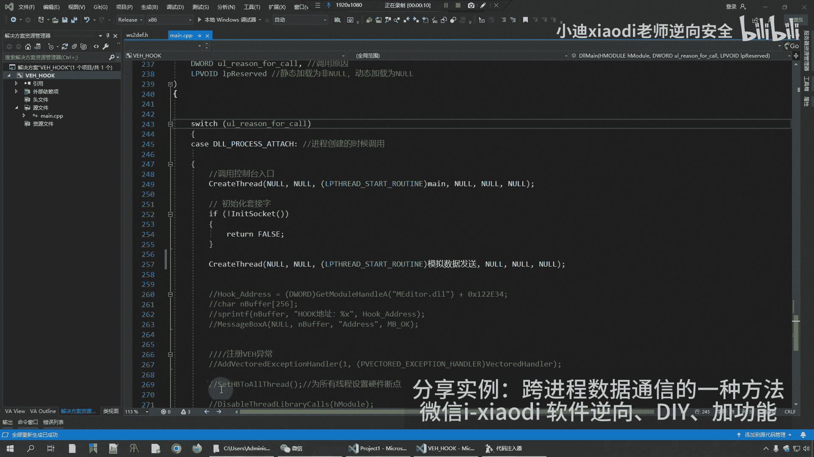
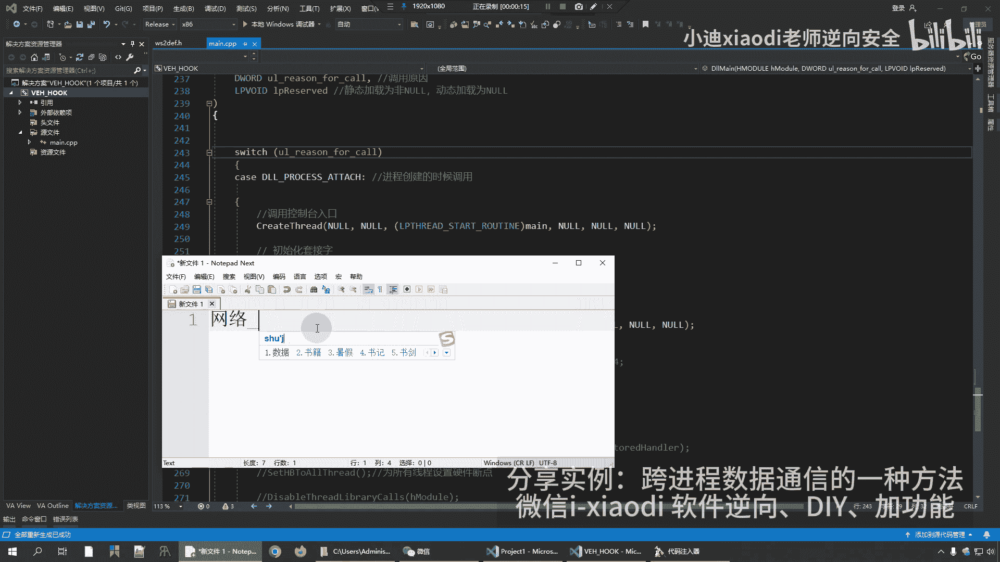
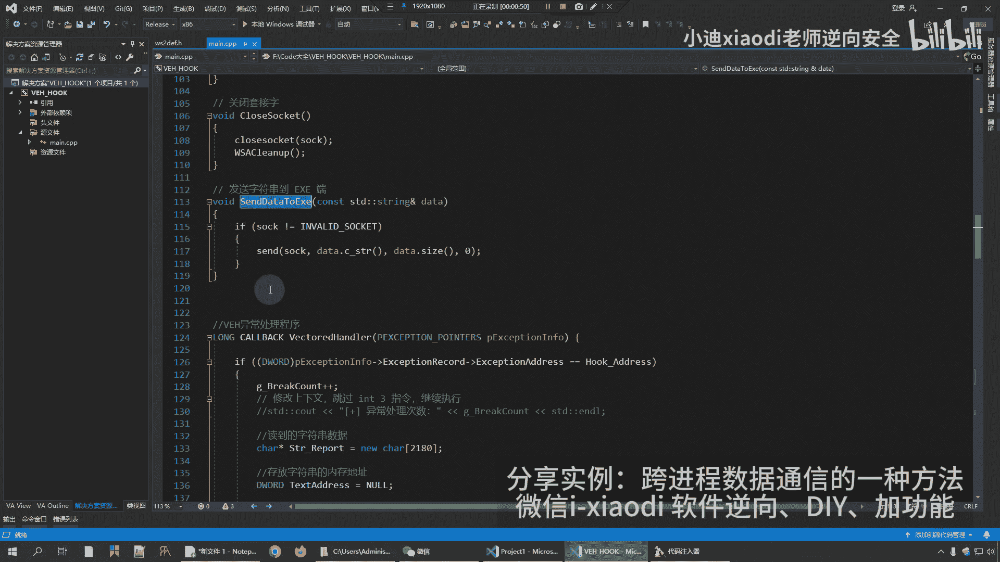
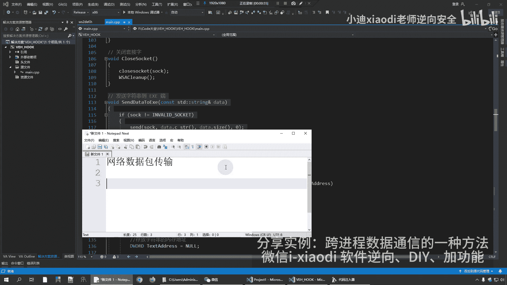
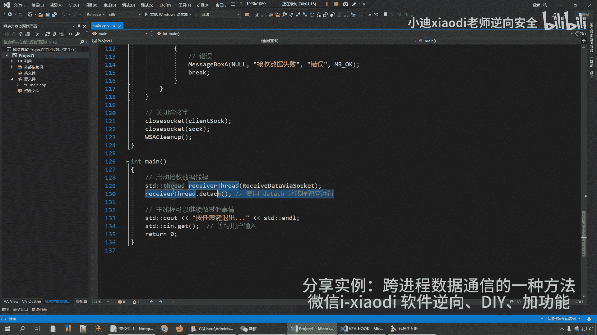
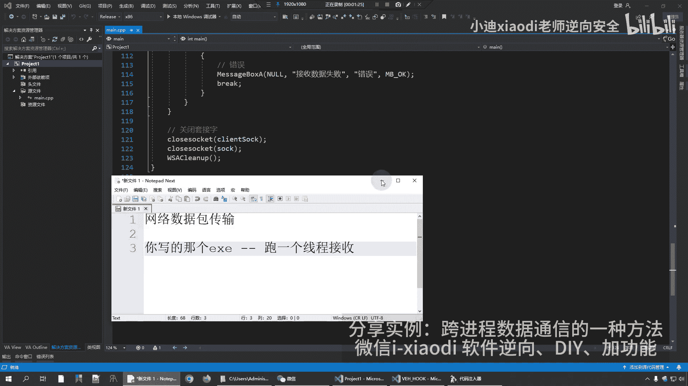
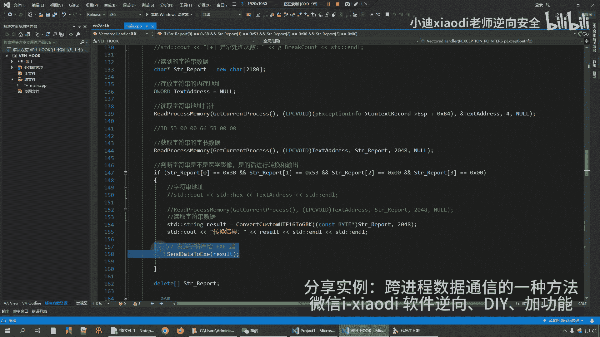
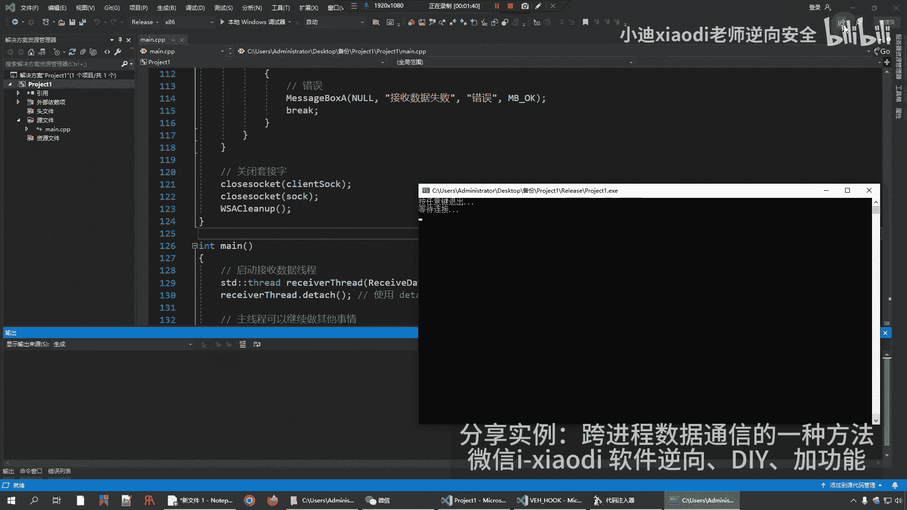
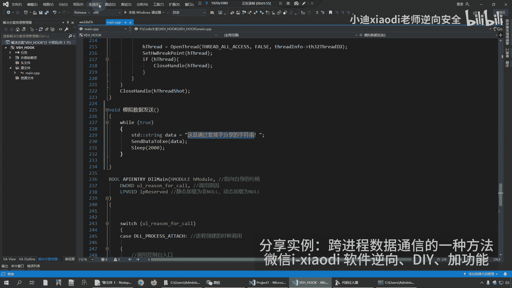

# 🧩 HOOK二改软件拦截数据与跨进程通信：01：课程概述

在本节课中我们将要学习 HOOK 二改软件拦截数据、跨进程套接字通信、软件二改与软件加功能的基本实现逻辑。课程内容也会涉及 2025 软件黑客、软件逆向破解、网络验证、Crackme、山寨、封包等相关主题，但本节重点放在字符串发送、源代码对接和进程间通信这条主线上。

原讲解视频简单说明了一个大致逻辑：程序如何实现字符串发送，以及开发者如何把这段逻辑对接到自己的源代码中。首先说明一点，我们采用的是套接字形式，也就是让两个进程通过套接字交换数据。理解这个总体目标后，下面先看整体思路。

## 🧭 HOOK二改软件拦截数据与跨进程通信：02：整体思路与套接字通信

上一节我们明确了课程目标，本节来看看整体通信思路。套接字通信相当于网络数据包传输，网络数据包传输你应该熟悉，可以把它理解为客户端把一段数据发给服务端，服务端再把这段数据收下来。



核心关系可以用下面的公式表示：




\[
\text{客户端进程} \xrightarrow{\text{send(result)}} \text{服务端进程}
\]


\[
\text{服务端进程} \xrightarrow{\text{recv()}} \text{字符串数据}
\]


也可以用下面的伪代码描述：


```text
客户端：init_socket() -> connect("127.0.0.1") -> send_data_to_ESE(result)
服务端：listen() -> accept() -> recv() -> 得到字符串
```


这里的关键点是：客户端负责发送拦截并转换后的字符串，服务端负责接收字符串。理解这个模型后，下一节回到代码层面，看看原有 HOOK 与新增套接字初始化如何配合。

## 🧱 HOOK二改软件拦截数据与跨进程通信：03：原有HOOK代码与初始化套接字

上一节介绍了套接字通信模型，本节来看看代码中的具体变化。之前的 VH HOOK 代码仍然保留，之前是在这里做 HOOK；现在为了测试，把这里注释掉了，回头恢复注释即可。相比之前，多出来的部分是初始化套接字。

初始化套接字就是在这里连接本地地址 `127.0.0.1`，这个地址你肯定知道，百分之百知道。然后在这里初始化套接字，通过发送数据包，也就是原文所说的 `sendE data to ESE`，向一个服务端发送数据包。因此最终你的程序，也就是你写的那个 ESE，需要通过这样一段代码来完成发送。可以用下面的代码示意：




```c
// 之前的 VH HOOK：测试时先注释，后面恢复注释
// hook_original();

init_socket();
connect_to("127.0.0.1", port);
send_data_to_ESE(result);
```




完成发送端与初始化后，还需要服务端和线程接收数据，下一节继续说明。

## 🛠️ HOOK二改软件拦截数据与跨进程通信：04：服务端代码与线程接收

上一节说明了客户端如何初始化套接字并发送数据，本节来看看服务端如何接收。这是服务端代码；有客户端就有服务端，两者是成对出现的。服务端代码可以直接复制粘贴，相关函数都已经写好。你只需要在自己的程序里跑一个线程，你的另一个程序也自己跑一个线程。线程负责接收字符串数据即可。

以下是服务端与线程接收的关键点：


- 服务端代码：有客户端就有服务端，服务端代码可以直接复制粘贴，函数已经写好。




- 线程运行：你的程序里需要跑一个线程，你的另一个程序也自己跑一个线程。


- 数据接收：线程负责接收字符串数据，把客户端发来的内容收下来。


服务端与接收线程准备好后，下一步就是明确拦截后在哪里发送字符串。

## 📤 HOOK二改软件拦截数据与跨进程通信：05：拦截后发送result

上一节完成了服务端与接收线程的说明，本节看看字符串在哪里发送。字符串就在原来的拦截位置发送：拦截仍然是之前的拦截，转换仍然在原位置转换；转换完成后，把 `result` 发送到服务端，然后运行起来。可以用下面的代码表示：




```c
result = convert(original_data);
send_data_to_ESE(result);
```




这里的重点不是改变原有拦截逻辑，而是在拦截并转换之后，把得到的 `result` 通过套接字发出去。发送逻辑明确后，就可以把程序运行起来做测试。

## 🧪 HOOK二改软件拦截数据与跨进程通信：06：运行测试与进程间通信

上一节说明了拦截后发送 `result` 的位置，本节来看看运行测试与验证效果。运行后可以看到服务端，这就是服务器；另一个是你的程序，只要添加上这段代码即可；还有一个是 ESE 程序。为了方便测试，可以单独跑一条线程模拟数据发送，模拟发送就是每隔 2 秒发送一次数据，然后生成程序进行测试。

以下是测试与验证流程：




- 启动服务端，确认服务端处于接收状态。


- 在你的程序中添加发送代码，并准备好 ESE 程序。




- 为了模拟你的程序，假设这个游戏就是你的程序，也就是医院里的某个系统，这时把相关代码或模块注入进去。


- 单独跑一条线程模拟数据发送，每隔 2 秒发送一次，用来观察通信效果。


- 每次拦截到数据后，服务端都会接收到信息，这个信息由客户端发送过来，从而实现两个进程之间的通信。


模拟发送可以用下面的伪代码表示：


```c
while (true) {
    sleep(2000);
    send_data_to_ESE(mock_data);
}
```


同时，这是一个局域网场景，因此完全可行，因为你是在本机检测这个东西，所以没有问题。每一次都可以接收到数据。整体逻辑大概就是这样：通过网络数据包的形式发送数据。至此，测试流程和通信效果已经说明，最后做一个总结。

## ✅ HOOK二改软件拦截数据与跨进程通信：07：课程总结

前面几节从整体思路讲到代码实现，再讲到运行测试，本节做最后总结。本节课中我们一起学习了 HOOK 二改软件拦截数据并跨进程通信的基本流程：使用套接字形式，相当于网络数据包传输；保留原有 HOOK 拦截与转换逻辑，在测试时注释原 HOOK，回头恢复注释；新增初始化套接字并连接 `127.0.0.1`；通过 `send_data_to_ESE` 向服务端发送数据；服务端代码可以直接复制粘贴，并通过线程接收字符串数据；拦截转换后把 `result` 发送到服务端；最后运行程序，通过模拟线程每隔 2 秒发送数据，验证服务端能够持续接收信息，从而实现两个进程之间的通信。

