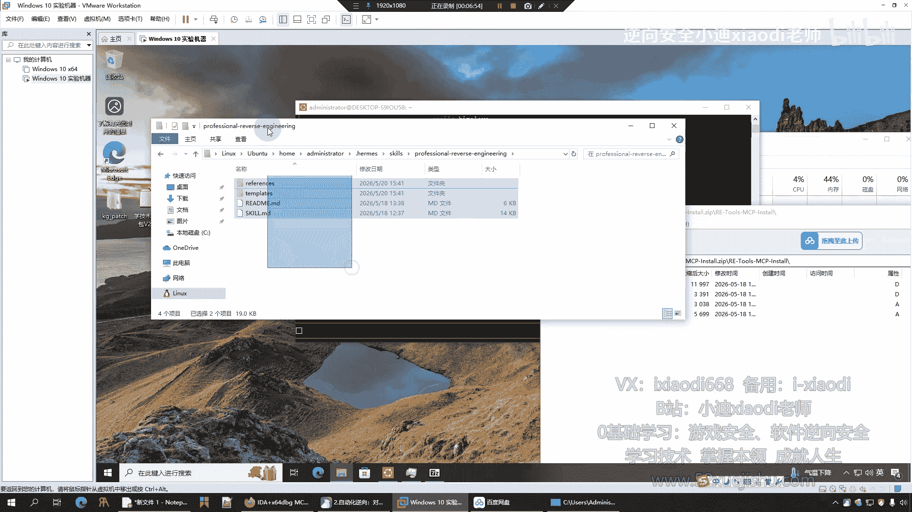
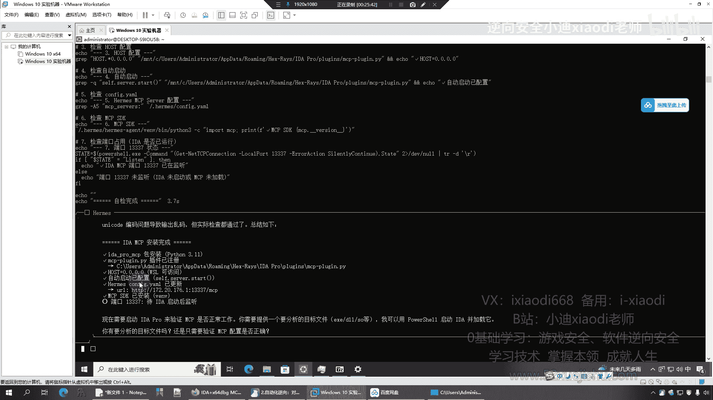
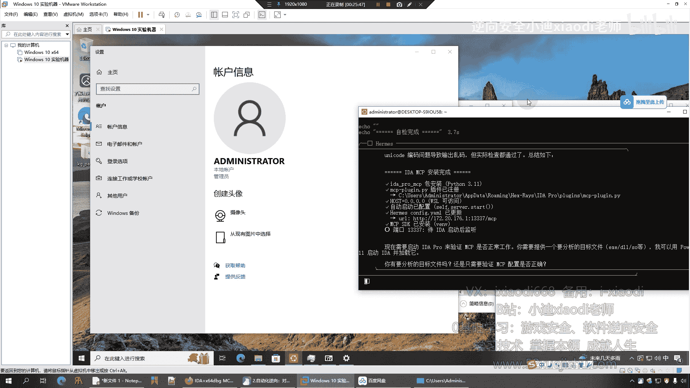
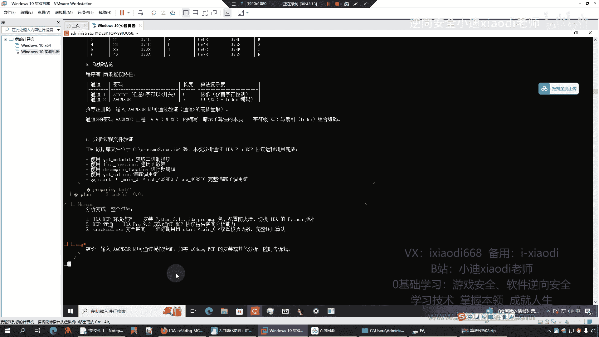
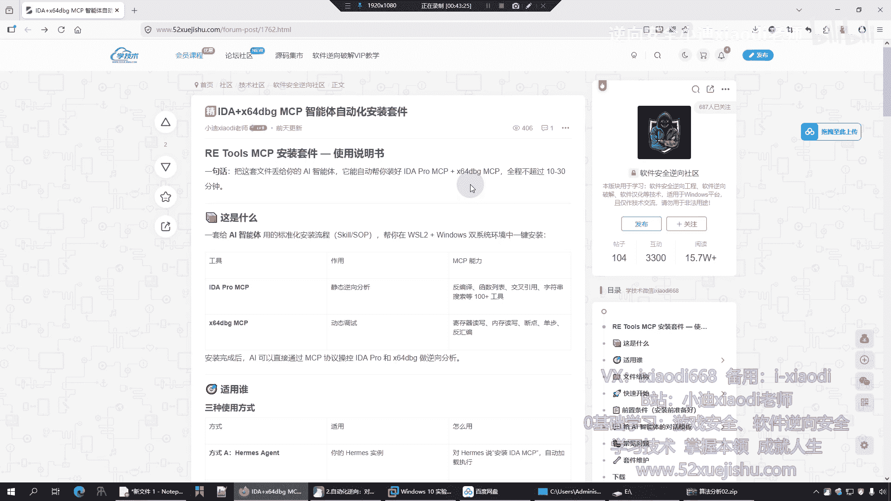

# 🧭 IDA Pro + MCP 全自动 AI 逆向环境搭建：00：课程概述与目标


在本节课中我们将要学习如何把 IDA Pro、x64dbg、MCP 与 AI 智能体组合起来，搭建一套自动化逆向分析环境，并完成一次从安装配置到实际 CrackMe 分析的全流程演示。本教程整理自视频内容，原文标题为“IDA-Pro-+-MCP全自动AI软件逆向【搭建全流程】——Hermes-AI智能体，新神降临，解放双手【游戏安全，软件安全，网络安全，CTF比赛必备基础】--BV1F2Lm63ETu-”。


> 视频主题：IDA Pro 与 x64dbg 搭配 MCP，再结合 AI 智能体，实现自动化逆向分析；内容涉及游戏安全、软件安全、网络安全和 CTF 比赛基础。


本教程的核心目标可以用下面的流程描述，后面所有安装和验证步骤，都是围绕这条链路展开的。




```text
AI 智能体 -> MCP Server -> IDA Pro / x64dbg -> 目标程序 -> 分析报告
```


上一节我们明确了整套环境的目标，本节先进入第一步，也就是安装 IDA Pro。安装 IDA 不是随便选一个版本就行，原文特别强调 IDA 要挑版本，最好使用 9.0 以上版本。教程提供的是 IDA 9.3，版本比较新，因此更推荐使用。下面列出 IDA 安装与系统权限准备的主要步骤。


- 安装包已经提供，直接运行安装包。
- 运行后进入安装界面，点击 Next。
- 安装到 C 盘或 D 盘都可以；如果安装到 C 盘，需要先处理管理员权限，不要把管理员权限设得太高。
- 打开控制面板，原文习惯从网络入口打开控制面板，然后找到“系统和安全”，再更改用户账户控制，把级别拉到最低。
- 把用户账户控制拉到最低后，安装过程以及后期允许 AI 操作电脑文件或配置时会更方便；否则 Windows 系统本身的权限限制可能导致各种问题。
- 简单完成权限配置后，原文演示安装到 C 盘。
- 安装目录默认即可，不用改动，点击 Next，再点击 Next。
- 安装程序会自动安装 Python 版本，继续点击 Next、点击 Next。
- 等待自动安装完成，安装 Python 的窗口不要关闭，此时正在做初始化，稍等即可。
- Python 安装完成后，还会安装一个运行库，默认让它安装完即可。
- 点击下一步、点击下一步，再点击 Finish，安装结束。
- 点击左下角开始菜单，可以看到 IDA 路径；右键点击“更多”，再点击“打开文件位置”。
- 在打开的位置中，右键点击“打开文件所在位置”，这里就是 IDA 的安装目录。
- IDA 9.3 更新后不再分 32 位和 64 位两个文件，而是直接一个文件。
- 如果想查看程序后缀，可以点击“查看”，再点击“文件扩展名”，这样就能看到可执行文件后缀为 .exe。
- 双击运行 IDA，此时还没有授权。
- 点击 Go 去分析文件仍然会有问题，因此需要打补丁。


上一节我们完成了 IDA 安装并确认需要补丁，本节继续处理补丁替换以及 x64dbg 调试器的准备。补丁需要先放到桌面上，下载后放到桌面即可。原文提供了好几个版本的补丁，除了 Windows 系统版本，还有 Linux 系统版本，本教程使用 Windows 系统版本。下面列出补丁替换与 x64dbg 准备的操作。




- 把两个补丁文件直接拖到 IDA 安装目录。
- 打开对应文件夹，把文件直接拖过来并替换。
- 如果权限不够，系统可能会申请权限，因此用户账户控制级别要调到最低。
- 这样操作文件以及让 AI 操作电脑文件时，额外权限申请会更顺利；AI 毕竟是第三方程序，需要额外权限。
- 完成补丁替换后，IDA 环境就配置好了。
- x64dbg 可以去网上下载最新版本，也可以去官网或 GitHub 下载最新版本。
- 也可以使用工具包里的 x64dbg，解压出来放到合适位置即可。
- 记住 x32dbg 的路径以及 x64dbg 的路径。
- 接着点击 Linux，找到 Ubuntu，双击 home，双击主用户，再双击 hermes 文件夹，找到 skills。
- 在 skills 中新建一个文件夹，文件夹名称按教程指定名称设置。
- 把下载到的技能包直接拖过来，刷新一下即可看到。




上一节我们准备好了补丁和调试器路径，本节开始让 AI 智能体读取技能说明，并进入 MCP 安装配置阶段。完成技能包放置后，可以与 AI 对话，告诉它根据 skill 技能、中等、里面的 README.md 和 skill.md 来配置 IDA MCP。下面列出与 AI 交互和安装 IDA MCP 的过程。


- 向 AI 发出配置 IDA MCP 的指令后，AI 会进行数据访问，慢慢读取里面的所有文件。
- 读取过程可能有点慢，目前也可能存在一些小 bug，可以稍微等待。
- 等待 AI 提示输入路径。
- AI 会要求一次性提供以下信息：IDA 路径、Windows 桌面路径、Windows 下 IDA Pro 版本号、x64dbg 安装路径、Windows 用户名、sudo 密码。
- IDA 路径就是前面找到的 IDA 安装位置，复制后提供。
- Windows 桌面路径可以写“Windows 桌面这里”，AI 知道 Windows 桌面。
- IDA Pro 版本号是 9.3。
- x64dbg 安装路径一次性提供，使用 Windows 系统下的路径。
- Windows 用户名按实际填写，sudo 密码原文示例为 123。
- 回车后，AI 根据收集的信息进行处理，稍等。
- 安装过程中，每台电脑可能因为权限问题或系统版本问题出现不同的 bug。
- 可以根据 AI 的提示去问 DBC，查看有没有对应解决方案，通常都能解决。
- 第一个检查全部通过后，AI 开始安装 IDA Pro 的 MCP。
- 耐心等待，AI 会自动下载 IDA Pro MCP 包，缺少什么也会自动下载。
- AI 发现 Python 环境不匹配，于是自动安装 Python 3.11.9，因为 IDA Pro MCP 所有版本都要求 Python 大于等于 3.11。
- MCP 安装成功后，开始注册 IDA 插件。
- 插件注册成功，提示开始执行后续步骤，随后安装完成。
- 接着开始安装 x64dbg 的 MCP，过程与 IDA 类似。
- 开始下载 x64dbg MCP 插件，等待一段时间。
- 解压完成后，原文提到刚才下载似乎被阻止；一开始只要求配置 IDA MCP，所以该下载先跳过了。
- 下载被阻止可能是网络影响或其他原因，可以自己检查网络环境。
- 现在进入 MCP 配置和 ID 验证阶段，检查智能体和 IDA 能否对接。
- AI 要求选择权限，选择允许该请求，然后回车。
- AI 提示 SDK 没有安装，于是让它自己安装。
- SDK 准备就绪后，把服务器添加到配置里。
- 开始启动 IDA，并进行端到端验证。


上一节我们完成了 MCP 安装，本节看看 AI 如何启动 IDA、验证配置，并尝试分析一个简单目标文件。整个流程都是自动化的，而且比较严谨，在启动 IDA 之前要先验证配置完整性。下面列出验证与实际分析演示的过程。


- 等待 AI 检查配置完整性。
- 所有东西检测完毕后，AI 询问是否需要启动，并验证是否正常工作；它要求提供一个要分析的目标文件。
- AI 提到用 PowerShell 启动 IDA 并附加目标文件，然后问现在有没有要分析的目标文件，还是只需要验证 MCP 配置是否正确。
- 此时可以提供一个简单文件让它分析，稍等。
- 让它分析 Windows 路径下的程序，这是一个算法分析程序，文件路径位于 Windows 系统。
- 要求 AI 分析逆向算法并突破授权，输出报告。
- 目前还没有开始训练，所以回答仍然根据 DeepSeek 原生模型的随机性来分析。
- 后期需要额外调教，例如让它按什么格式输出报告、报告需要提供哪些内容、PE 文件有哪些东西。
- 弹窗出现时手动点空格选择 Yes，选择 Yes 即可，换行也可以，其他不用管，点击 OK。
- 等待 AI 输出报告。
- 目前似乎出了问题，AI 提示超时，然后检查状态。
- 让 AI 修复，修复完成后让它记下这次解决方案。
- 后期会对插件继续优化，保证更大概率把环境安装好。
- AI 找到问题并修复，然后重启 IDA 让修改生效。
- 碰到问题不要慌，AI 智能体会自动解决，它自动关闭了 IDA Pro。
- 重新进入后等待，似乎还有小问题，AI 又找到第二个小问题并修复。
- 东西准备就绪后，MCP 服务器成功运行。
- AI 开始逆向分析 crackme2.exe，开始静态分析。
- 遇到问题不要怕，AI 会解决；大模型思考问题具有一定随机性，思考 10 次至少有 8 次正确，可能少数几次错误。
- 刚才似乎又出了问题，监听正常，但 Windows 防火墙被阻止，AI 自动添加防火墙规则。
- 实际可以在控制面板找到“系统和安全”，打开防火墙的“启用或关闭”，直接关闭防火墙也可以。
- 关闭防火墙后，数据才能连通；否则中间隔着一道墙，无法互通。
- AI 测试联通性，完全跑通后获取到原始数据，例如基地址等信息，然后继续深入分析。
- 由此可见，碰到什么问题，AI 就解决什么问题，基本都能检测出来。
- AI 开始搜索相关字符串，并自己编写脚本。
- 入口点字符串搜索没有结果，AI 开始获取完整函数列表和返回边入口点，这部分让它自己处理。
- 后期会专门教怎么让 AI 输出更完整的报告，以及教它怎样分析才是正确的。
- 目前仍具有一定随机性；卡住时点击 y，所有东西都点击 y，否则会卡在某个状态。
- 随后找到真实入口。
- 这是第一次与 AI 合作，表现还行，不是特别慢，也不是特别傻。
- 弹窗出现时点击 OK，有弹窗就点击确定。
- 后期可以训练它，当有弹窗出现时直接模拟回车键；原文中已经让它记住有弹窗时按回车。
- AI 查看返回边，寻找真正的 main 函数，并尝试把算法扒出来。
- 找到 main 函数后，开始核心逆向分析。
- 弹窗再次出现时点击 OK。
- AI 似乎找到关键逻辑，核心逻辑就在这里，随后思路变得清晰。
- 接下来 AI 把算法拔出来。
- AI 提示算法已完全破解，并要求输出完整分析报告。
- 报告包含基本信息、程序执行流程，内容非常清晰；核心验证逻辑的代码也直接反编译出来。
- 报告还包含双重校验算法的破解过程，并给出有效密码事例。
- 接下来进行验证：运行 CrackMe，随便输入密码并回车，结果失败。
- 使用 AI 提供的推荐注册码 AAMXY 再试一次，回车后显示 success，说明逆向分析完全正确。
- 这个报告是在还没有调校的时候做出来的，效果已经很好；调校之后，输出内容会更详细，分析也会更详细。
- x64dbg MCP 的安装可以继续让 AI 完成，后续有任何问题都可以重新投递给 AI。
- 问题解决一次、两次、三次，最终总能把问题解决。


本节课中我们一起学习了 IDA Pro 9.3 的安装、系统权限调整、补丁替换、x64dbg 路径准备、Hermes-AI 技能包放置、IDA MCP 与 x64dbg MCP 的安装配置，以及让 AI 智能体自动启动 IDA、验证 MCP、分析 CrackMe 程序并输出逆向报告的完整流程。核心思路可以概括为下面的公式。


```text
自动化逆向 = AI 智能体 + MCP Server + IDA Pro/x64dbg + 目标程序
```






同时也要记住，大模型分析存在一定随机性，安装过程也可能因权限、系统版本、网络和防火墙设置出现不同问题；遇到问题时让 AI 检查、修复、记录解决方案，再继续验证即可。本教程内容到此结束，下期再见。

