# 🧰 IDA Pro快速入门2，那个女人回来了，软件安全逆向必备神器【2025软件黑客、逆向破解、网络验证、Crackme、山寨、封包】：第31讲：使用IDA Pro逆向破解实战程序

在本节课中我们将要学习通过实验程序掌握IDA Pro最常规、最常见的用法。本节对应第三十一讲，由小迪老师讲解，主题是使用IDA Pro进行逆向破解实战。课程内容面向软件安全逆向场景，也会涉及2025软件黑客、逆向破解、网络验证、Crackme、山寨、封包等学习方向。整体内容分为5个部分，并补充一个小拓展。原文提到这些用法覆盖日常实验应用场景的百分之七八十，因此学习时需要结合实验程序反复操作。下面从认识部分窗口开始。

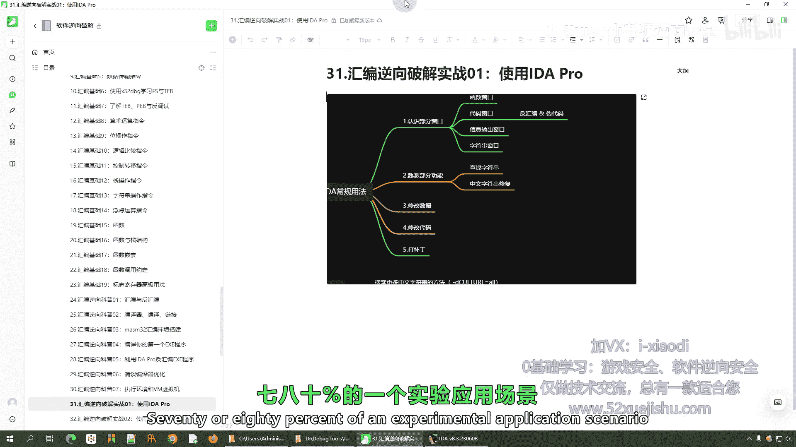

## 🪟 IDA Pro快速入门2：2.1：认识部分窗口

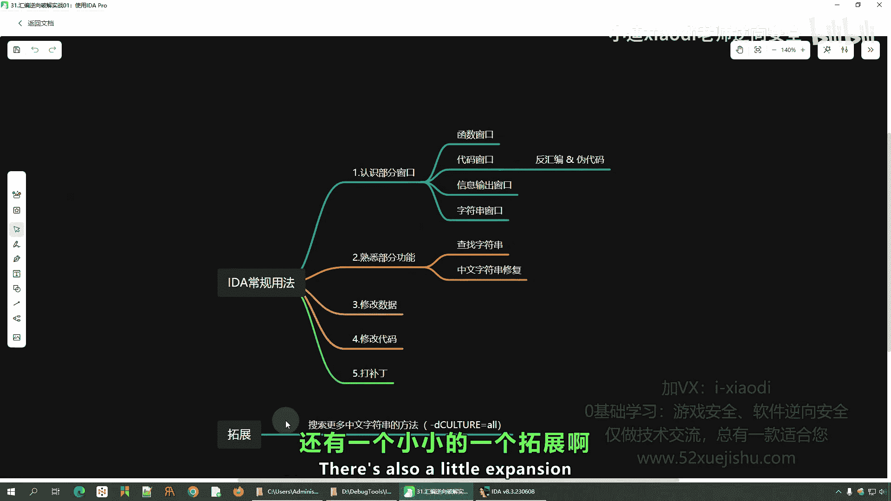

上一节概述了课程目标和内容范围，本节我们来看看IDA Pro中最常见的几个窗口。先打开IDA，把第一个实验程序`texax.exe`拖进来，也可以先运行程序查看样貌。拖入后点击`OK`即可，默认设置全部保持默认。掌握这些窗口后，后续分析程序和修改程序会更顺畅。

首先讲函数窗口。函数窗口用于显示程序中的函数，之前已经了解什么是函数，例如API函数，或者用户自己编写的函数。以下是函数窗口相关要点。

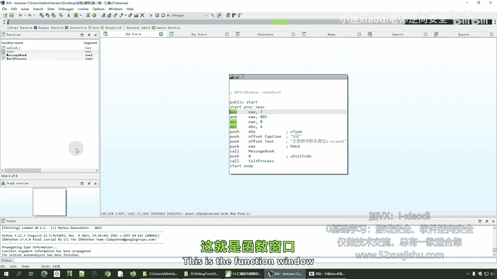

- 窗口中可以看到API函数。
- 窗口中也可能看到程序本身原生的函数。
- `start`位于函数列表内。
- 整个窗口就是`functions`窗口，所有函数功能模块都会在这里显示。

函数窗口了解后，接下来看代码窗口。代码窗口分为反汇编窗口和伪代码窗口。当前显示的是反汇编窗口。按空格键可以在图表视图和文本反汇编之间切换，文本反汇编是线性排列模式，图表模式则是图形化展示。按`F5`键可以把反汇编代码还原成伪C代码，也就是类似C语言的代码。以下是代码窗口相关快捷键。

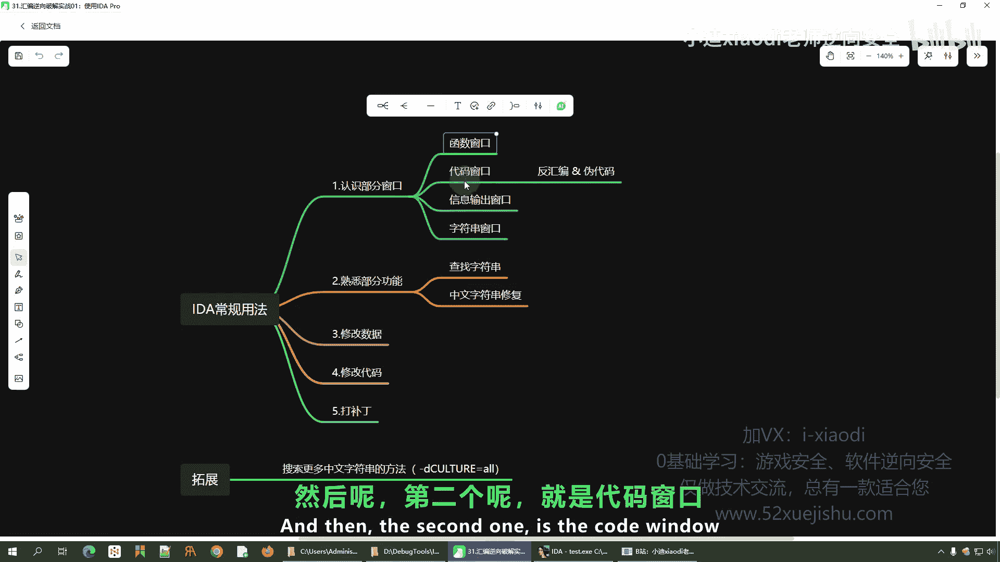

```text
空格键  # 在图表视图和文本反汇编之间切换
F5      # 将反汇编代码还原为伪C代码
```

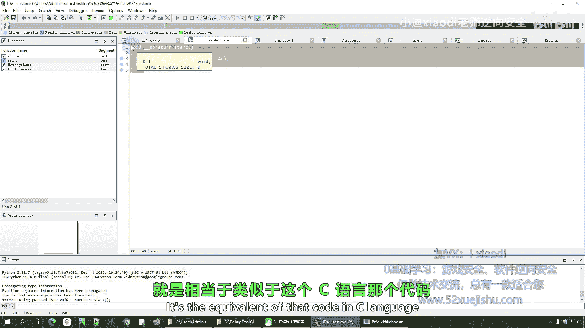

代码窗口了解后，接下来看信息输出窗口。信息输出窗口会在操作程序或加载程序时给出提示。重新加载程序时可以关闭前一个程序并选择不收集垃圾，然后点击`OK`，把IDA运行起来并拖入程序，再点击`OK`。程序加载完成后，信息输出窗口会提示初步分析已经完成，并显示这里没有发现问题。后续使用插件或IDA自带功能进行操作时，这个窗口也会提示修改成功或失败。以下是信息输出窗口的作用。

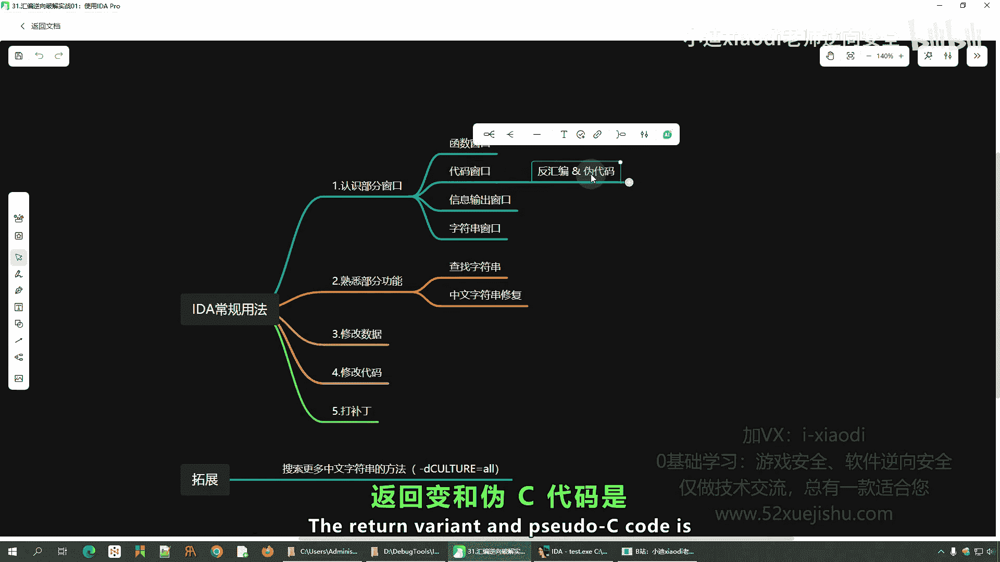

- 加载程序后提示初步分析完成。
- 显示相关提示信息。
- 使用插件或IDA功能时提示操作成功或失败。

信息输出窗口了解后，接下来看字符串窗口。字符串窗口最常用的快捷键是`Shift+F12`，按下后会把所有字符串显示出来，例如“你好，世界”“B站小迪老师正版微信”都会显示在这里。以下是字符串窗口的基础操作。

```text
Shift+F12  # 打开字符串窗口
Ctrl+F     # 在字符串窗口中搜索内容
```

字符串窗口打开后，重新启动程序并选择不收集垃圾，再次观察字符串。此时可能发现“B站小迪小迪老师”中的部分内容丢失。按`Shift+F12`搜索字符串，会发现“小迪”与刚才显示不完全一样，搜索到的字符串存在残缺。如果残缺不多、程序不大，可以进行字符串修复。修复方法如下。

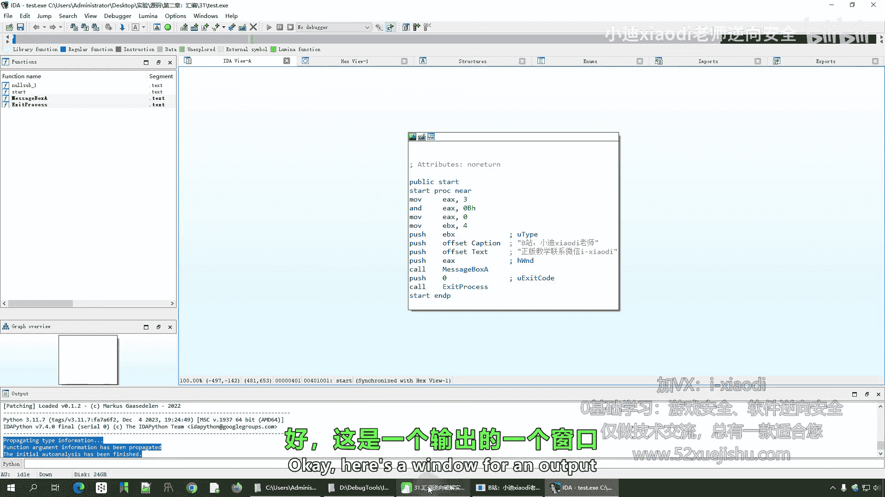

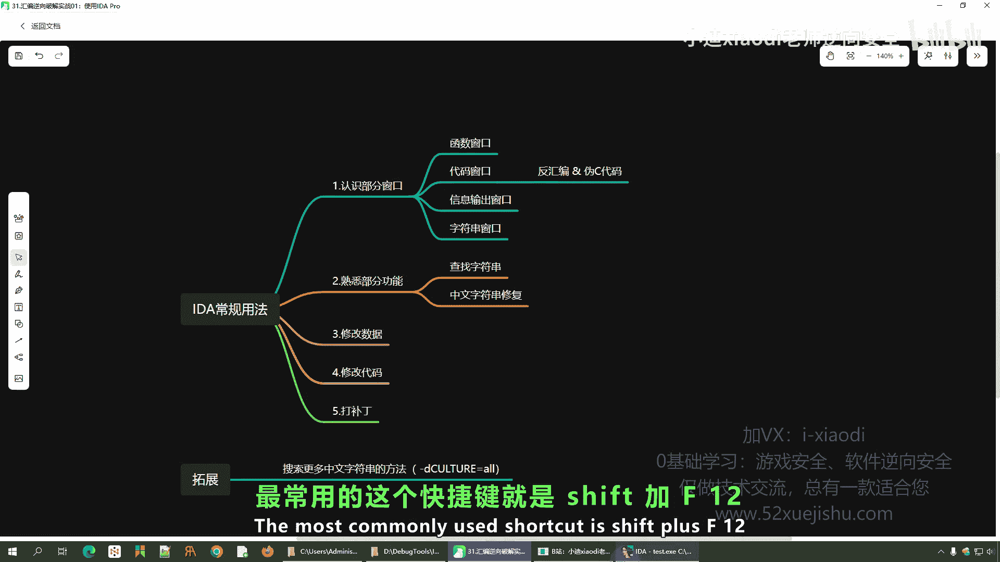

- 使用`Shift+F12`打开字符串窗口。
- 使用`Ctrl+F`搜索相关内容。
- 双击目标字符串跳转过去。
- 从字符串开头选中到结尾。
- 鼠标右键点击`A`，或直接按键盘上的`A`。
- 如果当前位置看不到内容，向下翻动查看。
- 字符串修复后，点击`str`，或按`F2`切换过来。
- 鼠标右键选择`Rebuild`重建字符串。
- 重建完成后字符串修复完成。
- 如果其他内容看起来像字符串，也可以鼠标右键点击`A`或按键盘上的`A`，例如“你好世界”可以这样处理。

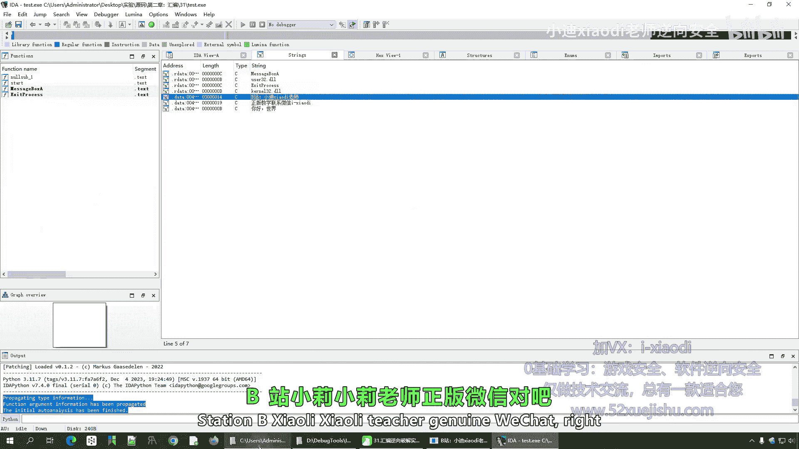

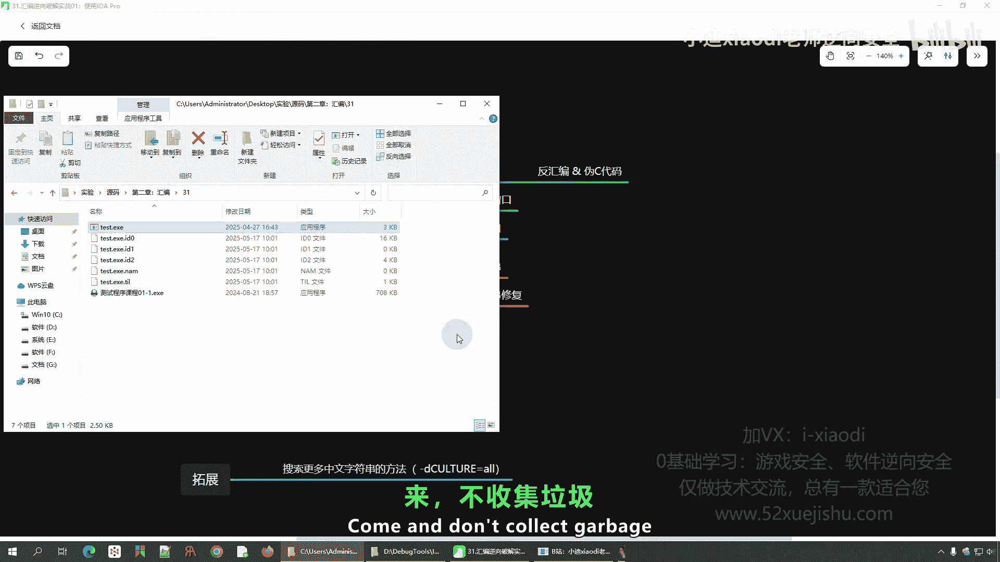

字符串修复是基础操作。掌握窗口和字符串修复后，下一节我们来看看如何修改数据。

## 🧩 IDA Pro快速入门2：2.2：修改数据

上一节介绍了函数窗口、代码窗口、信息输出窗口和字符串窗口，本节我们来看看如何修改程序中的数据。假设想把“B站”改成“A站”，可以直接从内存数据入手。字符串最终也是内存数据，因此可以在内存窗口或内存数据视图中显示和修改。以下是修改数据的基本步骤。

- 首先点击选中目标地址。
- 点击十六进制视图相关入口，IDA会自动选中刚才选中的“小迪老师B站”内容。
- “B站”中的`B`对应十六进制`0x42`。
- “A站”中的`A`对应十六进制`0x41`。
- 直接按键盘修改无效，需要鼠标右键点击`Edit`，或按快捷键`F2`。
- 将`0x42`改成`0x41`。
- 修改后颜色会发生变化。
- 鼠标右键点击应用，颜色会变成橘黄色，修改完成。
- 完成后再执行确认操作，代码中也会显示为“A站”。

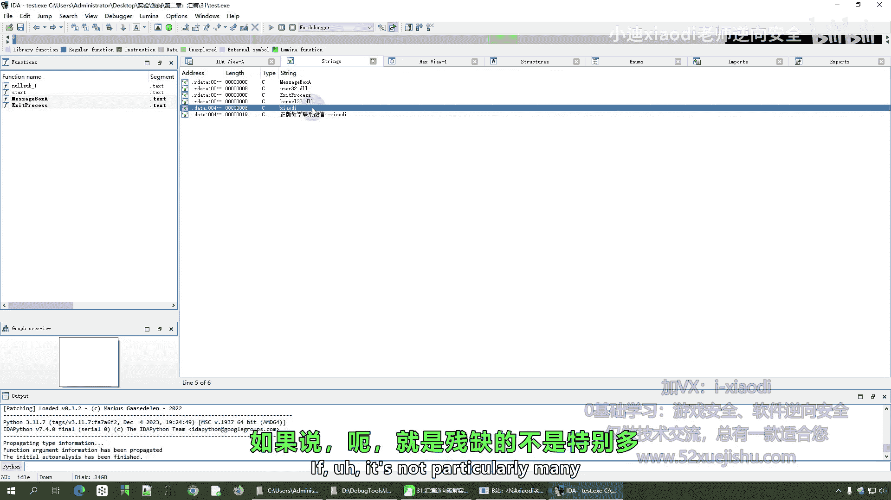

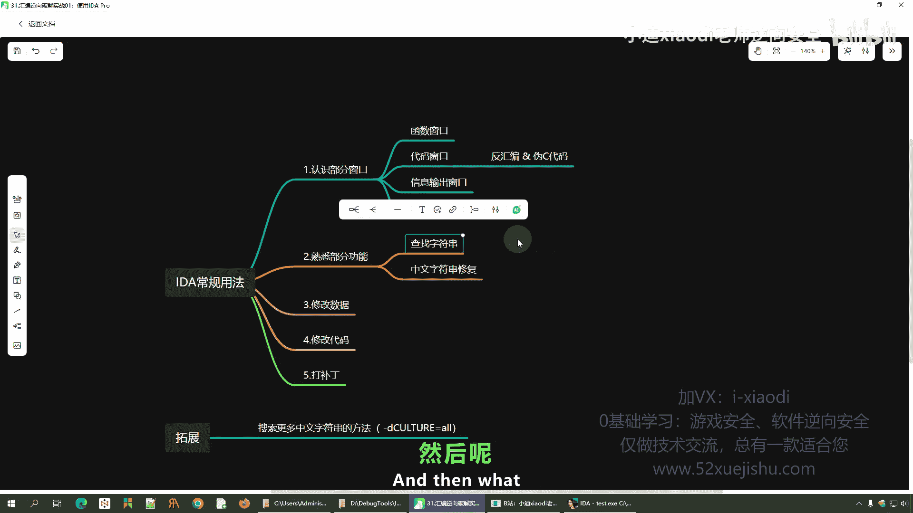

核心修改关系可以用下面的公式表示。

```text
B 的 ASCII 十六进制：0x42
A 的 ASCII 十六进制：0x41
修改：0x42 → 0x41
```

修改数据掌握后，下一节我们来看看如何直接修改代码。

## ✏️ IDA Pro快速入门2：2.3：修改代码

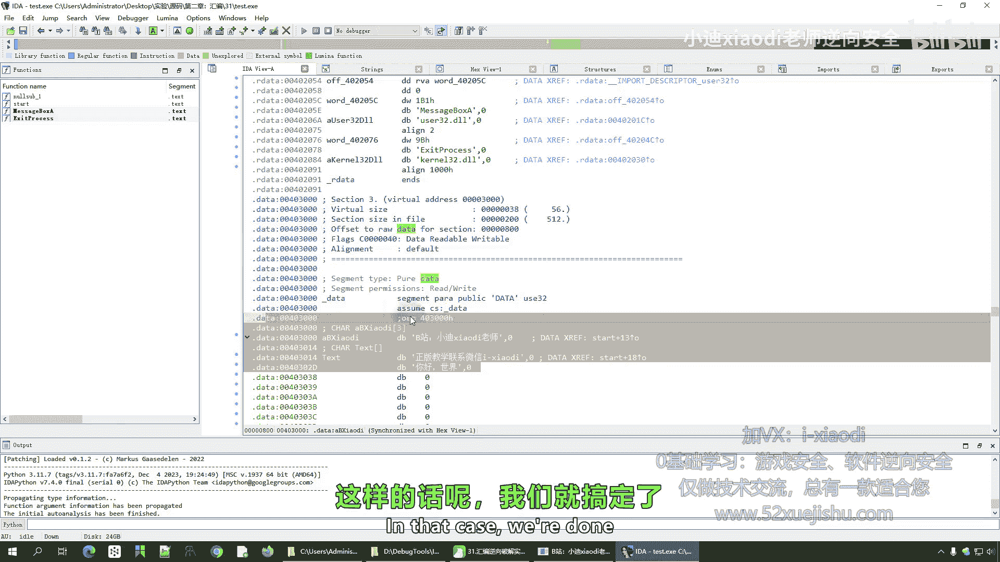

上一节介绍了如何修改内存中的数据，本节我们来看看如何修改反汇编代码。修改代码同样简单，鼠标右键点击`Assemble`，`Assemble`就是汇编的意思。选择哪一行，就可以修改哪一行的数据。例如当前是`BX4`，选择这一行后直接修改，再按回车，回车后它会变成`3`。点击关闭窗口后，程序在IDA中的显示就修改完成。以下是修改代码的基本流程。

```text
右键 → Assemble → 修改指令 → Enter
```

需要注意，这里的修改只是在IDA的反汇编编辑器里完成，并没有保存到本地文件。修改代码了解后，下一节我们来看看如何把修改保存成补丁。

## 🩹 IDA Pro快速入门2：2.4：打补丁

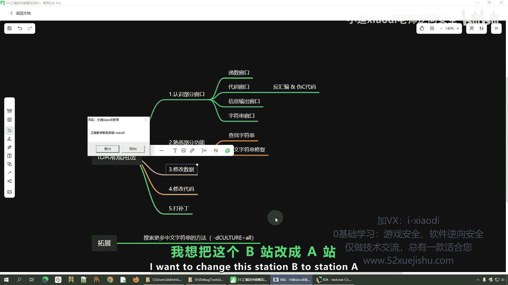

上一节介绍了在IDA中修改代码，本节我们来看看如何保存修改并打补丁。打开IDA后点击`Edit`，再点击`Apply`，就可以把修改应用到程序。例如把程序改成`tex.exe`，然后点击`Apply`应用。此时IDA会给出提示，并输出到一个路径。运行`tex.exe`后可以看到程序已经变成“A站”，窗口样式与刚才也有所更改。以下是打补丁的关键操作。

```text
Edit → Apply  # 将修改应用到输入文件
```

打补丁掌握后，下一节我们来看看第二个实验程序，并补充中文字符串搜索的拓展方法。

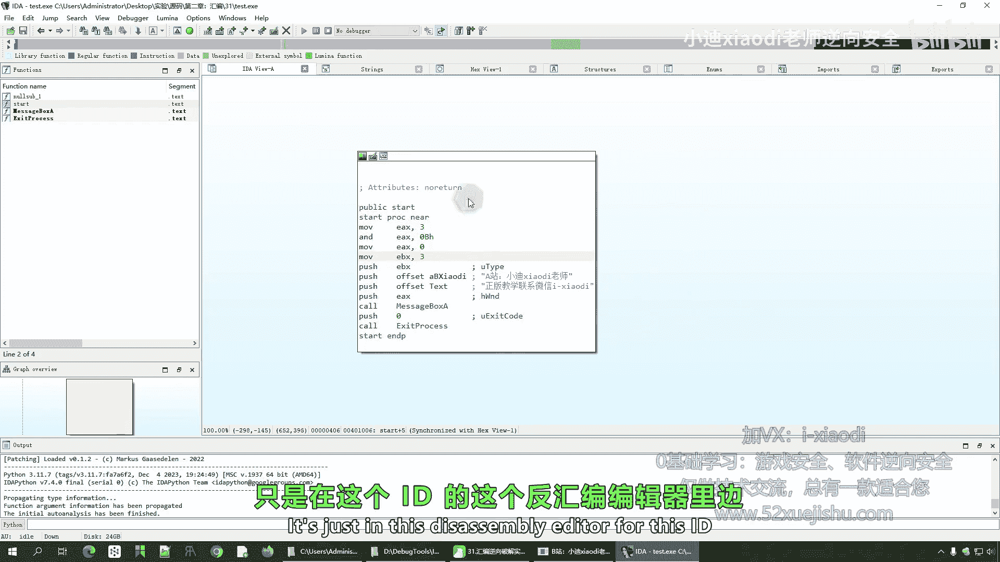

## 🧪 IDA Pro快速入门2：2.5：第二个实验程序与中文字符串搜索拓展

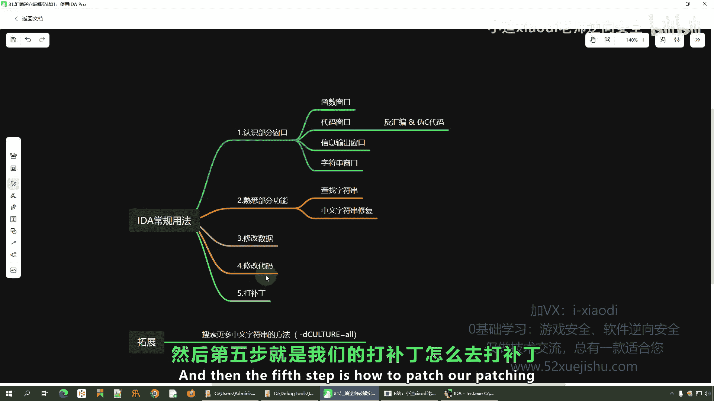

上一节完成了打补丁操作，本节我们来看看第二个实验程序。这个程序已经比较熟悉，点击登录会提示登录失败。运行IDA后点击`OK`，把程序拖过来，再点击`OK`，等待自动分析完成。分析过程中底部会给出提示，需要耐心等待。分析完成后，直接按`Shift+F12`打开字符串窗口，再用`Ctrl+F`在海量数据中搜索想要的数据。例如搜索“失败”，程序中本来有“登录失败”，但可能搜不到。以下是第二个实验程序的基础观察。

- 点击登录会提示登录失败。
- 将程序拖入IDA并点击`OK`。
- 等待自动分析完成。
- 分析完成后按`Shift+F12`打开字符串窗口。
- 使用`Ctrl+F`搜索目标字符串。
- 搜索“失败”时可能没有结果。

如果搜索不到，就需要用到本节的拓展知识。如果想搜索更多中文字符串，需要新建一个快捷方式，并在快捷方式后面加上原文给出的那一行内容。操作方法是：找到IDA程序，鼠标右键创建快捷方式，创建完成后鼠标右键点击属性，在目标路径后面先加一个空格，再把原文给出的内容复制并粘贴进去。这样就得到`IDA2`快捷方式。以下是拓展操作流程。

```text
右键 IDA → 创建快捷方式
右键 快捷方式 → 属性
在目标末尾加一个空格，再粘贴原文给出的参数
运行 IDA2 快捷方式
```

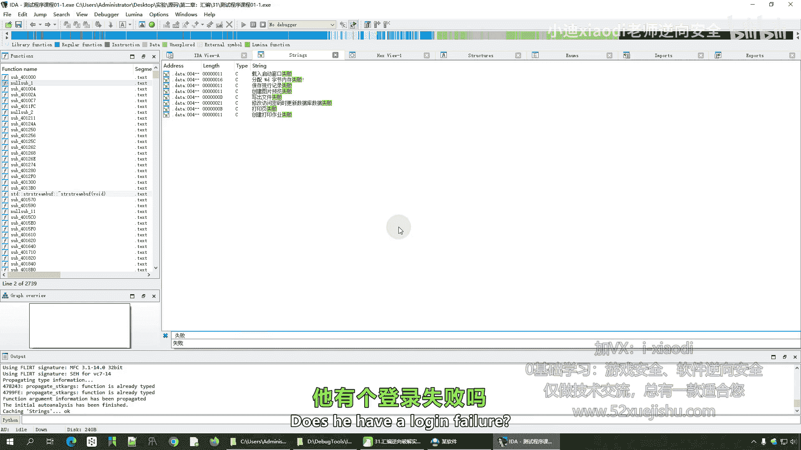

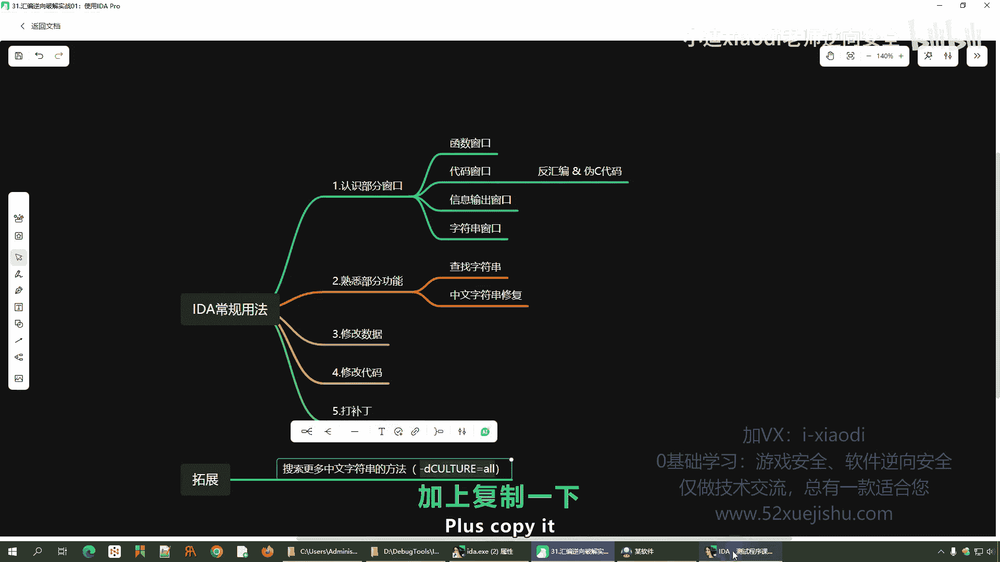

随后找到`IDA2`快捷方式运行，把第二个实验程序拖过来并点击`OK`，稍等IDA自动分析完成。分析完成后直接按`Shift+F12`，就可以看到“登录成功”“登录失败”等中文字符串全部显示出来。以下是拓展后的预期结果。

- 使用`IDA2`快捷方式运行IDA。
- 拖入第二个实验程序并等待分析完成。
- 按`Shift+F12`打开字符串窗口。
- “登录成功”“登录失败”等中文字符串可以显示出来。

## 📌 IDA Pro快速入门2：2.6：总结

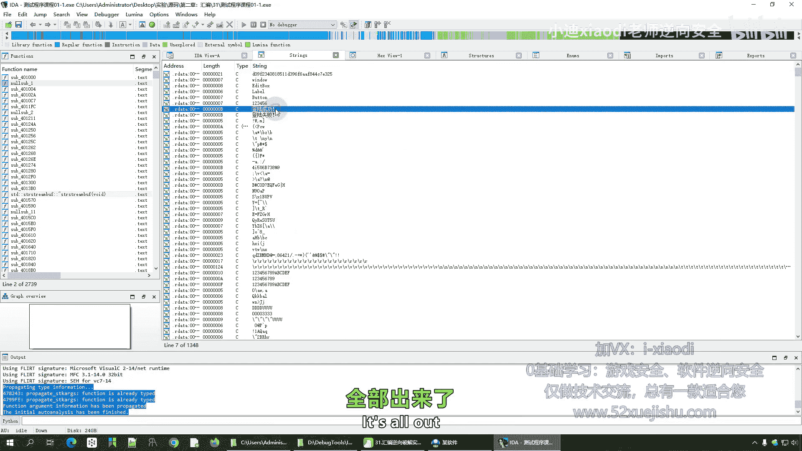

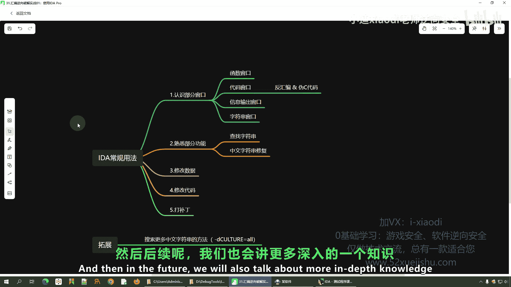

本节课中我们一起学习了IDA Pro逆向破解实战中的常见操作。开头介绍了课程目标和实验程序，然后依次认识了函数窗口、代码窗口、信息输出窗口和字符串窗口。接着学习了字符串残缺的修复方法，包括选中字符串、按`A`、使用`Rebuild`重建字符串。随后学习了修改内存数据，把`0x42`改成`0x41`，将“B站”改成“A站”。之后学习了使用`Assemble`修改代码，以及使用`Edit → Apply`打补丁保存修改。最后通过第二个实验程序演示了登录失败场景，并补充了通过新建快捷方式、添加原文给定参数来搜索更多中文字符串的方法。课后可以结合实验程序做练习，后续还会讲解更多深入知识，下集再见。
