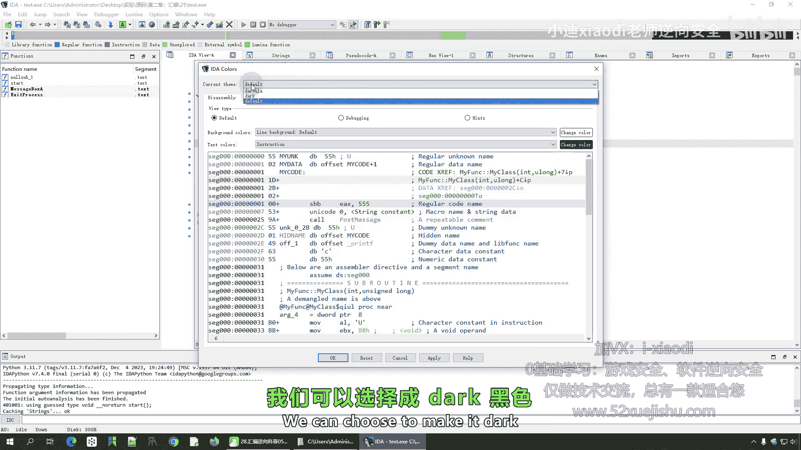
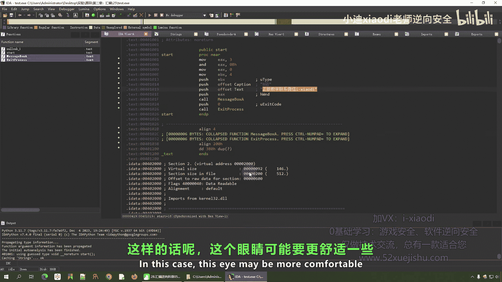
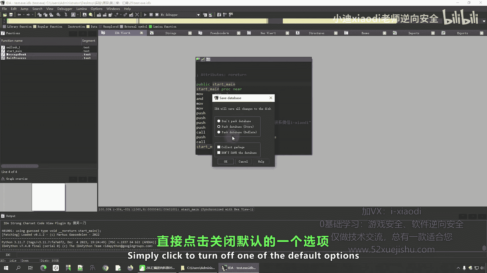
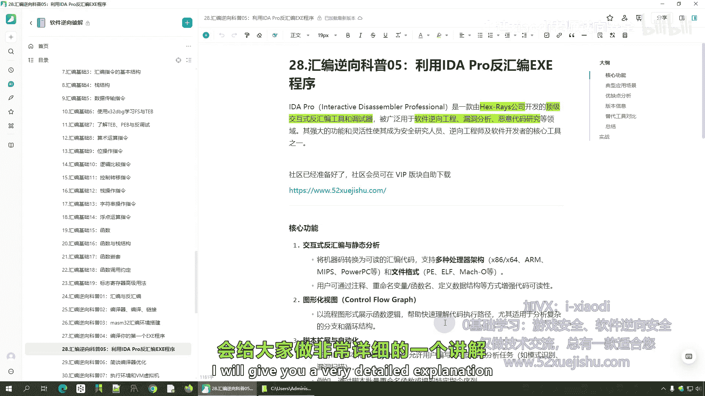

# 🧭 IDA Pro快速入门：00：课程概述

在本节课中我们将要学习IDA Pro快速入门的基础操作。IDA Pro在前面几节视频里有过一面之缘，可以把它理解为世界上最顶级的交互式反汇编工具和调试器。它被广泛用于软件逆向工程、漏洞分析、恶意代码研究等领域。学习工具最重要的是先跑通流程，再逐步理解细节，因此本节课会按实战步骤把基础操作串起来。

社区已经准备好相关工具，社区会员可以在VIP板块自助下载。下面直接进入实战，整个入门流程分为六步：界面基本分析、加载EXE程序、流程视图与代码视图切换、F5反编译与混淆代码还原、字符串窗口搜索、皮肤切换与保存分析结果。每一步都尽量用大白话说明，让初学者能够跟着操作。

# 🚪 IDA Pro快速入门：01：界面基本分析

上一节介绍了课程目标和IDA Pro的用途，本节中我们来看看界面基本分析。拿到工具后，在目录中找到带32位标识的“女人”图标程序，直接运行起来。运行后点击OK，界面上会出现三个按钮，这三个按钮如何点击需要先弄清楚。

先点击New体验一下。点击New后，它会提示选择一个程序，这种用法不太习惯。也可以使用第二个按钮来运行，点击OK后点击Go，这样就可以直接拖一个程序进去。为什么采用拖拽方式？因为界面提示“drag here”，把一个文件拖过来就可以进行反汇编。加载后界面主要分成上下两个区域，具体如下：

- **上方区域**：反汇编窗口，用来展示程序反汇编后的内容。
- **下方区域**：输出窗口，用来显示提示信息。

如果反汇编过程中出现问题，工具会在Output窗口给出交互性提示。界面区域可以用下面这个简单关系理解：

`反汇编窗口 = 展示程序指令的主区域`

上一节说明了界面组成，下一节我们看看如何把EXE程序加载进来并确认默认选项。

# 📦 IDA Pro快速入门：02：加载EXE程序并确认默认选项

上一节介绍了IDA Pro界面的上下区域，本节中我们来看看加载EXE程序时的提示和默认选项。把程序直接拖过来后，工具会给出一个提示。其中“Portable Executable 80386”表示可移植可执行文件，程序后缀是EXE，也就是executable可执行程序。理解文件类型后，界面选项默认即可。

加载时重点关注两件事，具体如下：

- **文件类型**：看到PE32和EXE，就知道这是Windows可执行程序。
- **默认选项**：不要随意更改，90%的情况保持默认，IDA本身非常智能。

核心概念可以用下面代码描述：

`PE32 = Portable Executable 80386`

`EXE = executable`

确认默认选项后点击OK，界面就会显示出来。下一节我们看看加载完成后的流程视图，以及如何切换到汇编代码视图。

# 🗺️ IDA Pro快速入门：03：流程视图与汇编代码视图切换

上一节完成了程序加载，本节中我们来看看流程视图和代码视图的切换。加载完成后显示出来的内容是一个流程视图，也可以理解为图表视图。如果喜欢直接看反汇编代码，可以按空格键切换，这样内存地址以及内存地址对应的汇编代码就会展示出来。

两种视图的用途可以这样理解，具体如下：

- **图表视图**：用图形方式展示程序流程，适合先看整体结构。
- **汇编代码视图**：展示地址和汇编指令，适合逐条分析。

视图切换可以用下面关系描述：

`图表视图 --空格键--> 汇编代码视图`

上一节看到的是流程结构，下一节我们进一步看看IDA Pro强大的F5反编译功能。

# ⚡ IDA Pro快速入门：04：F5反编译与混淆代码还原

上一节介绍了流程视图和汇编代码视图，本节中我们来看看F5反编译。IDA Pro是一款非常强大的反编译工具。反编译就是把低级语言转换成高级语言，例如C语言。操作非常简单，在当前界面按F5键，工具就会直接展示反编译结果。

F5生成的代码是经过优化的。回过去查看最原始的汇编代码，点击相应位置可以看到MOV ESI、若干运算和赋值等多行汇编代码。真正有用的代码只有最后一行，这一行完成最终赋值，然后把这个值赋给EBX。上面的内容起到混淆视听的作用。IDA Pro非常强大，可以把简单的混淆代码剥离掉，还原出更精确的代码。

反编译和优化可以用下面公式和快捷键描述：

`高级语言代码 = 反编译(汇编代码)`

`F5 -> 伪C代码`

本节观察点可以归纳为两个，具体如下：

- **按F5查看伪C代码**：快速理解函数逻辑。
- **回看汇编代码**：理解IDA如何剥离简单混淆并还原有效逻辑。

上一节学习了反编译，下一节我们看看如何通过字符串定位关键代码。

# 🔍 IDA Pro快速入门：05：字符串窗口与关键字搜索

上一节介绍了F5反编译和混淆代码还原，本节中我们来看看字符串窗口。程序里通常会有相关字符串提示，根据字符串提示可以定位到相应关键代码。查看程序里有哪些字符串，可以点击View，再点击Open subviews，然后选择Strings。这里推荐记住快捷键Shift+F12，因为使用频率非常高，建议直接背下来。

字符串窗口的操作可以归纳为下面几点，具体如下：

- **打开字符串窗口**：快捷键`Shift + F12`。
- **展示全部字符串**：窗口会列出程序中的字符串信息。
- **搜索过滤**：按`Ctrl + F`搜索关键字，例如输入“小迪”，窗口就会展示包含“小迪”的所有信息。

快捷键可以这样记录：

`Shift + F12 = 打开字符串窗口`

`Ctrl + F = 搜索字符串`

字符串数量可能超过好几页，所以搜索和过滤很重要。上一节通过字符串定位代码，下一节我们看看如何切换皮肤主题，让界面更舒适。

# 🎨 IDA Pro快速入门：06：皮肤主题切换

上一节介绍了字符串窗口和关键字搜索，本节中我们来看看皮肤切换。有同学觉得白色界面太亮，可以切换主题。点击Options，点击Colors，在这里找到Current当前主题，选择大黑色主题，点击Apply，再点击OK，界面就会变成深色，眼睛会更舒适。

主题切换路径可以归纳为下面两步，具体如下：

- **进入主题设置**：`Options -> Colors -> Current`。
- **应用深色主题**：选择大黑色，点击`Apply`，再点击`OK`。

操作路径可以用下面代码描述：

`Options -> Colors -> Current -> 大黑色 -> Apply -> OK`

上一节调整了界面外观，下一节我们看看如何保存分析结果，并在下次继续打开。

# 💾 IDA Pro快速入门：07：保存分析结果与打开IDB数据库

上一节介绍了皮肤切换，本节中我们来看看保存分析结果和打开上次分析结果。举个例子，现在要更改函数名字，点击函数名位置。如果已经知道它是入口函数，可以把函数名重命名为main，然后点击OK。操作完成后直接叉掉窗口，这里默认选择Pack database，也就是保存数据库，直接点击OK。

保存和复用分析结果的要点如下：

- **重命名函数**：函数名改为`main`，点击`OK`。
- **关闭并保存**：叉掉窗口，默认选择`Pack database`，点击`OK`。
- **生成数据库文件**：工具会把所有文件打包成一个`IDB`文件。
- **下次打开**：直接运行这个`IDB`文件，以前的分析结果都在里面。
- **再次关闭**：点击关闭，使用默认选项，点击`OK`即可。

核心概念可以用下面代码描述：

`分析数据库文件 = IDB`

`重命名函数：函数名 -> main -> OK`

上一节完成了保存和复用，下一节我们对整个课程做总结。

# 🧾 IDA Pro快速入门：08：课程总结

本节课中我们一起学习了IDA Pro快速入门的基础流程，包括界面基本分析、加载EXE程序、流程视图与汇编代码视图切换、F5反编译与混淆代码还原、字符串窗口与关键字搜索、皮肤主题切换，以及保存分析结果和打开IDB数据库。整个流程可以先简单体验一遍，后面还会做非常详细的讲解和实战。下集再见。😊

