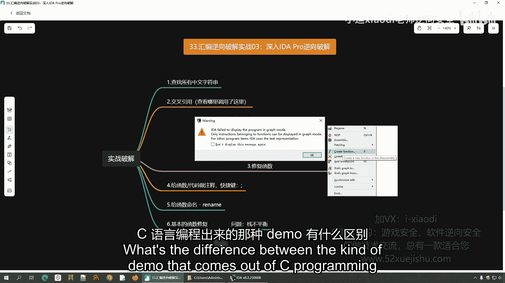
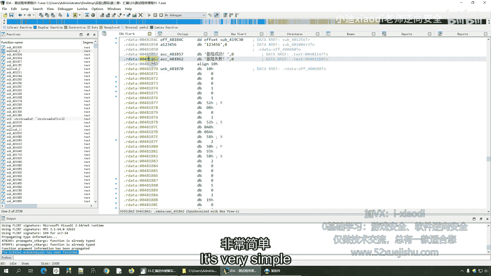
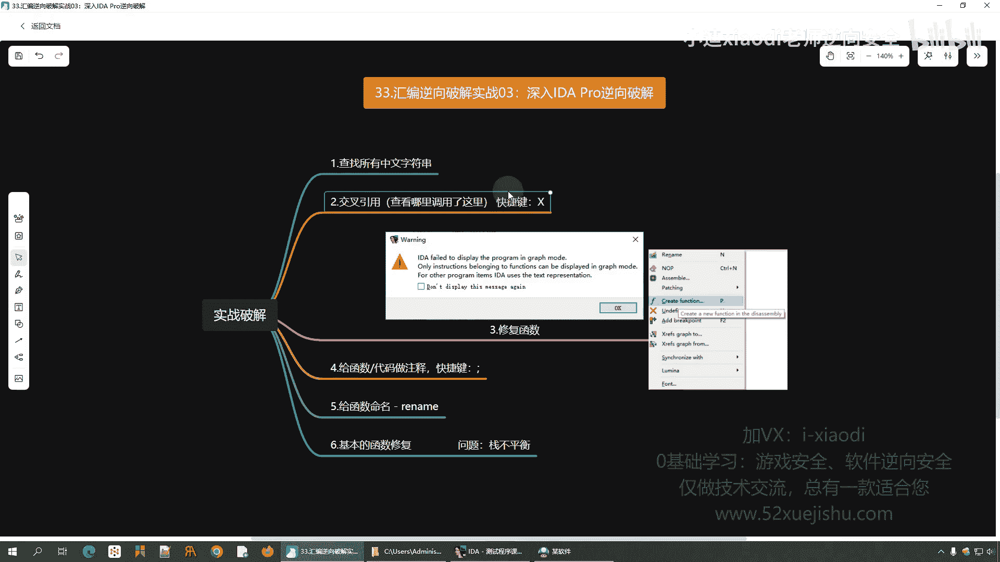
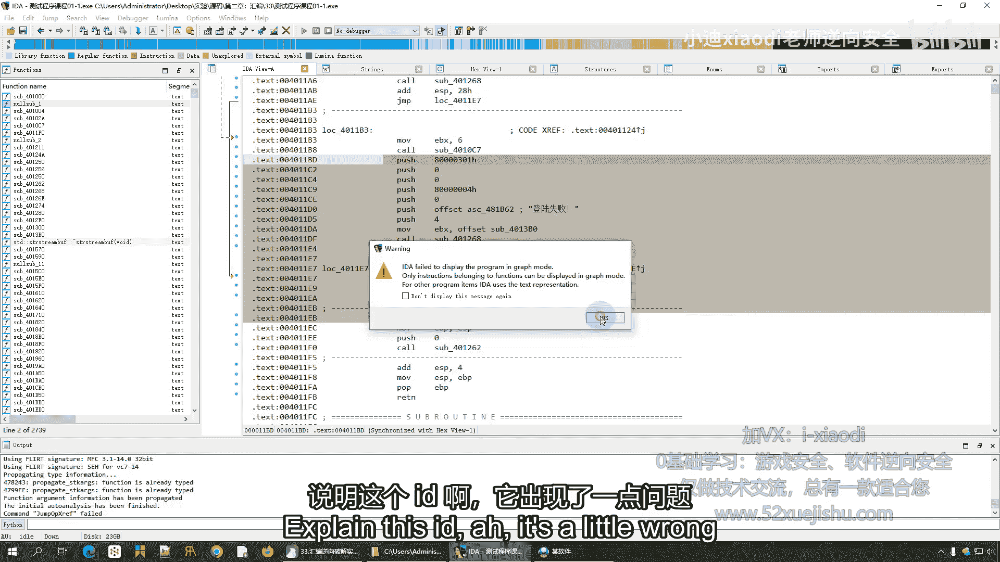
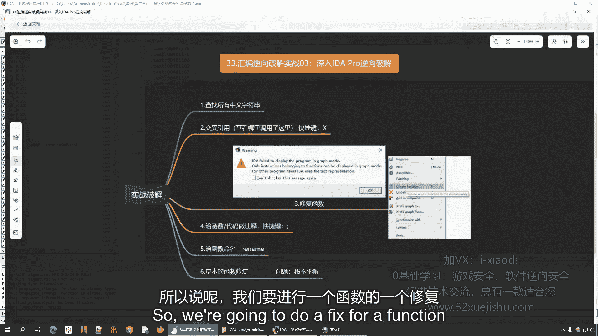
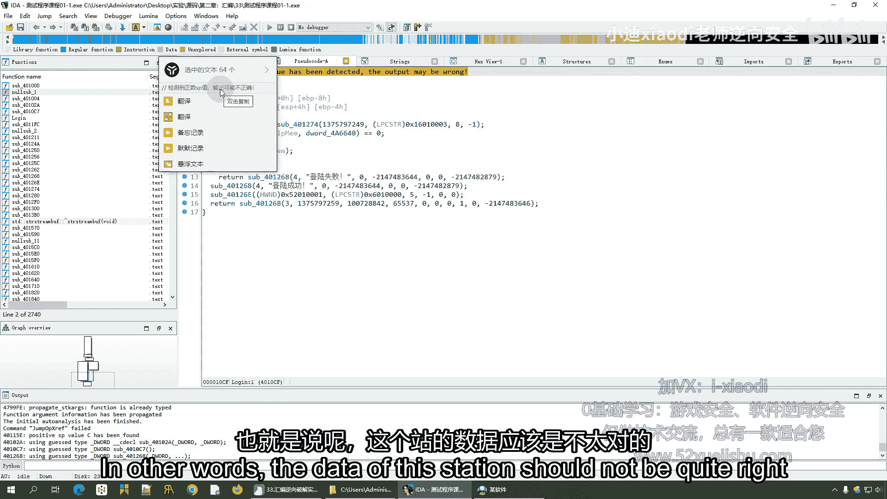
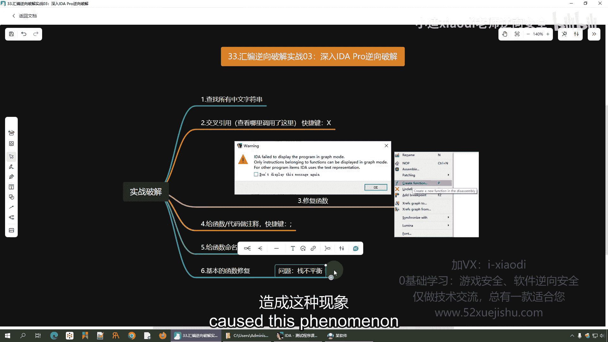
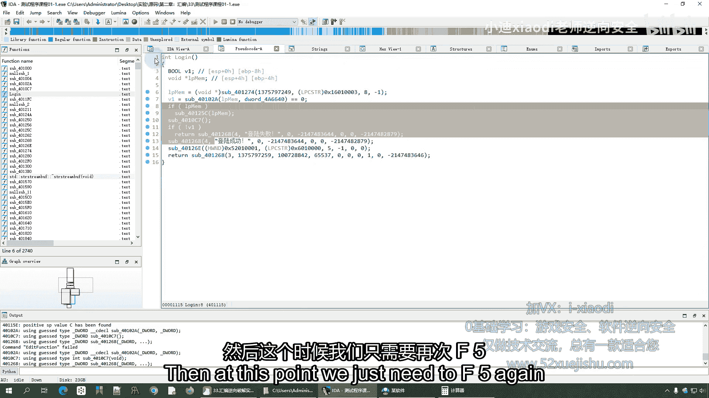
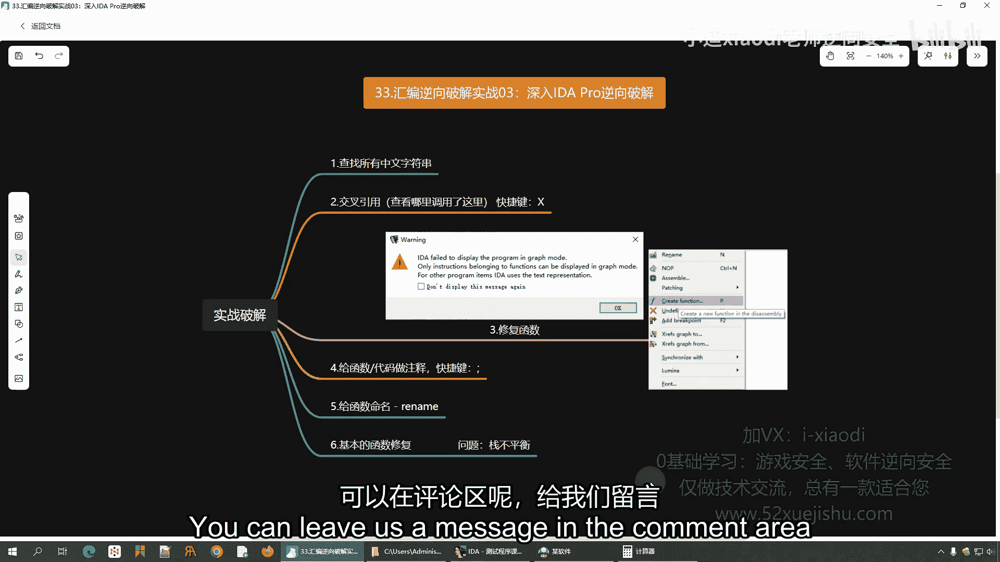

🔧 IDA Pro软件逆向破解指南：第33讲：深入IDA Pro逆向破解实战

大家好，我是小杰老师。今天是我们第三十三讲，主题是“汇编逆向破解实战03：深入IDA Pro逆向破解”。本节课中，我们将使用之前准备好的实验程序，在IDA Pro中实际动手操作，体验真正的逆向分析流程。通过这次实战，大家可以看到这种分析与我们之前那些普通的小课件、用C语言编写的demo到底有什么区别。

首先，我们需要查找程序中的所有中文字符串。操作方式是直接把目标程序拖进IDA Pro窗口。拖进去之后，直接点击“OK”按钮，使用默认配置即可。稍等片刻，等待它完成扫描。扫描完成后，输出（Output）窗口会给出提示，说明初步分析已经完成。

接下来，我们按下Shift+F12快捷键，就可以查找程序中的字符串。此时，我们能看到“登录成功”和“登录失败”这两个字符串。这两个字符串肯定与登录功能有关系，因为当我们点击登录时，如果验证失败，程序就会提示“登录失败”；如果验证成功，则可能提示“登录成功”。因此，我们可以选择“登录成功”或“登录失败”作为切入点。

现在，搜索结果显示的是一个字符串，字符串的旁边是它的长度，再旁边是对应的内存地址。我们双击字符串可以切换过去。切换过来之后，我们要思考的问题是：如何从字符串找到相关线索？方法很简单，就是找到使用这个字符串的代码。之所以这样找，是因为当我们点击登录时，会有一段代码逻辑在执行，它是一行一行执行的。如果验证失败，就会执行“登录失败”的分支；如果验证成功，就会执行“登录成功”的分支。总之，一定会有一段代码在执行。所以，我们要根据这个提示，去看这段代码到底在哪里执行。代码和字符串之间是相互依赖的，因为代码需要读取字符串的内容，它们显然是关联在一起的。

那么，如何找到这种关联呢？非常简单，有一个快捷键，就是交叉引用的快捷键——X。我们只需要在字符串所在的位置按一下X键。有的同学可能会注意到，列表中显示了两个相同的地址“4011D0”，实际上这两个是一样的，只是有时IDA会以“XREFS data XREF”的形式显示，点击任何一个都能跳转过去。我个人比较喜欢直接按快捷键X，这时会弹出一个清晰的引用列表，点击“OK”即可跳转到目标位置。跳转过去之后，一般我们会按一下空格键，切换成图形模式，以便观察跳转逻辑。

不过，这时你可能会看到一个错误提示。我们翻译一下，它说的是：“IDA无法在图形模式下显示程序，只有属于函数的指令，才能以图形方式显示。对于其他程序，IDA使用文本显示。”这说明一个非常关键的问题：IDA并没有把这边的代码识别成函数。因此，我们需要进行函数修复。怎么修复呢？很简单，先找到这段代码的函数头部位置。函数头大家应该都知道，就是“push ebp; mov ebp, esp”这样的开头。在函数头的地址上点击鼠标右键，选择“Create Function”，也就是创建一个函数。创建完成之后，再按一下空格键，这时就能看到图形化的跳转逻辑了。可以看到，左边是“登录成功”分支，右边是“登录失败”分支。我们只需要让条件跳转无条件跳转到特定地址，或者根据需求修改跳转条件即可。这个跳转就是程序中的一个关键跳转。

我们可以为这个关键跳转做注释，方便以后分析。操作非常简单：按一下分号键（;），就可以添加注释。例如，我们在关键跳转处按下分号键，输入“关键跳转”，然后点击“OK”。这时，图形中就会出现“关键跳转”这个注释。等下次再分析程序时，一眼就能看出这是一个关键位置，只需要重点关注这里就可以了。

接下来是给函数命名。我们向上翻看，可以发现这个函数非常重要，它是登录逻辑的判断函数。在函数名上点击鼠标右键，选择“Rename”，或者直接在键盘上按N键，效果是一样的。我们可以给它起一个有意义的英文名称，比如“login”。点击“OK”之后，这个函数就被命名为“login”了，也就是登录函数。

下面要处理基本的函数修复。现在我们看到的图形界面已经恢复正常，说明函数创建成功了。但最下方会提示“SP analysis”存在异常。这个问题主要影响我们使用F5快捷键查看C伪代码的功能。此时，我们按下F5，会看到一些错误弹窗。先不用管它们，点击“OK”之后，还会出现一个弹窗，提示“检测到正数SP值，输出可能不正确”。这句话的意思是，当前栈指针（SP）的数值很可能不正确，而这个不正确的值会直接影响伪代码的生成。

造成这种现象的根本原因是什么呢？就是栈不平衡的问题。也就是说，在这个程序的代码区域中，存在栈不平衡的情况。那么，如何观察栈不平衡呢？其实很简单。点击菜单栏的“Options”，选择“General”（通用设置），然后勾选“Stack pointer”选项，点击“OK”。这时，在反汇编代码中，每条指令前面会出现一些数字，这些数字代表栈指针的偏移量。我们可以观察到，这里有“0”，这里有“4”，这里有“C”。其中“C”出现在程序中的大多数场景。但是，在某个位置会突然出现“-0”（负零），这个位置很可能出错了。

我们仔细查看出错位置附近的代码。这里一共有7个push指令，每个push占用4字节，所以总共占用28字节。换算成十六进制就是：

`7 × 4 = 28 = 0x1C`

因此，这里的栈偏移值应该是1C，但IDA却计算成了0x34，这显然出错了。此时，我们可以在这个指令上点击鼠标右键，选择“Assemble”（汇编修改），把数值改成1C。修改完成后，值就正确了。同样的道理，在另一个位置也会发现计算错误，我们也需要把0x34改成1C。修改完成之后，按一下空格键，切换到图形模式，然后滚动到最上方。

刚才我们已经建立了一个函数。现在，我们需要把这个函数删除掉，再重新创建。怎么删除函数呢？非常简单：找到这个函数，点击鼠标右键，选择“Delete”。这样函数就消失了。然后，我们重新创建函数：鼠标右键，选择“Create Function”，点击“OK”。创建完成后，再按一下空格键，仔细观察栈指针的情况。你会发现，之前出现的负数情况已经消失了。主要就是因为刚才那个负数偏移影响了栈指针。修复之后，再次按下F5，这时就不会出现错误提示了，伪代码也能正常生成了。

以上就是本节课的全部内容。如果大家觉得学到了东西，可以在评论区给我们留言。如果想加入学习，欢迎联系小迪老师，我们下节课再见。

本节课中，我们一起学习了使用IDA Pro进行逆向破解的完整流程：从打开程序、查找中文字符串，到使用交叉引用定位代码，再到修复函数、注释关键跳转、重命名函数，最后修复栈不平衡问题并成功生成伪代码。这些技巧是逆向分析中非常基础且实用的能力，希望大家能动手实践，进一步巩固所学内容。
