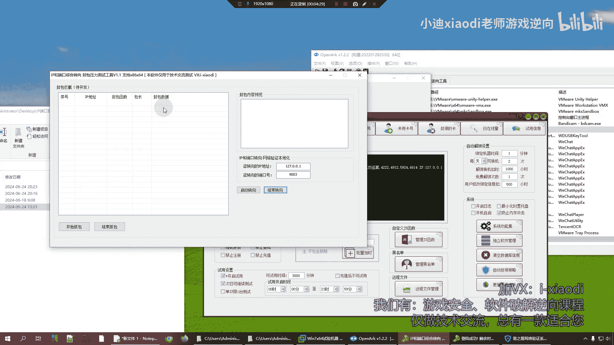

# 🛡️ 软件安全测试基础：01：课程目标与边界


在本节课中，我们将学习软件安全测试中与封包分析、端口映射相关的基础概念，并说明在授权环境下如何理解一个程序从“发送请求”到“观察响应”的过程。本文只讨论合法授权测试、自有程序测试和教学演示环境中的方法，不涉及破解卡密、绕过网络验证、未授权注入或对他人软件进行未授权分析。课程目标是把复杂概念讲直白，让初学者能够理解封包、端口、本地回环和测试记录之间的关系。


需要先明确一个边界：软件安全测试应当在书面授权、自有资产或公开靶场中进行。任何针对商业软件网络验证的绕过、山寨、破解和未授权端口转向，都不属于本教程讨论范围。以下是本课程的安全边界说明。


- 测试对象必须是自有程序、开源程序或明确授权的目标。

- 测试过程应记录授权范围、测试时间和测试目的。

- 不公开传播他人软件的卡密数据、账号数据和私有协议细节。

- 发现真实漏洞时应通过正规渠道报告，而不是用于绕过授权。


> 安全测试的核心不是“能不能绕过”，而是“在授权范围内能否证明风险存在，并给出修复建议”。


上一节我们明确了课程边界，本节中我们来看看封包分析的基本概念。理解这些概念以后，后续学习端口映射和测试记录时就不会把“网络请求”和“软件授权”混为一谈。


# 📦 软件安全测试基础：02：封包分析的基本概念


封包可以理解为程序在网络上发送的一段数据。它通常包含目标地址、目标端口、协议类型、数据长度和实际载荷。初学者容易把“封包总长度”和“有效数据长度”混在一起，实际上二者不一定相同。可以用下面的关系来描述。


```text
封包总长度 = 协议头长度 + 有效载荷长度 + 可能的填充数据
有效载荷 ≠ 封包总长度
```


在授权测试中，观察封包的目的通常是确认程序访问了哪个服务、发送了什么字段、返回了什么状态。以下是封包分析中常见的几个观察点。


- 目标地址：程序连接的是哪个服务器。

- 目标端口：程序使用的是哪个网络服务端口。

- 请求内容：程序发送了哪些业务字段。

- 响应内容：服务器返回了成功、失败还是其他状态。


- 数据长度：总长度和有效载荷分别是什么。


> 在测试记录中，建议同时记录“看到的数据”和“推断的含义”，避免把推断当成事实。


上一节我们介绍了封包的基本结构，本节中我们来看看程序架构与测试工具匹配的问题。原文演示中提到 64 位程序和 32 位程序，这里只从概念上说明架构匹配的重要性，不展开任何未授权注入操作。


# 🧩 软件安全测试基础：03：程序架构与工具匹配


测试工具和被测试程序需要架构匹配，这是很多初学者容易忽略的问题。简单说，32 位程序、64 位程序以及不同运行环境，对工具的要求可能不同。可以用下面的伪代码表达一个合规检查思路。


```text
if 测试目标已授权 and 工具架构 == 目标程序架构:
    进入授权测试流程
else:
    停止测试并检查授权与架构
```


以下是架构匹配时需要确认的几个基础点。


- 确认目标程序是 32 位还是 64 位。

- 确认测试工具是否支持该架构。

- 确认测试环境是隔离环境还是生产环境。

- 确认测试行为是否在授权范围内。


> 工具只是辅助，授权和边界才是测试能否开始的前提。


上一节我们说明了架构匹配，本节中我们来看看“端口映射”和“本地回环”的概念。这里只讲自有测试环境中的端口转发原理，不涉及对他人网络验证的绕过。


# 🔁 软件安全测试基础：04：端口映射与本地回环概念


端口可以理解为网络服务的“门牌号”，IP 地址可以理解为“楼栋地址”。本地回环地址通常是 `127.0.0.1`，它表示本机访问本机。端口映射可以抽象成下面的关系。


```text
映射关系：目标IP:目标端口 -> 本地IP:本地端口
示例：127.0.0.1:9003 -> 127.0.0.1:8000
```


在合法测试中，端口映射常用于把测试流量引导到自有模拟服务，以便观察程序行为。以下是自有测试环境中可以理解的几个概念。


- 本地回环：本机内部通信，不经过外部网络。

- 模拟服务：自己编写的假服务，用来返回测试数据。

- 端口转发：把一个端口的流量转到另一个端口。

- 流量记录：保存请求和响应，便于复现问题。

- 隔离环境：避免测试行为影响真实业务。


> 端口映射本身是中性技术，关键在于使用场景是否授权、目标是否自有、数据是否合法。


上一节我们介绍了端口映射概念，本节中我们来看看测试记录和复现方法。记录的目的不是传播破解结果，而是让问题可以被验证、被复现、被修复。


# 📝 软件安全测试基础：05：测试记录与复现方法


测试记录应尽量结构化，避免只写“这里有问题”。一个好的记录至少包括环境、步骤、观察结果和推断结论。以下是一个简化的记录模板。


```text
测试环境：自有测试程序 / 隔离虚拟机
测试目标：观察登录请求字段
测试步骤：启动模拟服务 -> 发送测试请求 -> 记录响应
观察结果：请求包含账号字段，响应返回状态码
结论：需确认状态码是否泄露过多信息
```


以下是记录时建议包含的内容。


- 测试时间和测试人员。


- 测试目标和授权范围。

- 工具版本和程序架构。

- 请求数据与响应数据。

- 复现步骤和预期结果。

- 修复建议和风险等级。


> 复现记录应尽量脱敏，不保存真实卡密、真实账号和他人隐私数据。


上一节我们完成了测试记录方法的介绍，本节中我们来做一个小结。通过前面的内容，我们已经把封包、端口、本地回环、架构匹配和记录方法串起来了。




# ✅ 软件安全测试基础：06：课程总结


本节课中我们一起学习了授权环境下软件安全测试的基础概念，包括封包结构、有效载荷与总长度的区别、32 位与 64 位架构匹配、端口映射与本地回环，以及测试记录和复现方法。需要再次强调，本教程只面向合法授权测试和自有程序测试，不提供破解卡密、绕过网络验证、未授权注入或山寨网络验证的操作方法。掌握这些基础概念以后，初学者可以更清楚地理解网络请求是如何产生的，也能更规范地记录测试过程。
