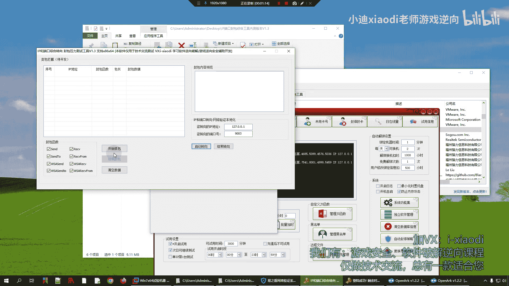
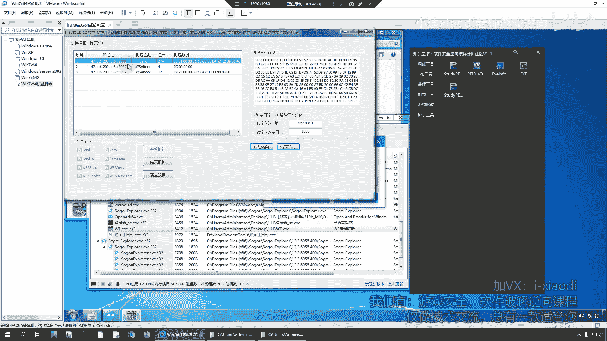
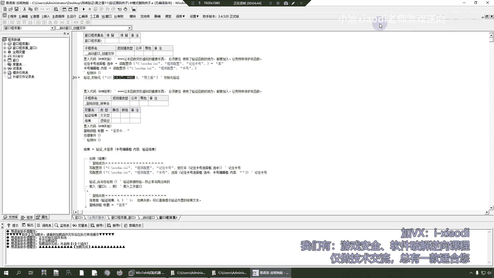
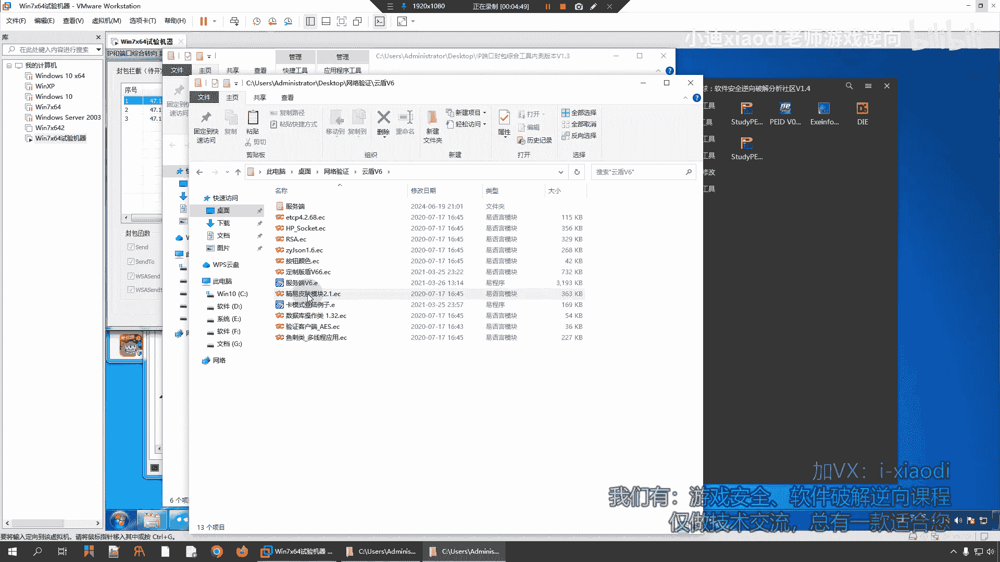
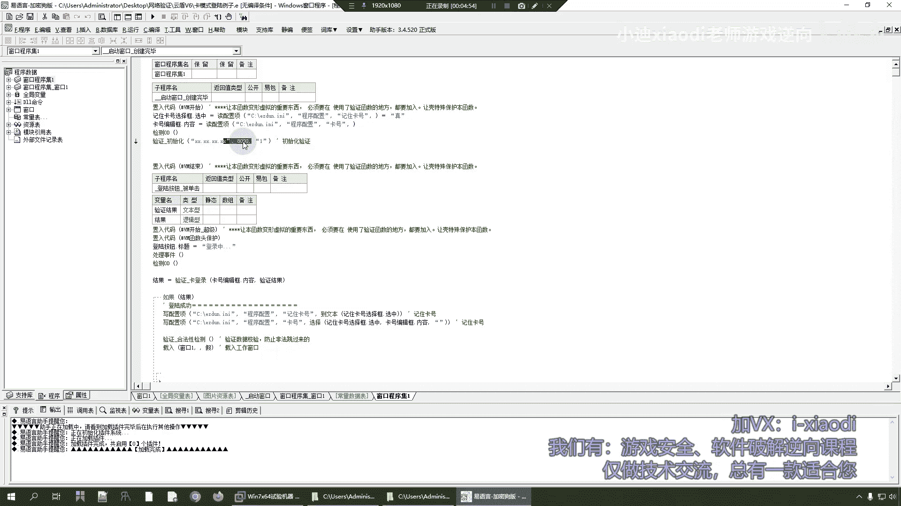
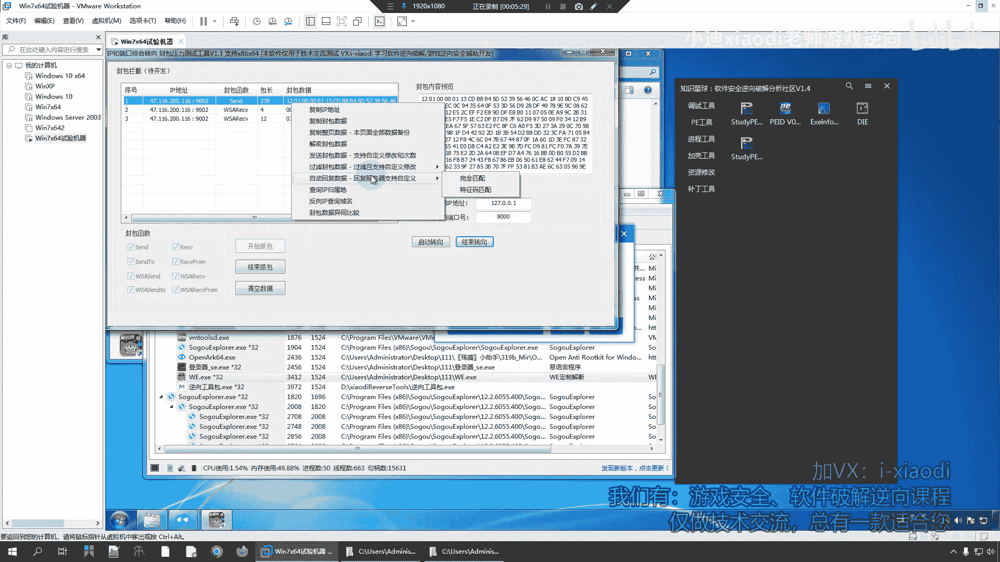

# 逆向破解与网络安全实战：第1章：IP和端口综合转向封包工具V1.3演示

## 概述

在本节课中，我们将学习如何使用由逆向破解社区自主开发的“IP和端口综合转向封包工具”内测版1.3。这个工具主要用于软件破解、网络验证转本地、游戏安全分析以及CTF比赛等场景。我们会通过实际演示，逐步了解它的转本地功能、抓包功能、封包数据查看方式，以及如何通过端口号判断对方使用的网络验证类型。整个教程面向初学者，所有内容都用大白话解释，保证大家能看懂。

## 工具简介

首先，我们要明白这个工具是干什么的。简单来说，它可以把程序连接的网络请求拦截下来，让你看到程序到底在向哪个IP地址、哪个端口发送数据，同时也能把数据包内容展示出来。更厉害的是，它还能把原本连接别人服务器的程序，改成连接你本地的服务器，从而实现“卡密本地验证”，也就是所谓的“转本地”。这个功能在做软件破解和逆向分析时非常有用。

我们来看一下工具的主界面。它提供了几个核心操作按钮：注入DLL、启动本地服务、开始抓包、结束抓包、清空数据。此外，最新版本还支持自行勾选相应的封包函数，方便我们更精准地分析。后面我们会逐一演示这些功能。

## 转本地功能演示

上一节我们介绍了工具的整体功能，本节中我们来看看最核心的“转本地”功能。所谓转本地，就是让一些原本连接别人服务器的辅助程序，变成连接我们自己搭建的服务器。这样我们就能自己开卡、自己玩，不需要依赖别人的验证服务器了。

举个例子，假设有一个程序，它的登录功能需要连接远程服务器。正常情况下，我们随便输入一个卡号，然后点击登录，程序就会尝试连接别人的服务器。如果连接不上，程序就会卡死，就像下面演示的那样：窗口无响应，一直停留在一个状态。

出现这种情况之后，该怎么办呢？方法非常简单。我们重新运行一下这个程序，等它正常运行起来之后，使用我们的工具，把两个关键的DLL文件注入到这个程序里面去。具体操作是这样的：在工具中，我们找到目标程序，这里叫“一直盾转本地”相关的程序，然后点击“注入DLL”。注意，如果是32位程序，就要选择x86模式。这里提示一下：x86对应的就是32位程序。点击注入后，工具会提示注入成功。

然后，我们还需要配置本地的服务器端口。比如我们本地架设的服务器端口是9003，那就在工具里输入9003，然后点击“启动服务”。完成这一步之后，我们再回到程序里，点击登录按钮。你会看到，这次登录成功了！这就是转本地的完整流程。

为了让大家更清楚，我们把步骤整理一下。以下是转本地功能的核心步骤：

1. 运行目标程序，让它处于待登录状态。
2. 在工具中选择对应位数的DLL注入（32位选x86，64位选x64）。
3. 输入本地服务器的端口号。
4. 点击“启动服务”，使本地服务器开始监听。
5. 在目标程序中点击登录即可。

## 抓包功能演示 - 64位程序

转本地功能我们已经学会了。接下来，我们再来测试一下抓包功能。抓包的意思是，把程序发送和接收的网络数据包都截获下来，并显示在工具界面上。通过抓包，我们能看到程序连接了哪个IP、哪个端口，以及数据包的具体内容。

刚刚我们测试的是32位程序，这里就不再重复了。我们换个64位的程序来试试看，比如“剪映专业版”。这个程序是64位的，运行起来之后，我们的抓包工具要怎样操作呢？

首先要刷新进程列表，找到剪映相关的进程。剪映的进程有两个，二选一，反正有一个是负责通信的。我们先选一个，点击“开始抓包”，然后去剪映里点击登录。如果界面上没有反应，说明我们选错了进程，那就应该是另一个进程。于是我们换另一个进程，点击“注入DLL”，选择x64模式。注入成功之后，再点击“开始抓包”。这时候，我们再去点击登录按钮，你就能看到封包内容出现在工具列表里了。

这个封包内容不仅包含了IP地址，还包含了端口号。在演示中我们看到端口号是443，这是非常常见的一个端口，因为很多网络程序的客户端都会使用443端口来进行HTTPS通信。除了IP和端口，我们还能看到封包函数和包长。

这里有一个细节值得一提：本次更新之后，工具会把包长后面多出来的那些“00”字节去掉，所以显示的包长是比较精准的。我们来看一下实际效果：每次操作都会产生新的封包，当我们关闭程序或者进行其他操作时，又会看到新的封包出现。这说明抓包工作得非常正常。

## 封包数据解析

通过刚才的演示，我们看到了抓包界面上的几项关键数据。为了方便理解，我们用一个表格来总结这些数据项：

| 数据项 | 含义 |
| --- | --- |
| IP地址 | 程序连接的远程服务器IP |
| 端口号 | 程序连接的远程服务器端口 |
| 封包函数 | 发起网络请求的API函数 |
| 包长 | 去掉填充字节后的实际数据包长度 |
| 封包数据 | 具体的十六进制数据内容，可复制 |

封包数据是可以直接复制的。如果你需要分析协议，就可以把这些数据复制出来，再用别的工具去解析。这个功能对于逆向工程师来说非常实用。

## 测试辅助程序并识别网络验证

封包数据的含义我们清楚了。下面我们再换一个辅助程序来测试一下，看看这个工具能否正常拦截封包，同时也演示一下如何通过端口号来判断对方使用了什么网络验证。

我们找一个辅助程序，运行起来。这个程序看起来是一个VIP登录界面。不过有个辅助程序加了一个SE的壳，运行不起来。换一个程序试试，发现不能在虚拟机里运行。再换一个“猴子”程序，但那个可能不是联网的。我们继续换，找到一个联网的程序。它的壳信息显示有VIP字样，不是VMP，应该是某网络验证的壳。好，就拿它来测试。

我们先运行这个程序，然后选择对应的进程，点击“注入DLL”，注入成功之后，点击“开始抓包”。然后随便输入一个卡号，点击登录，程序提示“卡密不存在”。这时候，我们就能在工具里看到它连接的网络端口了，显示是9002。

这个9002端口非常眼熟。大家回忆一下，之前我们提到过“异盾”或者“云盾”这类网络验证。让我来找一下相关信息。大家会发现，这个9002端口非常像“异盾”或者“云盾”的端口。所以它有可能就是异盾或云盾这类网络验证改的。我们再看一下云盾的卡模式登录，云盾的端口是多少？云盾是8000。所以，这个程序应该是改了一个异盾，而不是云盾。因此通过端口号，我们也能够大概猜测出对方使用的是哪一种网络验证。

在这个辅助程序的测试中，我们可以看到它的发包和收包情况都非常正常。工具完整地捕获到了数据包，并且没有出现漏包或乱码问题。

最后，我们再来测试一下“结束抓包”功能。当我们点击“结束抓包”时，程序就停止抓包了。然后点击“清空数据”，之前显示的封包内容就会被清空。再点击“开始抓包”，又会重新开始抓包。整个操作非常简单，一键切换。

## 总结

本节课中，我们一起学习了这款IP和端口综合转向封包工具V1.3的核心用法。主要内容可以归纳为以下几点：

1. 使用注入DLL功能实现将远程验证转为本地验证。
2. 使用抓包功能查看程序的IP地址、端口号、封包函数、包长和封包数据。
3. 通过端口号初步判断目标程序所用的网络验证类型。
4. 灵活使用开始抓包、结束抓包和清空数据按钮来管理分析过程。

这个工具目前还是内测版，之后会持续更新更多功能。我们会一步一步来，把剩余的内容都补充完整。感谢大家观看本节课，我们下节课再见。
