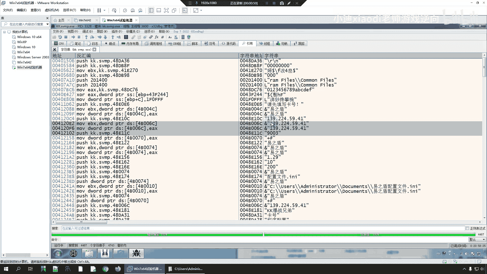
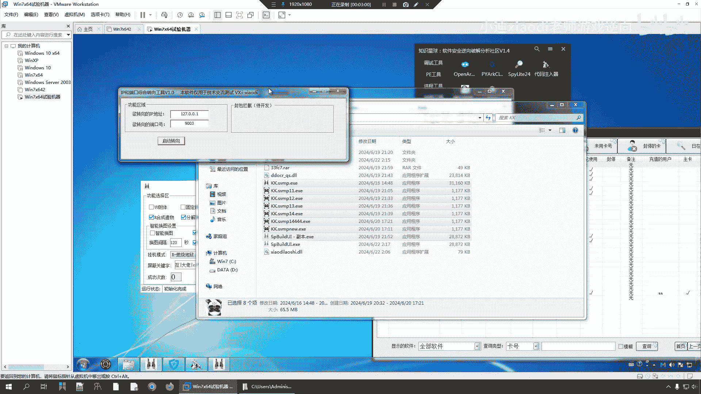

## IP和端口综合转向工具演示：01：课程概述与目标 🧭

在本节课中我们将要学习一款“IP和端口综合转向工具”的演示流程，并把它整理成适合初学者理解的教程。原文视频先回顾了以前用笨方法处理软件壳和网络验证的过程，然后演示了用综合转向工具把目标连接转到本地地址的操作，最后观察了登录提示和到期时间的变化。为了让内容更清楚，本教程会按照背景、工具概念、注入流程、登录测试、适用范围和总结几个部分展开。需要先说明的是，本教程仅用于合法授权的软件测试、教学和安全研究，请勿用于未经授权的软件破解或绕过授权。

> 本教程仅用于合法授权的软件测试、教学与安全研究，请勿用于未经授权的软件破解或绕过授权。

上一节是课程概述，接下来我们进入原文演示的背景部分。理解背景有助于初学者明白为什么原文要先讲“笨方法”，再讲“综合转向工具”的便捷之处。

## IP和端口综合转向工具演示：02：演示背景与问题 🛡️

上一节我们说明了课程目标，本节中我们来看看原文演示的背景和遇到的问题。原文视频一开始回顾了之前用笨方法去破解软件壳的过程，这个壳带有一个“盾”，原文称其为“异支盾”，它的默认端口是 `9003`。但是，这个盾连接的目标IP是别人的IP，同时软件提示卡号不存在。原文还特别说明，当前卡号确实不存在，这一点是后续演示要观察的现象。

理解这个背景后，我们再看以前的做法。之前使用的笨方法是：先附加到目标进程，然后在进程里查找IP地址，查看当前模块字符串，寻找类似 `139.` 开头的地址，并确认端口是 `9003`。为了完成这个转向，原文提到需要花费大量精力修改很多代码。这里可以用一个简单的流程表示：

```
目标进程 -> 查找当前模块字符串 -> 定位远端IP与9003端口 -> 手工修改代码
```

上一节我们了解了旧方法的繁琐，本节中我们来看看新工具要解决的核心问题。原文不想继续采用费劲改代码的方式，于是引出了“小迪老师”的“IP和端口综合转向工具”。这个工具的目标是把原本连接别人服务器的请求，转向到本地地址，从而方便测试和观察。



## IP和端口综合转向工具演示：03：工具与核心转向概念 🧰

上一节我们回顾了旧方法和新工具的出现原因，本节中我们来看看这个工具的核心概念。原文演示时，软件仍然连接着别人的服务器，界面提示卡号不存在，随后还会提示“卡不存在”。原文也提到别人的服务器响应比较慢，这也是演示过程中可以观察到的现象。用大白话解释，综合转向工具做的事情就是：先找到目标程序，再让目标程序把原本发往远端服务器的连接，改为发往本地指定的IP和端口。

这个核心概念可以用下面两个公式描述。第一个公式表示原始连接，第二个公式表示转向后的连接：

```
原始连接 = 远端IP:9003
转向连接 = 127.0.0.1:9003
```

上一节我们理解了转向的目标，本节中我们来看看具体操作流程。原文使用“代码注入器”来完成注入，然后通过工具界面启动转向。下面列出原文演示中的操作步骤，供初学者按顺序理解。

以下是原文演示中的操作流程：

1. 打开代码注入器。

2. 在注入器中找到目标进程。

3. 点击注入DLL，执行注入操作。

4. 打开工具目录下的文件，工具界面出现。

5. 在工具中填写端口 `9003`。

6. IP地址使用 `127.0.0.1`，这个地址不需要改动。

7. 点击“启动转向”，工具提示“开启成功，等待测试”。

上一节我们完成了注入和启动转向，本节中我们来看看登录测试的结果。原文在启动转向后去登录软件，第一次提示“卡号已到期”。随后原文选择开一个“老板号”，也就是年卡，并生成卡号、取消原有卡号列表，再复制卡号进行登录。登录后观察到到期时间显示为 `2025年`，原文用“又过了一年”来描述这个变化。这个观察过程可以用下面的公式表示：

```
登录提示 = 卡号已到期
重新生成卡号后到期时间 = 2025年
```

上一节我们观察了登录提示和到期时间，本节中我们来看看这个工具的适用范围和后续计划。原文认为，这个“IP和端口综合转向工具”对于一些简单的网络验证比较好用，尤其是那些处理逻辑没有那么多、不去校验版本号等额外信息的网络验证。它的好处是不需要再费劲地改这边、改那边，直接用工具完成转向即可。原文还提到，想要获取工具可以联系作者，本次演示的是 `1.0版本`，后期会再加入封包拦截相关功能，并慢慢完善。

## IP和端口综合转向工具演示：04：适用范围与后续计划 🧠

上一节我们完成了登录测试的观察，本节中我们来看看原文对工具适用范围的说明。原文强调，这个工具更适合简单的网络验证场景，也就是不校验版本号、不处理复杂附加信息的场景。对于这类场景，工具可以减少手工修改代码的工作量，把原本分散的修改步骤集中到一个转向工具里完成。原文还说明，本次演示的是 `1.0版本`，后续版本计划加入封包拦截功能，并逐步完善工具能力。

上一节我们说明了适用范围，本节中我们来看看原文的收尾信息。原文提到，想要获取工具可以联系作者；本次演示到此结束，后续会继续完善工具，并在下一期继续演示。到这里，原文演示的主要内容已经整理完毕，下面进入课程总结。



## IP和端口综合转向工具演示：05：课程总结 📌

本节课中我们一起学习了“IP和端口综合转向工具”的演示背景、核心概念、注入流程、登录测试和适用范围。原文先回顾了以前用笨方法附加进程、查找当前模块字符串、定位 `139.` 开头地址和 `9003` 端口、再修改大量代码的过程；随后演示了用代码注入器注入工具，把目标连接转向 `127.0.0.1:9003`，并观察卡号不存在、卡号已到期、生成年卡后显示 `2025年` 到期时间等结果。最后原文说明该工具适合简单网络验证场景，本次为 `1.0版本`，后续计划加入封包拦截并继续完善。通过本教程，初学者可以理解原文每一句所表达的含义，也能按小节梳理整个演示流程。

