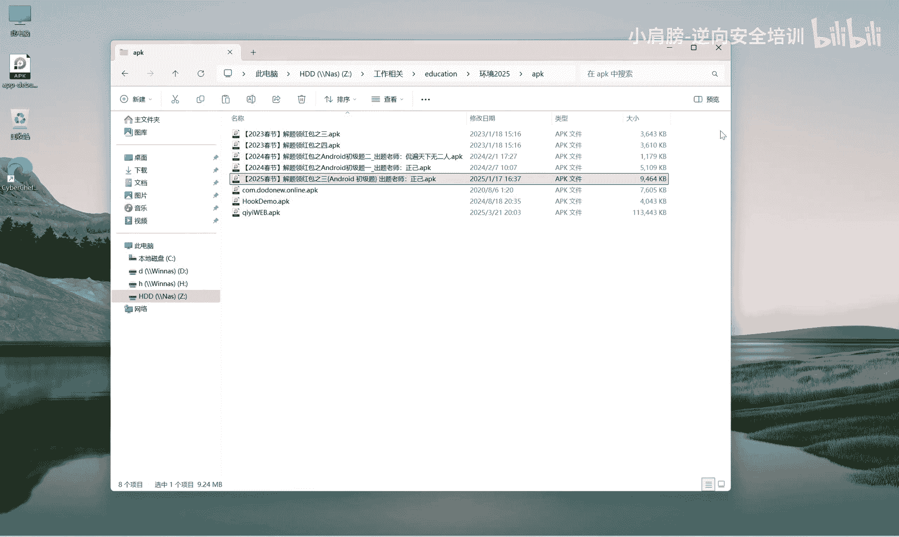

# 📱 Kotlin App逆向：01：课程概述

在本节课中我们将要学习Kotlin开发的App在逆向分析时与Java开发的App到底有什么不同。原文一开始就提到，以前总有学员说Kotlin开发的App跟Java开发的App不一样，所以这节课我们就来实际看一看这种“不一样”到底体现在哪里，并且先自己动手开发一个Kotlin App作为观察对象。

对于初学者来说，看到Kotlin和Java这两个名字，可能会先入为主地觉得二者在逆向层面会完全不同。但原文的核心结论很直接：Kotlin开发的App最终在逆向查看时，看到的仍然是Java代码形态，因此逆向分析方法基本一致。

下面用一段简化的流程描述原文想表达的核心概念。

```text
Kotlin源码 -> 原文说法中的Java代码 -> 编译产物 -> 反编译后看到Java代码形态
```

> 原文观点：Kotlin开发的App在反编译、逆向查看时，最终看到的仍然是Java代码形态。


# 🧪 Kotlin App逆向：02：创建一个Kotlin项目

上一节我们介绍了本节课要观察的核心问题，本节中我们来看看如何先自己创建一个Kotlin开发的App项目。原文的做法是新建一个项目，在创建项目的地方选择Kotlin，然后保持默认的KTS配置，最后点击Finish完成创建。

等待项目同步或构建完毕之后，这个项目就是用Kotlin开发出来的App。原文强调，从代码层面看，Kotlin开发的App肯定和Java开发的App不一样，但它实际上是把Java代码给封装了一层，所以不能只看表面语言名称，还要看编译和反编译后的结果。

下面把原文提到的创建项目关键步骤列出来，方便初学者对照操作。

1. 新建一个App项目。

2. 在项目创建界面选择Kotlin。

3. 保持默认的KTS配置。

4. 点击Finish完成创建。

5. 等待项目同步或构建完毕。

完成创建之后，原文继续说明：直接编译一个App，然后对它做反编译。接着打开反编译出来的源代码，查看主界面代码。对于初学者来说，这一步的目的不是马上分析复杂逻辑，而是先建立“Kotlin项目反编译后长什么样”的直观印象。

# 🔍 Kotlin App逆向：03：反编译后观察主界面代码

上一节我们创建并编译了Kotlin项目，本节中我们来看看反编译之后主界面代码到底是什么样子。原文打开源代码查看主界面后指出，代码实际上跟Java一样，没有什么区别。

在加载so文件这件事上，原文说Java使用`System.loadLibrary`去加载`.so`，Kotlin也是这样。也就是说，虽然源码语言是Kotlin，但在逆向看到的代码里，关键调用方式仍然可以用Java的视角来理解。

下面用代码形式概括原文提到的关键调用。

```kotlin
System.loadLibrary("xxx")

setContentView(binding.root)

binding.simpleText.setText(stringRes)
```

原文还提到一个很重要的观点：Kotlin开发的App实际上是先转换成Java，然后再去进行编译的。所以去“立项”或做逆向观察的时候，看到的实际上还是Java代码。也正因为如此，逆向的分析方法是一样的。

具体到主界面代码，原文指出这里实际上是获取了binding，然后通过`setContentView`把布局文件和当前界面的Activity绑定起来。接着从binding里面去获取`simpleText`，也就是界面上的标签控件，再调用它的`setText`方法，往里面设置一个值，这个值就是字符串资源返回的一个字符串。


对于初学者来说，可以把binding理解成“界面控件的绑定对象”，把`setContentView`理解成“把布局挂到当前Activity上”，把`setText`理解成“给标签设置显示文字”。这样再看反编译代码时，就不会被Kotlin项目这个名字吓到。

# 📂 Kotlin App逆向：04：真实App案例观察

通过上一节的反编译观察，我们已经知道Kotlin项目反编译后仍然呈现Java代码形态，本节中我们来看看原文提到的几个真实App案例。原文说，之前逆向的几个App里面也有Kotlin开发的，这说明Kotlin开发在真实App中并不少见。

下面根据原文提到的例子做一个归纳，帮助初学者理解“Kotlin开发”在逆向中的表现。


1. 某个App中能看到Kotlin相关标识，主界面里面有`MyActivity.kt`，它是从KT文件过来的，KT后缀肯定就是Kotlin。

2. 但是在这个App的逆向结果里，看到的仍然是代码形态，并不是无法分析的另一种东西。

3. 原文还提到另一个App也是Kotlin开发的。

4. 原文又提到还有这个App，它还是Kotlin开发的。

这些例子想说明的事情很直接：即使源码文件是`.kt`后缀，逆向时看到的仍然是可分析的代码。原文在这里的结论是，Kotlin开发的App在逆向层面，实际上跟Java开发的App没有什么区别。

# 🧠 Kotlin App逆向：05：逆向分析方法为什么一样

前面几节我们分别看了项目创建、反编译结果和真实App案例，本节中我们来归纳一下为什么逆向分析方法一样。原文反复强调，Kotlin开发的App会把Java代码封装起来，并且在原文说法中会先转换成Java再编译，所以最终在逆向里看到的还是Java代码。

对初学者来说，这里最需要记住的不是复杂理论，而是一个简单判断：不要因为项目是Kotlin写的，就认为逆向方法要完全换一套。原文说逆向分析方法一样，意思就是仍然按照Java App的思路去看加载so、绑定布局、获取控件、设置文本这些常见动作。


下面用公式形式概括本节课的核心结论。

```text
Kotlin开发App的逆向分析 ≈ Java开发App的逆向分析
```



# ✅ Kotlin App逆向：06：课程总结

本节课中我们一起学习了Kotlin开发的App在逆向层面与Java开发的App没有本质区别。原文先让我们自己创建一个Kotlin项目，选择Kotlin并保持默认KTS配置，点击Finish完成创建；然后编译并反编译，打开源代码查看主界面；接着观察到代码实际上跟Java一样，`System.loadLibrary`加载`.so`的方式也一样。

原文还说明，Kotlin开发的App实际上是先转换成Java再编译，所以立项或逆向时看到的仍然是Java代码，逆向分析方法也一样。主界面中通过binding获取控件，使用`setContentView`绑定布局和Activity，再从binding中获取`simpleText`标签并调用`setText`设置字符串资源返回的值。最后通过多个真实App案例确认，即使主界面文件是`MyActivity.kt`这种KT后缀，逆向里面看到的仍然是可分析的代码。本节课就到这里。

