# 🎓 Python二进制安全黑客开发系列教学：第1讲：基础与数据结构

## 📋 课程概述

在本节课中，我们将学习Python编程的基础知识，包括基础数据类型、控制流、以及核心数据结构。本课程面向零基础初学者，我们的目标不仅仅是在几周内学会写Python代码，而是要写出能够直接投入生产环境的代码。这意味着我们的代码必须整洁、高效，并且具备防御性，同时还要易于维护。

对于学习方法，我们完全不需要花费几个月的时间去死记硬背语法，这种死记硬背的学习方法是极不推荐的。聪明人的学习方法应该是掌握核心的概念，然后建立系统思维，然后通过实战去解决具体的问题，这叫干中练、练中学。我们将会以开发自动化脚本、文件解析器、扫描器作为一条线索贯穿整个课程。这样不仅学到了基础，而且学到最后，这个项目也开发完成了，一举两得。

今天的内容分为四个板块。前两个板块是我们的学习内容，主要讲解基础知识和数据结构。第三个板块是给大家布置的一个任务或者说作业，这个作业我们都会有一个课后的答案讲解，以视频的形式呈现。另外，我通常还会给大家一些小提示，帮助大家在写代码或者自己做练习的时候，知道怎么写会更好，基本上每一节课都会有这样一个环节。

## 🖥️ 环境搭建

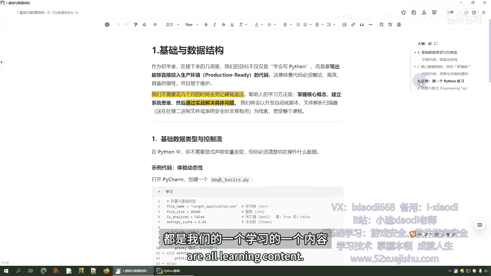

首先，环境我相信大家已经搭建好了。这个时候可以创建一个`day01`的文件夹，然后鼠标右键新建Python文件，直接写一个`day01`，回车确认。接下来可以点击自定义环境，在弹出窗口中点击添加本地解释器，然后选择你安装好的Python环境，点击确定就可以了。这个过程会创建一个虚拟环境，虚拟环境创建完成之后，我们就可以开始写代码了。

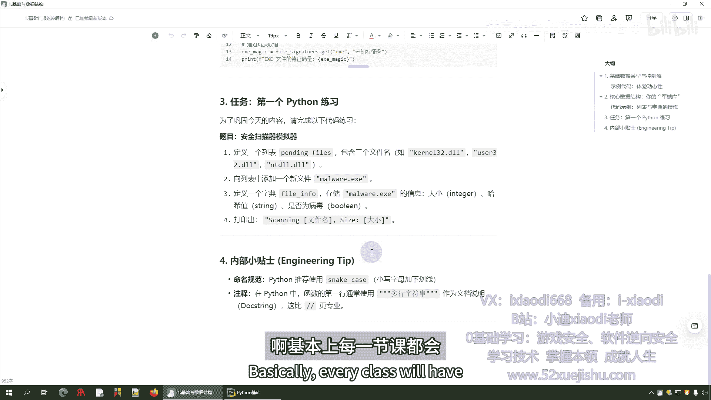

## 🔤 变量与基础数据类型

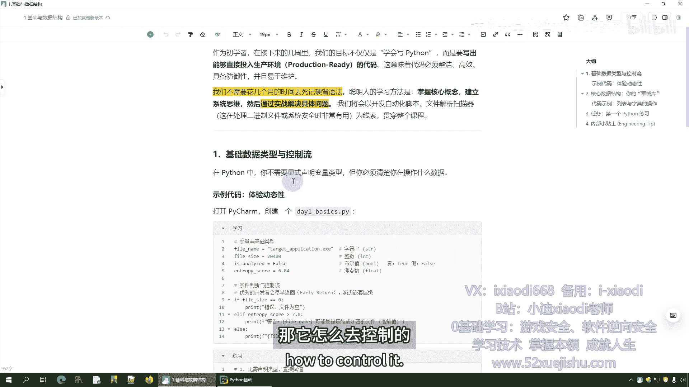

### ✍️ 变量的定义

在Python中表达一个数据其实非常简单。比如说我们要表达小明这个对象，小明是有名字的，他的名字等于什么呢？他的名字就等于"小明"。我们来看代码示例：

```python
name = "小明"
age = 18
score = 186.31
```

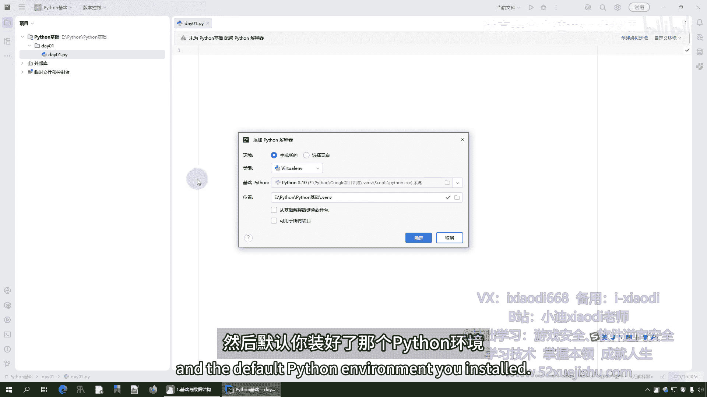

大家会发现，当我去写一个数据的时候，好像不需要标注它是什么数据类型。这就是Python简单的地方。如果你去学C语言或者C++，你会发现每一个数据类型前面都得加上它是什么类型的声明。但是Python会自动帮我们识别数据类型。

现在声明了三个变量，那怎么去输出打印呢？非常简单，使用`print`函数就可以了：

```python
print(age)
print(score)
print(name)
```

运行这段代码，输出结果为：

```
18
186.31
小明
```

可以看到，这些数据都被轻松打印出来了。Python真的是超级简单。

### 📚 常见的基础数据类型

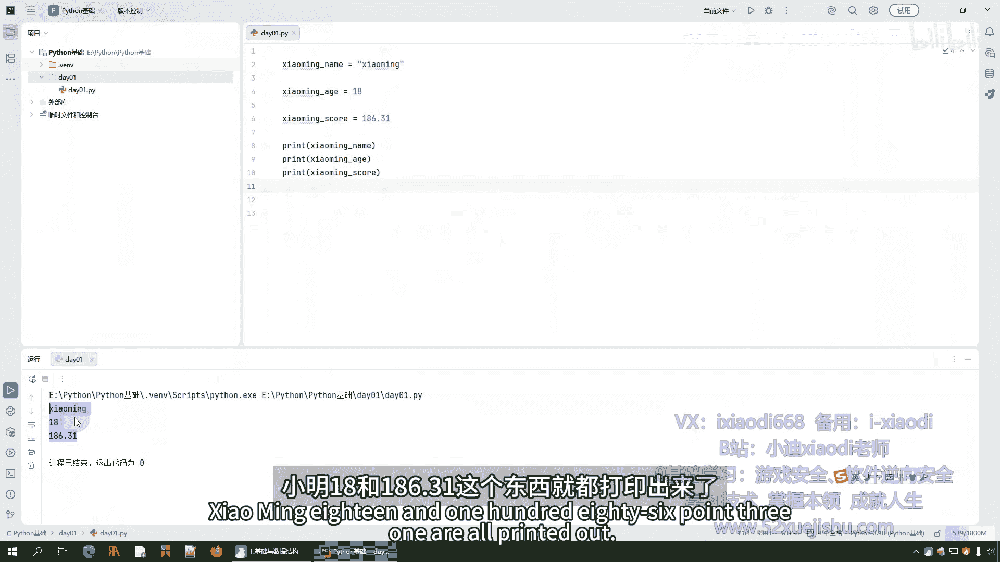

接下来我们把示例代码复制过来，做标准化的演示。在Python中声明变量的时候，完全不需要标注数据类型，Python会自动识别，这个特性叫动态类型。

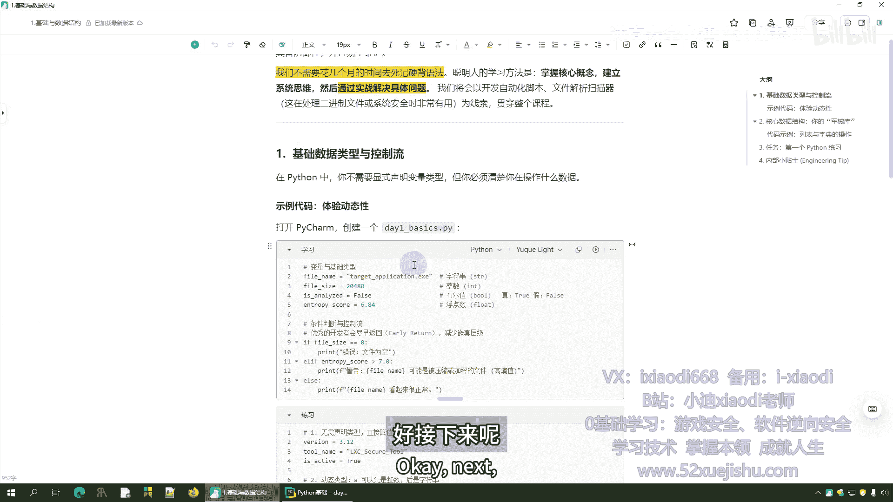

**以下是Python中常见的基础类型：**

- **字符串（str）**：字符串用双引号标识，任何名字、一句话等文本内容都可以用双引号表示一个字符串。例如`name = "小明"`，这里的类型就是`str`，是`string`的缩写。把鼠标放到变量上，编辑器会提示`str`类型。

- **整数型（int）**：整数型是`integer`的缩写，比如文件大小`file_size = 20480`，这就是一个整数类型。

- **布尔型（bool）**：布尔型也可以称为逻辑型或逻辑值。什么叫逻辑值呢？比如说我们去做一件事，有真有假、有正有反，正反和真假就需要有一个东西去标识，这个标识就是逻辑值。真的话就是`True`，假的话就是`False`。比如判断今天是否下雨：

```python
today_is_rainy = False
print(today_is_rainy)
```

输出为`False`，说明今天不下雨。

- **浮点型（float）**：浮点型就是小数，比如`6.84`。为什么叫浮点呢？因为小数点可以浮动，`6.84`小数点往右浮一下就变成了`68.4`，往左浮就变成`0.684`。以上就是常见的变量和基础类型。

### 🔄 变量的特性

变量的概念其实非常简单，它就是用来存放数据的，叫做变量。变量是可以改变的，比如：

```python
file_size = 20480
print(file_size)  # 输出 20480
file_size = 199
print(file_size)  # 输出 199
```

一开始赋值`20480`，随后修改成`199`，值就变了。变量是可以变的，并且是可以存放数据的。如果我们要写一个注释，用井号`#`来表示：

```python
# 变量就是可以存放数据，并且可以更改
```

一个变量就是用名字来存放数据并且后续可以修改的容器。

### 🏷️ 动态类型

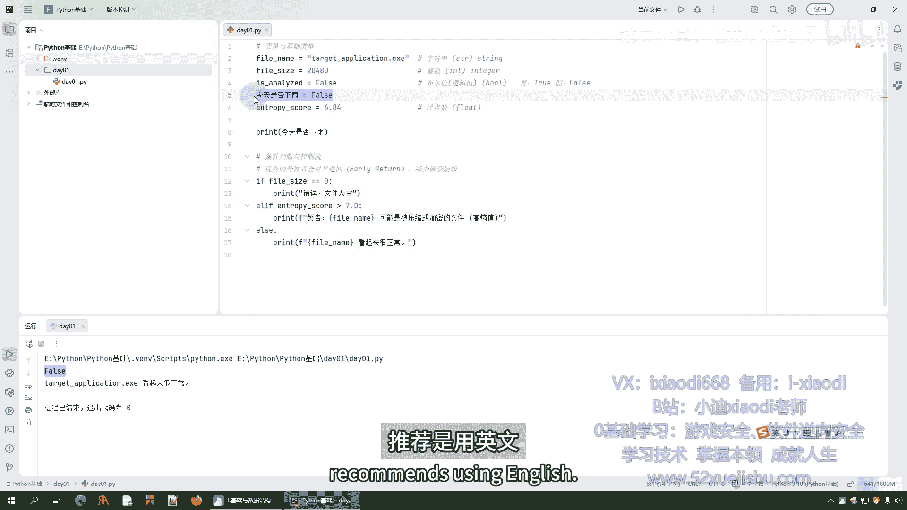

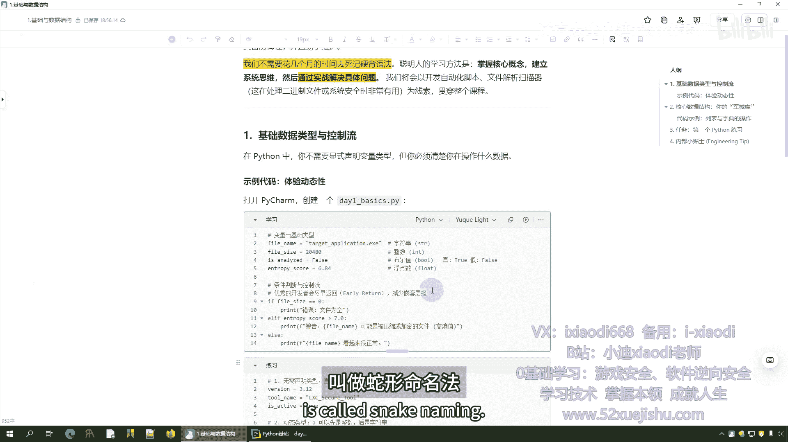

Python是一种动态类型语言，什么叫动态类型呢？其实还是那些数据类型，但是变量的类型可以在运行时发生变化。举个例子：

```python
a = 100
print(a)  # 输出 100
print(type(a))  # 输出 <class 'int'>
```

一开始`a`是一个整数型`int`。然后我做了更改，它是个变量嘛，那我给它赋一个字符串：

```python
a = "正在扫描"
print(a)  # 输出 正在扫描
print(type(a))  # 输出 <class 'str'>
```

你会发现它以前是整数型，现在变成了字符串类型。也就是说在人为的干预下，变量的类型是可以改变的，既可以变成整型，也可以在干预下变成`str`字符串类型。这就是动态类型的核心概念。

### 🧮 类型转换与加减法

不同类型之间的运算需要特别注意。比如：

```python
a = 100
b = 10
print(a + b)  # 输出 110
```

这是正常的整数相加。但如果`b`是字符串类型的`"5"`呢？

```python
a = 100
b = "5"
print(a + b)
```

执行一下就会发现报错了。报错信息说：不支持整型和字符串类型做加法。所以不同类型做加减法运算时，一定要进行数据类型转换，不然就会引发`TypeError`，也就是类型错误。

怎么转换呢？非常简单，把`b`用`int()`包起来就可以了：

```python
a = 100
b = "5"
print(a + int(b))  # 输出 105
```

同样的道理，如果不使用变量而直接放一个数字，也可以：

```python
print(a + 1)  # 输出 101
```

这就是基础数据类型和控制流的内容。实际上非常简单，核心就是理解Python的类型系统以及类型转换的方式。

## 🔀 条件判断与控制流

### 🧭 条件判断的基本概念

什么叫条件判断呢？日常生活中我们经常做判断，比如我饿了就去吃饭，不饿就不吃饭躺着睡觉。编程时也会做判断。举例来说，如果文件大小`file_size == 0`，就说明文件为空，需要提示用户。**注意**，千万不要用一个等号，一个等号是赋值操作，两个等号才是判断相等。判断条件的末尾必须加冒号，冒号表示判断的开始。代码结构如下：

```python
if file_size == 0:
    print("错误：文件为空")
```

如果`file_size`被赋值为`0`，程序就会打印"文件为空"。

我们还可以做多个条件的判断。比如一个文件有`entropy`这个属性，也就是熵值，翻译过来是"商"。如果熵值大于`7.0`，说明这个文件的熵值偏高，大概率是被压缩过或者加密过的文件。代码结构如下：

```python
entropy = 7.84
file_size = 1024
if entropy > 7.0:
    print(f"警告：{file_name} 可能是被压缩或加密的文件")
```

现在`entropy`是`6.84`，程序不会提示。改成`7.84`之后，运行就会输出警告信息。

### 📝 格式化字符串

刚才代码里前面加了一个`f`，这个`f`是`format`的意思，即格式化。什么叫格式化呢？可以这样理解：比如"小明的年龄是18""小红的年龄是20""小李的年龄是80"，这就是一个格式化模板。可以把它理解成格式化符号或者占位符，占一个位置，后边可以任意替换。用法就是前面加`f`，然后双引号中放句子，需要替换的地方用花括号`{}`括起来，花括号里写要替换的变量名：

```python
file_name = "test.bin"
print(f"正在扫描文件：{file_name}")
```

打印的时候，`file_name`变量的值就会自动填充进去。

### 🌳 多条件判断分支

如果`if`条件不成立，还想继续判断另一个条件，可以用`elif`，这是`else if`的缩写，表示另一层判断。举个例子：如果不吃苹果，是不是要吃香蕉呢——这就是第二层判断。只有当所有条件都不成立时，才会走到`else`分支。整体结构如下：

```python
if entropy > 7.0:
    print(f"警告：{file_name} 可能是被压缩或加密的文件")
elif file_size == 0:
    print("错误：文件为空")
else:
    print(f"{file_name} 看起来是正常的文件")
```

如果第一个条件不成立，就继续检查第二个条件。如果两个条件都不成立，就执行`else`，说明文件看起来比较正常。这些就是条件判断的全部核心知识。

## 🛠️ 练习一：基础类型实操

接下来我们把练习代码拿过来。第一段练习是：

```python
wa = 3.1  # 浮点型
name = "cmd"  # 字符串
flag = True  # 布尔类型/逻辑值
```

`wa = 3.1`，有一个小数点，它是浮点型。`name = "cmd"`是字符串。`flag = True`是逻辑型或者说布尔类型。这些变量赋值操作很简单。

第二个练习是关于动态类型的：

```python
a = 100
print(a)  # 输出 100
print(type(a))  # 输出 <class 'int'>
```

用一个占位符打印输出，然后调用了一个`type()`函数，这个函数的详细概念我们以后会讲到，也可以称它为方法。`type(a)`可以获取变量`a`的数据类型，把获取到的类型打印出来，就能看到它是`int`类型。

## 📊 核心数据结构：列表与字典

接下来是第二板块：核心数据结构。这里是我们的军械库，四个核心数据结构是Python开发中最常用的工具，我们必须非常熟练。今天要掌握的是`list`列表和`dict`字典。列表实际上就是一串有序的数据，数字、字符串都可以放进去。它是有顺序的，一个萝卜一个坑，这就是列表的含义。字典是键值对结构，什么叫键值对呢？比如"1点干什么、2点干什么、3点干什么"，有一一对应的关系，不能乱对应。

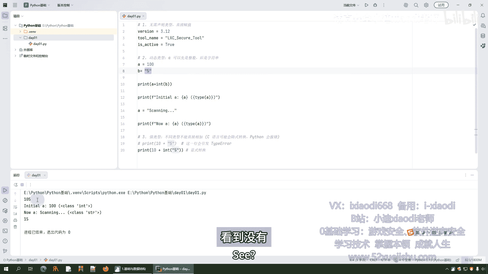

### 📋 列表(list)操作

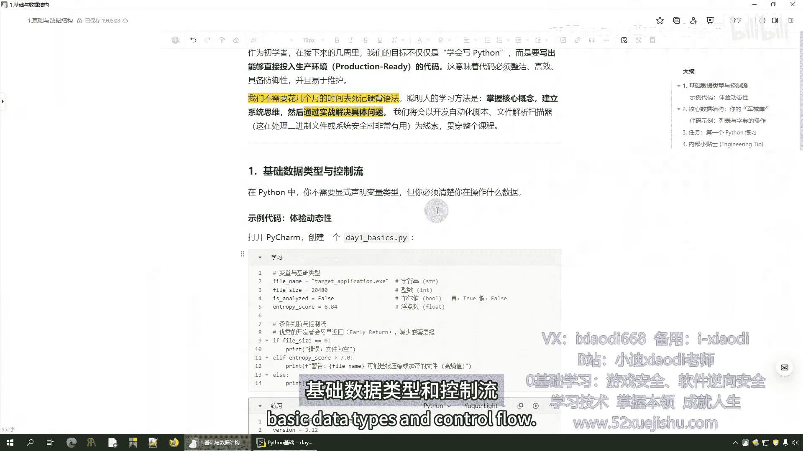

来看一个列表的示例：

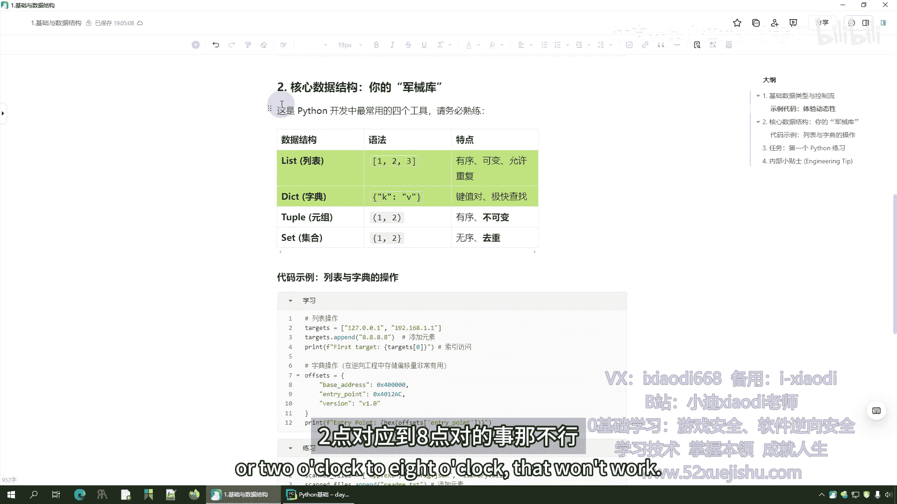

```python
targets = ["127.0.0.1", "192.168.1.1"]
print(targets)
```

这个列表里存放了两个字符串，每个字符串用双引号引起来，内容是IP地址。直接打印列表，输出为：

```
['127.0.0.1', '192.168.1.1']
```

如果要往列表中添加东西，直接调用`append`方法：

```python
targets.append("10.0.0.1")
print(targets)
```

添加进去之后，列表里的元素就多了一个。除了增加，还可以通过索引取出内容。这里要特别注意，索引是从`0`开始的。什么意思呢？第一个元素的序号不是`1`而是`0`，第二个元素的序号是`1`。因为索引下标是从零开始的，所以`targets[0]`才是第一个元素。

### 🔑 字典(dict)操作

字典操作是键值对结构，一对一对的数据不能乱。示例：

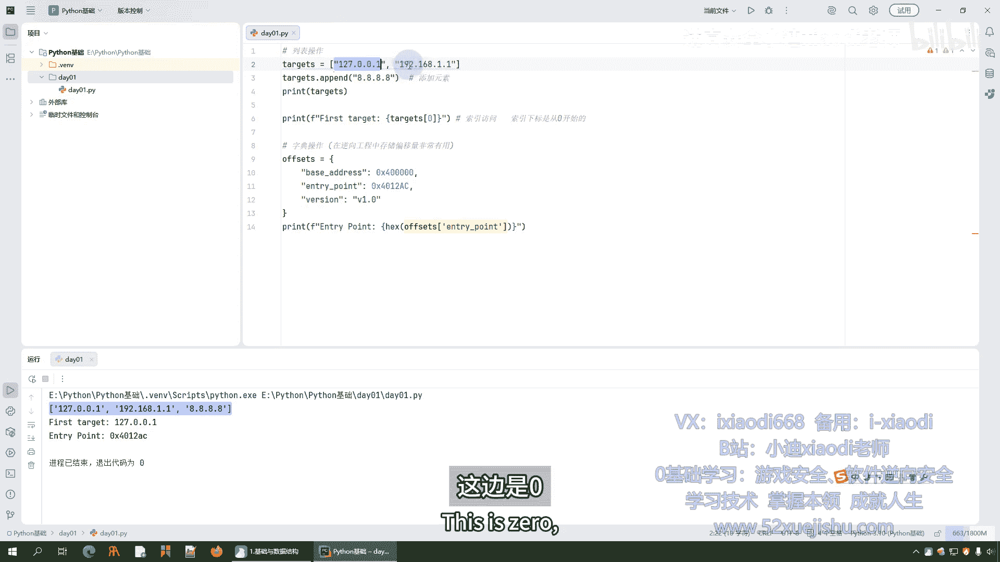

```python
schedule = {
    "1点": "写作业",
    "2点": "吃饭",
    "3点": "休息",
    "base_address": 0x400000
}
```

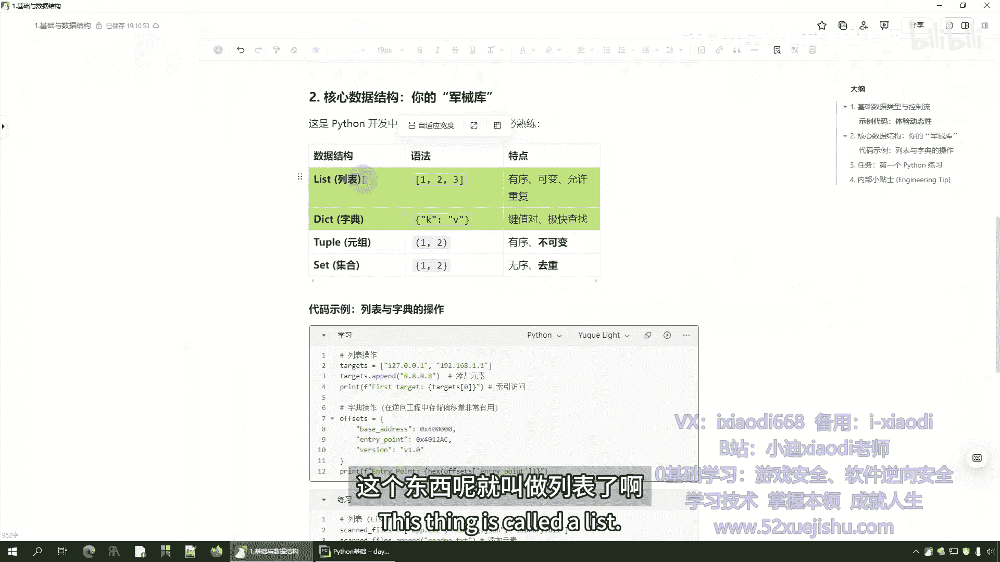

每个键值对之间用逗号分隔，最后一个后面不用加逗号。这时如果我要取出一个数据，可以把键直接填到方括号里：

```python
print(schedule["1点"])  # 输出 写作业
```

再看取出`base_address`：

```python
print(schedule["base_address"])
```

输出的时候你会发现数字对不上。为什么？因为字典里保存的是十六进制`0x400000`，但显示出来默认是十进制`4194304`。需要再次转换成十六进制显示，可以用`hex()`函数：

```python
print(hex(schedule["base_address"]))
```

输出就是`0x400000`了。

注意：获取字典数据的时候，用双引号或单引号都是可以的。

### 🧪 练习二：文件列表与字典

再来看一个练习，把代码复制过来：

```python
files = ["a.exe", "b.exe", "c.exe"]
files.append("d.exe")
print(files)
```

`files`有三个文件，添加一个之后变成四个。直接打印，输出的列表就有四个元素。这就是列表的基本操作。

然后是字典的操作：

```python
file_info = {
    "PE": "4D5A",
    "entry_point": 0x401000,
    "size": 30720
}
print(file_info["PE"])  # 输出 4D5A
```

这个字典里放了三个键值对，用方括号取出`PE`的内容，打印就能拿到`4D5A`。除了方括号方式之外，字典还有一个方法叫`get`。用法非常简单，直接把要获取的键传进去。那问题来了：如果字典里没有这个键怎么办？可以给一个提示信息。比如：

```python
print(file_info.get("COM", "没有找到"))
```

打印一下`COM`看看能不能找到，输出"没有找到"。也就是说，使用`get`方法的时候，如果键不存在，它会自动返回我们指定的提示。通过这个对比可以发现，`get`方法的功能性更强一些。

## ✅ 总结

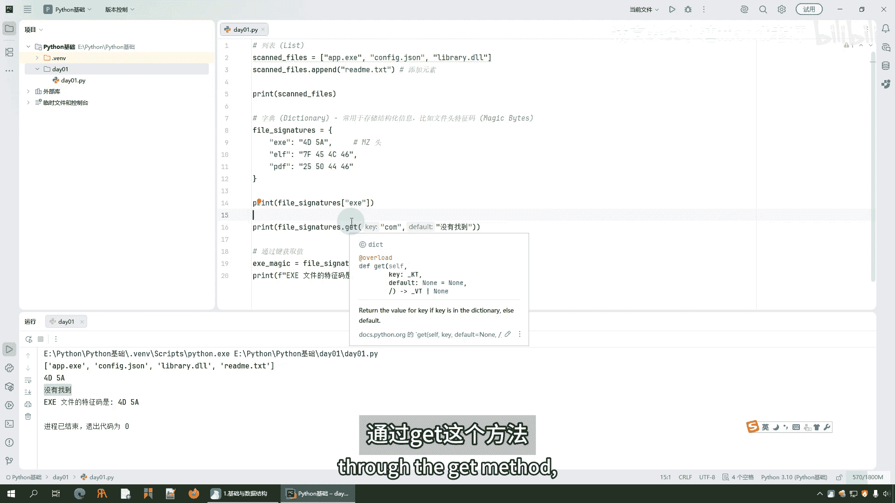

本节课中，我们一起学习了Python的基础与数据结构。首先我们了解了Python这门语言的基本特点——简洁、自动识别类型，然后学习了四种基础数据类型：字符串、整数型、布尔型和浮点型。接着我们介绍了条件判断与控制流，理解了`if`、`elif`、`else`的用法以及格式化字符串的写法。在核心数据结构部分，我们学习了列表的索引、追加操作，以及字典的键值对存取方式。最后我们还认识了动态类型的概念和类型转换的必要性。

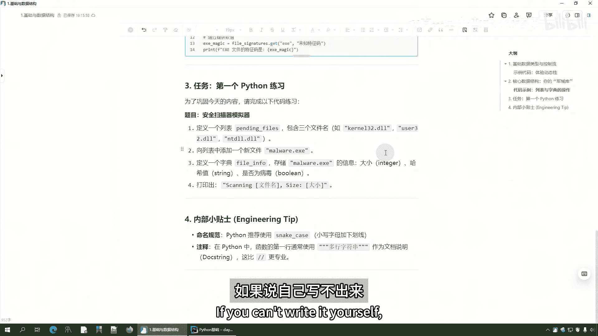

回家之后，大家可以把这个作业做一做。实际上这个任务非常简单，相信大家通过5到10分钟就可以搞定。如果自己写不出来也没有关系，下节课我们会有详细讲解。我们下节课再见。

