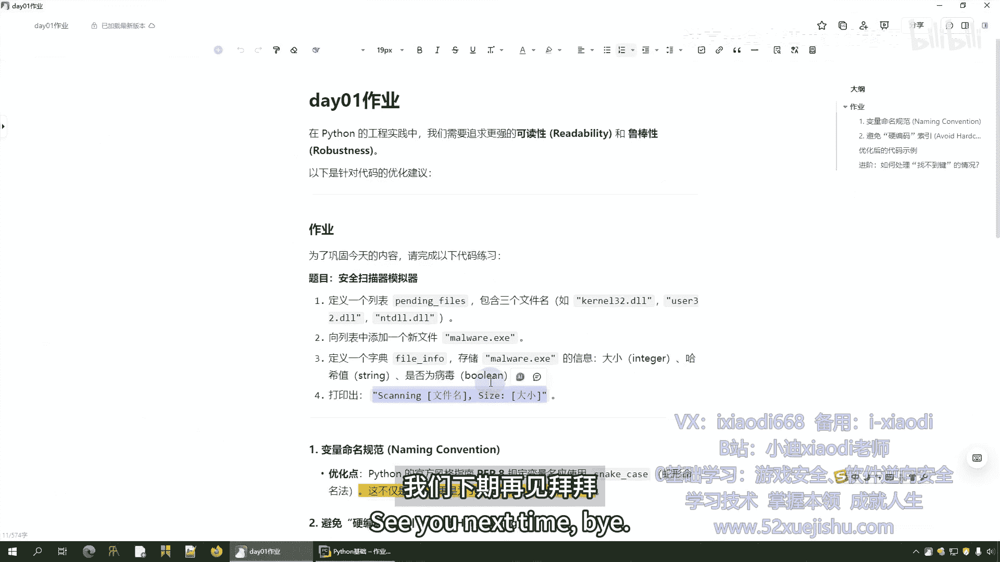

# 🐍 Python二进制安全黑客开发系列教学：0基础起步：Day01：作业讲解


在本节课中，我们将一起学习 Day01 的作业讲解。内容围绕 Python 中列表、字典、格式化字符串以及安全访问数据展开，目的是让初学者能够通过一个贴近文件信息处理的小例子，理解这些基础语法在二进制安全、逆向和软件安全学习中的常见用法。我们会从最基础的文件列表定义开始，一步步完成添加文件、打印调试、定义文件信息字典、输出扫描信息，并补充 `get` 方法、下标 `-1` 等实用小知识。下面我们正式开始。


## 📋 Python二进制安全黑客开发系列教学：0基础起步：Day01：定义文件列表并添加新文件

上一节我们介绍了本次作业的整体目标，本节中我们来看看第一个要求：定义一个文件列表，并在列表中加入新的文件名。原文要求定义一个类似 `pending_gun_files` 的列表，里面包含三个文件名。这个操作非常直接，就是把列表名字写在左边，把三个字符串用方括号括起来放在右边。核心概念可以用下面的代码描述：


```python
pending_gun_files = ["file1.exe", "file2.exe", "file3.exe"]
```

完成列表定义后，第二个要求是向列表中添加一个新的文件 `mywife.exe`。这个操作也比较简单，直接调用列表的 `append` 方法即可。核心概念可以写成：

```python
pending_gun_files.append("mywife.exe")
```

以下是完成列表定义与添加文件时需要用到的关键步骤，大家可以对照自己的代码检查：

- 使用方括号 `[]` 定义列表。
- 列表中的每一个文件名都写成字符串。
- 使用 `列表名.append(新元素)` 添加新文件。
- 添加完成后不要急着做下一题，先打印列表确认结果。


添加完成之后，我们先不着急回去做下一题，而是先打印一下列表，看看结果对不对。这里要养成时时刻刻调试代码的习惯，因为很多问题在早期打印一下就能发现。可以写成：


```python
print(pending_gun_files)
```

执行后如果结果没有问题，就可以继续后面的内容。这个小习惯在安全开发和逆向分析中也很重要，因为只有不断确认中间结果，才能避免后面越写越乱。


## 🗂️ Python二进制安全黑客开发系列教学：0基础起步：Day01：定义文件信息字典

上一节我们完成了文件列表的定义和添加操作，本节中我们来看看如何定义一个字典，用来存储 `mywife.exe` 的信息。原文要求字典中包含文件大小、哈希值以及是否为病毒等信息。字典使用花括号 `{}` 定义，写的时候可以回车换行，让结构更清晰。核心概念可以用下面的代码描述：


```python
file_info = {
    "file_size": 1024,
    "file_hash": "随便写一个哈希值",
    "is_virus": True
}
```


以下是定义文件信息字典时需要关注的字段和写法，大家可以作为参考：

- `file_size` 表示文件大小，可以给一个示例值 `1024`。
- `file_hash` 表示哈希值，原文中说明这里可以随便写一个值，意思意思即可。
- `is_virus` 表示是否为病毒，可以写 `True` 或 `False`。
- 最后一组数据后面不需要再写逗号。


这样字典就定义完成了。字典的作用是把一组相关信息放在一起，方便后面通过键来取值。对于初学者来说，先记住“键值对”这个说法即可，左边是名字，右边是对应的值。


## 🖨️ Python二进制安全黑客开发系列教学：0基础起步：Day01：格式化输出扫描信息

上一节我们定义好了文件信息字典，本节中我们来看看最后一个要求：打印出扫描文件名和文件大小。原文要求输出类似 `scaning 文件名 size 大小` 的信息。这个需求使用格式化字符串就可以完成，核心概念可以写成：

```python
print(f"scaning {pending_gun_files[3]} size {file_info['file_size']}")
```

以下是打印扫描信息时需要注意的几个点，尤其是引号问题：

- 文件名可以从列表中取，原文先使用下标 `3` 获取 `mywife.exe`。
- 文件大小可以从字典中取，例如 `file_info['file_size']`。
- 在 f-string 中如果已经使用了双引号，内部字典键最好使用单引号。
- Python 3.10 不允许在 f-string 中嵌套具有相同引号类型的字符串字面量，否则会报错。

原文中特别提到，如果前面有格式化字符串，里边就不能再带同样的双引号，要改成单引号。例如可以写成：

```python
print(f"scaning {pending_gun_files[3]} size {file_info['file_size']}")
```

这样程序就不会报错。打印结果中可以看到文件名是 `mywife.exe`，大小是 `1024`。这个引号问题看起来很小，但在实际写代码时经常遇到，所以大家要额外注意。

## 🔐 Python二进制安全黑客开发系列教学：0基础起步：Day01：使用 get 方法安全访问字典

上一节我们使用方括号从字典中取值，本节中我们来看看另一种方式：调用字典的 `get` 方法。除了 `file_info['file_size']` 这种方式，还可以写成 `file_info.get('file_size')`。核心概念可以写成：


```python
file_info.get("file_size")
```

以下是使用 `get` 方法时需要注意的内容，大家可以结合原文理解：

- `get` 方法同样可以通过键来获取字典中的值。
- 使用 `get` 时也要注意引号类型，避免 f-string 中引号冲突。
- 如果访问的键不存在，`get` 方法不会让程序崩溃，而是返回 `None`。
- 推荐在访问字典数据时使用 `get`，这样代码更安全。


原文中演示了把 `file_size` 改成不存在的 `file_open` 后，程序并没有崩溃，而是提示了 `None`。这时候就可以进行判断，例如：


```python
file_size = file_info.get("file_open")

if file_size == None:
    print("文件的大小为0")
```


运行后会提示“文件的大小为0”。原文还提到一个小知识：`None` 表示空，可以理解为没有值。这里要注意，`None` 本身不等于数字 `0`，但在原文的演示里是用它来表示“没有取到大小”的情况，所以大家可以把它理解成“空值判断”的入门例子。

## ➖ Python二进制安全黑客开发系列教学：0基础起步：Day01：使用下标 -1 获取最后一个元素

上一节我们介绍了 `get` 方法的安全访问方式，本节中我们来看看列表下标的另一个实用技巧。原文在打印时使用了 `pending_gun_files[3]`，但如果列表长度发生变化，这段代码就可能崩溃。如果我们要操作的就是列表中的最后一个数据，可以使用下标 `-1`。核心概念可以写成：

```python
pending_gun_files[-1]
```

以下是使用 `-1` 下标时的小结，大家可以记住：


- 下标 `-1` 代表列表中的最后一个成员。
- 把原来的 `3` 改成 `-1`，效果是一样的。
- 当列表长度变化时，`-1` 比固定下标更灵活。
- 运行后结果与使用固定下标时一致。


原文中把 `3` 改成 `-1` 后再次运行，效果是一样的。最后原文还给出了标准答案，大家可以作为参考。这里要强调一点：如果我们要访问字典里的数据，推荐使用 `get`。这样即使访问到了不存在的数据，程序也不会崩溃，后续还可以通过判断来处理异常情况。

## ✅ Python二进制安全黑客开发系列教学：0基础起步：Day01：完整参考代码与总结

上一节我们介绍了 `-1` 下标和 `get` 方法，本节中我们来看看整理后的完整参考代码。以下代码把原文作业中的列表定义、添加文件、字典定义、格式化输出和 `get` 判断串在一起，方便初学者整体理解：


```python
pending_gun_files = ["file1.exe", "file2.exe", "file3.exe"]
pending_gun_files.append("mywife.exe")

print(pending_gun_files)

file_info = {
    "file_size": 1024,
    "file_hash": "随便写一个哈希值",
    "is_virus": True
}

print(f"scaning {pending_gun_files[-1]} size {file_info['file_size']}")

file_size = file_info.get("file_open")

if file_size == None:
    print("文件的大小为0")
```



本节课中我们一起学习了 Day01 作业的完整做法，包括如何定义文件列表、如何用 `append` 添加新文件、如何定义文件信息字典、如何用 f-string 输出扫描信息、如何处理 Python 3.10 中 f-string 引号嵌套报错、如何使用 `get` 方法安全访问字典，以及如何使用下标 `-1` 获取列表最后一个元素。希望大家课后把这些代码自己敲一遍，并养成打印调试和异常判断的习惯。今天的内容就到这里，我们下期再见。

