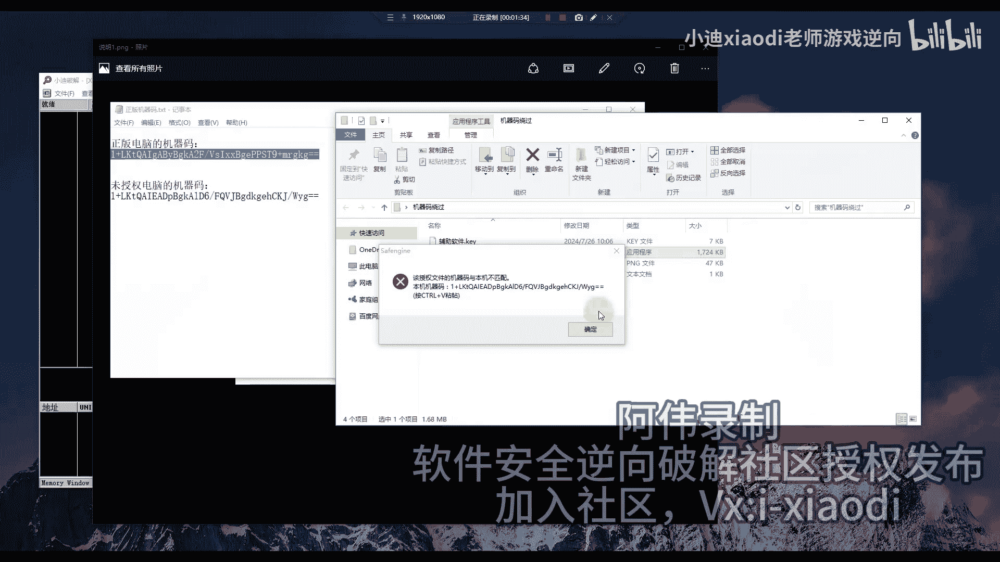
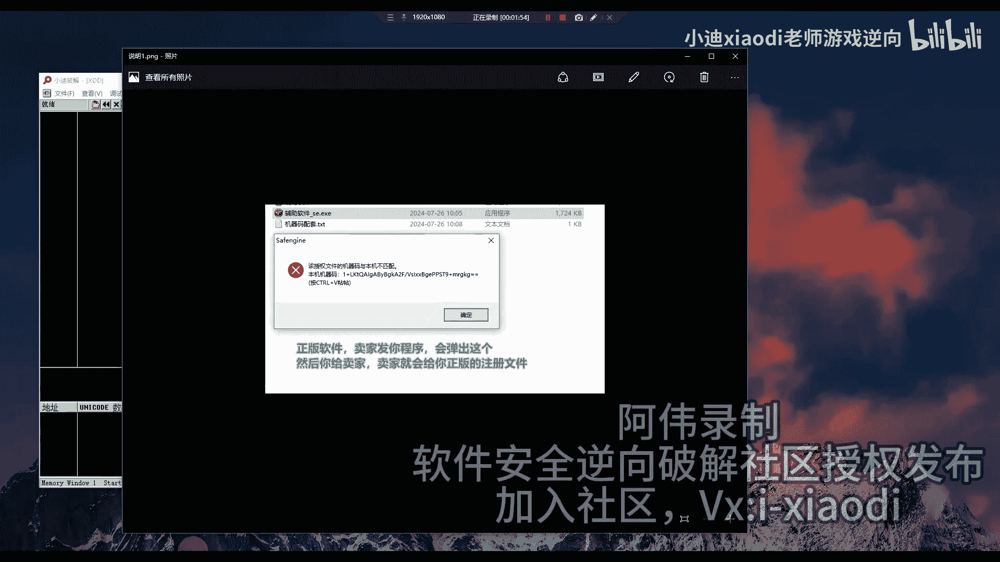
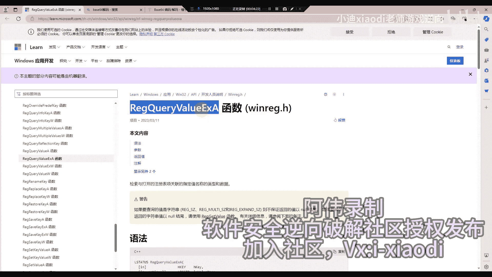
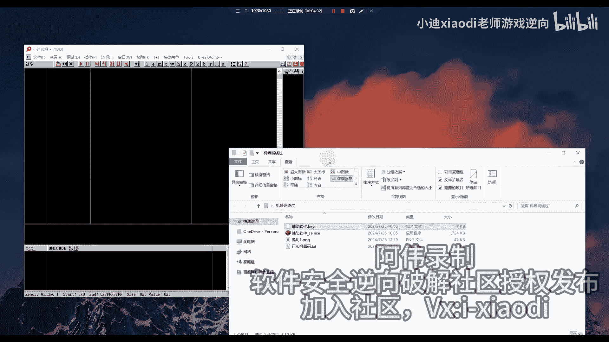
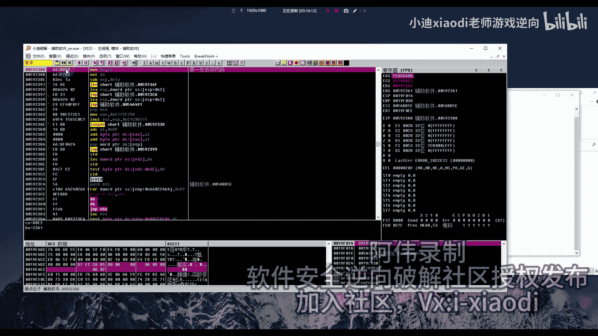
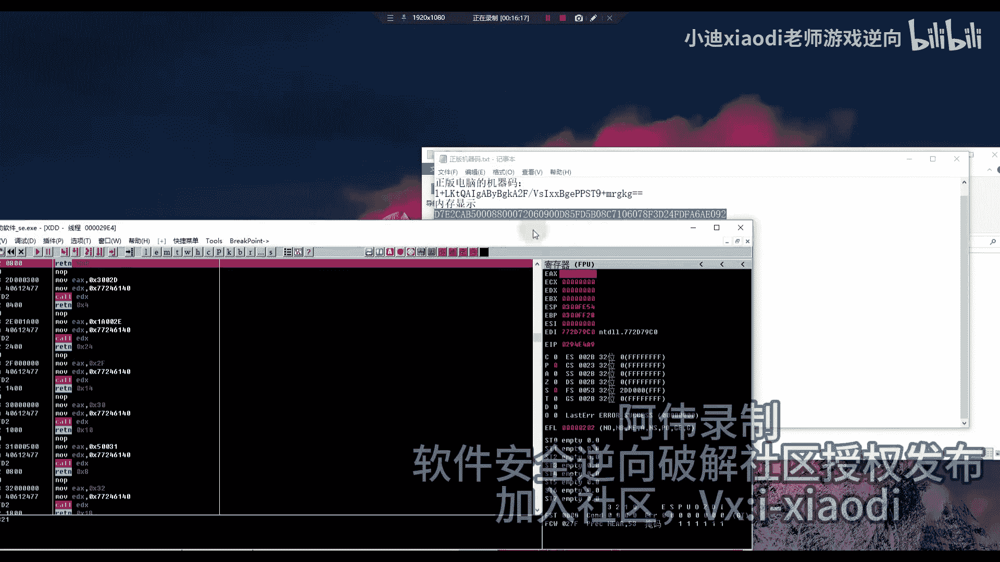
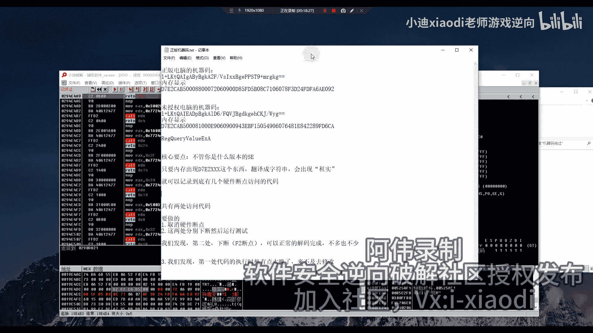

## 🧭 软件授权机制与安全研究基础：01：课程概述

在本节课中我们将要学习SE壳授权验证与“一机一码”机制的基本概念，理解正版软件授权流程、机器码和注册文件之间的关系，并认识注册表读取、调试观察和内存数据这些安全研究中常见的名词。需要先说明的是，原文涉及的是绕过软件授权的具体操作，本教程出于合规与安全考虑，只把其中的技术点整理成概念性学习材料，不提供可直接用于绕过授权的操作步骤，也不建议任何人把相关技术用于未授权场景。

本教程会尽量用大白话解释，让初学者能够看懂。你可以把机器码理解成电脑的“身份证”，把注册文件理解成“钥匙”，把授权校验理解成“门卫检查钥匙和身份证是否匹配”。这样理解以后，再看原文中提到的弹窗、注册表、调试器和内存显示，就不会觉得特别抽象。下面先给出一个整体流程，帮助大家建立框架。

```text
程序启动 -> 读取硬件信息 -> 生成机器码 -> 读取注册表/注册文件 -> 校验 -> 成功运行或弹窗提示
```

  
  



> 合规说明：本教程仅用于授权环境下的软件安全学习、逆向工程基础理解和授权机制研究，不提供破解、绕过授权、修改内存或复制正版机器码等可复现操作细节。
  
  

上一节我们说明了课程边界和学习目标，本节中我们来看看原文中描述的正版授权流程与“一机一码”概念。原文首先提到，用户购买正版软件后，卖家会发给用户一个程序，程序运行时会弹出授权提示，用户把自己的机器码发给卖家，卖家再返回正版注册文件，用户用注册文件和配套机器码就可以成功运行程序。这个流程的核心就是“机器码”和“注册文件”的匹配关系，可以用下面的公式概括。

```text
授权成立 = 校验(注册文件, 机器码)
机器码 ≈ f(CPU、主板、磁盘等硬件信息)
```

  
  



下面列出原文中与授权流程相关的几个关键概念，方便初学者先建立整体认识。

- 正版购买流程：用户购买软件后获得程序，程序启动时会要求授权信息，用户需要提供本机机器码，卖家根据机器码生成或匹配注册文件。

  

- 一机一码：程序把当前电脑的硬件信息综合起来，生成一串与这台电脑相关的机器码，注册文件通常只对匹配的机器码有效。

  

- 未授权机器码：原文展示了没有授权的电脑机器码，程序会自动复制或显示这串信息，提示用户当前电脑没有获得授权。

  

- 注册文件：原文把它描述为与机器码配套的授权文件，程序读取它以后判断当前电脑是否可以正常运行。

  



- 绕过目标：原文的目标是让程序在运行过程中把未授权提示替换成正版授权状态，但本教程不展开这种替换的具体做法，只说明其概念。

  
  



这些概念看起来简单，但背后涉及“程序如何识别电脑”和“程序如何读取授权”两个问题。上一节我们介绍了授权流程的整体框架，本节中我们来看看原文中提到的错误弹窗与SafeEngine标识。原文提到，未授权运行时会弹出一个错误窗口，窗口标题中的“SafeEngine”与SE壳的文件验证有关，也就是说，这个弹窗不是普通提示，而是授权验证机制在起作用。

  
  

下面列出与弹窗和SE壳标识相关的理解要点，帮助大家把现象和机制对应起来。

- 错误弹窗：程序发现授权不匹配时，会通过弹窗告诉用户当前不能正常运行。

  

- 弹窗标题：原文特别提到“SafeEngine”这个标题，它可以帮助研究人员判断当前遇到的是SE壳相关的文件验证。

  

- 文件验证：SE壳会对授权文件、机器码或相关注册信息进行校验，校验不通过就阻止程序继续运行。

  

- 观察入口：弹窗是表面现象，真正需要理解的是程序在弹窗之前读取了什么、比较了什么、在哪里做判断。

  
  

理解弹窗和SE壳标识以后，就能明白原文为什么先让学习者关注弹窗标题。上一节我们认识了弹窗与SafeEngine，本节中我们来看看原文中提到的编码观察与注册表读取。原文提到，机器码看起来像一串字符，可以先从Base64和HEX十六进制解码的角度去观察，因为这类数据将来可能会在内存中显示出来。这里要注意，本教程只说明“编码观察”这个思路，不提供具体的在线工具操作步骤。

```text
观察思路：显示字符串 -> 识别编码形式 -> 理解解码后的数据含义
```

  
  

原文还提到一个关键函数`RegQueryValueEx`，它的作用是检索与已打开注册表项关联的指定值名称的类型和数据。用大白话讲，程序会去注册表里读取与授权相关的值，再根据这些值判断当前机器是否被授权。原文说注册文件是注册表类型的，程序会读取注册表中的相关内容，这也是为什么学习授权机制时需要了解注册表。

```c
RegQueryValueEx(...); // 读取注册表中与授权相关的值
```

  
  

下面列出原文中与编码和注册表相关的技术点，方便初学者理解它们之间的关系。

- Base64与HEX：原文用它们来观察机器码字符串的表现形式，目的是理解同一份数据在不同编码下的样子。

  

- 内存显示：原文提到解码后的内容将来会在内存中显示，说明字符串只是表面，程序运行时会以内存数据的形式处理它。

  

- 注册表：原文用`regedit`打开注册表来说明程序会读取注册表内容，注册表可以理解为系统保存配置和授权信息的地方。

  

- `RegQueryValueEx`：这个函数是程序读取注册表值的常见方式，原文用它说明授权信息不是凭空出现的，而是从系统里读出来的。

  

- 注册文件类型：原文强调注册文件与注册表类型有关，理解这一点有助于把“文件授权”和“系统注册表读取”联系起来。

  
  

这些内容说明，授权验证不是单一步骤，而是“读取硬件信息、生成机器码、读取注册表或注册文件、进行比较”的组合过程。上一节我们介绍了编码观察和注册表读取，本节中我们来看看原文中提到的调试器观察与内存数据。原文描述了用调试器打开程序、查找字符串、设置断点、单步执行、观察寄存器恢复和硬件访问断点的过程。这里需要强调，本教程不提供具体地址、按键流程和修改方法，只解释这些名词在安全研究中的含义。

  
  

下面列出原文中出现的调试观察概念，帮助大家理解研究人员在合法授权测试中通常会关注什么。

- 调试器：调试器像“摄像头”，可以观察程序运行时的执行流程和数据变化，但必须在授权环境中使用。

  

- 字符串查找：原文通过查找机器码相关字符串来定位程序处理授权信息的位置，这是一种定位思路，不是本教程要展开的操作步骤。

  

- 断点：断点可以让程序在某个位置暂停，方便观察当前状态；原文提到的硬件访问断点用于观察哪些代码访问了特定内存数据。

  

- 单步执行：单步执行可以一步一步看程序做了什么，原文用`F7`、`F8`等按键描述这个过程，本教程只把它理解为“逐条观察”的方法。

  

- `popad`与寄存器环境：原文提到`popad`会恢复寄存器环境，看到这里可以理解程序正在从函数调用或系统调用中恢复上下文。

  

- 系统硬件信息：原文提到`system`、`Bios`等与系统硬件相关的信息，说明机器码的生成和硬件信息读取有关系。

  

- 内存显示：原文观察到内存中逐步出现机器码相关内容，说明授权数据是在运行过程中被读取、拼接或解码出来的。

  

- 多处访问代码：原文发现有多处代码访问机器码数据，并提到有的访问点执行时机较晚，等数据全部读入后再修改就来不及；有的访问点可以完整观察解码过程。本教程只强调“时机”和“完整性”这两个概念，不提供可复现的修改步骤。

  

- “猪食/诸时”观察标记：原文用翻译字符串后出现“猪食/诸时”作为观察标记，用来判断机器码数据是否已经出现；这属于原文作者的定位经验，本教程不展开具体操作。

  

- 不同版本差异：原文提到不同版本的SE壳可能有更多或更少的访问点，说明授权验证的实现会随版本变化，学习时应关注原理而不是死记某个位置。

  
  

这些调试概念放在一起，其实就是在回答一个问题：程序在运行时到底读取了哪些数据、在什么时机读取、哪些数据会进入内存。上一节我们介绍了调试观察与内存数据，本节中我们来看看原文强调的关键观察点与合规边界。原文反复强调，核心不是盲目修改，而是观察机器码数据是否完整出现，找到能够完整解码的时机，并理解第一处访问和第二处访问的差异；同时原文也提到要取消硬件断点、在相关代码处下普通断点进行测试，但这些属于具体绕过操作，本教程不提供。

  
  

下面列出从原文中可以提炼出的安全研究要点，帮助初学者把注意力放在原理和边界上。



- 先理解流程：先弄清程序如何读取硬件信息、如何生成机器码、如何读取注册表或注册文件，再谈其他观察手段。

  



- 关注数据完整性：原文强调机器码数据要“不多也不少”地出现，这说明分析时要关注数据是否完整，而不是只看某一段字符串。

  

- 关注执行时机：原文提到有的访问点太晚，数据已经被读入，再处理就没有效果；这提醒我们，分析程序行为要理解时序。

  

- 区分观察与修改：观察程序行为属于安全研究，未授权修改内存、替换授权数据、复制正版机器码则可能违反软件许可和法律法规，不应实施。

  

- 授权测试边界：如果要做类似研究，应在自己拥有授权的软件、实验环境或明确许可的CTF/教学环境中进行，并遵守相关法律和平台规则。

  

- 版本差异：不同版本的SE壳访问点数量不同，说明不能把某一个固定位置当成万能答案，理解机制比记忆步骤更重要。

  
  

到这里，原文中关于SE壳、一机一码、机器码、注册文件、注册表读取、调试观察和关键时机的技术点已经按概念整理完毕。上一节我们梳理了关键观察点与合规边界，本节中我们来做最后总结。本节课中我们一起学习了正版授权的基本流程、机器码与注册文件的匹配关系、SafeEngine弹窗的含义、Base64与HEX的编码观察思路、`RegQueryValueEx`读取注册表的概念、调试器观察程序行为的基本名词，以及为什么只能在授权环境中研究这些内容。

  
  



最后再强调一次，原文包含的是绕过软件授权的具体操作，本教程只保留概念性、原理性和合规性的内容，不提供可直接复现的破解步骤。希望初学者把重点放在理解授权机制、学习逆向工程基础和提高安全意识上，而不是把技术用于未授权场景。本节课中我们一起学习了SE壳授权验证的概念框架，也明确了安全研究的边界，后续如果继续学习，应优先选择合法授权环境和公开教学靶场。

