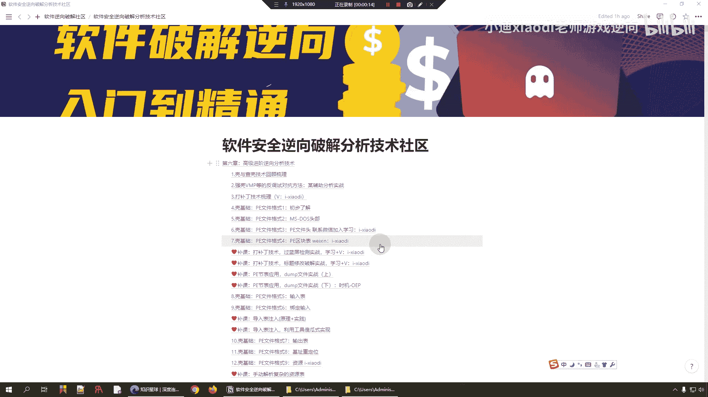
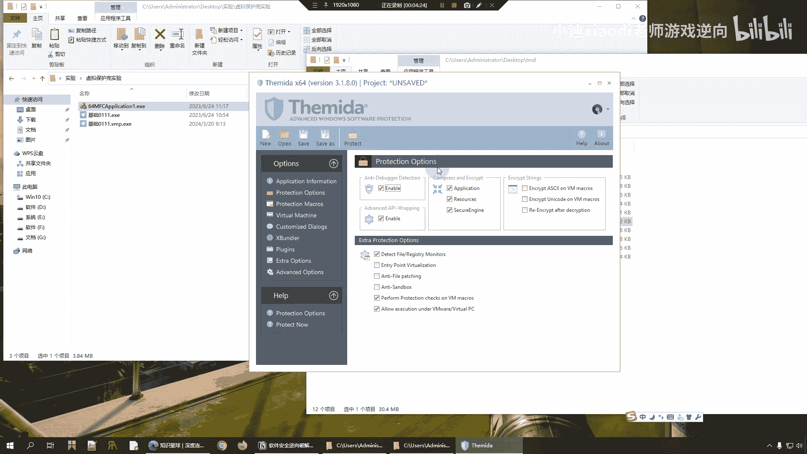
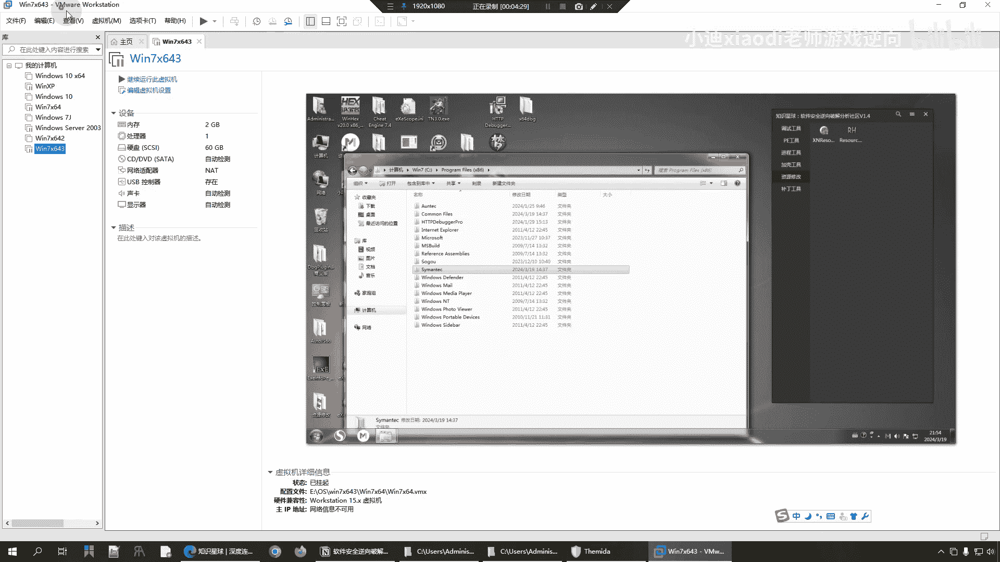
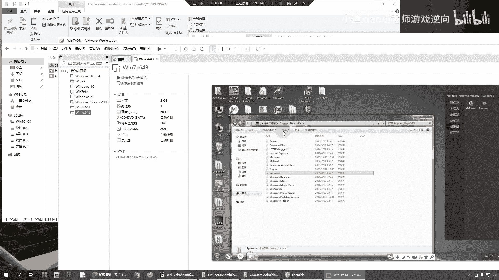
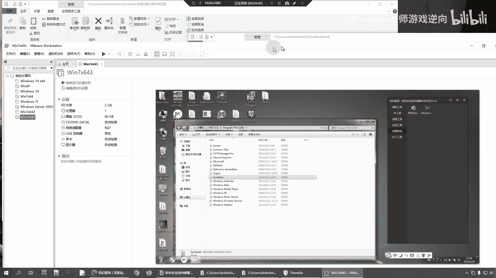
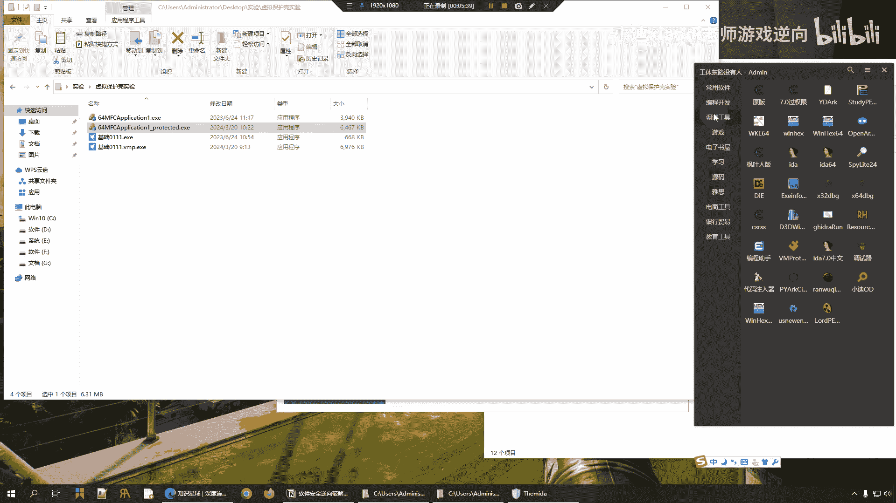
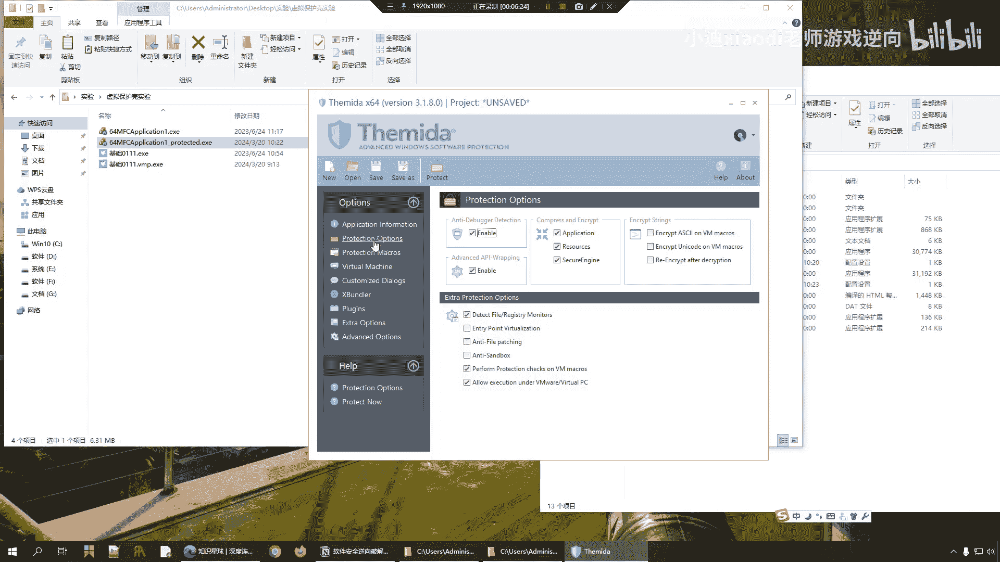
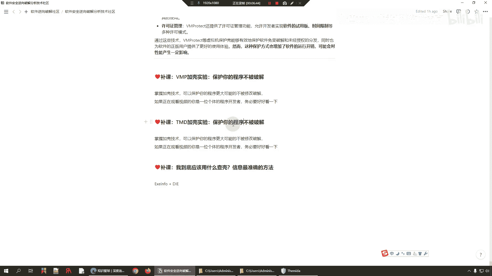

# 🛡️ 软件安全逆向破解：第六章补课二：TMD加壳实验

在本节课中我们将要学习 TMD 加壳实验，主题是保护程序不被破解。这个内容对应视频《TMD加壳实验：保护你的程序不被破解，程序员的福音》，面向游戏安全、软件安全、网络安全和 CTF 比赛基础，也适合小白学习软件破解、反汇编、逆向和安全工程师方向的 2024 最新内容，视频编号为 BV1xw4m1o7zG。换句话说，本节不是单纯讲一个工具按钮怎么点，而是帮助个体程序开发者建立一个基本认识：程序发布前可以通过加壳提高被修改和破解的难度。下面我们会从课程信息、壳的基本概念、TMD 准备、保护选项设置、执行加壳和结果验证几个部分展开，尽量用大白话说明，让初学者能够跟上。


## 🧭 软件安全逆向破解：第六章补课二：课程信息与学习提示



本节先说明课程信息。讲师是小李老师，欢迎大家跟着学习软件安全逆向破解。课程提供联系方式，如果想加入社区学习，可以联系小李老师，社区有最新优惠。本次内容是第六章高级进阶逆向分析技术的第二次补课，也就是第 16 课之后的第二次补课，主题为 TMD 加壳实验，目标是保护程序不被破解。关于壳和加壳相关的内容，前面已经做过讲解，所以本节会直接进入实验操作。如果在听本次视频时有一些疑惑，可以重点回看第 13 集和第 16 集，用来解决心中的疑点。换句话说，前面的基础概念是理解本节实验的前提，回看相关内容可以让操作更顺畅。下面先看一个原文学习提示，再进入壳的概念。

> 原文提示：如果对本节内容有疑惑，可以着重查看第 13 集以及第 16 集，帮助解决心中的疑点。

上一节我们说明了课程信息和学习提示，本节中我们来看看壳与 TMD 的基本概念。


## 🧱 软件安全逆向破解：第六章补课二：壳与TMD的基本概念

TMD 是一种壳，也就是一种保护壳，用来保护程序。上节课和上上节课已经提到过 TMD。典型壳包括 ESEc 和 TMD，其中 TMD 是前两者中的第二个。TMD 的特点是把壳与虚拟机结合起来。由于设计原因，TMD 中虚拟机的保护强度没有 VMP 高，也就是没有上节课讲的 VMP 那么高；但是针对逆向工程来说，它的防护程度还是非常不错的。因此，加壳时可以选择 VMP 壳，也可以选择 TMD 壳。换句话说，本节的重点不是比较所有壳的绝对强弱，而是让初学者知道 TMD 是一个可选方案，并且在保护程序不被轻易修改方面有实际作用。下面用简单公式描述核心概念。

```text
受保护程序 = 加壳工具(原始程序, 保护选项)

TMD壳特点 = 壳 + 虚拟机保护

原文观点：VMP的虚拟机保护强度 > TMD的虚拟机保护强度
```

上一节我们介绍了壳与 TMD 的基本概念，本节中我们来看看准备 TMD 和示例程序。


## 🧰 软件安全逆向破解：第六章补课二：准备TMD与示例程序

TMD 壳已经准备好。如果跟着课程加入社区，就可以在社区下载这个壳，下载下来直接使用即可。运行 TMD 时有两个版本，一个是 32 位版本，一个是 64 位版本，需要根据你自己的程序位数来选择。示例中有一个 64 位程序，所以推荐使用 64 位版本的 TMD。这个示例程序是没有壳的，可以提前用 Stud_PE 查看，所在区段和区段信息都非常干净，都是正常区段。接着复制一份程序，复制到“虚拟保护实验”目录。现在这个程序没有经过保护，非常容易被修改界面、修改版权或者修改其他内容。换句话说，准备阶段的关键是确认程序位数、确认原始程序状态，并把原始程序复制到实验目录，避免直接改动原文件。以下是准备阶段的操作要点。

- 联系课程社区，下载 TMD 加壳工具。

- 根据目标程序选择 32 位或 64 位版本的 TMD，示例程序为 64 位，所以选择 64 位版本。

- 使用 Stud_PE 查看原始程序区段，确认区段干净且正常。

- 将原始程序复制一份到“虚拟保护实验”目录，作为后续加壳实验对象。

上一节我们准备好了 TMD 和示例程序，本节中我们来看看拖入程序和保护选项设置。


## 🖱️ 软件安全逆向破解：第六章补课二：拖入程序与保护选项设置

双击运行 TMD，稍等一下，启动可能有点慢。运行起来后是一个界面设置，一般来说保持当前状态即可，点击进入。界面是英文的，不过不需要管英文细节，直接把程序往里拖。拖入之后，工具会自动把相关程序信息列出来，或者说把程序信息都填进去。界面上会显示你的程序位置，也会显示输出程序的位置，输出程序名后面会自动加上 `protected`，表示受保护版本。接着可以点击 `protection options`，也就是保护选项。比如 `antidebugger` 是反调试，用来对抗一些黑客工具；API 相关选项不用管，默认操作即可。如果想检测虚拟机，可以勾选虚拟机检测，勾选之后程序就没有办法在虚拟机中运行。很多破解人员会在虚拟机中模拟一个操作系统环境来破解软件，而不是使用真实物理机，所以想检测这种手段就可以勾选。其他选项如 `ant file`，如果希望对文件做一些防护，可以点击加强防护。一般来说默认设置就可以。换句话说，这一节的核心是认识几个保护选项的含义，不要求初学者一开始就调整所有参数。以下是保护选项的简要说明。

- `antidebugger`：反调试选项，用于检测和对抗调试器、黑客工具等。



- API 相关选项：本节不需要重点处理，保持默认即可。

- 虚拟机检测：勾选后，程序无法在虚拟机环境中运行，可用于检测在虚拟机中分析程序的情况。

- `ant file` 与加强防护：用于对文件本身增加防护，降低文件被修改的风险。

- 一般情况下保持默认选项，然后点击 `protect` 执行保护。

上一节我们设置了保护选项，本节中我们来看看执行加壳和验证结果。






## 🛡️ 软件安全逆向破解：第六章补课二：执行加壳与结果验证



设置完成后点击 `protect`。保护过程中会生成一个临时文件，保护完成之后会完整生成我们自己的程序。加壳后的程序会膨胀，因为代码会变得更多。随后运行加壳后的程序，程序运行完全没有问题。这时打开黑客工具，假设是逆向工程人员或黑客来观察，把程序拖到工具里，工具提示请用 64 位，于是用 64DBG 拖过来。运行后会提示 `TMD debugger has been found running in your system`，意思是系统中检测到 TMD 调试器正在运行，也就是检测到了黑客工具或调试器。这个效果和 VMP 差不多。个人认为英文版 TMD 更好用一些，它有更多维护和配置选项，还有一些插件，选项更丰富。做程序保护时也可以使用 TMD。换句话说，验证阶段主要观察两点：加壳后的程序能否正常运行，以及调试工具启动时是否会出现检测提示。以下是验证结果的观察点。

- 点击 `protect` 后，工具会先生成临时文件，保护完成后生成最终受保护程序。

- 加壳后程序体积通常会膨胀，因为加入的保护代码更多。



- 加壳后的程序仍应能够正常运行。

- 使用 64DBG 等调试工具观察时，会出现检测提示：`TMD debugger has been found running in your system`。

```text
加壳后程序 = TMD.protect(原始程序, 默认保护选项)

运行结果 = 正常启动

调试检测提示 = "TMD debugger has been found running in your system"
```

> 英文提示含义：`TMD debugger has been found running in your system`，即系统检测到 TMD 调试器正在运行。



上一节我们完成了加壳和验证，本节中我们对本次内容做总结。


## ✅ 软件安全逆向破解：第六章补课二：本节总结



本节课中我们一起学习了 TMD 加壳实验，内容包括课程信息、壳与 TMD 的基本概念、TMD 工具准备、示例程序查看、拖入程序、保护选项设置、执行加壳以及结果验证。本次视频的内容是给个体程序开发者做一个科普：如果想保护自己的软件，可以使用 TMD 加壳，保护程序不被破解，最大可能或更大可能地避免程序被修改和破解。掌握加壳技术之后，就可以在发布程序前增加一层保护。换句话说，本节的重点是让初学者理解加壳的基本流程和保护选项的作用，而不是要求立刻掌握所有高级细节。本次内容到此结束，下一节继续。
